<div align="center">

**English** · [Türkçe](README.tr.md)


# FluxWP Suite

### All-in-one WordPress solutions for nonprofits and online stores

Donations, e-commerce, communication, AI, analytics and team tools: 20 plugins and a block theme that share one design, one AI budget and one update server, so a single WordPress site can run the whole organisation.

[](https://wordpress.org) [](https://www.php.net) [](https://woocommerce.com)   [](https://www.gnu.org/licenses/gpl-2.0.html)

[Why](#why-fluxwp-suite) · [How it fits together](#how-it-fits-together) · [Packages](#packages-and-latest-versions) · [Get started](#get-started) · [For developers](#for-developers)

</div>

---

## Why FluxWP Suite?

Most WordPress sites end up as a patchwork: a donation plugin, a form plugin, an SMTP plugin, an analytics script, a chat widget, each with its own settings, its own upsell and its own idea of what the admin should look like. FluxWP Suite was built the other way round, for a real charity that needed all of it on shared hosting:

- **Built to work together.** A donation made on WhatsApp shows up in Flux Donation, gets its certificate and sends the e-mail through Flux Contact, with no glue code.
- **AI where it helps, on one budget.** Every package uses Flux AI, so keys, models and daily spending limits live in one place, and assistants like Claude can work through MCP.
- **One calm admin, also on a phone.** Flux Admin gives every package the same look, a role-based menu and a mobile bottom bar.
- **Your data stays on your site.** Cookie-free analytics, local backups, no external SaaS for the core work; GPL and self-hosted.
- **Turkish and English everywhere.** Every package ships both languages; content goes multilingual with Flux Language.

## How it fits together

Packages talk to each other through small public filters and REST endpoints; nothing is required except where an arrow says so.

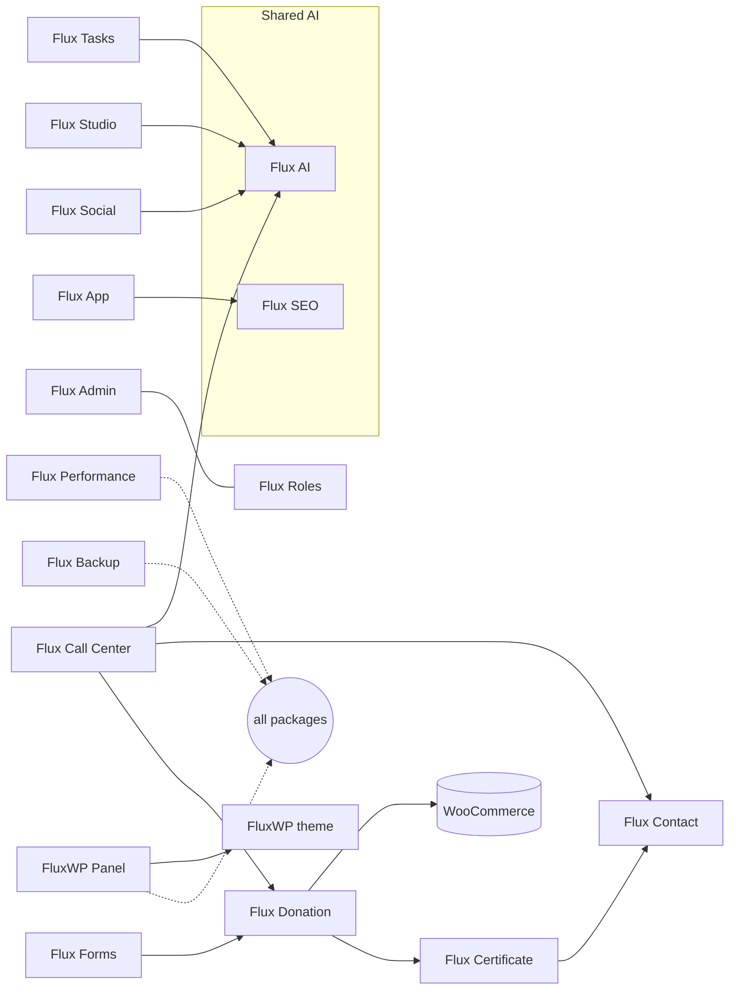

## Packages and latest versions

<!-- paketler:start -->
<table><tr><th>Package</th><th>Preview</th><th>Package</th><th>Preview</th></tr><tr><td width="18%"><a href="plugins/flx-admin"><b>Flux Admin</b></a></td><td align="center" width="32%"><a href="plugins/flx-admin">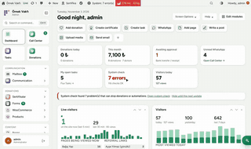</a></td><td width="18%"><a href="plugins/flx-ai"><b>Flux AI</b></a></td><td align="center" width="32%"><a href="plugins/flx-ai">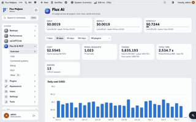</a></td></tr><tr><td width="18%"><a href="plugins/flx-analytics"><b>Flux Site Analytics</b></a></td><td align="center" width="32%"><a href="plugins/flx-analytics">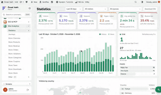</a></td><td width="18%"><a href="plugins/flx-app"><b>Flux App</b></a></td><td align="center" width="32%"><a href="plugins/flx-app">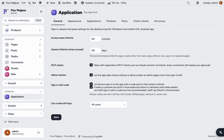</a></td></tr><tr><td width="18%"><a href="plugins/flx-backup"><b>Flux Backup</b></a></td><td align="center" width="32%"><a href="plugins/flx-backup">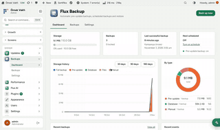</a></td><td width="18%"><a href="plugins/flx-certificates"><b>Flux Certificate</b></a></td><td align="center" width="32%"><a href="plugins/flx-certificates">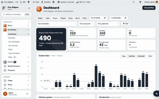</a></td></tr><tr><td width="18%"><a href="plugins/flx-chat"><b>Flux Call Center</b></a></td><td align="center" width="32%"><a href="plugins/flx-chat">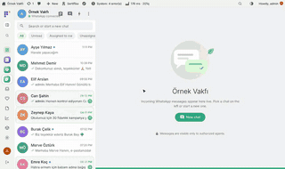</a></td><td width="18%"><a href="plugins/flx-chatbot"><b>Flux AI Chatbot</b></a></td><td align="center" width="32%"><a href="plugins/flx-chatbot">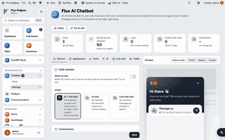</a></td></tr><tr><td width="18%"><a href="plugins/flx-commerce"><b>Flux Commerce</b></a></td><td align="center" width="32%"><a href="plugins/flx-commerce">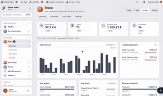</a></td><td width="18%"><a href="plugins/flx-crm"><b>Flux CRM</b></a></td><td align="center" width="32%"><a href="plugins/flx-crm">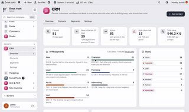</a></td></tr><tr><td width="18%"><a href="plugins/flx-donate"><b>Flux Donation</b></a></td><td align="center" width="32%"><a href="plugins/flx-donate">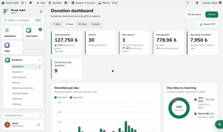</a></td><td width="18%"><a href="plugins/flx-forms"><b>Flux Forms</b></a></td><td align="center" width="32%"><a href="plugins/flx-forms">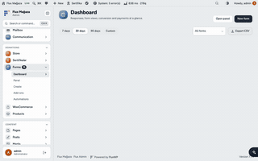</a></td></tr><tr><td width="18%"><a href="plugins/flx-lang"><b>Flux Language</b></a></td><td align="center" width="32%"><a href="plugins/flx-lang">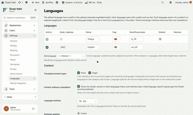</a></td><td width="18%"><a href="plugins/flx-mail"><b>Flux Contact</b></a></td><td align="center" width="32%"><a href="plugins/flx-mail">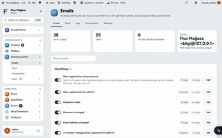</a></td></tr><tr><td width="18%"><a href="plugins/flx-recaptcha"><b>Flux reCAPTCHA</b></a></td><td align="center" width="32%"><a href="plugins/flx-recaptcha">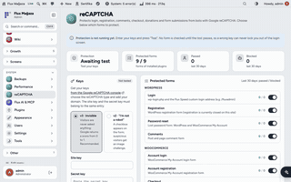</a></td><td width="18%"><a href="plugins/flx-roles"><b>Flux Roles</b></a></td><td align="center" width="32%"><a href="plugins/flx-roles">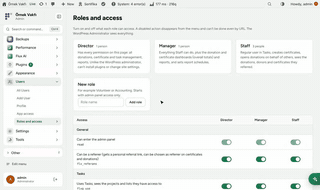</a></td></tr><tr><td width="18%"><a href="plugins/flx-seo"><b>Flux SEO</b></a></td><td align="center" width="32%"><a href="plugins/flx-seo">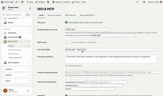</a></td><td width="18%"><a href="plugins/flx-setup"><b>FluxWP Panel</b></a></td><td align="center" width="32%"><a href="plugins/flx-setup">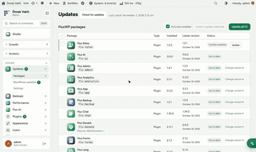</a></td></tr><tr><td width="18%"><a href="plugins/flx-social"><b>Flux Social</b></a></td><td align="center" width="32%"><a href="plugins/flx-social">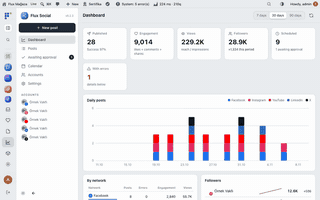</a></td><td width="18%"><a href="plugins/flx-speed"><b>Flux Performance</b></a></td><td align="center" width="32%"><a href="plugins/flx-speed">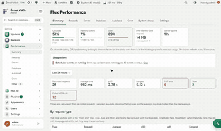</a></td></tr><tr><td width="18%"><a href="plugins/flx-studio"><b>Flux Studio</b></a></td><td align="center" width="32%"><a href="plugins/flx-studio">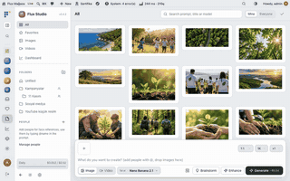</a></td><td width="18%"><a href="plugins/flx-tasks"><b>Flux Tasks</b></a></td><td align="center" width="32%"><a href="plugins/flx-tasks">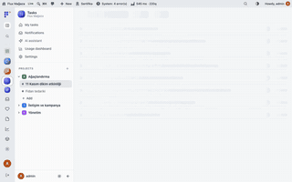</a></td></tr><tr><td width="18%"><a href="plugins/flx-wiki"><b>Flux Wiki</b></a></td><td align="center" width="32%"><a href="plugins/flx-wiki">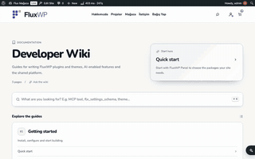</a></td><td width="18%"><a href="themes/fluxwp"><b>FluxWP</b></a></td><td align="center" width="32%"><a href="themes/fluxwp">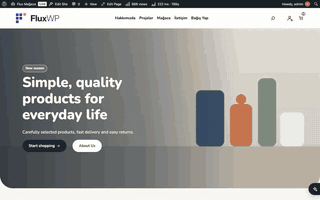</a></td></tr></table>

| Package | Description | Type | Latest | Date | Download |
|---|---|---|---|---|---|
| [Flux Admin](plugins/flx-admin) | Redesigns the admin: role-based sidebar, mobile bottom bar, command palette, light and dark. Installs as a PWA. | Plugin | [1.7.23](https://github.com/FluxWP/FluxWP/releases/tag/flx-admin-v1.7.23) | 2026-11-12 | [flx-admin.zip](https://github.com/FluxWP/FluxWP/releases/download/flx-admin-v1.7.23/flx-admin.zip) |
| [Flux Ads](plugins/flx-ads) | Reklam dönüşüm takibi: Meta Pixel + Conversions API, TikTok Pixel + Events API ve Google Analytics 4 (Measurement Protocol). | Plugin | [0.7.0](https://github.com/FluxWP/FluxWP/releases/tag/flx-ads-v0.7.0) | 2026-11-12 | [flx-ads.zip](https://github.com/FluxWP/FluxWP/releases/download/flx-ads-v0.7.0/flx-ads.zip) |
| [Flux AI](plugins/flx-ai) | One AI hub for every package: keys, models, spending limits and a shared AI chat. | Plugin | [0.13.2](https://github.com/FluxWP/FluxWP/releases/tag/flx-ai-v0.13.2) | 2026-11-12 | [flx-ai.zip](https://github.com/FluxWP/FluxWP/releases/download/flx-ai-v0.13.2/flx-ai.zip) |
| [Flux Site Analytics](plugins/flx-analytics) | Cookie-free site analytics that keep visitor data on your site. Sources, donation funnel and journeys. | Plugin | [0.4.10](https://github.com/FluxWP/FluxWP/releases/tag/flx-analytics-v0.4.10) | 2026-11-12 | [flx-analytics.zip](https://github.com/FluxWP/FluxWP/releases/download/flx-analytics-v0.4.10/flx-analytics.zip) |
| [Flux App](plugins/flx-app) | Sign-in for the desktop and mobile app: OAuth 2.0 (PKCE), API keys and a role-based menu. | Plugin | [0.4.14](https://github.com/FluxWP/FluxWP/releases/tag/flx-app-v0.4.14) | 2026-11-12 | [flx-app.zip](https://github.com/FluxWP/FluxWP/releases/download/flx-app-v0.4.14/flx-app.zip) |
| [Flux Backup](plugins/flx-backup) | Automatic backups before updates, scheduled full backups and selective restore. | Plugin | [1.4.10](https://github.com/FluxWP/FluxWP/releases/tag/flx-backup-v1.4.10) | 2026-11-12 | [flx-backup.zip](https://github.com/FluxWP/FluxWP/releases/download/flx-backup-v1.4.10/flx-backup.zip) |
| [Flux Block Editor](plugins/flx-blocks) | Block editor toolkit: row and column layouts, advanced heading, buttons, icons, gallery, tabs, accordion, forms, header builder and more. | Plugin | [0.2.0](https://github.com/FluxWP/FluxWP/releases/tag/flx-blocks-v0.2.0) | 2026-11-12 | [flx-blocks.zip](https://github.com/FluxWP/FluxWP/releases/download/flx-blocks-v0.2.0/flx-blocks.zip) |
| [Flux Certificate](plugins/flx-certificates) | Certificate templates, live PDF preview and /certificate/{code} verification. Sent by e-mail, SMS and WhatsApp. | Plugin | [2.0.1](https://github.com/FluxWP/FluxWP/releases/tag/flx-certificates-v2.0.1) | 2026-11-12 | [flx-certificates.zip](https://github.com/FluxWP/FluxWP/releases/download/flx-certificates-v2.0.1/flx-certificates.zip) |
| [Flux Call Center](plugins/flx-chat) | A WhatsApp inbox with canned replies, tags and assignment. An AI assistant that records donations and certificates. | Plugin | [1.43.3](https://github.com/FluxWP/FluxWP/releases/tag/flx-chat-v1.43.3) | 2026-11-12 | [flx-chat.zip](https://github.com/FluxWP/FluxWP/releases/download/flx-chat-v1.43.3/flx-chat.zip) |
| [Flux AI Chatbot](plugins/flx-chatbot) | AI chat window for your site: answers from your content and products with Flux AI and hands over to a live agent in Flux Chat. Color, position, avatar and texts are set in the panel with a live preview. | Plugin | [0.1.8](https://github.com/FluxWP/FluxWP/releases/tag/flx-chatbot-v0.1.8) | 2026-11-12 | [flx-chatbot.zip](https://github.com/FluxWP/FluxWP/releases/download/flx-chatbot-v0.1.8/flx-chatbot.zip) |
| [Flux Commerce](plugins/flx-commerce) | A sales dashboard, customers and sales reports for any WooCommerce store. Bank transfer with receipt upload, a leaner checkout, a free-shipping bar and a Google Merchant feed. | Plugin | [0.3.1](https://github.com/FluxWP/FluxWP/releases/tag/flx-commerce-v0.3.1) | 2026-11-12 | [flx-commerce.zip](https://github.com/FluxWP/FluxWP/releases/download/flx-commerce-v0.3.1/flx-commerce.zip) |
| [Flux CRM](plugins/flx-crm) | A CRM that brings donors, customers, volunteers and leads together in one contact card. Timeline, RFM scoring, churn risk and segments ready for Flux Mail sends. | Plugin | [0.5.0](https://github.com/FluxWP/FluxWP/releases/tag/flx-crm-v0.5.0) | 2026-11-12 | [flx-crm.zip](https://github.com/FluxWP/FluxWP/releases/download/flx-crm-v0.5.0/flx-crm.zip) |
| [Flux Donation](plugins/flx-donate) | Sapling and campaign donations on WooCommerce with card, bank transfer and monthly giving. A certificate for every gift. | Plugin | [2.26.1](https://github.com/FluxWP/FluxWP/releases/tag/flx-donate-v2.26.1) | 2026-11-12 | [flx-donate.zip](https://github.com/FluxWP/FluxWP/releases/download/flx-donate-v2.26.1/flx-donate.zip) |
| [Flux Files](plugins/flx-files) | A modern file manager in wp-admin: browse, edit, upload and share files, with trash, version history and AI help. | Plugin | [0.1.1](https://github.com/FluxWP/FluxWP/releases/tag/flx-files-v0.1.1) | 2026-11-12 | [flx-files.zip](https://github.com/FluxWP/FluxWP/releases/download/flx-files-v0.1.1/flx-files.zip) |
| [Flux Forms](plugins/flx-forms) | Drag-and-drop form builder with multi-step forms, payments, conditional logic and automations. | Plugin | [2.4.0](https://github.com/FluxWP/FluxWP/releases/tag/flx-forms-v2.4.0) | 2026-11-12 | [flx-forms.zip](https://github.com/FluxWP/FluxWP/releases/download/flx-forms-v2.4.0/flx-forms.zip) |
| [Flux Language](plugins/flx-lang) | Makes the site multilingual: /en/ addresses, per-post translations, hreflang and a language switcher. | Plugin | [0.2.10](https://github.com/FluxWP/FluxWP/releases/tag/flx-lang-v0.2.10) | 2026-11-12 | [flx-lang.zip](https://github.com/FluxWP/FluxWP/releases/download/flx-lang-v0.2.10/flx-lang.zip) |
| [Flux Contact](plugins/flx-mail) | Every e-mail the site sends, a mailbox and delivery logs in one place. WhatsApp and SMS lines shared with other packages. | Plugin | [1.15.1](https://github.com/FluxWP/FluxWP/releases/tag/flx-mail-v1.15.1) | 2026-11-12 | [flx-mail.zip](https://github.com/FluxWP/FluxWP/releases/download/flx-mail-v1.15.1/flx-mail.zip) |
| [Flux Migrate](plugins/flx-migrate) | Moves site data saved under the old package names (settings, tables, meta, content, theme, upload folders) to the FluxWP names. | Plugin | [0.1.10](https://github.com/FluxWP/FluxWP/releases/tag/flx-migrate-v0.1.10) | 2026-11-12 | [flx-migrate.zip](https://github.com/FluxWP/FluxWP/releases/download/flx-migrate-v0.1.10/flx-migrate.zip) |
| [Flux reCAPTCHA](plugins/flx-recaptcha) | Protects login, registration, comments, checkout, donations and form submissions from bots with Google reCAPTCHA v3 or v2. Pick the forms to protect in the panel. | Plugin | [0.2.5](https://github.com/FluxWP/FluxWP/releases/tag/flx-recaptcha-v0.2.5) | 2026-11-12 | [flx-recaptcha.zip](https://github.com/FluxWP/FluxWP/releases/download/flx-recaptcha-v0.2.5/flx-recaptcha.zip) |
| [Flux Roles](plugins/flx-roles) | Staff, Manager and Admin roles; every package's capabilities on one page. Personal referral links. | Plugin | [1.4.1](https://github.com/FluxWP/FluxWP/releases/tag/flx-roles-v1.4.1) | 2026-11-12 | [flx-roles.zip](https://github.com/FluxWP/FluxWP/releases/download/flx-roles-v1.4.1/flx-roles.zip) |
| [Flux SEO](plugins/flx-seo) | Meta, Open Graph, schema, sitemap and SEO checks. An MCP server for AI assistants. | Plugin | [1.9.0](https://github.com/FluxWP/FluxWP/releases/tag/flx-seo-v1.9.0) | 2026-11-13 | [flx-seo.zip](https://github.com/FluxWP/FluxWP/releases/download/flx-seo-v1.9.0/flx-seo.zip) |
| [FluxWP Panel](plugins/flx-setup) | Setup wizard, presets and updates: installs the theme and plugins in one pass, applies a preset (profile, header/footer, pages, menus) and brings FluxWP packages from your update server into the WordPress updates screen. | Plugin | [1.2.8](https://github.com/FluxWP/FluxWP/releases/tag/flx-setup-v1.2.8) | 2026-11-13 | [flx-setup.zip](https://github.com/FluxWP/FluxWP/releases/download/flx-setup-v1.2.8/flx-setup.zip) |
| [Flux Social](plugins/flx-social) | Social media inside the site: accounts, scheduling, approval and calendar. AI writing help and MCP tools. | Plugin | [0.2.7](https://github.com/FluxWP/FluxWP/releases/tag/flx-social-v0.2.7) | 2026-11-12 | [flx-social.zip](https://github.com/FluxWP/FluxWP/releases/download/flx-social-v0.2.7/flx-social.zip) |
| [Flux Performance](plugins/flx-speed) | Queries, PHP errors, slow requests, server, database and cron on one screen. Home of the System Check. | Plugin | [0.7.2](https://github.com/FluxWP/FluxWP/releases/tag/flx-speed-v0.7.2) | 2026-11-12 | [flx-speed.zip](https://github.com/FluxWP/FluxWP/releases/download/flx-speed-v0.7.2/flx-speed.zip) |
| [Flux Studio](plugins/flx-studio) | An AI image and video studio. Generation, references and a foldered gallery through Flux AI. | Plugin | [0.4.4](https://github.com/FluxWP/FluxWP/releases/tag/flx-studio-v0.4.4) | 2026-11-11 | [flx-studio.zip](https://github.com/FluxWP/FluxWP/releases/download/flx-studio-v0.4.4/flx-studio.zip) |
| [Flux Tasks](plugins/flx-tasks) | Task tracking with projects, lists, boards and calendars. Meeting reports, notifications and MCP tools. | Plugin | [0.8.19](https://github.com/FluxWP/FluxWP/releases/tag/flx-tasks-v0.8.19) | 2026-11-12 | [flx-tasks.zip](https://github.com/FluxWP/FluxWP/releases/download/flx-tasks-v0.8.19/flx-tasks.zip) |
| [Flux Wiki](plugins/flx-wiki) | Developer wiki at /wiki: Markdown pages, detailed search, SEO, .md and llms.txt for LLMs, "Ask the wiki" with Flux AI and MCP tools. Ships with plugin and theme development guides. | Plugin | [0.2.11](https://github.com/FluxWP/FluxWP/releases/tag/flx-wiki-v0.2.11) | 2026-11-12 | [flx-wiki.zip](https://github.com/FluxWP/FluxWP/releases/download/flx-wiki-v0.2.11/flx-wiki.zip) |
| [FluxWP](themes/fluxwp) | A simple, fast WooCommerce block theme. Hero, header, footer and home patterns are fully replaceable by presets. | Theme | [0.7.23](https://github.com/FluxWP/FluxWP/releases/tag/fluxwp-v0.7.23) | 2026-11-12 | [fluxwp.zip](https://github.com/FluxWP/FluxWP/releases/download/fluxwp-v0.7.23/fluxwp.zip) |

All versions: [Releases](https://github.com/FluxWP/FluxWP/releases). This table is updated by the release workflow.
<!-- paketler:end -->

## Get started

1. Install **FluxWP Panel** from the [latest `flx-setup` release](https://github.com/FluxWP/fluxwp/releases) (**Plugins › Add New › Upload Plugin**). It connects to `updater.fluxwp.com` by default; public packages need no key.
2. The setup wizard opens after activation: pick the plugins, a preset and a colour, and it installs everything. You can skip it and use **FluxWP Panel › Packages** later; updates arrive the same way.
3. Recommended base: **Flux Admin**, **Flux Roles**, **Flux AI** and **Flux Performance** (System Check). Add solutions as you need them.
4. Each package README has screenshots, setup steps and a roadmap; detailed notes are in [`docs/`](docs/README.md).

## Resources

The [FluxWP Wiki](https://fluxwp.com/wiki) is a great place to start, or explore these other channels:

* [Website](https://fluxwp.com) (Product, Presets)
* [GitHub Issues](https://github.com/FluxWP/FluxWP/issues) (Report Bugs, Feature Requests)
* [Security Policy](SECURITY.md) (Report Vulnerabilities)
* [info@fluxwp.com](mailto:info@fluxwp.com) (Support, Questions)

## For developers

```
plugins/<slug>/      plugins (main file <slug>/<slug>.php)
themes/<slug>/       themes (style.css)
bin/                 build.sh, package-info.sh, release-notes.sh, test-update.sh, readme-table.sh
tools/readme-media/  screenshots, GIFs and README generator
.github/workflows/   release.yml, fluxapp-ci.yml, fluxapp-desktop.yml, mobile-ci.yml
docs/                setup and API notes per package (docs/README.md, Turkish)
.claude/skills/      Claude Code skills: flx-wp-eklenti, flx-wp-tema, flx-paket-yayin, flx-readme-tanitim
```

### Releasing a version

1. Bump the package's `Version:` header (and its version constant, e.g. `FLXB_VERSION`).
2. Optionally add `CHANGELOG.md`; the text under `## 1.2.3` becomes the release notes, otherwise the last commit message is used.
3. Push to `main`.

GitHub Actions builds `dist/<slug>.zip` for every package whose version changed, publishes a `<slug>-v<version>` release and clears the update server cache; sites see it under **Dashboard › Updates** within minutes. A version with `-` (`1.3.0-beta.1`) is a pre-release for sites on the beta channel. Local zip: `bin/build.sh plugins/flx-forms`. Files listed in a package's `.distignore` stay out of the zip.

### Adding a package

Create `plugins/<slug>/` or `themes/<slug>/` with a `Version:` header and push; the update server picks it up from the release.

### Update server

The update server lives in [FluxWP/updater](https://github.com/FluxWP/updater) (`updater.fluxwp.com`); sites need `plugins/flx-setup`.

### Promo media

Screenshots, GIFs and package READMEs are generated by `tools/readme-media` (see its README): `bash tools/readme-media/run.sh <slug> [plugins|themes]`.

## Desktop and mobile apps, shared TS packages

The desktop/web app (React + Tauri), the mobile app (Expo, [apps/mobile](apps/mobile/README.md)) and the shared layer that plugin admin screens also use live at the root: `packages/` (core, tokens, manifest, runtime, ui, modules, panel), `apps/desktop`, `apps/mobile`, `apps/wp-embed`, `brands/`. `core`, `tokens`, `manifest` and `runtime` are platform-neutral (no DOM or React Native); app contracts and their JSON Schemas are in `packages/manifest`. React is pinned to Expo's version for the whole workspace. Package manager is Bun: `bun install`, `bun run dev`. Details: [docs/fluxapp/README.md](docs/fluxapp/README.md).

## Maintainers

FluxWP is led and maintained by **Ahmet Yılmaz** ([@sharkpaw](https://github.com/sharkpaw)).

<table><tr><td align="center"><a href="https://github.com/sharkpaw"><br><b>Ahmet Yılmaz</b></a><br><sub>Project lead · Maintainer</sub></td></tr></table>

### Contributors

Issues and pull requests are welcome. Contributors will be listed here.

## License

All packages are released under the [GNU General Public License v2 or later](https://www.gnu.org/licenses/gpl-2.0.html).<br>Made by FluxWP.

<!-- translation-coverage:start -->
## Translation coverage

Percentage of English source entries with a nonempty, structurally valid translation. This measures file coverage, not linguistic quality. Source-identical values (such as brand names) count as valid and are listed separately in the JSON report. Rerun after adding messages.

| Package | EN strings | TR | DE | ES | FR | PT-BR | JA | ZH | AR | RU |
|---|---:|---:|---:|---:|---:|---:|---:|---:|---:|---:|
| flx-admin | 391 | 100% | 100% | 100% | 100% | 100% | 100% | 100% | 100% | 100% |
| flx-ai | 509 | 100% | 100% | 100% | 100% | 100% | 100% | 100% | 100% | 100% |
| flx-analytics | 491 | 100% | 100% | 100% | 100% | 100% | 100% | 100% | 100% | 100% |
| flx-app | 433 | 100% | 100% | 100% | 100% | 100% | 100% | 100% | 100% | 100% |
| flx-backup | 344 | 100% | 100% | 100% | 100% | 100% | 100% | 100% | 100% | 100% |
| flx-certificates | 312 | 100% | 100% | 100% | 100% | 100% | 100% | 100% | 100% | 100% |
| flx-chat | 1602 | 100% | 100% | 100% | 100% | 100% | 100% | 100% | 100% | 100% |
| flx-chatbot | 398 | 100% | 100% | 100% | 100% | 100% | 100% | 100% | 100% | 100% |
| flx-commerce | 300 | 100% | 100% | 100% | 100% | 100% | 100% | 100% | 100% | 100% |
| flx-crm | 387 | 100% | 100% | 100% | 100% | 100% | 100% | 100% | 100% | 100% |
| flx-donate | 1814 | 100% | 100% | 100% | 100% | 100% | 100% | 100% | 100% | 100% |
| flx-forms | 3049 | 100% | 100% | 100% | 100% | 100% | 100% | 100% | 100% | 100% |
| flx-lang | 109 | 100% | 100% | 100% | 100% | 100% | 100% | 100% | 100% | 100% |
| flx-mail | 880 | 100% | 100% | 100% | 100% | 100% | 100% | 100% | 100% | 100% |
| flx-migrate | 59 | 100% | 100% | 100% | 100% | 100% | 100% | 100% | 100% | 100% |
| flx-recaptcha | 141 | 100% | 100% | 100% | 100% | 100% | 100% | 100% | 100% | 100% |
| flx-roles | 106 | 100% | 100% | 100% | 100% | 100% | 100% | 100% | 100% | 100% |
| flx-seo | 403 | 100% | 100% | 100% | 100% | 100% | 100% | 100% | 100% | 100% |
| flx-setup | 629 | 100% | 98.9% | 98.9% | 98.9% | 98.9% | 98.9% | 98.9% | 98.9% | 98.9% |
| flx-social | 553 | 100% | 100% | 100% | 100% | 100% | 100% | 100% | 100% | 100% |
| flx-speed | 501 | 100% | 100% | 100% | 100% | 100% | 100% | 100% | 100% | 100% |
| flx-studio | 316 | 100% | 100% | 100% | 100% | 100% | 100% | 100% | 100% | 100% |
| flx-tasks | 913 | 100% | 100% | 100% | 100% | 100% | 100% | 100% | 100% | 100% |
| flx-wiki | 175 | 100% | 100% | 100% | 100% | 100% | 100% | 100% | 100% | 100% |
| fluxwp | 491 | 100% | 97.1% | 97.1% | 97.1% | 97.1% | 97.1% | 97.1% | 97.1% | 97.1% |

```sh
python3 tools/site-translations/coverage.py --repo . --scan-source --write-readme
```

[Language guide](tools/site-translations/LANGUAGES.md)
<!-- translation-coverage:end -->
