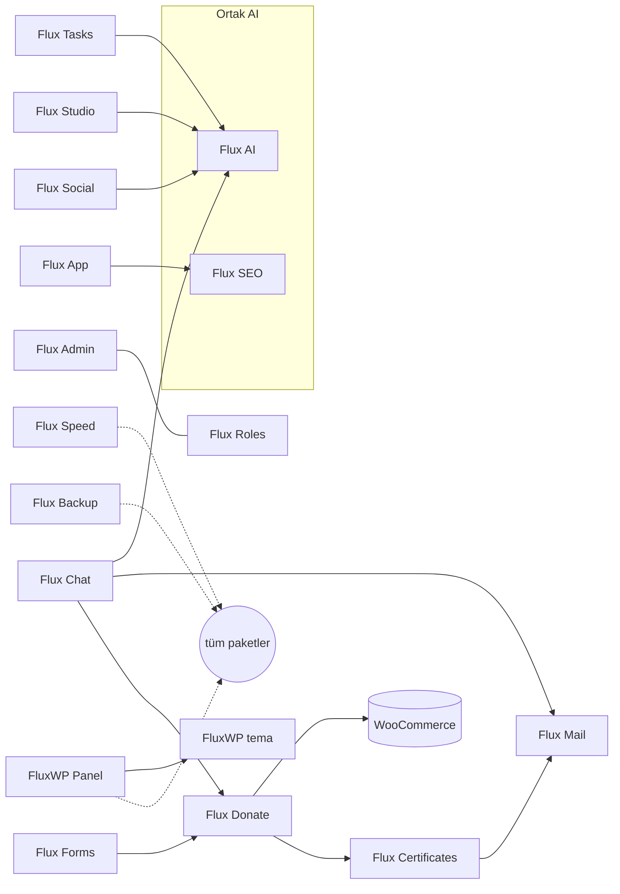

<div align="center">

[English](README.md) · **Türkçe**


# FluxWP Suite

### Dernekler ve online mağazalar için hepsi bir arada WordPress çözümleri

Bağış, e-ticaret, iletişim, yapay zekâ, analitik ve ekip araçları: aynı tasarımı, aynı AI bütçesini ve aynı güncelleme sunucusunu paylaşan 20 eklenti ve bir blok tema. Tek bir WordPress sitesi bütün kurumu yönetebilsin diye.

[](https://wordpress.org) [](https://www.php.net) [](https://woocommerce.com)   [](https://www.gnu.org/licenses/gpl-2.0.html)

[Neden](#neden-fluxwp-suite) · [Nasıl birlikte çalışır](#nasıl-birlikte-çalışır) · [Paketler](#paketler-ve-son-sürümler) · [Başlarken](#başlarken) · [Geliştiriciler için](#geliştiriciler-için)

</div>

---

## Neden FluxWP Suite?

Çoğu WordPress sitesi yamalı bohçaya döner: bir bağış eklentisi, bir form eklentisi, bir SMTP eklentisi, bir analitik kodu, bir sohbet balonu; her birinin ayrı ayarı, ayrı "Pro'ya geç" düğmesi ve panelin nasıl görünmesi gerektiğine dair ayrı fikri. FluxWP Suite tersinden kuruldu; bunların hepsine paylaşımlı sunucuda ihtiyaç duyan gerçek bir dernek için:

- **Birlikte çalışmak için yapıldı.** WhatsApp'tan gelen bir bağış Flux Donate'a düşer, sertifikası hazırlanır ve e-postası Flux Mail'den gider; arada yapıştırıcı kod yok.
- **Gereken yerde yapay zekâ, tek bütçeyle.** Tüm paketler Flux AI'yi kullanır; anahtarlar, modeller ve günlük harcama sınırı tek yerde. Claude gibi asistanlar MCP ile çalışır.
- **Telefonda da sakin tek panel.** Flux Admin her pakete aynı görünümü, rol bazlı menüyü ve mobil alt barı verir.
- **Veriniz sitenizde kalır.** Çerezsiz analitik, yerel yedek, temel işler için dış SaaS yok; GPL ve kendi sunucunuzda.
- **Her yerde Türkçe ve İngilizce.** Her paket iki dille gelir; içerik Flux Lang ile çok dilli olur.

## Nasıl birlikte çalışır

Paketler birbiriyle küçük, açık filtreler ve REST uçlarıyla konuşur; ok olmayan yerde hiçbiri diğerini zorunlu kılmaz.



## Paketler ve son sürümler

<!-- paketler:start -->
<table><tr><th>Paket</th><th>Tanıtım</th><th>Paket</th><th>Tanıtım</th></tr><tr><td width="18%"><a href="plugins/flx-admin/README.tr.md"><b>Flux Admin</b></a></td><td align="center" width="32%"><a href="plugins/flx-admin/README.tr.md"></a></td><td width="18%"><a href="plugins/flx-ai/README.tr.md"><b>Flux AI & MCP</b></a></td><td align="center" width="32%"><a href="plugins/flx-ai/README.tr.md"></a></td></tr><tr><td width="18%"><a href="plugins/flx-analytics/README.tr.md"><b>Flux Analytics</b></a></td><td align="center" width="32%"><a href="plugins/flx-analytics/README.tr.md"></a></td><td width="18%"><a href="plugins/flx-app/README.tr.md"><b>Flux App</b></a></td><td align="center" width="32%"><a href="plugins/flx-app/README.tr.md"></a></td></tr><tr><td width="18%"><a href="plugins/flx-backup/README.tr.md"><b>Flux Backup</b></a></td><td align="center" width="32%"><a href="plugins/flx-backup/README.tr.md"></a></td><td width="18%"><a href="plugins/flx-certificates/README.tr.md"><b>Flux Certificates</b></a></td><td align="center" width="32%"><a href="plugins/flx-certificates/README.tr.md"></a></td></tr><tr><td width="18%"><a href="plugins/flx-chat/README.tr.md"><b>Flux Chat</b></a></td><td align="center" width="32%"><a href="plugins/flx-chat/README.tr.md"></a></td><td width="18%"><a href="plugins/flx-chatbot/README.tr.md"><b>Flux AI Chatbot, Live Chat & Customer Support</b></a></td><td align="center" width="32%"><a href="plugins/flx-chatbot/README.tr.md"></a></td></tr><tr><td width="18%"><a href="plugins/flx-commerce/README.tr.md"><b>Flux Commerce</b></a></td><td align="center" width="32%"><a href="plugins/flx-commerce/README.tr.md"></a></td><td width="18%"><a href="plugins/flx-crm/README.tr.md"><b>Flux CRM</b></a></td><td align="center" width="32%"><a href="plugins/flx-crm/README.tr.md"></a></td></tr><tr><td width="18%"><a href="plugins/flx-donate/README.tr.md"><b>Flux Donate</b></a></td><td align="center" width="32%"><a href="plugins/flx-donate/README.tr.md"></a></td><td width="18%"><a href="plugins/flx-forms/README.tr.md"><b>Flux Forms</b></a></td><td align="center" width="32%"><a href="plugins/flx-forms/README.tr.md"></a></td></tr><tr><td width="18%"><a href="plugins/flx-lang/README.tr.md"><b>Flux Lang</b></a></td><td align="center" width="32%"><a href="plugins/flx-lang/README.tr.md"></a></td><td width="18%"><a href="plugins/flx-mail/README.tr.md"><b>Flux Mail</b></a></td><td align="center" width="32%"><a href="plugins/flx-mail/README.tr.md"></a></td></tr><tr><td width="18%"><a href="plugins/flx-recaptcha/README.tr.md"><b>Flux reCAPTCHA</b></a></td><td align="center" width="32%"><a href="plugins/flx-recaptcha/README.tr.md"></a></td><td width="18%"><a href="plugins/flx-roles/README.tr.md"><b>Flux Roles</b></a></td><td align="center" width="32%"><a href="plugins/flx-roles/README.tr.md"></a></td></tr><tr><td width="18%"><a href="plugins/flx-seo/README.tr.md"><b>Flux SEO</b></a></td><td align="center" width="32%"><a href="plugins/flx-seo/README.tr.md"></a></td><td width="18%"><a href="plugins/flx-setup/README.tr.md"><b>FluxWP Panel</b></a></td><td align="center" width="32%"><a href="plugins/flx-setup/README.tr.md"></a></td></tr><tr><td width="18%"><a href="plugins/flx-social/README.tr.md"><b>Flux Social</b></a></td><td align="center" width="32%"><a href="plugins/flx-social/README.tr.md"></a></td><td width="18%"><a href="plugins/flx-speed/README.tr.md"><b>Flux Speed</b></a></td><td align="center" width="32%"><a href="plugins/flx-speed/README.tr.md"></a></td></tr><tr><td width="18%"><a href="plugins/flx-studio/README.tr.md"><b>Flux Studio</b></a></td><td align="center" width="32%"><a href="plugins/flx-studio/README.tr.md"></a></td><td width="18%"><a href="plugins/flx-tasks/README.tr.md"><b>Flux Tasks</b></a></td><td align="center" width="32%"><a href="plugins/flx-tasks/README.tr.md"></a></td></tr><tr><td width="18%"><a href="plugins/flx-wiki/README.tr.md"><b>Flux Wiki</b></a></td><td align="center" width="32%"><a href="plugins/flx-wiki/README.tr.md"></a></td><td width="18%"><a href="themes/fluxwp/README.tr.md"><b>FluxWP</b></a></td><td align="center" width="32%"><a href="themes/fluxwp/README.tr.md"></a></td></tr></table>

| Paket | Açıklama | Tür | Son sürüm | Tarih | İndir |
|---|---|---|---|---|---|
| [Flux Admin](plugins/flx-admin/README.tr.md) | Yönetim panelini baştan tasarlar: rol bazlı sol menü, mobil alt bar, komut paleti ve açık/koyu tema. PWA ile ana ekrana eklenir. | Eklenti | [1.7.24](https://github.com/FluxWP/FluxWP/releases/tag/flx-admin-v1.7.24) | 2026-11-13 | [flx-admin.zip](https://github.com/FluxWP/FluxWP/releases/download/flx-admin-v1.7.24/flx-admin.zip) |
| [Flux Ads](plugins/flx-ads/README.tr.md) | Reklam dönüşüm takibi: Meta Pixel + Conversions API, TikTok Pixel + Events API ve Google Analytics 4 (Measurement Protocol). | Eklenti | [0.7.0](https://github.com/FluxWP/FluxWP/releases/tag/flx-ads-v0.7.0) | 2026-11-12 | [flx-ads.zip](https://github.com/FluxWP/FluxWP/releases/download/flx-ads-v0.7.0/flx-ads.zip) |
| [Flux AI & MCP](plugins/flx-ai/README.tr.md) | Tüm FluxWP eklentileri için ortak yapay zekâ merkezi. Anahtarlar, modeller, harcama sınırı ve ortak AI sohbeti burada. | Eklenti | [0.15.0](https://github.com/FluxWP/FluxWP/releases/tag/flx-ai-v0.15.0) | 2026-11-13 | [flx-ai.zip](https://github.com/FluxWP/FluxWP/releases/download/flx-ai-v0.15.0/flx-ai.zip) |
| [Flux Analytics](plugins/flx-analytics/README.tr.md) | Çerezsiz, kişisel veri tutmayan site istatistikleri. Ziyaretçiler, kaynaklar, bağış hunisi ve yolculuklar sitede kalır. | Eklenti | [0.4.10](https://github.com/FluxWP/FluxWP/releases/tag/flx-analytics-v0.4.10) | 2026-11-12 | [flx-analytics.zip](https://github.com/FluxWP/FluxWP/releases/download/flx-analytics-v0.4.10/flx-analytics.zip) |
| [Flux App](plugins/flx-app/README.tr.md) | Masaüstü ve mobil uygulama için giriş: OAuth 2.0 (PKCE), API anahtarları ve rol bazlı menü. | Eklenti | [0.4.14](https://github.com/FluxWP/FluxWP/releases/tag/flx-app-v0.4.14) | 2026-11-12 | [flx-app.zip](https://github.com/FluxWP/FluxWP/releases/download/flx-app-v0.4.14/flx-app.zip) |
| [Flux Backup](plugins/flx-backup/README.tr.md) | Güncellemelerden önce otomatik yedek, zamanlanmış tam yedekler ve seçerek geri yükleme. | Eklenti | [1.4.10](https://github.com/FluxWP/FluxWP/releases/tag/flx-backup-v1.4.10) | 2026-11-12 | [flx-backup.zip](https://github.com/FluxWP/FluxWP/releases/download/flx-backup-v1.4.10/flx-backup.zip) |
| [Flux Block Editor](plugins/flx-blocks/README.tr.md) | Block editor toolkit: row and column layouts, advanced heading, buttons, icons, gallery, tabs, accordion, forms, header builder and more. | Eklenti | [0.2.1](https://github.com/FluxWP/FluxWP/releases/tag/flx-blocks-v0.2.1) | 2026-11-13 | [flx-blocks.zip](https://github.com/FluxWP/FluxWP/releases/download/flx-blocks-v0.2.1/flx-blocks.zip) |
| [Flux Certificates](plugins/flx-certificates/README.tr.md) | Sertifika şablonları, canlı PDF önizleme ve /sertifika/{kod} doğrulama. E-posta, SMS ve WhatsApp ile gönderim. | Eklenti | [2.0.2](https://github.com/FluxWP/FluxWP/releases/tag/flx-certificates-v2.0.2) | 2026-11-13 | [flx-certificates.zip](https://github.com/FluxWP/FluxWP/releases/download/flx-certificates-v2.0.2/flx-certificates.zip) |
| [Flux Chat](plugins/flx-chat/README.tr.md) | WhatsApp çağrı merkezi: sohbetler, hazır cevaplar, etiketler ve atama. Sohbetten bağış ve sertifika kaydı, AI asistanı. | Eklenti | [1.43.3](https://github.com/FluxWP/FluxWP/releases/tag/flx-chat-v1.43.3) | 2026-11-12 | [flx-chat.zip](https://github.com/FluxWP/FluxWP/releases/download/flx-chat-v1.43.3/flx-chat.zip) |
| [Flux AI Chatbot, Live Chat & Customer Support](plugins/flx-chatbot/README.tr.md) | Siteye yapay zekâ sohbet penceresi: Flux AI ile içerikten ve ürünlerden cevap, gerekince Flux Chat'teki canlı temsilciye devir. Renk, konum, avatar ve metinler panelden canlı önizlemeyle özelleştirilir. | Eklenti | [0.1.8](https://github.com/FluxWP/FluxWP/releases/tag/flx-chatbot-v0.1.8) | 2026-11-12 | [flx-chatbot.zip](https://github.com/FluxWP/FluxWP/releases/download/flx-chatbot-v0.1.8/flx-chatbot.zip) |
| [Flux Commerce](plugins/flx-commerce/README.tr.md) | WooCommerce mağazası için satış paneli, müşteriler ve satış raporları. Dekont yüklemeli Havale/EFT, sade ödeme sayfası, ücretsiz kargo çubuğu ve Google Merchant feed'i. | Eklenti | [0.3.1](https://github.com/FluxWP/FluxWP/releases/tag/flx-commerce-v0.3.1) | 2026-11-12 | [flx-commerce.zip](https://github.com/FluxWP/FluxWP/releases/download/flx-commerce-v0.3.1/flx-commerce.zip) |
| [Flux CRM](plugins/flx-crm/README.tr.md) | Bağışçı, müşteri, gönüllü ve adayları tek kişi kartında toplayan CRM. Zaman tüneli, RFM skorlama, kayıp riski ve Flux Mail gönderimine hazır segmentler. | Eklenti | [0.6.0](https://github.com/FluxWP/FluxWP/releases/tag/flx-crm-v0.6.0) | 2026-11-13 | [flx-crm.zip](https://github.com/FluxWP/FluxWP/releases/download/flx-crm-v0.6.0/flx-crm.zip) |
| [Flux Donate](plugins/flx-donate/README.tr.md) | WooCommerce üzerinde fidan ve kampanya bağışları; kart, havale ve aylık bağış. Her bağışa kişi başına sertifika. | Eklenti | [2.27.0](https://github.com/FluxWP/FluxWP/releases/tag/flx-donate-v2.27.0) | 2026-11-13 | [flx-donate.zip](https://github.com/FluxWP/FluxWP/releases/download/flx-donate-v2.27.0/flx-donate.zip) |
| [Flux Files](plugins/flx-files/README.tr.md) | wp-admin içinde modern dosya yöneticisi: dosyaları gezin, düzenleyin, yükleyin ve paylaşın; çöp kutusu, sürüm geçmişi ve AI yardımı. | Eklenti | [0.1.1](https://github.com/FluxWP/FluxWP/releases/tag/flx-files-v0.1.1) | 2026-11-12 | [flx-files.zip](https://github.com/FluxWP/FluxWP/releases/download/flx-files-v0.1.1/flx-files.zip) |
| [Flux Forms](plugins/flx-forms/README.tr.md) | Sürükle-bırak form oluşturucu: çok adımlı formlar, ödemeler, koşullu mantık ve otomasyonlar. Gelen kayıtlar tek panelde. | Eklenti | [2.4.0](https://github.com/FluxWP/FluxWP/releases/tag/flx-forms-v2.4.0) | 2026-11-12 | [flx-forms.zip](https://github.com/FluxWP/FluxWP/releases/download/flx-forms-v2.4.0/flx-forms.zip) |
| [Flux Lang](plugins/flx-lang/README.tr.md) | Siteyi çok dilli yapar: /en/ adresleri, içerik başına çeviri, hreflang ve dil seçici. | Eklenti | [0.2.10](https://github.com/FluxWP/FluxWP/releases/tag/flx-lang-v0.2.10) | 2026-11-12 | [flx-lang.zip](https://github.com/FluxWP/FluxWP/releases/download/flx-lang-v0.2.10/flx-lang.zip) |
| [Flux Mail](plugins/flx-mail/README.tr.md) | Sitenin tüm e-postaları, posta kutusu ve gönderim kayıtları tek yerde. WhatsApp ve SMS bağlantıları diğer eklentilere ortak API ile açılır. | Eklenti | [1.16.0](https://github.com/FluxWP/FluxWP/releases/tag/flx-mail-v1.16.0) | 2026-11-13 | [flx-mail.zip](https://github.com/FluxWP/FluxWP/releases/download/flx-mail-v1.16.0/flx-mail.zip) |
| [Flux Migrate](plugins/flx-migrate/README.tr.md) | Eski paket adlarıyla kaydedilmiş site verilerini (ayarlar, tablolar, meta, içerik, tema, yükleme klasörleri) FluxWP adlarına taşır. | Eklenti | [0.1.10](https://github.com/FluxWP/FluxWP/releases/tag/flx-migrate-v0.1.10) | 2026-11-12 | [flx-migrate.zip](https://github.com/FluxWP/FluxWP/releases/download/flx-migrate-v0.1.10/flx-migrate.zip) |
| [Flux reCAPTCHA](plugins/flx-recaptcha/README.tr.md) | Giriş, kayıt, yorum, ödeme, bağış ve form gönderimlerini Google reCAPTCHA v3 ya da v2 ile botlara karşı korur. Hangi formun korunacağı panelden seçilir. | Eklenti | [0.2.5](https://github.com/FluxWP/FluxWP/releases/tag/flx-recaptcha-v0.2.5) | 2026-11-12 | [flx-recaptcha.zip](https://github.com/FluxWP/FluxWP/releases/download/flx-recaptcha-v0.2.5/flx-recaptcha.zip) |
| [Flux Roles](plugins/flx-roles/README.tr.md) | Personel, İdareci ve Yönetici rolleri; paketlerin yetkileri tek sayfadan açılıp kapanır. Kişisel referans linki burada. | Eklenti | [1.4.1](https://github.com/FluxWP/FluxWP/releases/tag/flx-roles-v1.4.1) | 2026-11-12 | [flx-roles.zip](https://github.com/FluxWP/FluxWP/releases/download/flx-roles-v1.4.1/flx-roles.zip) |
| [Flux SEO](plugins/flx-seo/README.tr.md) | Meta, Open Graph, schema, sitemap ve SEO kontrolü. Yapay zekâ asistanları için MCP sunucusu. | Eklenti | [1.9.0](https://github.com/FluxWP/FluxWP/releases/tag/flx-seo-v1.9.0) | 2026-11-13 | [flx-seo.zip](https://github.com/FluxWP/FluxWP/releases/download/flx-seo-v1.9.0/flx-seo.zip) |
| [FluxWP Panel](plugins/flx-setup/README.tr.md) | Kurulum sihirbazı, ön ayarlar ve güncellemeler: tema ve eklentileri tek seferde kurar, ön ayarı (profil, header/footer, sayfalar, menüler) uygular, FluxWP paketlerini güncelleme sunucusundan WordPress'in güncelleme ekranına getirir. | Eklenti | [1.2.8](https://github.com/FluxWP/FluxWP/releases/tag/flx-setup-v1.2.8) | 2026-11-13 | [flx-setup.zip](https://github.com/FluxWP/FluxWP/releases/download/flx-setup-v1.2.8/flx-setup.zip) |
| [Flux Social](plugins/flx-social/README.tr.md) | Sosyal medya yönetimi sitenin içinde: hesaplar, zamanlama, onay ve takvim. Flux AI yazım yardımı ve MCP araçları. | Eklenti | [0.2.7](https://github.com/FluxWP/FluxWP/releases/tag/flx-social-v0.2.7) | 2026-11-12 | [flx-social.zip](https://github.com/FluxWP/FluxWP/releases/download/flx-social-v0.2.7/flx-social.zip) |
| [Flux Speed](plugins/flx-speed/README.tr.md) | Sorgular, PHP hataları, yavaş istekler, sunucu, veritabanı ve cron tek ekranda. Sistem Kontrolü burada. | Eklenti | [0.7.2](https://github.com/FluxWP/FluxWP/releases/tag/flx-speed-v0.7.2) | 2026-11-12 | [flx-speed.zip](https://github.com/FluxWP/FluxWP/releases/download/flx-speed-v0.7.2/flx-speed.zip) |
| [Flux Studio](plugins/flx-studio/README.tr.md) | Yapay zekâ ile görsel ve video stüdyosu. Üretim, referanslar ve klasörlü galeri Flux AI üzerinden. | Eklenti | [0.4.4](https://github.com/FluxWP/FluxWP/releases/tag/flx-studio-v0.4.4) | 2026-11-11 | [flx-studio.zip](https://github.com/FluxWP/FluxWP/releases/download/flx-studio-v0.4.4/flx-studio.zip) |
| [Flux Tasks](plugins/flx-tasks/README.tr.md) | Görev takibi: projeler, listeler, pano ve takvim görünümleri. Toplantı raporları, bildirimler ve MCP araçları. | Eklenti | [0.8.19](https://github.com/FluxWP/FluxWP/releases/tag/flx-tasks-v0.8.19) | 2026-11-12 | [flx-tasks.zip](https://github.com/FluxWP/FluxWP/releases/download/flx-tasks-v0.8.19/flx-tasks.zip) |
| [Flux Wiki](plugins/flx-wiki/README.tr.md) | Sitede /wiki altında geliştirici wiki: Markdown sayfalar, ayrıntılı arama, SEO, LLM için .md ve llms.txt, Flux AI ile "Wiki'ye sor" ve MCP araçları. Eklenti ve tema yazma rehberleriyle gelir. | Eklenti | [0.2.11](https://github.com/FluxWP/FluxWP/releases/tag/flx-wiki-v0.2.11) | 2026-11-12 | [flx-wiki.zip](https://github.com/FluxWP/FluxWP/releases/download/flx-wiki-v0.2.11/flx-wiki.zip) |
| [FluxWP](themes/fluxwp/README.tr.md) | Sade, hızlı WooCommerce block teması. Hero, header, footer ve ana sayfa desenleri ön ayarlarla tamamen değişir. | Tema | [0.7.23](https://github.com/FluxWP/FluxWP/releases/tag/fluxwp-v0.7.23) | 2026-11-12 | [fluxwp.zip](https://github.com/FluxWP/FluxWP/releases/download/fluxwp-v0.7.23/fluxwp.zip) |

Tüm sürümler: [Releases](https://github.com/FluxWP/FluxWP/releases). Bu tablo release workflow'u tarafından otomatik güncellenir.
<!-- paketler:end -->

## Başlarken

1. **FluxWP Panel**'i [son `flx-setup` sürümünden](https://github.com/FluxWP/fluxwp/releases) kurun (**Eklentiler › Yeni ekle › Eklenti yükle**). Varsayılan sunucu `updater.fluxwp.com`; public paketler anahtar istemez.
2. Etkinleştirince kurulum sihirbazı açılır: eklentileri, ön ayarı ve rengi seçin, gerisini o kurar. Atlarsanız **FluxWP Panel › Paketler**'den sonra kurabilirsiniz; güncellemeler de buradan gelir.
3. Önerilen temel: **Flux Admin**, **Flux Roles**, **Flux AI** ve **Flux Speed** (Sistem Kontrolü). Çözümleri ihtiyaç oldukça ekleyin.
4. Her paketin README'sinde ekranlar, kurulum adımları ve yol haritası var; ayrıntılı notlar [`docs/`](docs/README.md) altında.

## Kaynaklar

Başlamak için en iyi yer [FluxWP Wiki](https://fluxwp.com/wiki). Diğer kanallar:

* [Web sitesi](https://fluxwp.com) (Ürün, ön ayarlar)
* [GitHub Issues](https://github.com/FluxWP/FluxWP/issues) (Hata bildirimi, özellik isteği)
* [Güvenlik politikası](SECURITY.md) (Güvenlik açığı bildirimi)
* [info@fluxwp.com](mailto:info@fluxwp.com) (Destek, sorular)

## Geliştiriciler için

```
plugins/<slug>/      eklentiler (ana dosya <slug>/<slug>.php)
themes/<slug>/       temalar (style.css)
bin/                 build.sh, package-info.sh, release-notes.sh, test-update.sh, readme-table.sh
tools/readme-media/  tanıtım ekranları, GIF'ler ve README üretici
.github/workflows/   release.yml, fluxapp-ci.yml, fluxapp-desktop.yml, mobile-ci.yml
docs/                paket kurulum/API belgeleri (docs/README.md)
.claude/skills/      Claude Code skill'leri: flx-wp-eklenti, flx-wp-tema, flx-paket-yayin, flx-readme-tanitim
```

Claude Code bu repoda açılınca `.claude/skills/` altındaki skill'leri kendiliğinden yükler; yeni eklenti/tema yazarken ve sürüm yayınlarken projedeki kurallar ve bilinen tuzaklar oradadır.

### Yeni sürüm çıkarmak

1. Paketteki `Version:` başlığını artır (eklentide sabit varsa onu da: `FLXB_VERSION` vb.).
2. İstersen paket klasörüne `CHANGELOG.md` ekle; `## 1.2.3` başlığının altı release notu olur.
   Yoksa son commit mesajı kullanılır.
3. `main`'e push et.

GitHub Actions sürümü değişen her paket için `dist/<slug>.zip` üretir, `<slug>-v<sürüm>` tag'i ile
Release açar ve güncelleme sunucusunun önbelleğini boşaltır. Birkaç dakika içinde sitelerde
**Başlangıç › Güncellemeler** ekranında görünür.

- Sürümde `-` varsa (`1.3.0-beta.1`) pre-release olur; yalnız `channel => 'beta'` olan siteler görür.
- Sürüm geri giderse (yayınlanmış en yüksek sürümden küçükse) iş hata verir.
- Elle tetiklemek: Actions › Paket release › Run workflow (isteğe bağlı `plugins/flx-forms`).

Yerelde zip almak: `bin/build.sh plugins/flx-forms` → `dist/flx-forms.zip`.
Pakete girmemesi gereken dosyalar için paket klasörüne `.distignore` koy (satır başına bir desen).
Varsayılan olarak `.git*`, `.github`, `node_modules`, `tests`, `CHANGELOG.md` girmez.

### Yeni paket eklemek

`plugins/<slug>/` ya da `themes/<slug>/` klasörünü aç, `Version:` başlığıyla push et. Sunucu paketi
release'den tanır, ayrıca ayar gerekmez. Siteye ilk kurulum: **FluxWP Panel › Paketler › Kur**.

### Sunucu ve siteler

Güncelleme sunucusu ayrı repoda: [FluxWP/updater](https://github.com/FluxWP/updater) (`updater.fluxwp.com`).
Sitelerde `plugins/flx-setup` kurulu olmalı; kurulum adımları o reponun README'sinde.

## Masaüstü ve mobil uygulama, ortak TS paketleri

Masaüstü/web uygulaması (React + Tauri), mobil uygulama (Expo, [apps/mobile](apps/mobile/README.tr.md)) ve eklenti panellerinin de kullandığı ortak katman kökte: `packages/` (core, tokens, manifest, runtime, ui, modules, panel), `apps/desktop`, `apps/mobile`, `apps/wp-embed`, `brands/`. `core`, `tokens`, `manifest` ve `runtime` platformdan bağımsızdır (DOM ya da React Native yok); uygulama sözleşmeleri ve JSON Schema'ları `packages/manifest`'te. React tüm workspace'te Expo'nun sürümüne sabitli. Paket yöneticisi Bun: `bun install`, `bun run dev`. Ayrıntı: [docs/fluxapp/README.md](docs/fluxapp/README.md).

## Geliştirici

FluxWP, **Ahmet Yılmaz** ([@sharkpaw](https://github.com/sharkpaw)) tarafından yürütülmekte ve geliştirilmektedir.

<table><tr><td align="center"><a href="https://github.com/sharkpaw"><br><b>Ahmet Yılmaz</b></a><br><sub>Proje lideri · Maintainer</sub></td></tr></table>

### Katkıda bulunanlar

Issue ve pull request'ler açıktır. Katkıda bulunanlar burada listelenecek.

## Lisans

Tüm paketler [GNU Genel Kamu Lisansı v2 veya üzeri](https://www.gnu.org/licenses/gpl-2.0.html) ile yayınlanır.<br>FluxWP tarafından geliştirilmiştir.

<!-- translation-coverage:start -->
## Dil dosyalarının kapsamı

İngilizce kaynakla karşılaştırılan, boş olmayan ve biçimi geçerli kayıt yüzdesidir; dil kalitesi onayı değildir. Kaynakla aynı kalan değerler (ör. marka adları) geçerli sayılır ve JSON raporunda ayrıca gösterilir. Yeni metin eklendiğinde komutu yeniden çalıştırın.

| Package | EN strings | TR | DE | ES | FR | PT-BR | JA | ZH | AR | RU |
|---|---:|---:|---:|---:|---:|---:|---:|---:|---:|---:|
| flx-admin | 391 | 100% | 100% | 100% | 100% | 100% | 100% | 100% | 100% | 100% |
| flx-ai | 509 | 100% | 100% | 100% | 100% | 100% | 100% | 100% | 100% | 100% |
| flx-analytics | 491 | 100% | 100% | 100% | 100% | 100% | 100% | 100% | 100% | 100% |
| flx-app | 433 | 100% | 100% | 100% | 100% | 100% | 100% | 100% | 100% | 100% |
| flx-backup | 344 | 100% | 100% | 100% | 100% | 100% | 100% | 100% | 100% | 100% |
| flx-certificates | 312 | 100% | 100% | 100% | 100% | 100% | 100% | 100% | 100% | 100% |
| flx-chat | 1602 | 100% | 100% | 100% | 100% | 100% | 100% | 100% | 100% | 100% |
| flx-chatbot | 398 | 100% | 100% | 100% | 100% | 100% | 100% | 100% | 100% | 100% |
| flx-commerce | 300 | 100% | 100% | 100% | 100% | 100% | 100% | 100% | 100% | 100% |
| flx-crm | 387 | 100% | 100% | 100% | 100% | 100% | 100% | 100% | 100% | 100% |
| flx-donate | 1814 | 100% | 100% | 100% | 100% | 100% | 100% | 100% | 100% | 100% |
| flx-forms | 3049 | 100% | 100% | 100% | 100% | 100% | 100% | 100% | 100% | 100% |
| flx-lang | 109 | 100% | 100% | 100% | 100% | 100% | 100% | 100% | 100% | 100% |
| flx-mail | 880 | 100% | 100% | 100% | 100% | 100% | 100% | 100% | 100% | 100% |
| flx-migrate | 59 | 100% | 100% | 100% | 100% | 100% | 100% | 100% | 100% | 100% |
| flx-recaptcha | 141 | 100% | 100% | 100% | 100% | 100% | 100% | 100% | 100% | 100% |
| flx-roles | 106 | 100% | 100% | 100% | 100% | 100% | 100% | 100% | 100% | 100% |
| flx-seo | 403 | 100% | 100% | 100% | 100% | 100% | 100% | 100% | 100% | 100% |
| flx-setup | 629 | 100% | 98.9% | 98.9% | 98.9% | 98.9% | 98.9% | 98.9% | 98.9% | 98.9% |
| flx-social | 553 | 100% | 100% | 100% | 100% | 100% | 100% | 100% | 100% | 100% |
| flx-speed | 501 | 100% | 100% | 100% | 100% | 100% | 100% | 100% | 100% | 100% |
| flx-studio | 316 | 100% | 100% | 100% | 100% | 100% | 100% | 100% | 100% | 100% |
| flx-tasks | 913 | 100% | 100% | 100% | 100% | 100% | 100% | 100% | 100% | 100% |
| flx-wiki | 175 | 100% | 100% | 100% | 100% | 100% | 100% | 100% | 100% | 100% |
| fluxwp | 491 | 100% | 97.1% | 97.1% | 97.1% | 97.1% | 97.1% | 97.1% | 97.1% | 97.1% |

```sh
python3 tools/site-translations/coverage.py --repo . --scan-source --write-readme
```

[Dil ekleme rehberi](tools/site-translations/LANGUAGES.tr.md)
<!-- translation-coverage:end -->
