<div align="center">

[English](README.md) · **Türkçe**


# FluxWP Suite

### Dernekler ve online mağazalar için hepsi bir arada WordPress çözümleri

Bağış, e-ticaret, iletişim, yapay zekâ, analitik ve ekip araçları: aynı tasarımı, aynı AI bütçesini ve aynı güncelleme sunucusunu paylaşan 21 eklenti ve 3 tema. Tek bir WordPress sitesi bütün kurumu yönetebilsin diye.

[](https://wordpress.org) [](https://www.php.net) [](https://woocommerce.com)   [](https://www.gnu.org/licenses/gpl-2.0.html)

[Neden](#neden-flx-suite) · [Çözümler](#çözümler) · [Nasıl birlikte çalışır](#nasıl-birlikte-çalışır) · [Paketler](#paketler-ve-son-sürümler) · [Başlarken](#başlarken) · [Geliştiriciler için](#geliştiriciler-için)

</div>

---

## Neden FluxWP Suite?

Çoğu WordPress sitesi yamalı bohçaya döner: bir bağış eklentisi, bir form eklentisi, bir SMTP eklentisi, bir analitik kodu, bir sohbet balonu; her birinin ayrı ayarı, ayrı "Pro'ya geç" düğmesi ve panelin nasıl görünmesi gerektiğine dair ayrı fikri. FluxWP Suite tersinden kuruldu; bunların hepsine paylaşımlı sunucuda ihtiyaç duyan gerçek bir dernek için:

- 🧩 **Birlikte çalışmak için yapıldı.** WhatsApp'tan gelen bir bağış Flux Donate'a düşer, sertifikayı tetikler, e-postayı Flux Mail'den gönderir ve ofis TV'sinde görünür.
- 🤖 **Gereken yerde yapay zekâ, tek bütçeyle.** Tüm paketler Flux AI'yi kullanır; anahtarlar, modeller ve günlük harcama sınırı tek yerde. Claude gibi asistanlar MCP ile çalışır.
- 📱 **Telefonda da sakin tek panel.** Flux Admin her pakete aynı görünümü, rol bazlı menüyü ve mobil alt barı verir.
- 🔒 **Veriniz sitenizde kalır.** Çerezsiz analitik, yerel yedek, temel işler için dış SaaS yok; GPL ve kendi sunucunuzda.
- 🌍 **Her yerde Türkçe ve İngilizce.** Her paket iki dille gelir; içerik Flux Lang ile çok dilli olur.

## Çözümler

### 🌱 Bağış ve e-ticaret

WooCommerce üzerinde bağış ve ödeme alın; sitenize benzeyen formlar ve her bağışçıya sertifika.

| | |
|---|---|
| [**Flux Donate**](plugins/flx-donate/README.tr.md) | Fidan ve kampanya bağışları: kart, havale, aylık bağış, bağışçı hesabı. |
| [**Flux Forms**](plugins/flx-forms/README.tr.md) | Ödemeli, koşullu ve otomasyonlu sürükle-bırak formlar. |
| [**Flux Certificates**](plugins/flx-certificates/README.tr.md) | PDF, paylaşım linki ve doğrulamalı kişisel sertifikalar. |

### 💬 İletişim

Destekçilerinizin kullandığı her kanal, tek panelden.

| | |
|---|---|
| [**Flux Chat**](plugins/flx-chat/README.tr.md) | Ekip için WhatsApp gelen kutusu; bağış kaydeden AI asistanı. |
| [**Flux Mail**](plugins/flx-mail/README.tr.md) | E-posta şablonları, posta kutusu, gönderim kaydı; tüm paketlere WhatsApp ve SMS. |
| [**Flux Social**](plugins/flx-social/README.tr.md) | Sosyal medya gönderilerini planla, onayla, yayınla; ortak takvim. |

### 🤖 Yapay zekâ ve otomasyon

Tüm site için tek AI bütçesi ve Claude gibi asistanlar için bir kapı.

| | |
|---|---|
| [**Flux AI**](plugins/flx-ai/README.tr.md) | Her paket için anahtarlar, modeller, harcama sınırı ve ortak sohbet. |
| [**Flux SEO**](plugins/flx-seo/README.tr.md) | Hafif SEO ve içeriği yapay zekânın yönetmesi için MCP sunucusu. |
| [**Flux Studio**](plugins/flx-studio/README.tr.md) | Referanslı, ortak galerili yapay zekâ görsel ve video stüdyosu. |

### 🧭 Ekip ve yönetim

Telefonda da çalışan sakin bir panel; herkese doğru yetki.

| | |
|---|---|
| [**Flux Admin**](plugins/flx-admin/README.tr.md) | Modern panel: rol bazlı menü, mobil alt bar, komut paleti, PWA. |
| [**Flux Roles**](plugins/flx-roles/README.tr.md) | Personel ve idareci rolleri, tüm yetkiler tek sayfada, referans linkleri. |
| [**Flux Tasks**](plugins/flx-tasks/README.tr.md) | AI asistanlı liste, pano, takvim, toplantı ve dokümanlar. |
| [**Flux App**](plugins/flx-app/README.tr.md) | Masaüstü/mobil uygulama ve MCP istemcileri için OAuth giriş ve API. |

### 📈 Büyüme ve içerik

Neyin işe yaradığını görün, insanlara kendi dillerinde ulaşın.

| | |
|---|---|
| [**Flux Analytics**](plugins/flx-analytics/README.tr.md) | Bağış hunisi, yolculuklar ve canlı widget'lı çerezsiz analitik. |
| [**Flux Lang**](plugins/flx-lang/README.tr.md) | /en/ adresli, hreflang'li, tek tık AI çevirili çok dilli site. |

### 🛠️ Operasyon

Paylaşımlı sunucuda özel güncelleme, yedek ve performans.

| | |
|---|---|
| [**Flux Updater**](plugins/flx-updater/README.tr.md) | Özel paketler WordPress'in güncelleme ekranında. |
| [**Flux Backup**](plugins/flx-backup/README.tr.md) | Her güncellemeden önce yedek, zamanlı yedek, seçerek geri yükleme. |
| [**Flux Speed**](plugins/flx-speed/README.tr.md) | Yavaş sorgular, hatalar, cron ve Sistem Kontrolü tek ekranda. |

### 📺 Ekranlar

Günün rakamlarını ofis TV'sine taşıyın.

| | |
|---|---|
| [**Flux TV Board**](plugins/flx-tv-board/README.tr.md) | Google TV panosunda canlı bağış, görev ve namaz vakitleri. |
| [**Flux TV Remote**](plugins/flx-tv-remote/README.tr.md) | Evdeki küçük köprüyle panelden Android TV kumandası. |

### 🎨 Temalar

Tek tık Site Kurulumu olan tam site düzenlemeli blok temalar.

| | |
|---|---|
| [**FluxWP**](themes/fluxwp/README.tr.md) | Sade, hızlı WooCommerce block teması; ön ayarlar onu istenen siteye çevirir (FluxWP Extras). |

## Nasıl birlikte çalışır

Paketler birbiriyle küçük, açık filtreler ve REST uçlarıyla konuşur; ok olmayan yerde hiçbiri diğerini zorunlu kılmaz.

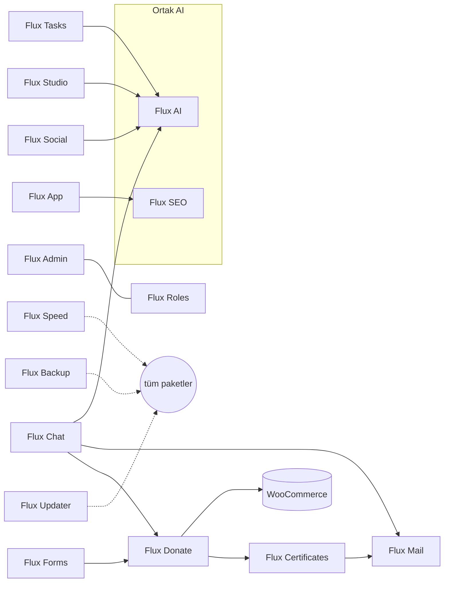

## Paketler ve son sürümler

<!-- paketler:start -->
<table><tr><th>Paket</th><th>Tanıtım</th><th>Paket</th><th>Tanıtım</th></tr><tr><td width="18%"><a href="plugins/flx-admin/README.tr.md"><b>Flux Admin</b></a></td><td align="center" width="32%"><a href="plugins/flx-admin/README.tr.md">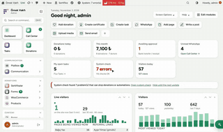</a></td><td width="18%"><a href="plugins/flx-ai/README.tr.md"><b>Flux AI</b></a></td><td align="center" width="32%"><a href="plugins/flx-ai/README.tr.md">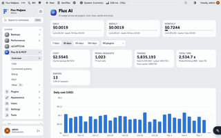</a></td></tr><tr><td width="18%"><a href="plugins/flx-analytics/README.tr.md"><b>Flux Analytics</b></a></td><td align="center" width="32%"><a href="plugins/flx-analytics/README.tr.md">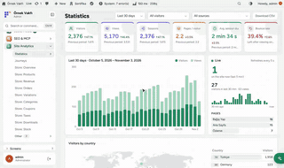</a></td><td width="18%"><a href="plugins/flx-app/README.tr.md"><b>Flux App</b></a></td><td align="center" width="32%"><a href="plugins/flx-app/README.tr.md">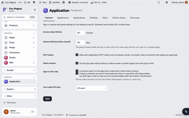</a></td></tr><tr><td width="18%"><a href="plugins/flx-backup/README.tr.md"><b>Flux Backup</b></a></td><td align="center" width="32%"><a href="plugins/flx-backup/README.tr.md">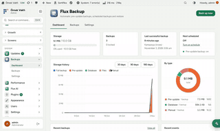</a></td><td width="18%"><a href="plugins/flx-certificates/README.tr.md"><b>Flux Certificates</b></a></td><td align="center" width="32%"><a href="plugins/flx-certificates/README.tr.md">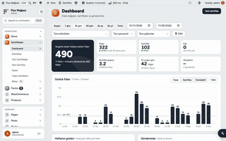</a></td></tr><tr><td width="18%"><a href="plugins/flx-chat/README.tr.md"><b>Flux Chat</b></a></td><td align="center" width="32%"><a href="plugins/flx-chat/README.tr.md">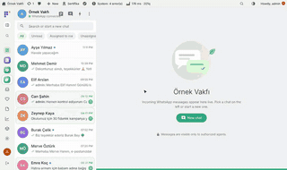</a></td><td width="18%"><a href="plugins/flx-donate/README.tr.md"><b>Flux Donate</b></a></td><td align="center" width="32%"><a href="plugins/flx-donate/README.tr.md">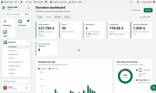</a></td></tr><tr><td width="18%"><a href="plugins/flx-forms/README.tr.md"><b>Flux Forms</b></a></td><td align="center" width="32%"><a href="plugins/flx-forms/README.tr.md">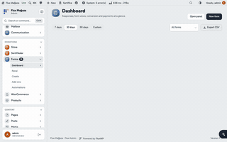</a></td><td width="18%"><a href="plugins/flx-lang/README.tr.md"><b>Flux Lang</b></a></td><td align="center" width="32%"><a href="plugins/flx-lang/README.tr.md">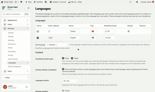</a></td></tr><tr><td width="18%"><a href="plugins/flx-mail/README.tr.md"><b>Flux Mail</b></a></td><td align="center" width="32%"><a href="plugins/flx-mail/README.tr.md">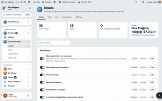</a></td><td width="18%"><a href="plugins/flx-roles/README.tr.md"><b>Flux Roles</b></a></td><td align="center" width="32%"><a href="plugins/flx-roles/README.tr.md">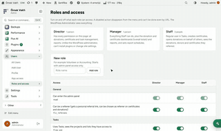</a></td></tr><tr><td width="18%"><a href="plugins/flx-seo/README.tr.md"><b>Flux SEO</b></a></td><td align="center" width="32%"><a href="plugins/flx-seo/README.tr.md">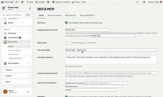</a></td><td width="18%"><a href="plugins/flx-social/README.tr.md"><b>Flux Social</b></a></td><td align="center" width="32%"><a href="plugins/flx-social/README.tr.md">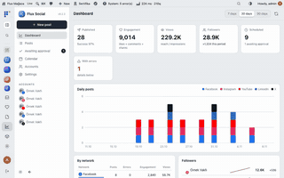</a></td></tr><tr><td width="18%"><a href="plugins/flx-speed/README.tr.md"><b>Flux Speed</b></a></td><td align="center" width="32%"><a href="plugins/flx-speed/README.tr.md">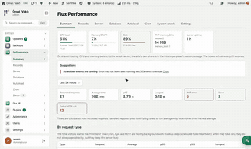</a></td><td width="18%"><a href="plugins/flx-studio/README.tr.md"><b>Flux Studio</b></a></td><td align="center" width="32%"><a href="plugins/flx-studio/README.tr.md"></a></td></tr><tr><td width="18%"><a href="plugins/flx-tasks/README.tr.md"><b>Flux Tasks</b></a></td><td align="center" width="32%"><a href="plugins/flx-tasks/README.tr.md">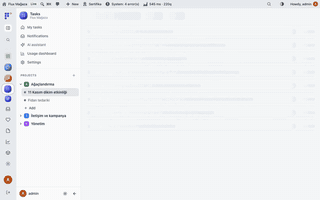</a></td><td width="18%"><a href="plugins/flx-updater/README.tr.md"><b>Flux Updater</b></a></td><td align="center" width="32%"><a href="plugins/flx-updater/README.tr.md">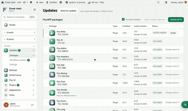</a></td></tr></table>

| Paket | Açıklama | Tür | Son sürüm | Tarih | İndir |
|---|---|---|---|---|---|
| [Flux Admin](plugins/flx-admin/README.tr.md) | Yönetim panelini baştan tasarlar: rol bazlı sol menü, mobil alt bar, komut paleti ve açık/koyu tema. PWA ile ana ekrana eklenir. | Eklenti | [1.6.4](https://github.com/FluxWP/FluxWP/releases/tag/flx-admin-v1.6.4) | 2026-11-03 | [flx-admin.zip](https://github.com/FluxWP/FluxWP/releases/download/flx-admin-v1.6.4/flx-admin.zip) |
| [Flux AI](plugins/flx-ai/README.tr.md) | Tüm FluxWP eklentileri için ortak yapay zekâ merkezi. Anahtarlar, modeller, harcama sınırı ve ortak AI sohbeti burada. | Eklenti | [0.6.4](https://github.com/FluxWP/FluxWP/releases/tag/flx-ai-v0.6.4) | 2026-11-03 | [flx-ai.zip](https://github.com/FluxWP/FluxWP/releases/download/flx-ai-v0.6.4/flx-ai.zip) |
| [Flux Analytics](plugins/flx-analytics/README.tr.md) | Çerezsiz, kişisel veri tutmayan site istatistikleri. Ziyaretçiler, kaynaklar, bağış hunisi ve yolculuklar sitede kalır. | Eklenti | [0.3.4](https://github.com/FluxWP/FluxWP/releases/tag/flx-analytics-v0.3.4) | 2026-11-03 | [flx-analytics.zip](https://github.com/FluxWP/FluxWP/releases/download/flx-analytics-v0.3.4/flx-analytics.zip) |
| [Flux App](plugins/flx-app/README.tr.md) | Masaüstü ve mobil uygulama için giriş: OAuth 2.0 (PKCE), API anahtarları ve rol bazlı menü. | Eklenti | [0.3.6](https://github.com/FluxWP/FluxWP/releases/tag/flx-app-v0.3.6) | 2026-11-03 | [flx-app.zip](https://github.com/FluxWP/FluxWP/releases/download/flx-app-v0.3.6/flx-app.zip) |
| [Flux Backup](plugins/flx-backup/README.tr.md) | Güncellemelerden önce otomatik yedek, zamanlanmış tam yedekler ve seçerek geri yükleme. | Eklenti | [1.2.3](https://github.com/FluxWP/FluxWP/releases/tag/flx-backup-v1.2.3) | 2026-11-03 | [flx-backup.zip](https://github.com/FluxWP/FluxWP/releases/download/flx-backup-v1.2.3/flx-backup.zip) |
| [Flux Certificates](plugins/flx-certificates/README.tr.md) | Sertifika şablonları, canlı PDF önizleme ve /sertifika/{kod} doğrulama. E-posta, SMS ve WhatsApp ile gönderim. | Eklenti | [1.8.3](https://github.com/FluxWP/FluxWP/releases/tag/flx-certificates-v1.8.3) | 2026-11-03 | [flx-certificates.zip](https://github.com/FluxWP/FluxWP/releases/download/flx-certificates-v1.8.3/flx-certificates.zip) |
| [Flux Chat](plugins/flx-chat/README.tr.md) | WhatsApp çağrı merkezi: sohbetler, hazır cevaplar, etiketler ve atama. Sohbetten bağış ve sertifika kaydı, AI asistanı. | Eklenti | [1.35.2](https://github.com/FluxWP/FluxWP/releases/tag/flx-chat-v1.35.2) | 2026-11-03 | [flx-chat.zip](https://github.com/FluxWP/FluxWP/releases/download/flx-chat-v1.35.2/flx-chat.zip) |
| [Flux Donate](plugins/flx-donate/README.tr.md) | WooCommerce üzerinde fidan ve kampanya bağışları; kart, havale ve aylık bağış. Her bağışa kişi başına sertifika. | Eklenti | [2.11.4](https://github.com/FluxWP/FluxWP/releases/tag/flx-donate-v2.11.4) | 2026-11-03 | [flx-donate.zip](https://github.com/FluxWP/FluxWP/releases/download/flx-donate-v2.11.4/flx-donate.zip) |
| [Flux Forms](plugins/flx-forms/README.tr.md) | Sürükle-bırak form oluşturucu: çok adımlı formlar, ödemeler, koşullu mantık ve otomasyonlar. Gelen kayıtlar tek panelde. | Eklenti | [2.1.6](https://github.com/FluxWP/FluxWP/releases/tag/flx-forms-v2.1.6) | 2026-11-03 | [flx-forms.zip](https://github.com/FluxWP/FluxWP/releases/download/flx-forms-v2.1.6/flx-forms.zip) |
| [Flux Lang](plugins/flx-lang/README.tr.md) | Siteyi çok dilli yapar: /en/ adresleri, içerik başına çeviri, hreflang ve dil seçici. | Eklenti | [0.1.3](https://github.com/FluxWP/FluxWP/releases/tag/flx-lang-v0.1.3) | 2026-11-03 | [flx-lang.zip](https://github.com/FluxWP/FluxWP/releases/download/flx-lang-v0.1.3/flx-lang.zip) |
| [Flux Mail](plugins/flx-mail/README.tr.md) | Sitenin tüm e-postaları, posta kutusu ve gönderim kayıtları tek yerde. WhatsApp ve SMS bağlantıları diğer eklentilere ortak API ile açılır. | Eklenti | [1.13.2](https://github.com/FluxWP/FluxWP/releases/tag/flx-mail-v1.13.2) | 2026-11-03 | [flx-mail.zip](https://github.com/FluxWP/FluxWP/releases/download/flx-mail-v1.13.2/flx-mail.zip) |
| [Flux Migrate](plugins/flx-migrate) | Eski paket adlarıyla kaydedilmiş site verilerini (ayarlar, tablolar, meta, içerik, tema, yükleme klasörleri) FluxWP adlarına taşır. | Eklenti | [0.1.2](https://github.com/FluxWP/FluxWP/releases/tag/flx-migrate-v0.1.2) | 2026-11-03 | [flx-migrate.zip](https://github.com/FluxWP/FluxWP/releases/download/flx-migrate-v0.1.2/flx-migrate.zip) |
| [Flux Roles](plugins/flx-roles/README.tr.md) | Personel, İdareci ve Yönetici rolleri; paketlerin yetkileri tek sayfadan açılıp kapanır. Kişisel referans linki burada. | Eklenti | [1.2.2](https://github.com/FluxWP/FluxWP/releases/tag/flx-roles-v1.2.2) | 2026-11-03 | [flx-roles.zip](https://github.com/FluxWP/FluxWP/releases/download/flx-roles-v1.2.2/flx-roles.zip) |
| [Flux SEO](plugins/flx-seo/README.tr.md) | Meta, Open Graph, schema, sitemap ve SEO kontrolü. Yapay zekâ asistanları için MCP sunucusu. | Eklenti | [1.2.4](https://github.com/FluxWP/FluxWP/releases/tag/flx-seo-v1.2.4) | 2026-11-03 | [flx-seo.zip](https://github.com/FluxWP/FluxWP/releases/download/flx-seo-v1.2.4/flx-seo.zip) |
| [Flux Setup](plugins/flx-setup/README.tr.md) | Ön ayar motoru: tek şablon dosyasıyla kurum profili, ayarlar, header/footer, şablonlar, sayfalar ve menüleri kurar. AI sohbetinden ve MCP'den onaylı yamalarla siteyi düzenler. | Eklenti | [0.2.3](https://github.com/FluxWP/FluxWP/releases/tag/flx-setup-v0.2.3) | 2026-11-03 | [flx-setup.zip](https://github.com/FluxWP/FluxWP/releases/download/flx-setup-v0.2.3/flx-setup.zip) |
| [Flux Social](plugins/flx-social/README.tr.md) | Sosyal medya yönetimi sitenin içinde: hesaplar, zamanlama, onay ve takvim. Flux AI yazım yardımı ve MCP araçları. | Eklenti | [0.1.3](https://github.com/FluxWP/FluxWP/releases/tag/flx-social-v0.1.3) | 2026-11-03 | [flx-social.zip](https://github.com/FluxWP/FluxWP/releases/download/flx-social-v0.1.3/flx-social.zip) |
| [Flux Speed](plugins/flx-speed/README.tr.md) | Sorgular, PHP hataları, yavaş istekler, sunucu, veritabanı ve cron tek ekranda. Sistem Kontrolü burada. | Eklenti | [0.3.0](https://github.com/FluxWP/FluxWP/releases/tag/flx-speed-v0.3.0) | 2026-11-03 | [flx-speed.zip](https://github.com/FluxWP/FluxWP/releases/download/flx-speed-v0.3.0/flx-speed.zip) |
| [Flux Studio](plugins/flx-studio/README.tr.md) | Yapay zekâ ile görsel ve video stüdyosu. Üretim, referanslar ve klasörlü galeri Flux AI üzerinden. | Eklenti | [0.3.3](https://github.com/FluxWP/FluxWP/releases/tag/flx-studio-v0.3.3) | 2026-11-03 | [flx-studio.zip](https://github.com/FluxWP/FluxWP/releases/download/flx-studio-v0.3.3/flx-studio.zip) |
| [Flux Tasks](plugins/flx-tasks/README.tr.md) | Görev takibi: projeler, listeler, pano ve takvim görünümleri. Toplantı raporları, bildirimler ve MCP araçları. | Eklenti | [0.8.4](https://github.com/FluxWP/FluxWP/releases/tag/flx-tasks-v0.8.4) | 2026-11-03 | [flx-tasks.zip](https://github.com/FluxWP/FluxWP/releases/download/flx-tasks-v0.8.4/flx-tasks.zip) |
| [Flux Updater](plugins/flx-updater/README.tr.md) | Özel FluxWP tema ve eklentilerini kendi güncelleme sunucusundan WordPress'in güncelleme ekranına getirir. | Eklenti | [1.7.1](https://github.com/FluxWP/FluxWP/releases/tag/flx-updater-v1.7.1) | 2026-11-03 | [flx-updater.zip](https://github.com/FluxWP/FluxWP/releases/download/flx-updater-v1.7.1/flx-updater.zip) |
| [FluxWP](themes/fluxwp/README.tr.md) | Sade, hızlı WooCommerce block teması. Hero, header, footer ve ana sayfa desenleri ön ayarlarla tamamen değişir. | Tema | [0.7.1](https://github.com/FluxWP/FluxWP/releases/tag/fluxwp-v0.7.1) | 2026-11-03 | [fluxwp.zip](https://github.com/FluxWP/FluxWP/releases/download/fluxwp-v0.7.1/fluxwp.zip) |

Tüm sürümler: [Releases](https://github.com/FluxWP/FluxWP/releases). Bu tablo release workflow'u tarafından otomatik güncellenir.
<!-- paketler:end -->

## Başlarken

1. **Flux Updater**'yi [son `flx-updater` sürümünden](https://github.com/FluxWP/fluxwp/releases) kurun (**Eklentiler › Yeni ekle › Eklenti yükle**).
2. **Başlangıç › Güncellemeler**'de gereken paketlerin yanındaki **Kur**'a basın; güncellemeler de buradan gelir.
3. Önerilen temel: **Flux Admin**, **Flux Roles**, **Flux AI** ve **Flux Speed** (Sistem Kontrolü). Çözümleri ihtiyaç oldukça ekleyin.
4. Her paketin README'sinde ekranlar, kurulum adımları ve yol haritası var; ayrıntılı notlar [`docs/`](docs/README.md) altında.

## Geliştiriciler için

```
plugins/<slug>/      eklentiler (ana dosya <slug>/<slug>.php)
themes/<slug>/       temalar (style.css)
bin/                 build.sh, package-info.sh, release-notes.sh, test-update.sh, readme-table.sh
tools/readme-media/  tanıtım ekranları, GIF'ler ve README üretici
.github/workflows/   release.yml, mirror.yml
docs/                paket kurulum/API belgeleri (docs/README.md)
.claude/skills/      Claude Code skill'leri: flx-wp-eklenti, flx-wp-tema, flx-paket-yayin, flx-readme-tanitim
```

Claude Code bu repoda açılınca `.claude/skills/` altındaki skill'leri kendiliğinden yükler; yeni eklenti/tema yazarken ve sürüm yayınlarken projedeki kurallar ve bilinen tuzaklar oradadır.

### Yeni sürüm çıkarmak

1. Paketteki `Version:` başlığını artır (eklentide sabit varsa onu da: `FLXB_VERSION` vb.).
2. İstersen paket klasörüne `CHANGELOG.md` ekle; `## 1.2.3` başlığının altı release notu olur.
   Yoksa son commit mesajı kullanılır.
3. `main`'e push et.

GitHub Actions sürümü değişen her paket için `dist/<slug>.zip` üretir, `<slug>-v<sürüm>` tag'i ile
Release açar ve güncelleme sunucusunun önbelleğini boşaltır. Birkaç dakika içinde sitelerde
**Başlangıç › Güncellemeler** ekranında görünür.

- Sürümde `-` varsa (`1.3.0-beta.1`) pre-release olur; yalnız `channel => 'beta'` olan siteler görür.
- Sürüm geri giderse (yayınlanmış en yüksek sürümden küçükse) iş hata verir.
- Elle tetiklemek: Actions › Paket release › Run workflow (isteğe bağlı `plugins/flx-forms`).

Yerelde zip almak: `bin/build.sh plugins/flx-forms` → `dist/flx-forms.zip`.
Pakete girmemesi gereken dosyalar için paket klasörüne `.distignore` koy (satır başına bir desen).
Varsayılan olarak `.git*`, `.github`, `node_modules`, `tests`, `CHANGELOG.md` girmez.

### Yeni paket eklemek

`plugins/<slug>/` ya da `themes/<slug>/` klasörünü aç, `Version:` başlığıyla push et. Sunucu paketi
release'den tanır, ayrıca ayar gerekmez. Siteye ilk kurulum: **Ayarlar › Flux Updater › Kur**.

### Sunucu ve siteler

Güncelleme sunucusu ayrı repoda: [FluxWP/updater](https://github.com/FluxWP/updater) (`updater.fluxwp.com`).
Sitelerde `plugins/flx-updater` kurulu olmalı; kurulum adımları o reponun README'sinde.

### flx-wc-bagis (kaldırıldı)

Flux WooCommerce Bağış, Flux Donate 2.0 ile birleşti (2026-10-16) ve 2026-11-01'de repodan silindi. Tüm özellikleri (fidan paketleri, Havale/EFT + dekont, Bağış Seçenekleri bloğu `flx-wc-bagis/secenekler`, `/bagis-urunleri.xml`) `plugins/flx-donate` içinde. Eski release'ler (`flx-wc-bagis-v*`) GitHub'da durur; sitede kuruluysa kaldırılır.

## Geliştirici

FluxWP, **Ahmet Yılmaz** ([@sharkpaw](https://github.com/sharkpaw)) tarafından yürütülmekte ve geliştirilmektedir.

<table><tr><td align="center"><a href="https://github.com/sharkpaw"><br><b>Ahmet Yılmaz</b></a><br><sub>Proje lideri · Maintainer</sub></td></tr></table>

### Katkıda bulunanlar

Issue ve pull request'ler açıktır. Katkıda bulunanlar burada listelenecek.

## Lisans

Tüm paketler [GNU Genel Kamu Lisansı v2 veya üzeri](https://www.gnu.org/licenses/gpl-2.0.html) ile yayınlanır.<br>FluxWP tarafından geliştirilmiştir.
