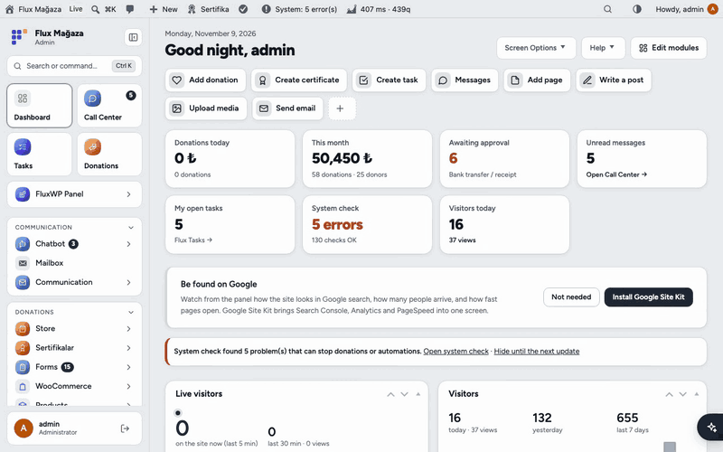
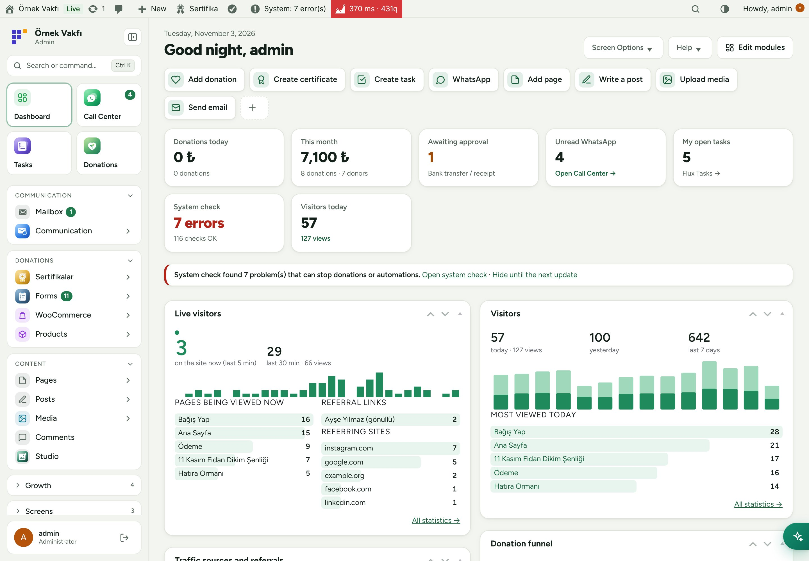
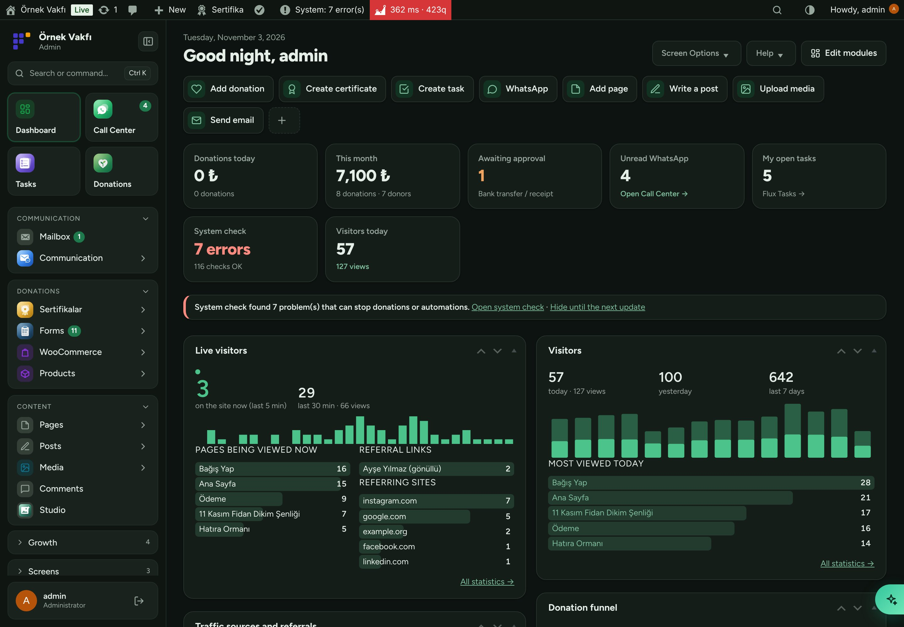
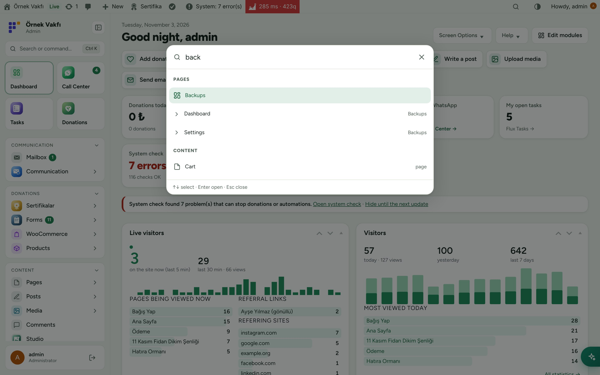
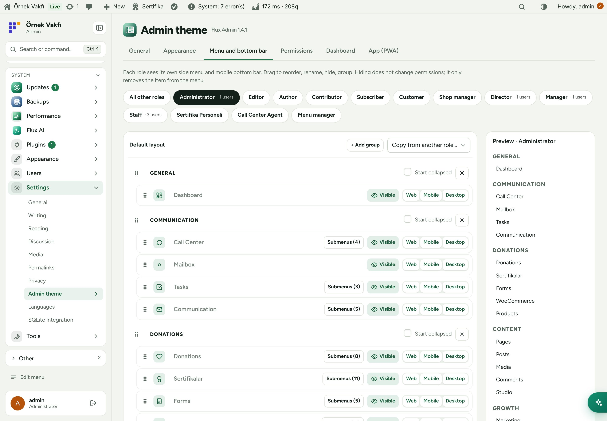
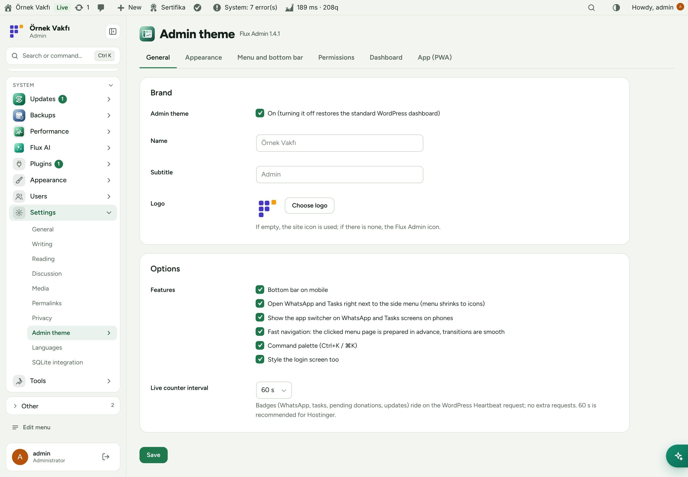
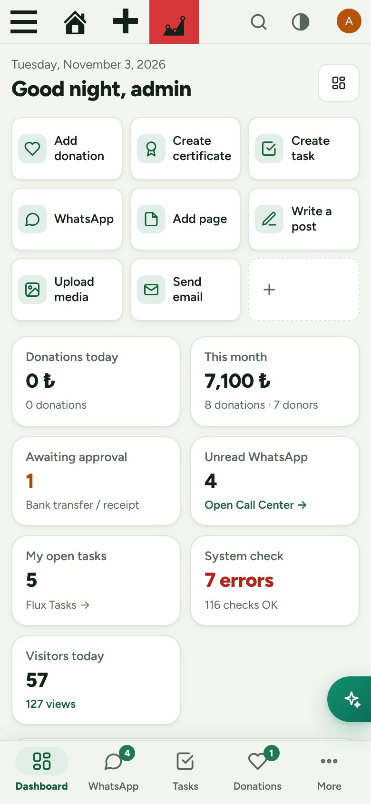
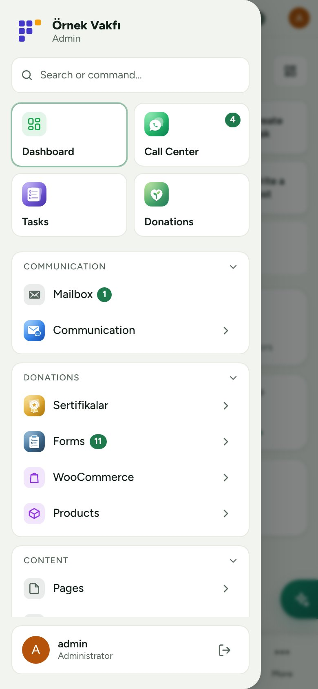

**English** · [Türkçe](README.tr.md)

# Flux Admin

**A calm, modern WordPress admin that works as well on a phone as on a desktop.** 
Flux Admin redesigns the WordPress dashboard: a grouped sidebar you can edit per role, a mobile bottom bar, automatic light and dark themes, a command palette, live counters and an installable app (PWA). Turn it off and the standard WordPress admin comes back; no content or permission changes.

[Features](#features) · [Screenshots](#screenshots) · [Installation](#installation) · [For developers](#for-developers) · [Roadmap](#roadmap)

---

## Why Flux Admin?

Our volunteers and staff use WordPress mostly from their phones, and the stock admin shows them dozens of menus they never need. Flux Admin keeps WordPress underneath but changes how it feels:

- 🧭 **Only what each role needs.** Edit the sidebar per role: reorder, rename, hide, group. Hiding never changes permissions.
- 📱 **Phone first.** A bottom bar with four shortcuts and a slide-in side panel; the bar hides while the keyboard is open.
- 🌗 **Light, dark or automatic**, chosen by each person.
- ⌨️ **Ctrl+K / ⌘K** jumps to any screen, action or post.
- ⚡ **No white flashes.** The page is held until it is ready, so the menu and top bar never jump.
- 📲 **Install it as an app** on phones and computers (PWA) with a fast splash screen.

## Features

### Navigation
- Grouped sidebar (General, Apps, Donations, Content, Site, Other) with line icons; collapses to an icon strip.
- **Menu editor** per role with a live preview: drag to reorder, rename, hide, add groups, copy from another role. With Flux App installed, each item can be shown on Web, Mobile or Desktop separately.
- Panel / WhatsApp / Tasks switch above the menu with unread badges, and a small switch on the edge of the Call Center and Tasks screens (Alt+1…9).
- Mobile bottom bar (four shortcuts you choose plus "More") and a side panel that opens from the left.

### Dashboard
- Editable modules: everyone can rearrange their own start screen with "Edit modules".
- Summary tiles from other FluxWP packages (system check, visitors today, donations) and quick actions (`Label|address`).
- Live badges ride on WordPress Heartbeat, so no extra requests are opened.

### Look and feel
- Automatic light and dark themes, brand name, subtitle, logo and accent colour.
- Command palette with search across menus, apps, actions and content.
- Shared building blocks for other packages: list filters and pagination (`flxa_list_*`), safe-area variables for full-screen screens, modal dimming.

### App (PWA)
- "Add to Home Screen" on phones and the install icon on desktop browsers. Only CSS, JS, fonts and images are cached, never admin pages.
- Logins made inside the app stay signed in; browser logins behave as usual.

## Screenshots

| Dashboard | Dark mode |
|---|---|
|  |  |
| **Command palette (Ctrl+K)** | **Menu editor per role** |
|  |  |
| **Settings** | **Mobile: bottom bar** |
|  |  |
| **Mobile: side panel** |   |
|  |   |

## Installation

Requirements: WordPress 6.4+, PHP 7.4+.

**From a zip**

1. Download `flx-admin.zip` from the latest `flx-admin-v*` release on the [Releases](https://github.com/FluxWP/fluxwp/releases) page.
2. **Plugins › Add New › Upload Plugin**, choose the zip, then **Activate**.

**With Flux Updater** (recommended on our sites)

**Dashboard › Updates** lists every FluxWP package; click **Install** next to *Flux Admin*. Updates arrive the same way.

**First steps**

1. **Settings › Admin theme** opens with sensible defaults; nothing has to be filled in.
2. Under **Menu and bottom bar**, pick a role, arrange its menu and choose the four bottom-bar shortcuts, then **Save**.
3. On a phone, open the admin and use **Add to Home Screen** to install it as an app.

> ℹ️ Before removing the plugin, turn off the PWA under **Settings › Admin theme › App** so installed apps unregister their service worker.

Full setup notes (Turkish): [KURULUM.md](../../docs/flx-admin/KURULUM.md) · Release notes: [CHANGELOG.md](CHANGELOG.md)

## For developers

- Count badges in the menu: filter `flxa_counts`. Dashboard tiles: `flxa_dashboard_stats`.
- Full-screen apps that want the switch button: `flxa_app_screens`.
- Shared list UI: `flxa_list_form_attrs()`, `flxa_list_per_page()`, `flxa_list_pagination()` ([LISTE-API.md](../../docs/flx-admin/LISTE-API.md)).
- Safe-area contract for full-screen screens and modals: [GUVENLI-ALAN.md](../../docs/flx-admin/GUVENLI-ALAN.md). In JS: `FLXA.safeArea()`, `FLXA.modal(true|false)`.

## Roadmap

| | |
|---|---|
| ✅ | Grouped, role-based sidebar and menu editor |
| ✅ | Mobile bottom bar, side panel and PWA |
| ✅ | Automatic light and dark themes, command palette |
| ✅ | Shared list filters and pagination for all FluxWP packages |
| ✅ | Per-platform menu items for the FluxWP desktop and mobile apps |
| ⬜ | Dark theme for the block editor |
| ⬜ | Saved searches in the command palette |

## License

Flux Admin Released under the [GNU General Public License v2 or later](https://www.gnu.org/licenses/gpl-2.0.html).

Made by FluxWP.
