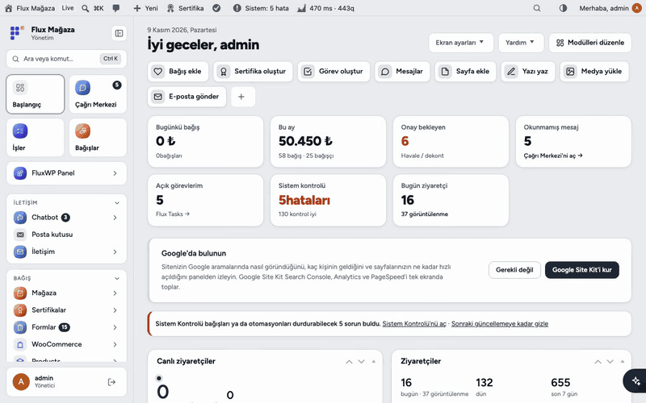
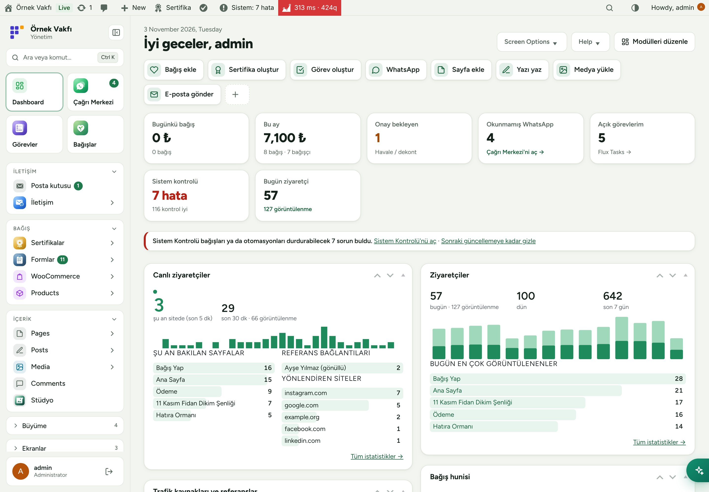
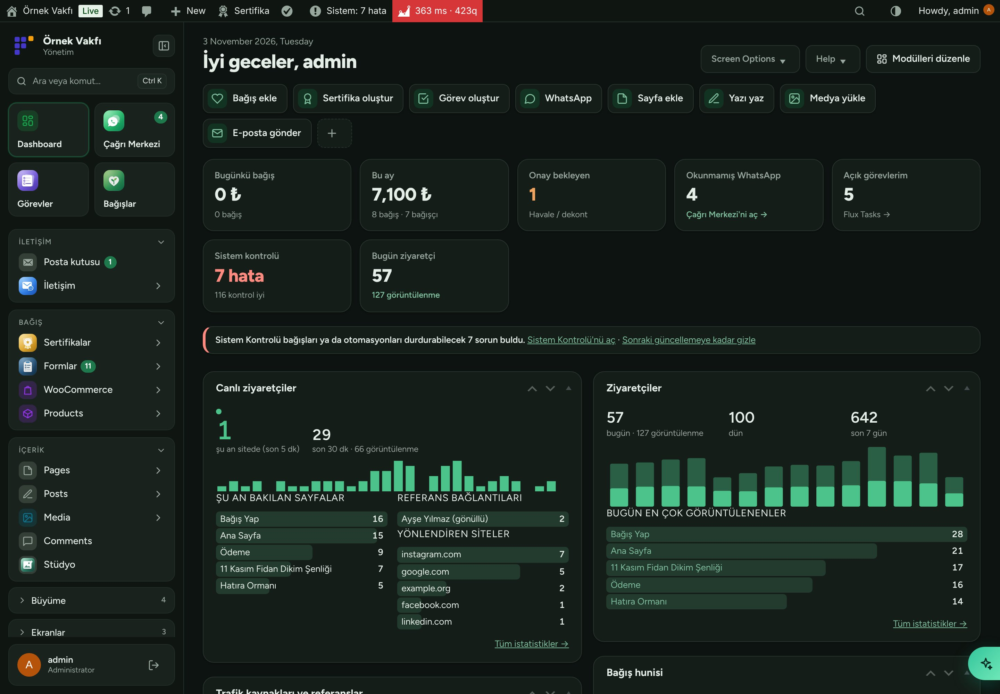
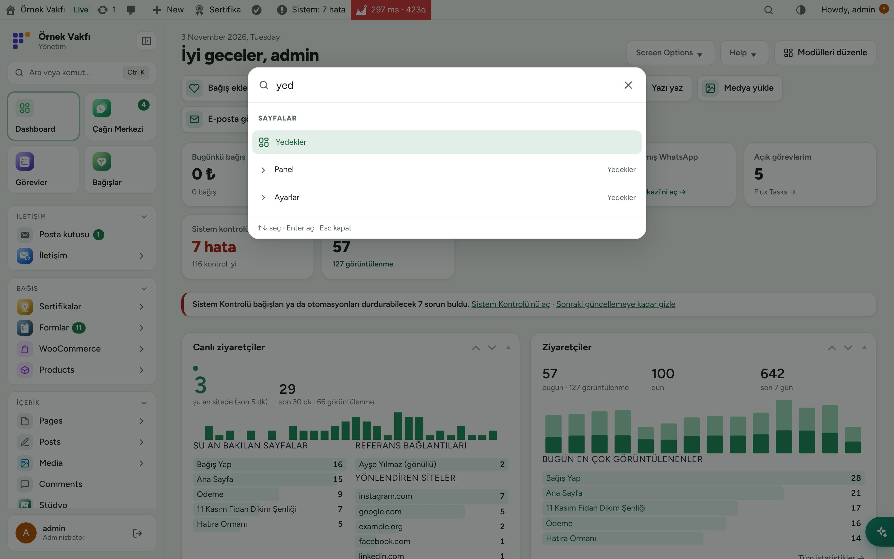
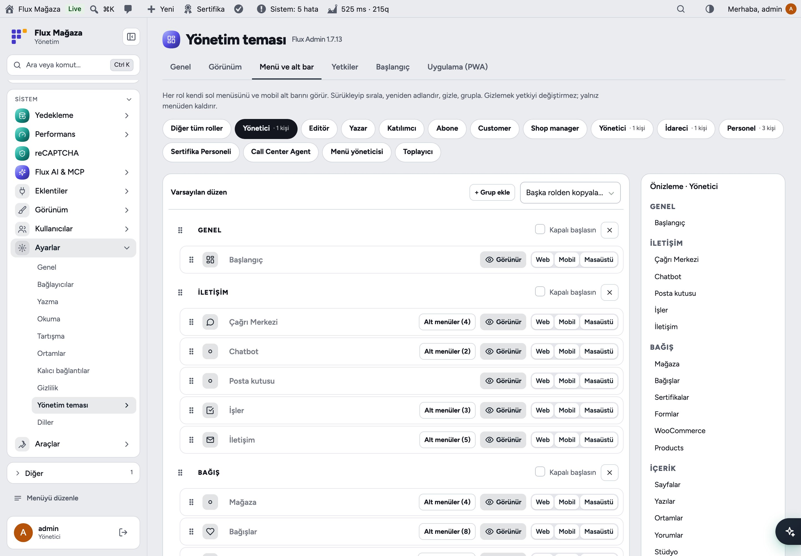
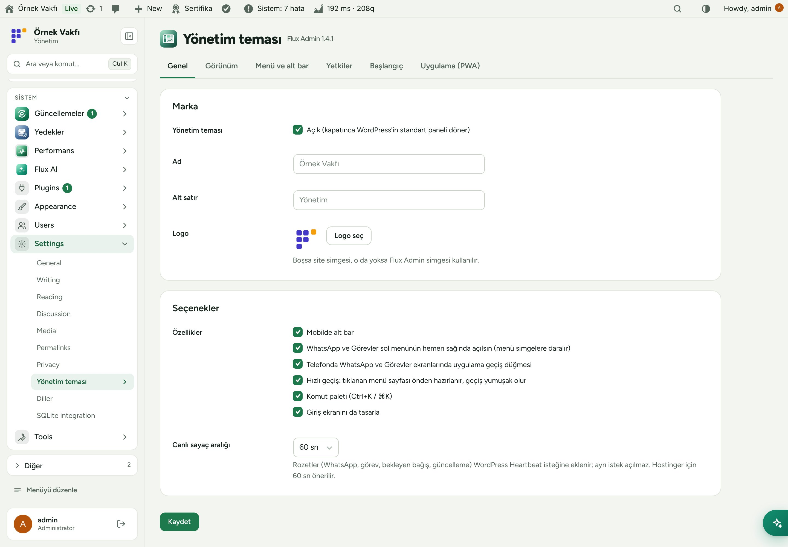
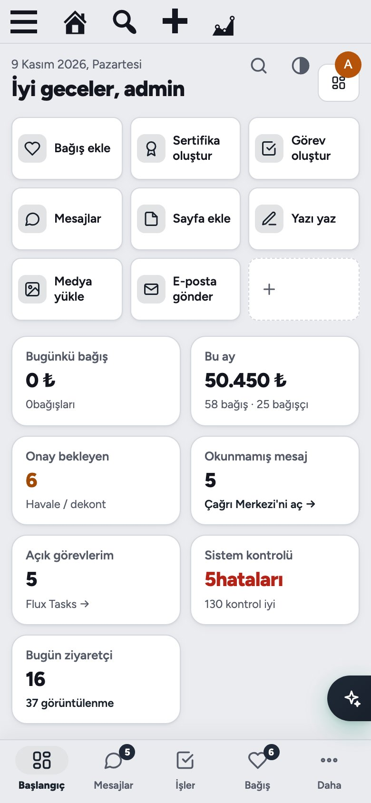
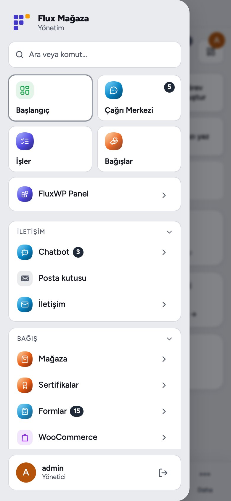

[English](README.md) · **Türkçe**

# Flux Admin

**Telefonda da bilgisayarda da rahat kullanılan, sade ve modern bir WordPress paneli.** 
Flux Admin WordPress yönetim panelini baştan tasarlar: role göre düzenlenebilen gruplu sol menü, mobil alt bar, otomatik açık/koyu tema, komut paleti, canlı sayaçlar ve kurulabilir uygulama (PWA). Kapatınca standart WordPress paneli geri gelir; içerik ve yetkiler değişmez.

[Özellikler](#özellikler) · [Ekran görüntüleri](#ekran-görüntüleri) · [Kurulum](#kurulum) · [Geliştiriciler için](#geliştiriciler-için) · [Yol haritası](#yol-haritası)

---

## Neden Flux Admin?

Gönüllülerimiz ve personelimiz WordPress'i çoğunlukla telefondan kullanıyor; standart panel onlara hiç gerekmeyen onlarca menü gösteriyor. Flux Admin WordPress'i olduğu gibi bırakır, ama kullanım hissini değiştirir:

- 🧭 **Her role yalnız gerekeni.** Sol menüyü role göre düzenleyin: sıralayın, yeniden adlandırın, gizleyin, gruplayın. Gizlemek yetkiyi değiştirmez.
- 📱 **Önce telefon.** Dört kısayollu alt bar ve soldan açılan yan panel; klavye açıkken alt bar gizlenir.
- 🌗 **Açık, koyu ya da otomatik**, herkes kendisi seçer.
- ⌨️ **Ctrl+K / ⌘K** ile her ekrana, işleme ya da yazıya atlayın.
- ⚡ **Beyaz ekran yok.** Sayfa hazır olana kadar eskisi ekranda kalır; menü ve üst çubuk yerinden oynamaz.
- 📲 **Uygulama olarak kurun:** telefonda ve bilgisayarda (PWA), hızlı açılış ekranıyla.

## Özellikler

### Gezinme
- Gruplu sol menü (Genel, Uygulamalar, Bağış, İçerik, Site, Diğer), çizgi simgeler; daraltılınca simge şeridine döner.
- Role göre **menü düzenleyicisi** ve canlı önizleme: sürükleyip sıralama, yeniden adlandırma, gizleme, grup ekleme, başka rolden kopyalama. Flux App kuruluysa her öğe Web, Mobil ve Masaüstü için ayrı açılıp kapanır.
- Menünün üstünde okunmamış rozetli Panel / WhatsApp / Görevler geçişi; Çağrı Merkezi ve Görev ekranlarının kenarında küçük geçiş düğmesi (Alt+1…9).
- Mobil alt bar (seçtiğiniz dört kısayol + "Daha") ve soldan açılan yan panel.

### Başlangıç
- Düzenlenebilir modüller: herkes kendi Başlangıç ekranını "Modülleri düzenle" ile düzenler.
- Diğer FluxWP paketlerinden özet kutucukları (sistem kontrolü, bugünkü ziyaretçi, bağışlar) ve hızlı işlemler (`Etiket|adres`).
- Canlı rozetler WordPress Heartbeat'e eklenir; ayrı istek açılmaz.

### Görünüm
- Otomatik açık/koyu tema, kurum adı, alt satır, logo ve vurgu rengi.
- Menülerde, uygulamalarda, işlemlerde ve içerikte arayan komut paleti.
- Diğer paketler için ortak yapı taşları: liste süzgeçleri ve sayfalama (`flxa_list_*`), tam ekran sayfalar için güvenli alan değişkenleri, modal karartma.

### Uygulama (PWA)
- Telefonda "Ana Ekrana Ekle", bilgisayarda tarayıcının yükle simgesi. Yalnız CSS, JS, yazı tipi ve görseller önbelleğe alınır; panel sayfaları alınmaz.
- Uygulama içinden yapılan girişler açık kalır; tarayıcı girişleri her zamanki gibi davranır.

## Ekran görüntüleri

| Başlangıç | Koyu tema |
|---|---|
|  |  |
| **Komut paleti (Ctrl+K)** | **Role göre menü düzenleyicisi** |
|  |  |
| **Ayarlar** | **Mobil: alt bar** |
|  |  |
| **Mobil: yan panel** |   |
|  |   |

## Kurulum

Gereksinimler: WordPress 6.4+, PHP 7.4+.

**Zip ile**

1. [Releases](https://github.com/FluxWP/fluxwp/releases) sayfasında en son `flx-admin-v*` sürümünden `flx-admin.zip`'i indirin.
2. **Eklentiler › Yeni ekle › Eklenti yükle**, zip'i seçin, sonra **Etkinleştir**.

**FluxWP Panel ile** (sitelerimizde önerilen)

**FluxWP Panel › Paketler** tüm FluxWP paketlerini listeler; *Flux Admin* satırındaki **Kur**'a basın. Güncellemeler de buradan gelir.

**İlk adımlar**

1. **Ayarlar › Yönetim teması** hazır varsayılanlarla açılır; bir şey girmeniz gerekmez.
2. **Menü ve alt bar** sekmesinde bir rol seçin, menüsünü düzenleyin, alt barın dört kısayolunu seçin ve **Kaydet**'e basın.
3. Telefonda paneli açıp **Ana Ekrana Ekle** ile uygulama olarak kurun.

> ℹ️ Eklentiyi kaldırmadan önce **Ayarlar › Yönetim teması › Uygulama**'dan PWA'yı kapatın; böylece kurulu uygulamalar service worker'ı siler.

Ayrıntılı kurulum notları: [KURULUM.md](../../docs/flx-admin/KURULUM.md) · Sürüm notları: [CHANGELOG.md](CHANGELOG.md)

## Geliştiriciler için

- Menüde sayı rozetleri: `flxa_counts` filtresi. Başlangıç kutucukları: `flxa_dashboard_stats`.
- Geçiş düğmesi isteyen tam ekran uygulamalar: `flxa_app_screens`.
- Ortak liste arayüzü: `flxa_list_form_attrs()`, `flxa_list_per_page()`, `flxa_list_pagination()` ([LISTE-API.md](../../docs/flx-admin/LISTE-API.md)).
- Tam ekran sayfa ve modallar için güvenli alan sözleşmesi: [GUVENLI-ALAN.md](../../docs/flx-admin/GUVENLI-ALAN.md). JS'te `FLXA.safeArea()`, `FLXA.modal(true|false)`.

## Yol haritası

| | |
|---|---|
| ✅ | Gruplu, role göre sol menü ve menü düzenleyicisi |
| ✅ | Mobil alt bar, yan panel ve PWA |
| ✅ | Otomatik açık/koyu tema, komut paleti |
| ✅ | Tüm FluxWP paketleri için ortak liste süzgeci ve sayfalama |
| ✅ | FluxWP masaüstü ve mobil uygulamaları için platforma göre menü öğeleri |
| ⬜ | Blok editöründe koyu tema |
| ⬜ | Komut paletinde kayıtlı aramalar |

## Lisans

Flux Admin, [GNU Genel Kamu Lisansı v2 veya üzeri](https://www.gnu.org/licenses/gpl-2.0.html) ile yayınlanır.

FluxWP tarafından geliştirilmiştir.
