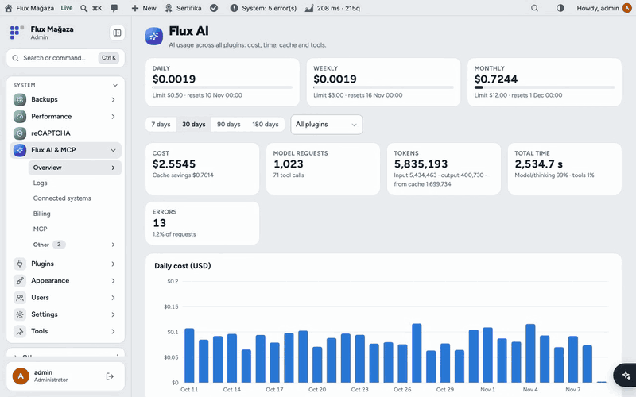
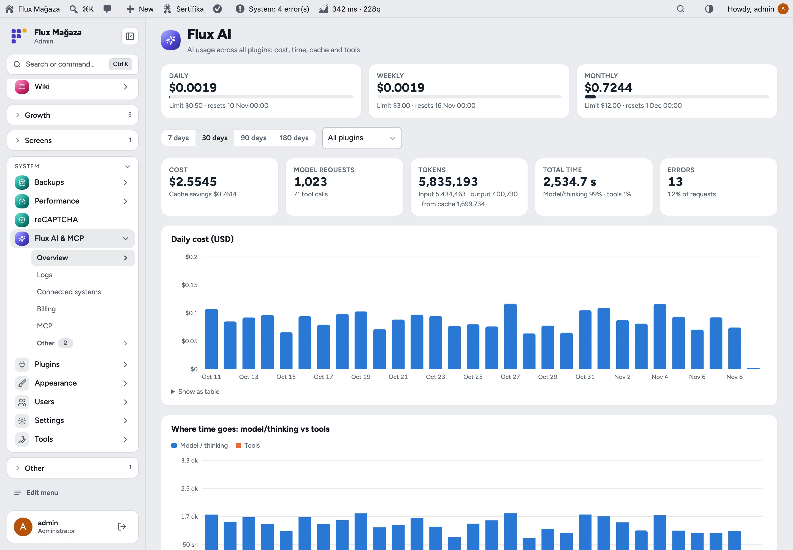
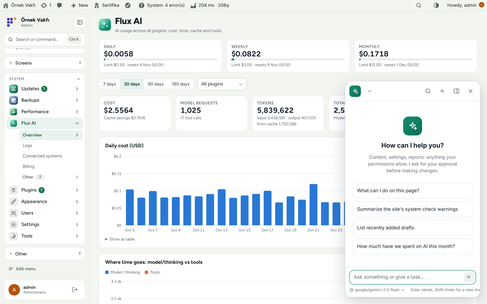
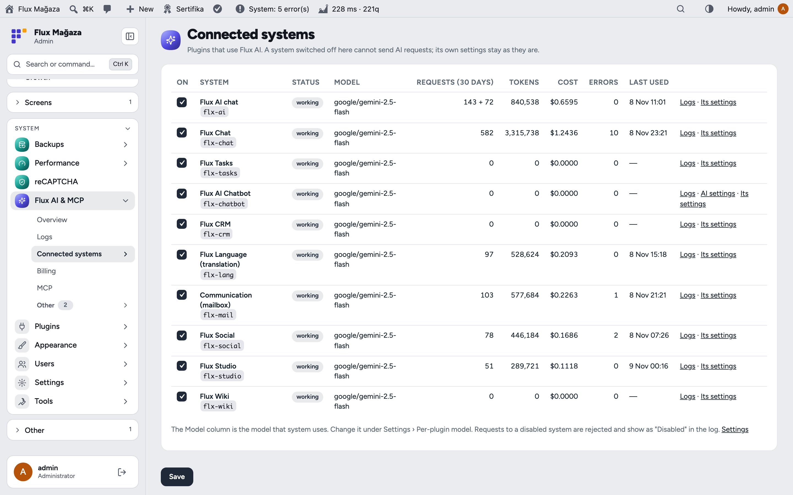
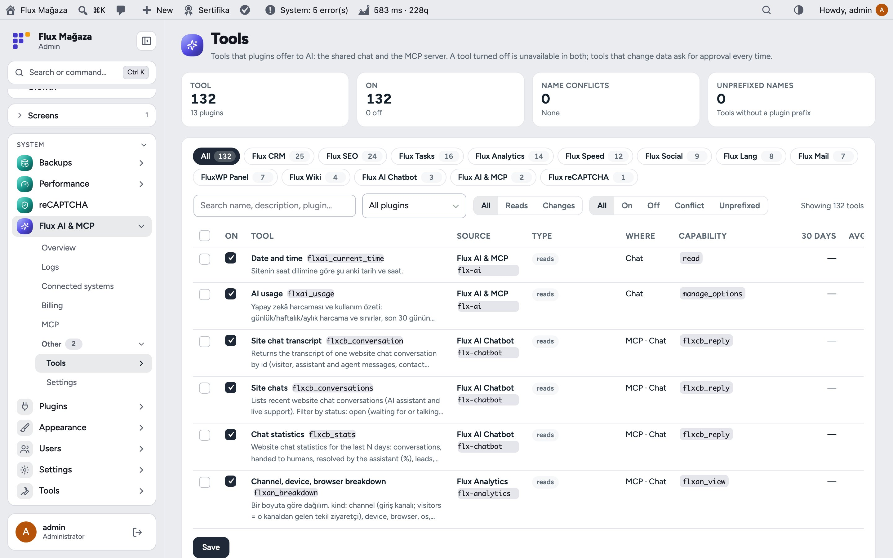
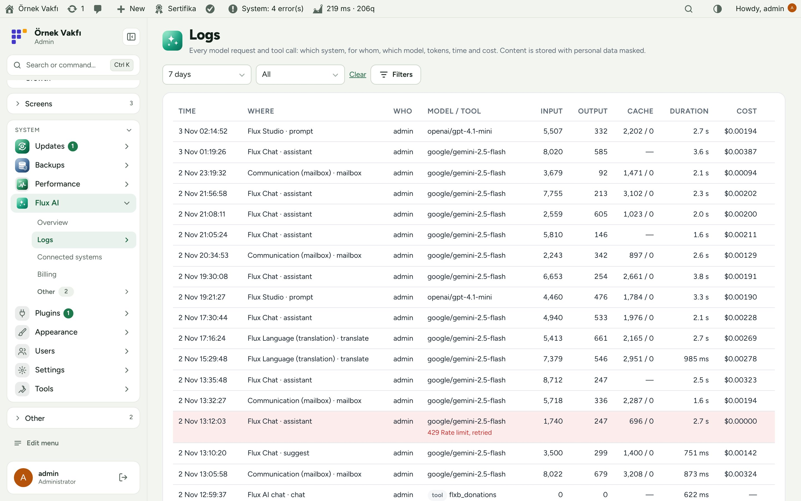
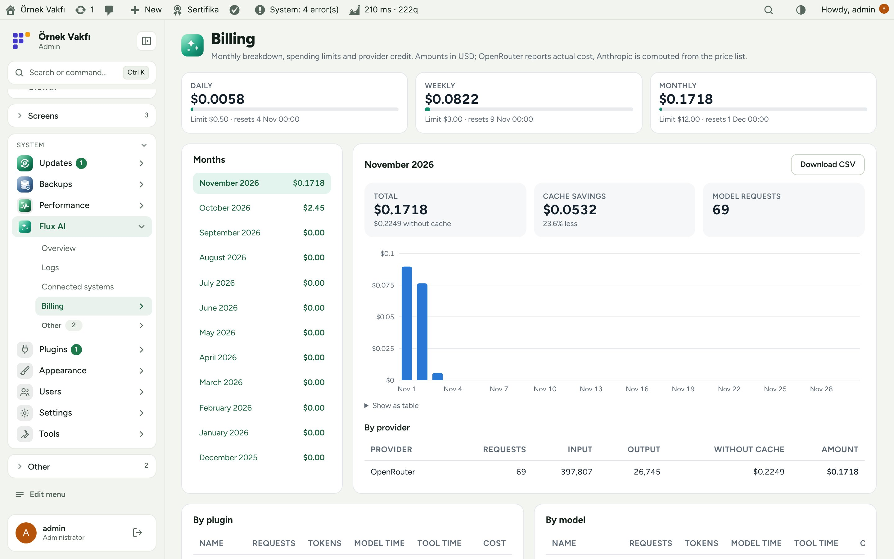
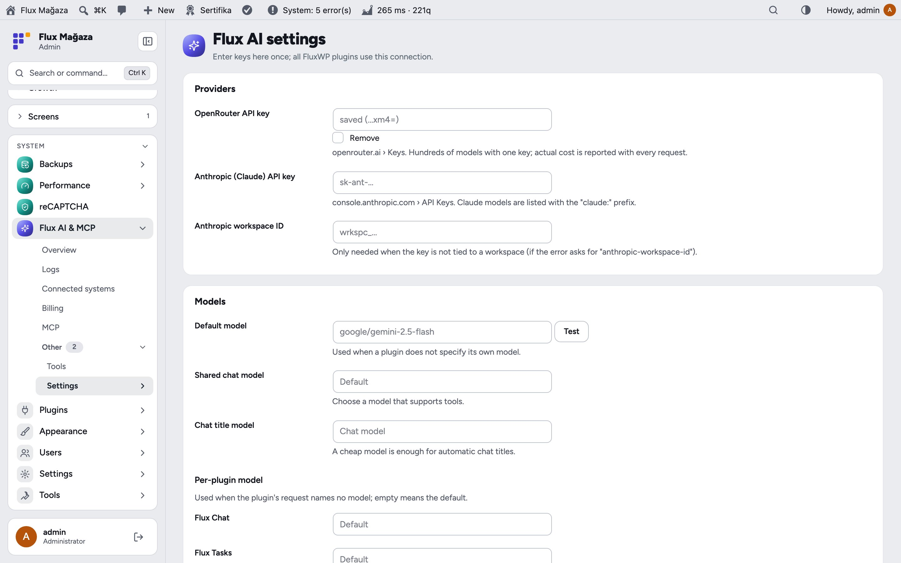
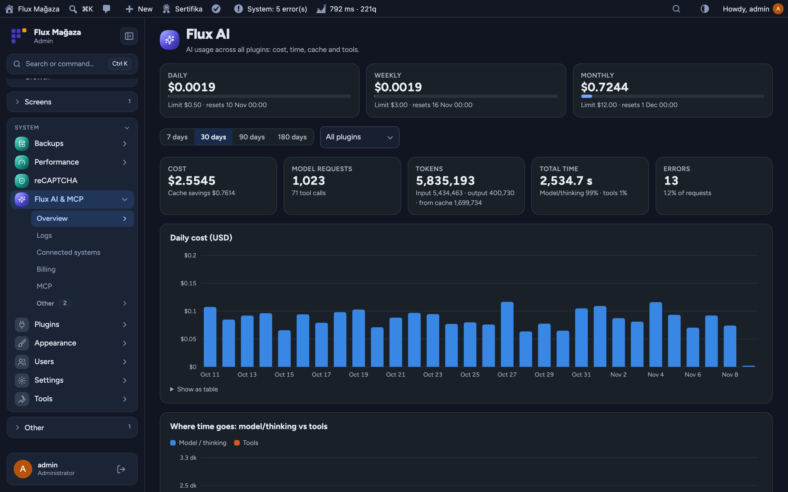
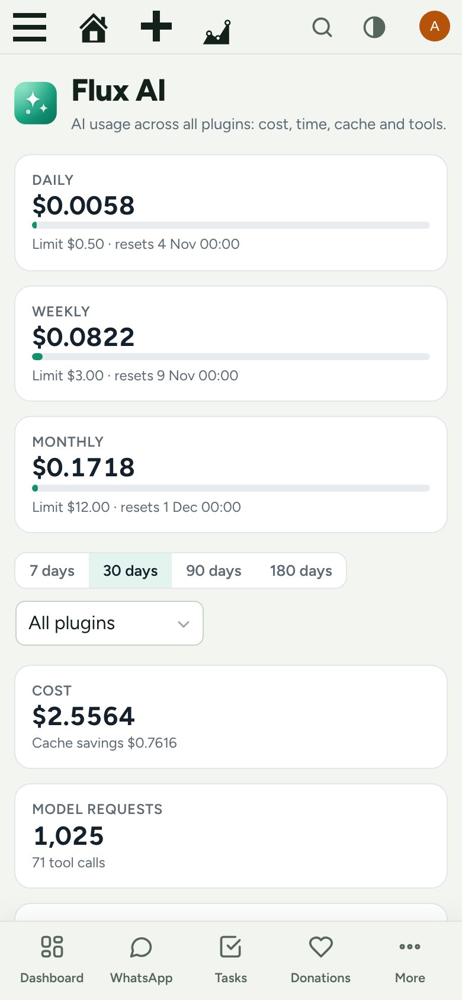

<div align="center">

**English** · [Türkçe](README.tr.md)


# Flux AI & MCP

**One AI hub for every FluxWP plugin: keys, models, costs, limits and a shared chat.**<br>
Flux AI is the shared AI layer of the FluxWP packages. OpenRouter and Anthropic keys, the model catalogue and prices, prompt caching, a tool registry, the shared MCP server, usage logs, billing and spending limits live here once; Flux Call Center, Flux Contact, Flux Social, Flux Language, Flux Studio and the rest call it instead of talking to AI providers themselves. Authorised users also get a streaming AI chat in the admin that can use those tools.

[](https://wordpress.org)
[](https://www.php.net)
[](https://www.gnu.org/licenses/gpl-2.0.html)


[Features](#features) · [Screenshots](#screenshots) · [Installation](#installation) · [For developers](#for-developers) · [Roadmap](#roadmap)



</div>

---

## Why Flux AI?

When every plugin brings its own AI connection, you end up with keys in five settings pages, no idea what the month costs, and no way to stop a runaway loop at 3 a.m. Flux AI puts one layer in between:

- 🔑 **Keys in one place.** OpenRouter and Anthropic keys are entered once, stored encrypted and never sent to the browser.
- 💸 **Costs you can see and cap.** Daily, weekly and monthly limits with a warning threshold; every request logged with tokens, cache, time and cost.
- 🧩 **One switch per system.** See which plugin uses which model, how much it spent and how often it failed, and turn it off without touching its settings.
- 💬 **A chat that can act.** The shared chat sees the tools other plugins register, asks for approval before changing anything and only shows tools the user is allowed to use.

## Features

### Hub for other plugins
- `flxai_chat()` / `flxai_complete()` with tools, streaming, prompt caching (Claude) and model fallback; `flxai_ready()`, `flxai_model_for()`, `flxai_budget_status()`.
- **Connected systems:** each plugin with status, model, 30-day requests, tokens, cost, errors and last use; on/off per system; per-plugin model in Settings.
- **MCP server:** `/wp-json/flx-mcp/v1/mcp` for Claude Desktop, Claude Code, Cursor and claude.ai; per-user keys that can be limited to chosen tools, last use and recent activity. Every FluxWP plugin (SEO, CRM, Mail, Speed, Analytics, Social…) registers its tools here with `flx_mcp_tools`.
- **Tools:** every tool registered through `flx_mcp_tools` or `flxai_tools`, with source, reads/writes, approval flag, capability, 30-day calls and average time; on/off per tool.
- Images in answers: ```widget / ```mermaid blocks rendered to PNG through Gotenberg or Imagick.
- Image and video generation for Flux Studio through fal.ai, EvoLink, OpenAI, Gemini and OpenRouter (`flxai_media_submit`).

### Costs and limits
- **Overview:** daily, weekly and monthly spend against limits, cost, requests, tokens (input, output, from cache), total time split into model vs tools, errors; daily charts for 7 to 180 days, per plugin.
- **Billing:** month by month with cache savings, per provider, per plugin and per model, CSV download.
- **Logs:** every model request and tool call (where, who, model or tool, tokens, cache, duration, cost); content stored masked (e-mail, phone, IBAN, keys) and kept 30 days by default.
- Spending limit action: block or only warn, with a warning percentage.

### Shared chat
- The AI button in the admin opens a docked or floating chat with chat history, search, model picker, suggestions for the current page and streaming answers.
- Changes need the user's approval in the chat; stop at any time; edit a message or go back to an earlier point.
- The chat keeps running across page loads.

## Screenshots

| Overview: spend, limits and time | Shared AI chat |
|---|---|
|  |  |
| **Connected systems** | **Tool registry** |
|  |  |
| **Request log** | **Monthly billing** |
|  |  |
| **Keys and models** | **Dark mode with Flux Admin** |
|  |  |
| **Mobile overview** |   |
|  |   |

## Installation

Requirements: WordPress 6.5+, PHP 7.4+. An OpenRouter or Anthropic API key. Optional: Gotenberg or Imagick for images in answers, fal.ai / EvoLink / OpenAI / Gemini keys for Flux Studio.

**From a zip**

1. Download `flx-ai.zip` from the latest `flx-ai-v*` release on the [Releases](https://github.com/FluxWP/fluxwp/releases) page.
2. **Plugins › Add New › Upload Plugin**, choose the zip, then **Activate**.

**With FluxWP Panel** (recommended on our sites)

**FluxWP Panel › Packages** lists every FluxWP package; click **Install** next to *Flux AI*. Updates arrive the same way.

**First steps**

1. Activate Flux AI and open **Flux AI & MCP › Settings**.
2. Enter an OpenRouter key (or an Anthropic key), choose the default model and press **Test**.
3. Set daily, weekly and monthly limits.
4. Open **Connected systems** to see which plugins use Flux AI and pick a model per plugin if you like.

> ⚠️ Flux AI is required by every FluxWP package that uses AI; none of them keeps its own AI connection. Older keys saved in Flux Call Center are moved here automatically.

Full setup notes (Turkish): [KURULUM.md](../../docs/flx-ai/KURULUM.md) · API reference: [API.md](../../docs/flx-ai/API.md) · Release notes: [CHANGELOG.md](CHANGELOG.md)

## For developers

- `flxai_chat( $messages, [ 'source' => 'my-plugin', 'tools' => …, 'stream' => true ] )`, `flxai_complete( $prompt )`.
- Register a system with `flxai_systems`, MCP + chat tools with `flx_mcp_tools` (chat-only: `flxai_tools`); log your own calls with `flxai_log()`.
- Media: `flxai_media_submit()`, `flxai_media_status()`, `flxai_media_cancel()`; REST under `/wp-json/flx-ai/v1`.

## Roadmap

| | |
|---|---|
| ✅ | One key store, model catalogue and prices |
| ✅ | Usage logs, billing and spending limits |
| ✅ | Connected systems and tool registry |
| ✅ | Shared MCP server with scoped keys |
| ✅ | Streaming shared chat with approvals |
| ✅ | Image and video generation for Flux Studio |
| ⬜ | Per-user and per-role budgets |
| ⬜ | Local model support (Ollama) |

## License

Flux AI Released under the [GNU General Public License v2 or later](https://www.gnu.org/licenses/gpl-2.0.html).

Made by FluxWP.
