<div align="center">

**English** · [Türkçe](README.tr.md)


# Flux Site Analytics

**See who visits, where they come from and how far they get toward a donation, without collecting personal data.**<br>
A privacy-first analytics plugin for WordPress: visitors, pages, sources, a donation funnel, visitor journeys, referral links and a live view. Data stays in your own database, and AI assistants can read it over MCP.

[](https://wordpress.org)
[](https://www.php.net)
[](https://www.gnu.org/licenses/gpl-2.0.html)


[Features](#features) · [Screenshots](#screenshots) · [Installation](#installation) · [AI and MCP](#use-it-with-ai-assistants-mcp) · [For developers](#for-developers) · [Roadmap](#roadmap)

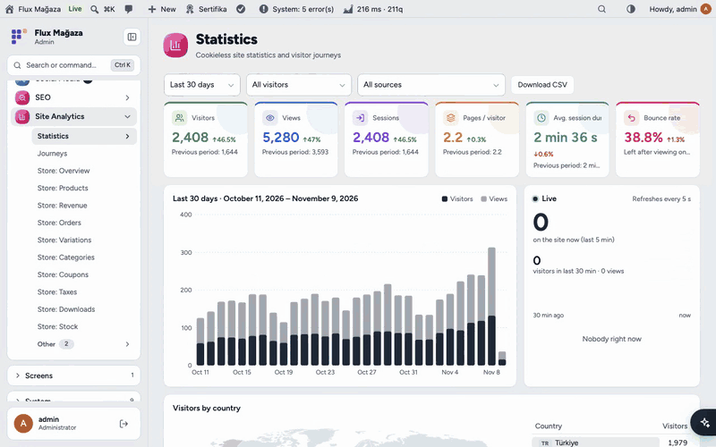

</div>

---

## Why Flux Site Analytics?

Google Analytics is heavy, needs a cookie banner and sends your visitors' data to a third party. Simple counters stop at page views. A non-profit needs something in between: *how many people came, from where, and how many of them actually donated?*

- 🔒 **No personal data.** No IP address or browser fingerprint is stored. A visitor is recognised only within the same day by a random key that is deleted the next day. No cookie banner needed.
- 💚 **Built around donations.** A ready-made funnel follows each visit from the first page to the donation page, the checkout form, the "Place order" click and the thank-you page.
- 🧭 **Journeys, not just counts.** See the order in which people browse, where they drop out and which paths reach the goal.
- 🔗 **Referral links for volunteers.** Give each volunteer or campaign a `?r=code` link and see their visitors, sessions and donations.
- ⚡ **Fast and cache-friendly.** A ~2 KB beacon and a collection endpoint that doesn't even load WordPress. Works behind LiteSpeed and other page caches.
- 🤖 **Ready for AI.** 15 MCP tools let Flux AI, Claude or any MCP client answer "where did our donors come from this month?".
- 🌐 **English and Turkish**, following each user's WordPress language.

## Features

### Statistics
- Six headline cards: visitors, views, sessions, pages per visitor, average session duration and bounce rate, each compared with the previous period.
- Date ranges (today, 7/30/90 days, months, years, custom), a daily chart and a **Live** panel that refreshes every 5 seconds.
- **World map** and country list. The country comes from the browser's time zone, never from the IP.
- Pages (click one for its own chart), referring sites, channels (search, social, AI assistants, email, ads, campaigns, referral links), device, browser, OS, language, UTM campaigns, 404 pages and CSV export.
- **Visitor type filter** on every screen: everyone, outside visitors only, logged-in users, or a single role.

### Donation funnel
- Default steps: *site entry → donation page → checkout page → started the form → clicked "Place order" → donation completed*. The checkout events are sent automatically on classic and block checkout.
- Break the funnel down **by channel, referring site, referral code, role or country**.
- **Visual funnel editor:** up to 5 funnels × 10 steps; each step is a page, an event or the site entry. Drag to reorder, pick pages and events from suggestions.

### Journeys
- A step-by-step flow from the entry page (2 to 6 steps): how many visits each box has and what share ended there.
- Most common paths with their share, change from the previous period and goal rate; filter by start page, end page or goal.
- "Group pages" folds sub-pages such as `/news/...` into one box.

### Referral links
- Create a named link (`?r=ayse`) in one click. The visitor gets a 30-day first-party cookie holding only the code, so later pages, later days and the donation are credited to it.
- Per link: visitors, sessions, pages per session, average duration, the furthest funnel step reached, and donations (count and amount). Click a row to filter the whole screen to that link.

### Events
- Tracked automatically: outbound links, file downloads, phone, email and WhatsApp clicks, site search, and paid WooCommerce donations (type and amount, once per order).
- Your own events: `data-flxan-event="name"` on any element, `flxan.track()` in JavaScript or `flxan_track_event()` in PHP.

### Around WordPress
- Four **dashboard widgets**: live visitors, visitors, traffic sources and referrals, donation funnel.
- A "Views" column in the post and page lists, the page's view count in the admin bar, and two shortcodes: `[flx_analiz_populer]` (most read posts) and `[flx_analiz_sayac]` (view counter).
- Imports historical data from Koko Analytics without touching its tables.
- Registers its checks in **System Check** (Flux Performance) and its `flxan_view` capability in Flux Roles.

## Screenshots

| Overview | Journeys |
|---|---|
| 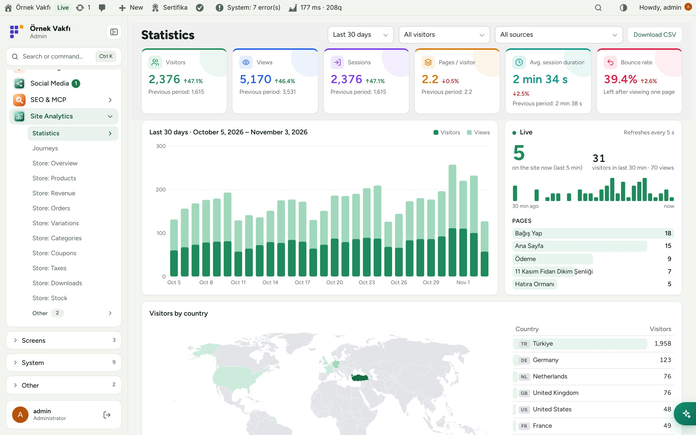 | 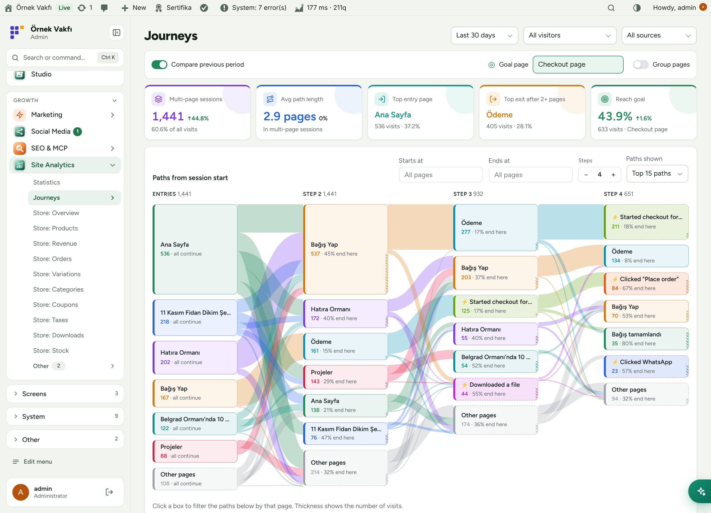 |
| **Donation funnel** | **Visual funnel editor** |
| 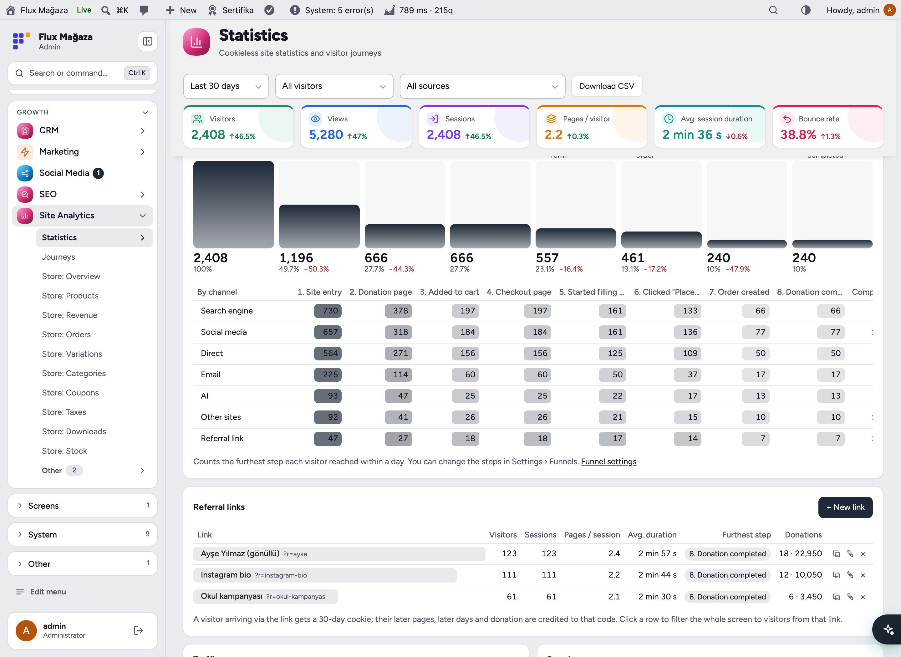 | 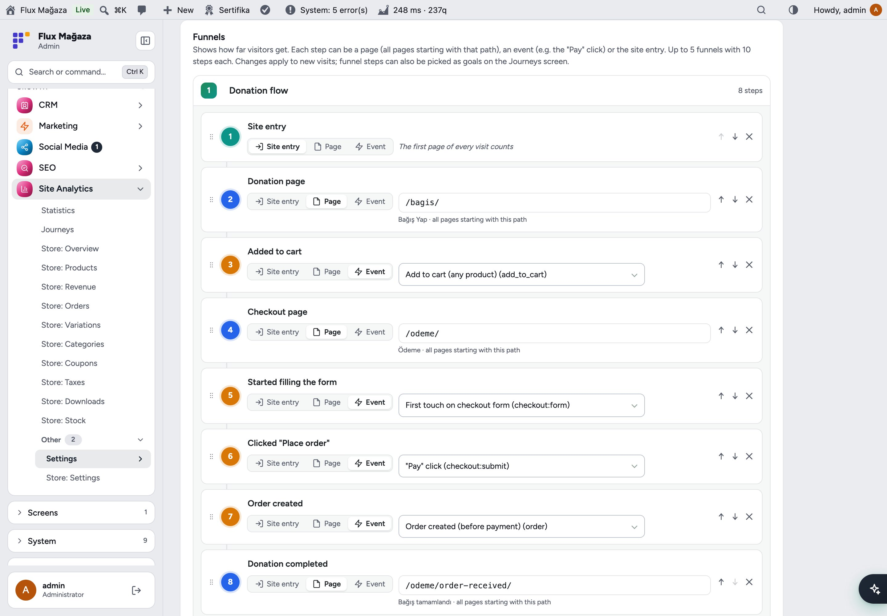 |
| **Referral links, sources and roles** | **Visitors by country** |
| 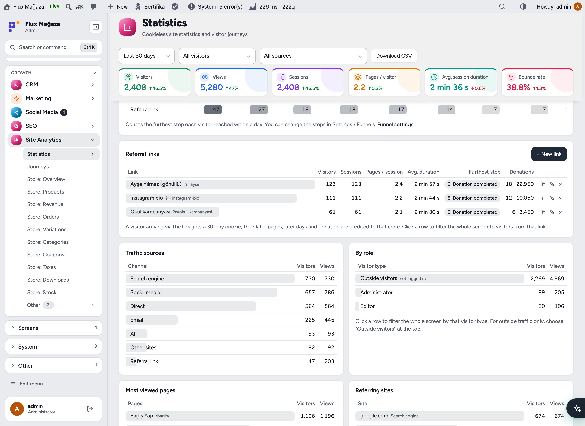 | 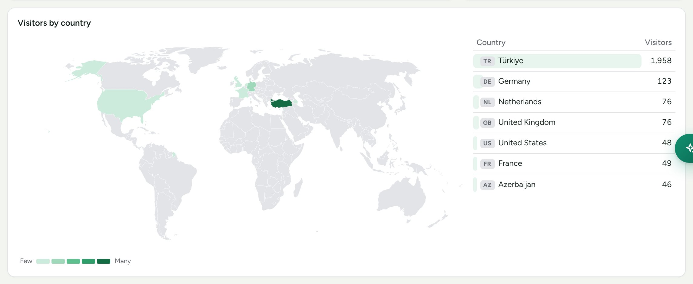 |
| **Pages and referring sites** | **Clicks and conversions** |
| 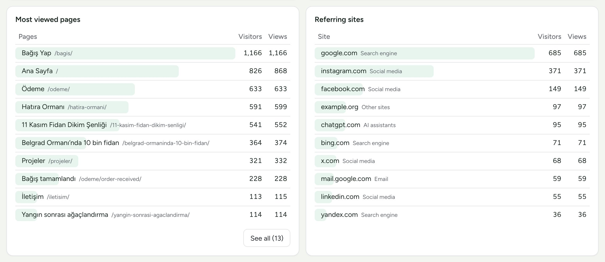 | 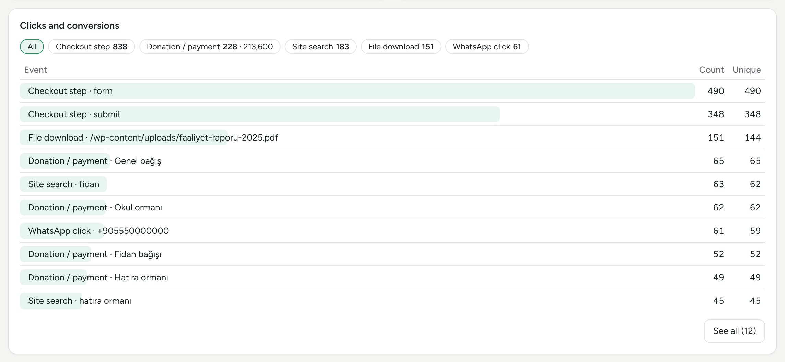 |
| **Dashboard widgets** | **Mobile** |
| 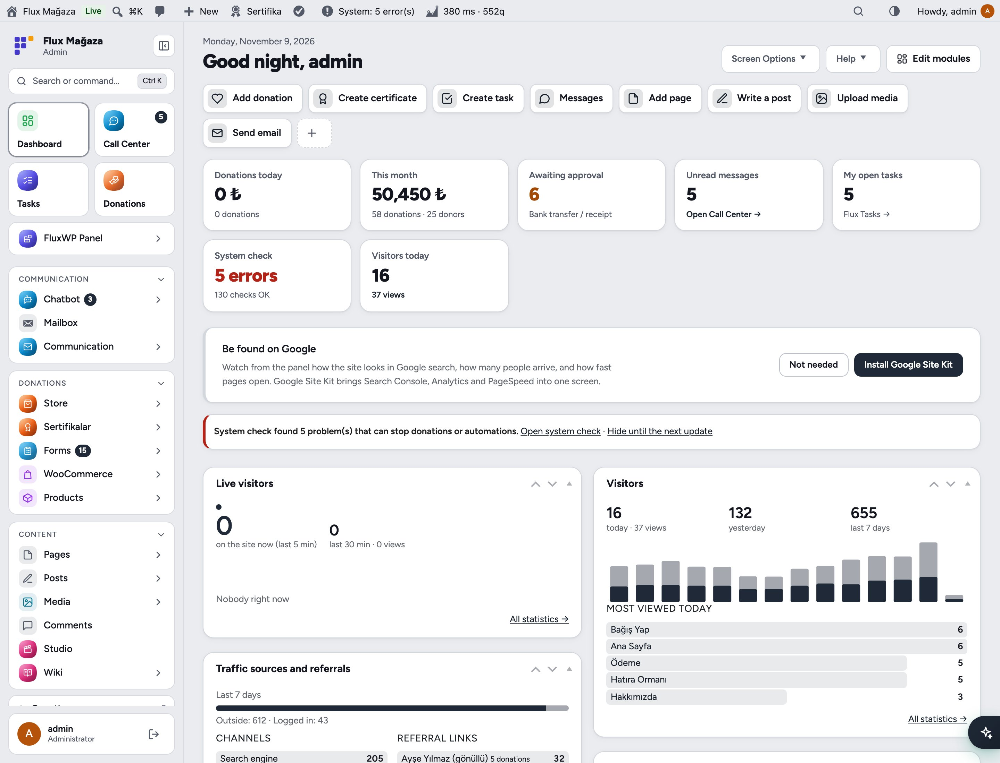 | 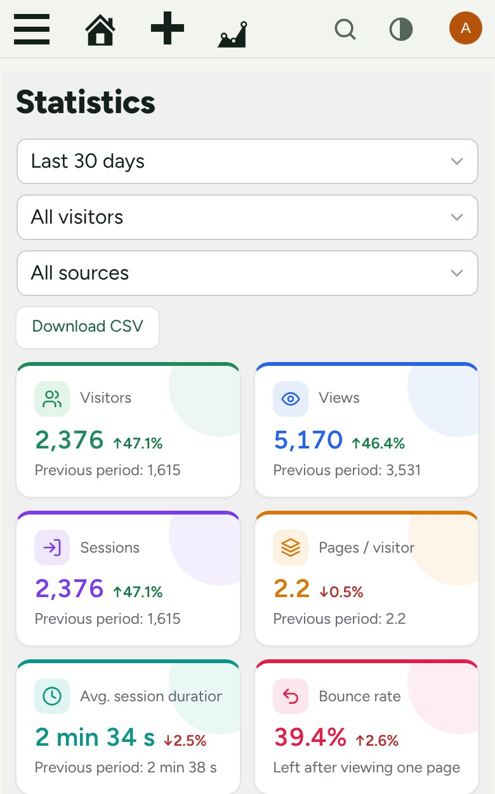 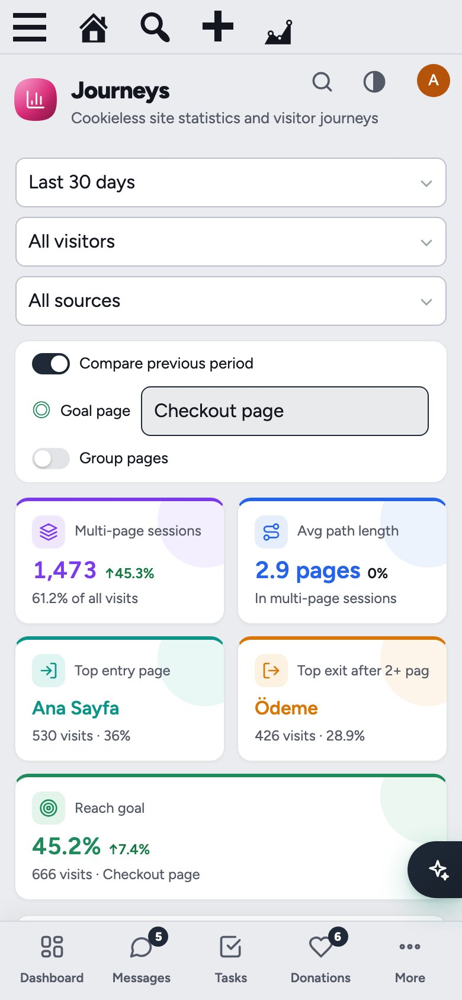 |

## Installation

Requirements: WordPress 6.4+, PHP 7.4+. WooCommerce is optional (needed only for donation events).

**From a zip**

1. Download `flx-analytics.zip` from the latest `flx-analytics-v*` release on the [Releases](https://github.com/FluxWP/fluxwp/releases) page.
2. **Plugins › Add New › Upload Plugin**, choose the zip, then **Activate**.

**With Flux Setup** (recommended on our sites)

**Setup › Packages** lists every FluxWP package; click **Install** next to *Flux Site Analytics*. Updates arrive the same way.

**First steps**

1. Open **Site Analytics › Settings** once. The fast collection endpoint is tested automatically; if it doesn't work, the plugin falls back to REST on its own.
2. Visit the site from a browser where you are not logged in. The visit shows up under **Site Analytics › Statistics** within a few minutes.
3. Check the funnel steps under **Settings › Funnels** (fix the donation page path if it isn't `/bagis/`).
4. Using LiteSpeed? No extra setting is needed; after changing settings run **Purge All**.
5. Coming from Koko Analytics? **Settings › Data › Import Koko Analytics data**, then remove Koko.

> ℹ️ Mention in your privacy policy that anonymous statistics are collected. The only cookie (`flxan_r`) is set for visitors who arrive through a referral link and holds nothing but the code.

## Use it with AI assistants (MCP)

Flux Site Analytics adds 15 tools to the site's MCP server (provided by **Flux SEO & MCP**) and to the **Flux AI** chat. Every tool accepts a date range, a visitor type (`seg`) and a referral code (`rc`).

| Tool | What it answers |
|---|---|
| `flxan_summary`, `flxan_timeseries`, `flxan_compare` | Totals, the trend, and two periods side by side |
| `flxan_pages`, `flxan_page`, `flxan_referrers`, `flxan_breakdown` | Pages, a single page, referring sites, channels, devices, countries, UTM |
| `flxan_events`, `flxan_realtime` | Clicks and donations, who is on the site now |
| `flxan_funnel`, `flxan_journeys` | Funnel steps by source, visitor paths and goal rate |
| `flxan_refs`, `flxan_segments`, `flxan_ref_save` | Referral link report, role breakdown, create or rename a referral link |

Connect an MCP client to `https://your-site/wp-json/flx-mcp/v1/mcp`. With Flux App installed, clients sign in with OAuth; otherwise create a key under **SEO & MCP › AI (MCP)**:

```bash
claude mcp add --transport http my-site https://example.org/wp-json/flx-mcp/v1/mcp --header "Authorization: Bearer YOUR_KEY"
```

Access requires the `flxan_view` capability. All tools are read-only except `flxan_ref_save`.

Example prompts:
- *"How many visitors did we have this week compared to last week, and which channel grew the most?"*
- *"Which referral link brought the most donations in October?"*
- *"Where do people drop out between the donation page and the payment? Break it down by device."*
- *"Create a referral link for the school campaign."*

## For developers

```php
// Server-side event (e.g. a sign-up), counted once per day per $uniq.
flxan_track_event( 'newsletter', 'footer-form', 0, 'user-42' );
```

```html
<a href="/rapor.pdf" data-flxan-event="report" data-flxan-param="2025">Annual report</a>
<script>flxan.track('share', 'instagram');</script>
```

- REST API under `/wp-json/flxan/v1` (`report`, `list`, `realtime`, `funnel`, `journeys`, `refs`, `dashboard`).
- Filters: `flxan_exclude_request`, `flxan_order_event_param`, `flxan_ref_cookie_days`, `flxan_can_manage_refs`.
- Full reference: [docs/flx-analytics/API.md](../../docs/flx-analytics/API.md). Setup notes in Turkish: [KURULUM.md](../../docs/flx-analytics/KURULUM.md). Release notes: [CHANGELOG.md](CHANGELOG.md).

### How it works

```
 Browser ── tracker.js (~2 KB, sendBeacon) ──▶ endpoint.php (no WordPress load)
                                                  │ appends to uploads/flx-analytics/buffer-*.ndjson
                                                  ▼
                             aggregator (WP-Cron + admin page open + request shutdown, every 10 min)
                                                  │ daily summary tables wp_flxan_*
                                                  ▼
             Statistics · Journeys · widgets · REST · MCP tools · Flux AI chat
```

## Roadmap

| | |
|---|---|
| ✅ | Cookieless counting, fast endpoint, Koko Analytics import |
| ✅ | Visitor types and roles, referral links, donation funnel by source |
| ✅ | World map, live panel, dashboard widgets |
| ✅ | Journeys and the visual funnel editor |
| ✅ | MCP and Flux AI tools, English and Turkish UI |
| ⬜ | More detailed e-commerce steps in funnels (e.g. add to cart) |
| ⬜ | Scheduled email reports |
| ⬜ | Goal alerts (e.g. a sudden drop in the funnel) |

## License

Flux Site Analytics is released under the [GNU General Public License v2 or later](https://www.gnu.org/licenses/gpl-2.0.html). It was inspired by [Koko Analytics](https://github.com/ibericode/koko-analytics) but written from scratch; no code was copied.

Made by FluxWP.
