<div align="center">

[English](README.md) · **Türkçe**


# Flux Analytics

**Kim geldi, nereden geldi, bağışa kadar ne kadar ilerledi: kişisel veri toplamadan görün.**<br>
WordPress için gizlilik öncelikli istatistik eklentisi: ziyaretçiler, sayfalar, kaynaklar, bağış hunisi, ziyaretçi yolculukları, referans bağlantıları ve canlı görünüm. Veriler kendi veritabanınızda kalır; yapay zekâ asistanları MCP ile okuyabilir.

[](https://wordpress.org)
[](https://www.php.net)
[](https://www.gnu.org/licenses/gpl-2.0.html)


[Özellikler](#özellikler) · [Ekran görüntüleri](#ekran-görüntüleri) · [Kurulum](#kurulum) · [Yapay zekâ ve MCP](#yapay-zekâ-asistanlarıyla-kullanım-mcp) · [Geliştiriciler için](#geliştiriciler-için) · [Yol haritası](#yol-haritası)

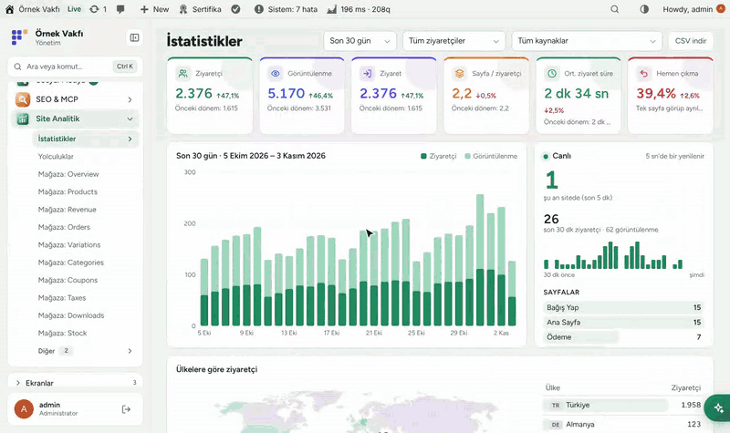

</div>

---

## Neden Flux Analytics?

Google Analytics ağır, çerez uyarısı ister ve ziyaretçi verisini üçüncü tarafa gönderir. Basit sayaçlar ise görüntülenmede kalır. Bir derneğin ihtiyacı ikisinin arası: *kaç kişi geldi, nereden geldi ve kaçı gerçekten bağış yaptı?*

- 🔒 **Kişisel veri yok.** IP adresi ya da tarayıcı parmak izi saklanmaz. Ziyaretçi yalnız aynı gün içinde, ertesi gün silinen rastgele bir anahtarla tanınır. Yönlendirilmiş adres yalnız bağlantı Cloudflare'den geliyorsa okunur. Çerez uyarısı gerekmez.
- 💚 **Bağış odaklı.** Hazır huni her ziyareti ilk sayfadan bağış sayfasına, ödeme formuna, "Ödeme yap" tıklamasına ve teşekkür sayfasına kadar izler.
- 🧭 **Sayıların ötesinde yolculuklar.** İnsanların hangi sırayla gezdiğini, nerede bıraktığını ve hangi yolların hedefe ulaştığını görün.
- 🔗 **Gönüllüler için referans bağlantıları.** Her gönüllüye ya da kampanyaya bir `?r=kod` bağlantısı verin; getirdiği ziyaretçileri, ziyaretleri ve bağışları görün.
- ⚡ **Hızlı ve önbellek dostu.** ~2 KB'lık sayaç ve WordPress'i bile yüklemeyen toplama ucu. LiteSpeed ve diğer sayfa önbellekleriyle çalışır. Sayaç kısa ömürlü bir belirteç taşır (12 saatlik pencere; bir önceki pencere de geçerlidir), bu yüzden kopyalanmış bir Referer sayım göndermeye yetmez.
- 🤖 **Yapay zekâya hazır.** 15 MCP aracı sayesinde Flux AI, Claude ya da herhangi bir MCP istemcisi "bu ay bağışçılarımız nereden geldi?" sorusunu yanıtlar.
- 🌐 **Türkçe ve İngilizce**, her kullanıcının WordPress diline göre.

## Özellikler

### İstatistikler
- Altı gösterge: ziyaretçi, görüntülenme, ziyaret, ziyaretçi başına sayfa, ortalama ziyaret süresi ve hemen çıkma; her biri önceki dönemle karşılaştırmalı.
- Tarih aralıkları (bugün, 7/30/90 gün, aylar, yıllar, özel), günlük grafik ve 5 saniyede bir yenilenen **Canlı** panel.
- **Dünya haritası** ve ülke listesi. Ülke IP'den değil, tarayıcının saat diliminden çıkarılır.
- Sayfalar (tıklayınca kendi grafiği), yönlendiren siteler, kanallar (arama, sosyal, yapay zekâ asistanları, e-posta, reklam, kampanya, referans bağlantısı), cihaz, tarayıcı, sistem, dil, UTM kampanyaları, 404 sayfaları ve CSV.
- Her ekranda **ziyaretçi türü süzgeci**: tümü, yalnız dışarıdan gelenler, giriş yapanlar ya da tek bir rol.

### Bağış hunisi
- Varsayılan adımlar: *siteye giriş → bağış sayfası → ödeme sayfası → formu doldurmaya başladı → "Ödeme yap"a bastı → bağış tamamlandı*. Ödeme adımı olayları klasik ve blok ödemede kendiliğinden gönderilir.
- Huniyi **kanala, yönlendiren siteye, referans koduna, role ya da ülkeye göre** kırın.
- **Görsel huni düzenleyicisi:** en fazla 5 huni × 10 adım; her adım bir sayfa, bir olay ya da siteye giriş. Sürükleyerek sıralayın, sayfa ve olayları önerilerden seçin.

### Yolculuklar
- Giriş sayfasından itibaren adım adım akış (2–6 adım): her kutuda kaç ziyaret var, ne kadarı orada bitti.
- En sık izlenen yollar; payı, önceki döneme göre değişimi ve hedefe ulaşma oranıyla. Başlangıç sayfası, bitiş sayfası ya da hedefe göre süzün.
- "Sayfaları grupla", `/haber/...` gibi alt sayfaları tek kutuda toplar.

### Referans bağlantıları
- Tek tıkla adlı bağlantı oluşturun (`?r=ayse`). Gelen kişiye yalnız kodu tutan 30 günlük birinci taraf çerez konur; sonraki sayfaları, sonraki günleri ve bağışı o koda sayılır.
- Bağlantı başına: ziyaretçi, ziyaret, ziyaret başına sayfa, ortalama süre, hunide ulaşılan en ileri adım ve bağışlar (adet ve tutar). Satıra tıklayınca bütün ekran o bağlantıyla gelenlere süzülür.

### Olaylar
- Kendiliğinden: dış bağlantılar, dosya indirmeler, telefon, e-posta ve WhatsApp tıklamaları, site içi arama ve ödenen WooCommerce bağışları (tür ve tutar, sipariş başına bir kez).
- Kendi olaylarınız: herhangi bir öğede `data-flxan-event="ad"`, JavaScript'te `flxan.track()` ya da PHP'de `flxan_track_event()`.

### WordPress'in içinde
- Başlangıç ekranında dört **widget**: canlı ziyaretçiler, ziyaretçiler, trafik kaynakları ve referanslar, bağış hunisi.
- Yazı ve sayfa listelerinde "Görüntülenme" sütunu, yönetim çubuğunda sayfanın görüntülenmesi ve iki kısa kod: `[flx_analiz_populer]` (en çok okunanlar) ve `[flx_analiz_sayac]` (sayaç).
- Koko Analytics'in geçmiş verisini, onun tablolarına dokunmadan aktarır.
- Kontrollerini **Sistem Kontrolü**'ne (Flux Speed), `flxan_view` yetkisini Flux Roles'e kaydeder.

## Ekran görüntüleri

| Özet | Yolculuklar |
|---|---|
| 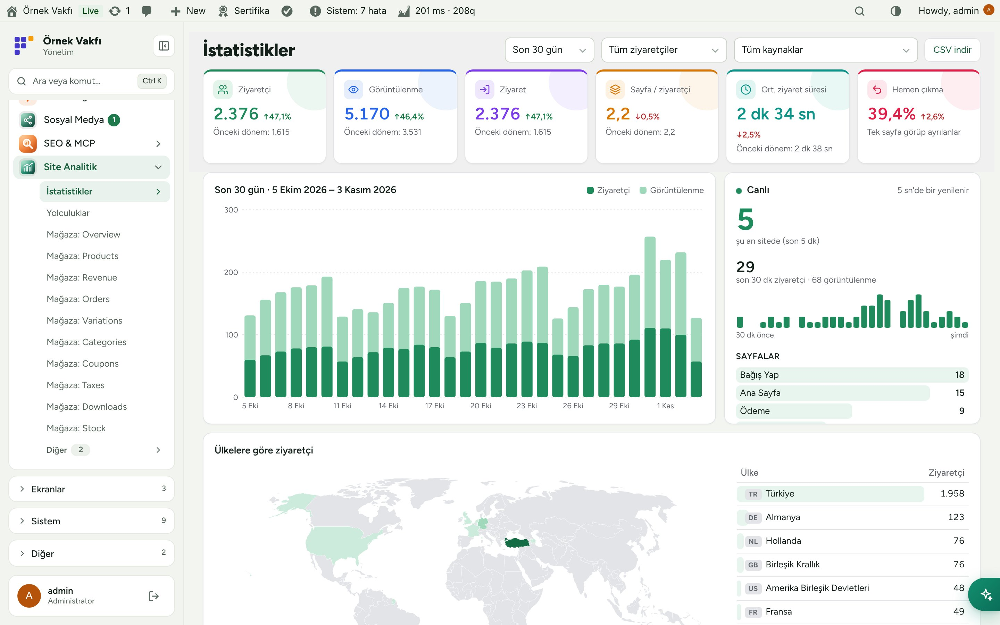 | 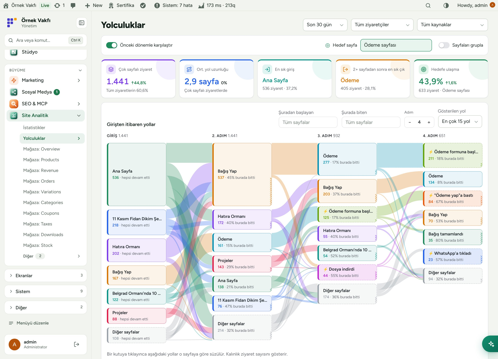 |
| **Bağış hunisi** | **Görsel huni düzenleyicisi** |
| 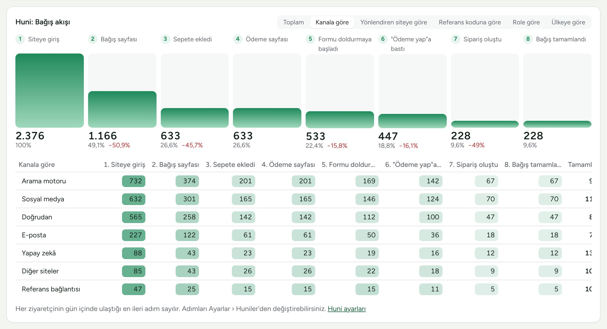 | 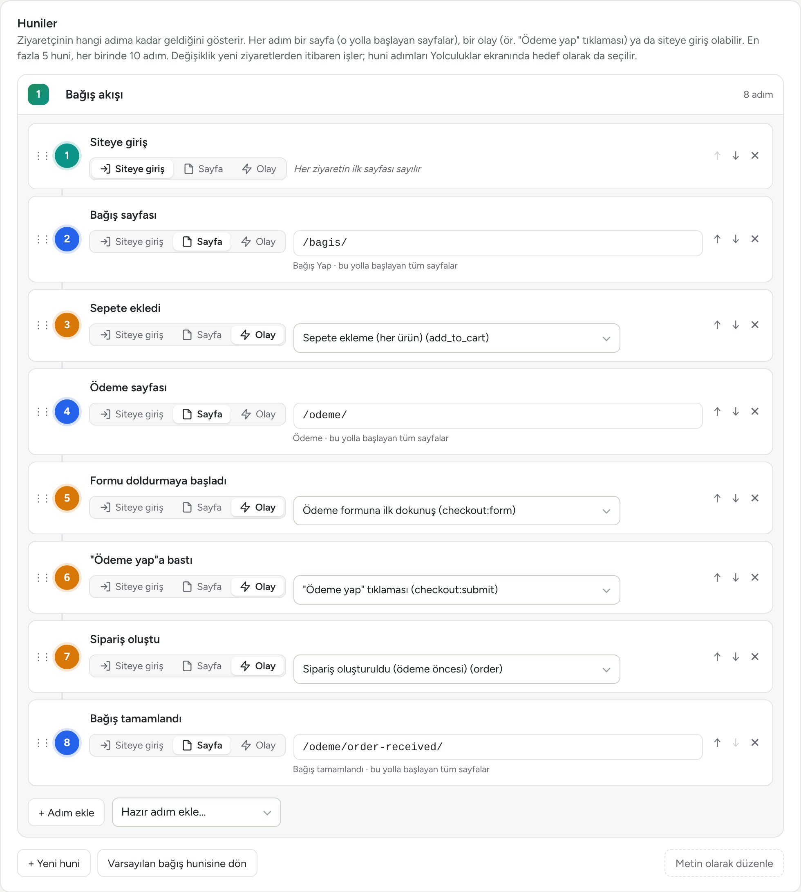 |
| **Referans bağlantıları, kaynaklar ve roller** | **Ülkelere göre ziyaretçi** |
| 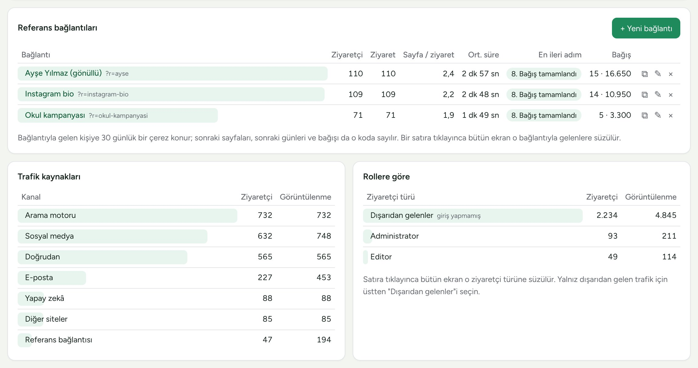 | 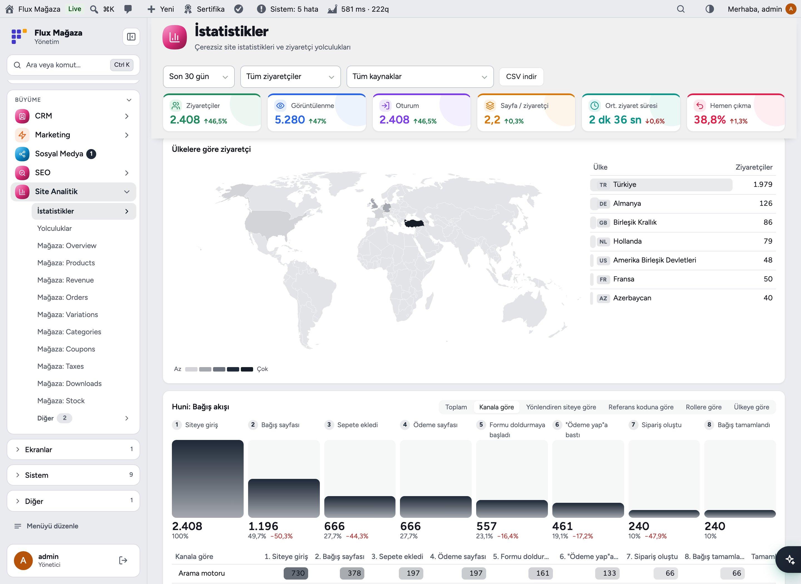 |
| **Sayfalar ve yönlendiren siteler** | **Tıklamalar ve dönüşümler** |
| 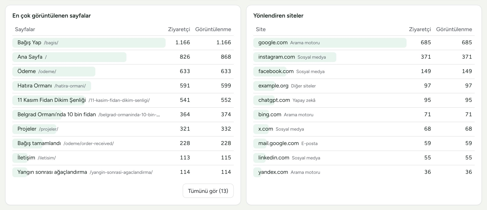 | 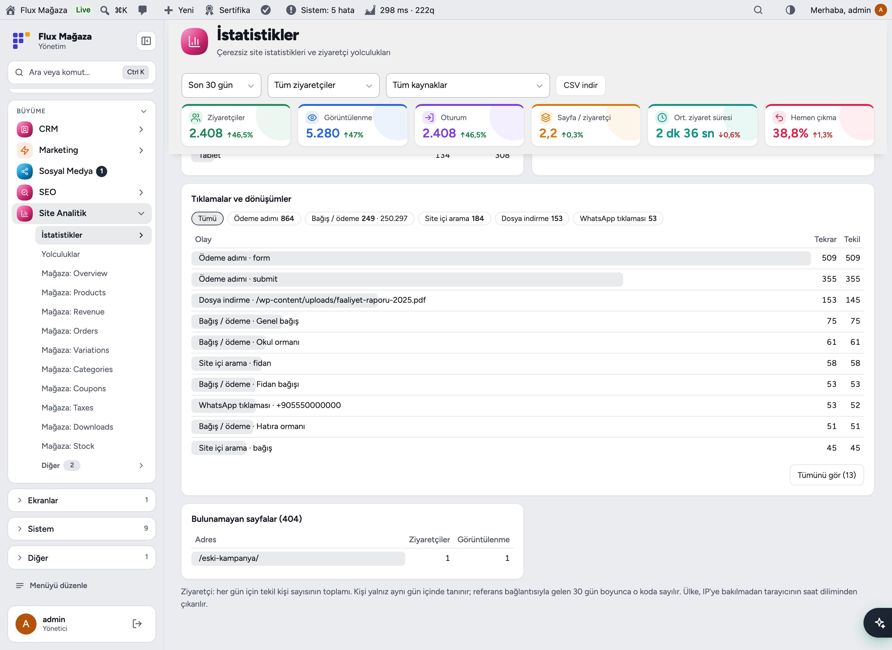 |
| **Başlangıç widget'ları** | **Mobil** |
| 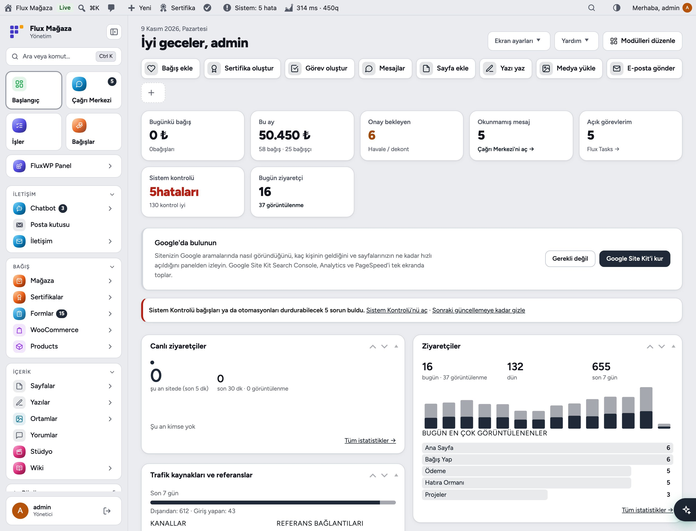 | 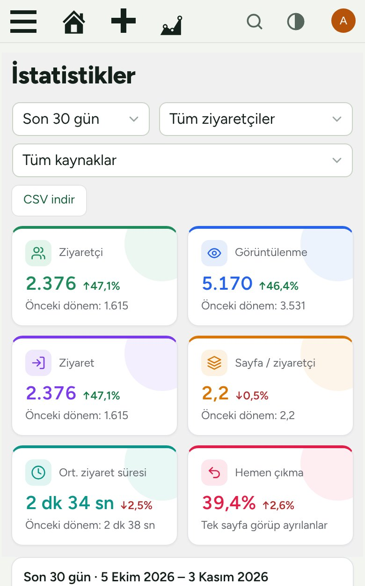 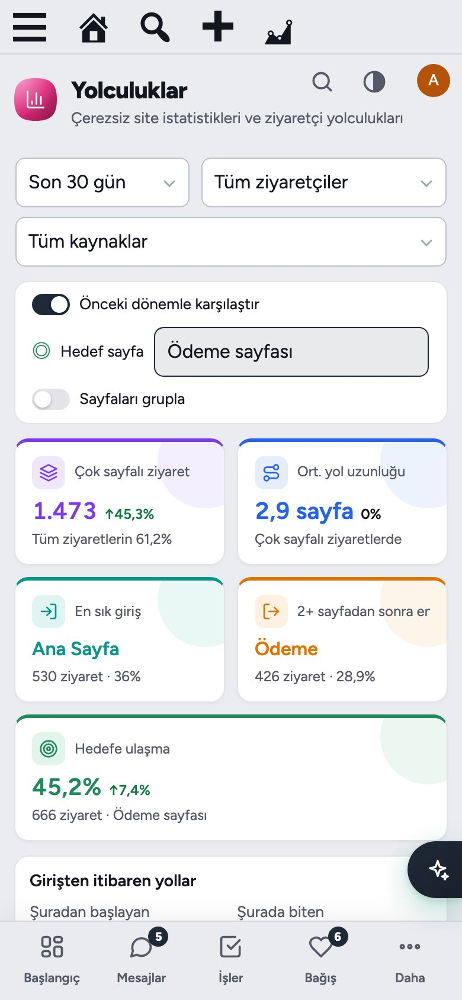 |

## Kurulum

Gereksinimler: WordPress 6.4+, PHP 7.4+. WooCommerce isteğe bağlı (yalnız bağış olayları için gerekir).

**Zip ile**

1. [Releases](https://github.com/FluxWP/fluxwp/releases) sayfasında en son `flx-analytics-v*` sürümünden `flx-analytics.zip`'i indirin.
2. **Eklentiler › Yeni ekle › Eklenti yükle**, zip'i seçin, sonra **Etkinleştir**.

**FluxWP Panel ile** (sitelerimizde önerilen)

**FluxWP Panel › Paketler** tüm FluxWP paketlerini listeler; *Flux Analytics*'in yanındaki **Kur**'a basın. Güncellemeler de buradan gelir.

**İlk adımlar**

1. **Site Analitik › Ayarlar**'ı bir kez açın. Hızlı toplama ucu kendiliğinden test edilir; çalışmazsa eklenti kendisi REST'e geçer.
2. Siteyi giriş yapmadığınız bir tarayıcıdan açın. Ziyaret birkaç dakika içinde **Site Analitik › İstatistikler**'de görünür.
3. **Ayarlar › Huniler**'de huni adımlarına bakın (bağış sayfanızın yolu `/bagis/` değilse düzeltin).
4. LiteSpeed kullanıyorsanız ek ayar gerekmez; ayar değiştirdikten sonra **Purge All** yapın.
5. Koko Analytics'ten mi geçiyorsunuz? **Ayarlar › Veri › Koko Analytics verisini aktar**, sonra Koko'yu kaldırın.

> ℹ️ Gizlilik metninize anonim istatistik toplandığını yazın. Tek çerez (`flxan_r`) yalnız referans bağlantısıyla gelen ziyaretçiye konur ve koddan başka bir şey tutmaz.

Ayrıntılı kurulum notları: [KURULUM.md](../../docs/flx-analytics/KURULUM.md).

## Yapay zekâ asistanlarıyla kullanım (MCP)

Flux Analytics, sitenin MCP sunucusuna (**Flux AI & MCP** sağlar) ve **Flux AI** sohbetine 15 araç ekler. Her araç tarih aralığı, ziyaretçi türü (`seg`) ve referans kodu (`rc`) alır.

| Araç | Neyi yanıtlar |
|---|---|
| `flxan_summary`, `flxan_timeseries`, `flxan_compare` | Toplamlar, gidişat ve iki dönemin karşılaştırması |
| `flxan_pages`, `flxan_page`, `flxan_referrers`, `flxan_breakdown` | Sayfalar, tek sayfa, yönlendiren siteler, kanallar, cihazlar, ülkeler, UTM |
| `flxan_events`, `flxan_realtime` | Tıklamalar ve bağışlar, şu an sitede kim var |
| `flxan_funnel`, `flxan_journeys` | Kaynağa göre huni adımları, ziyaretçi yolları ve hedefe ulaşma |
| `flxan_refs`, `flxan_segments`, `flxan_ref_save` | Referans raporu, rollere göre dağılım, referans bağlantısı oluşturma/adlandırma |

MCP istemcisine `https://siteniz/wp-json/flx-mcp/v1/mcp` adresini verin. Flux App kuruluysa istemci OAuth ile giriş yapar; değilse **Flux AI & MCP › MCP** altında anahtar oluşturun:

```bash
claude mcp add --transport http sitem https://example.org/wp-json/flx-mcp/v1/mcp --header "Authorization: Bearer ANAHTAR"
```

Erişim için `flxan_view` yetkisi gerekir. `flxan_ref_save` dışındaki tüm araçlar salt okunurdur.

Örnek istekler:
- *"Bu hafta geçen haftaya göre kaç ziyaretçimiz oldu, en çok hangi kanal büyüdü?"*
- *"Ekim'de en çok bağışı hangi referans bağlantısı getirdi?"*
- *"Bağış sayfasıyla ödeme arasında insanlar nerede bırakıyor? Cihaza göre kır."*
- *"Okul kampanyası için bir referans bağlantısı oluştur."*

## Geliştiriciler için

```php
// Sunucu tarafı olay (ör. bülten kaydı); $uniq başına günde bir kez sayılır.
flxan_track_event( 'bulten', 'alt-form', 0, 'user-42' );
```

```html
<a href="/rapor.pdf" data-flxan-event="rapor" data-flxan-param="2025">Faaliyet raporu</a>
<script>flxan.track('paylas', 'instagram');</script>
```

- REST API `/wp-json/flxan/v1` altında (`report`, `list`, `realtime`, `funnel`, `journeys`, `refs`, `dashboard`).
- Filtreler: `flxan_exclude_request`, `flxan_order_event_param`, `flxan_ref_cookie_days`, `flxan_can_manage_refs`.
- Tam başvuru: [docs/flx-analytics/API.md](../../docs/flx-analytics/API.md). Sürüm notları: [CHANGELOG.md](CHANGELOG.md).

### Nasıl çalışır

```
 Tarayıcı ── tracker.js (~2 KB, sendBeacon) ──▶ endpoint.php (WordPress yüklenmez)
                                                  │ uploads/flx-analytics/buffer-*.ndjson'a ekler
                                                  ▼
                     toplayıcı (WP-Cron + panel açılışı + istek sonu, 10 dk arayla)
                                                  │ günlük özet tabloları wp_flxan_*
                                                  ▼
       İstatistikler · Yolculuklar · widget'lar · REST · MCP araçları · Flux AI sohbeti
```

## Yol haritası

| | |
|---|---|
| ✅ | Çerezsiz sayım, hızlı toplama ucu, Koko Analytics aktarımı |
| ✅ | Ziyaretçi türleri ve roller, referans bağlantıları, kaynağa göre bağış hunisi |
| ✅ | Dünya haritası, canlı panel, Başlangıç widget'ları |
| ✅ | Yolculuklar ve görsel huni düzenleyicisi |
| ✅ | MCP ve Flux AI araçları, Türkçe ve İngilizce arayüz |
| ⬜ | Hunilerde daha ayrıntılı e-ticaret adımları (ör. sepete ekleme) |
| ⬜ | Zamanlanmış e-posta raporları |
| ⬜ | Hedef uyarıları (ör. hunide ani düşüş) |

## Lisans

Flux Analytics [GNU Genel Kamu Lisansı v2 veya üzeri](https://www.gnu.org/licenses/gpl-2.0.html) ile yayınlanır. [Koko Analytics](https://github.com/ibericode/koko-analytics)'ten esinlenilerek sıfırdan yazıldı; kod kopyalanmadı.

FluxWP tarafından geliştirilmiştir.
