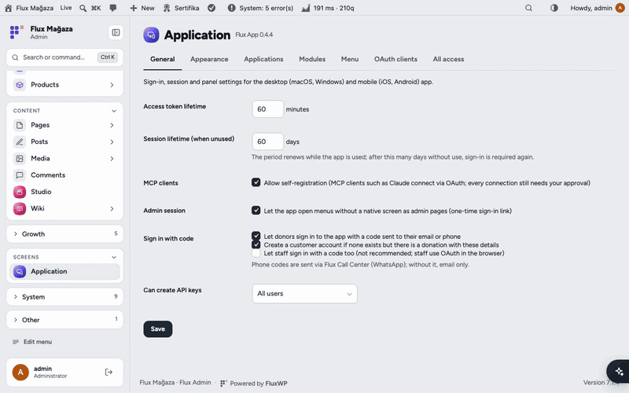
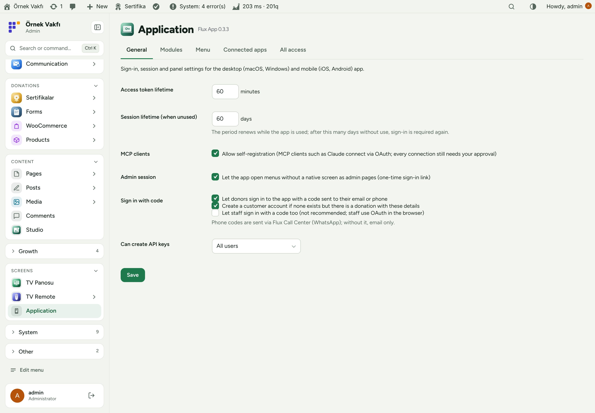
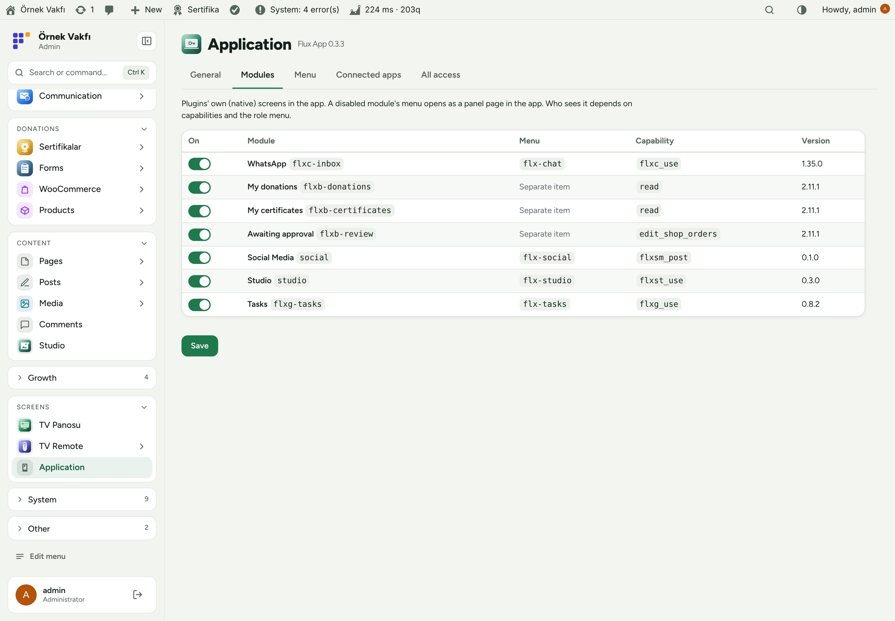
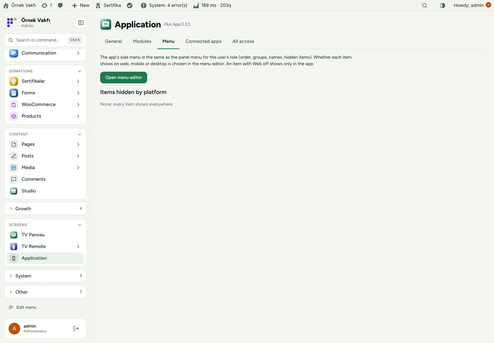
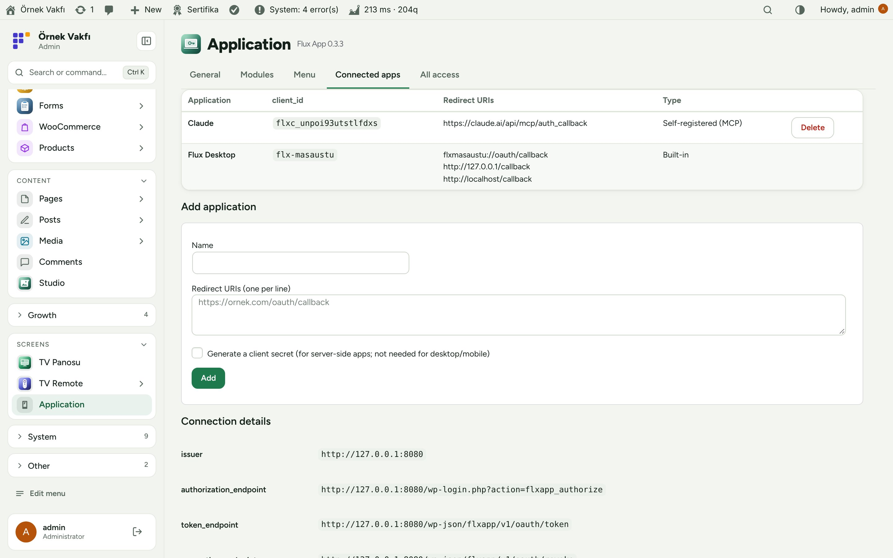
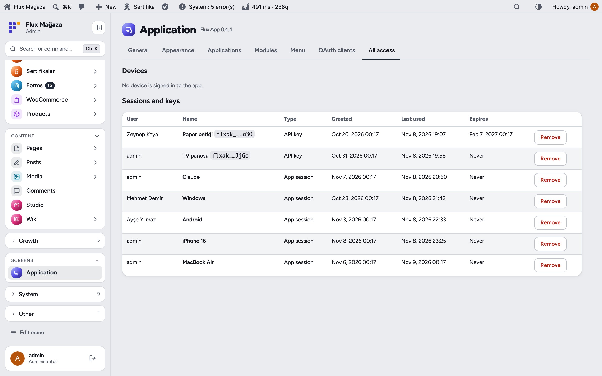
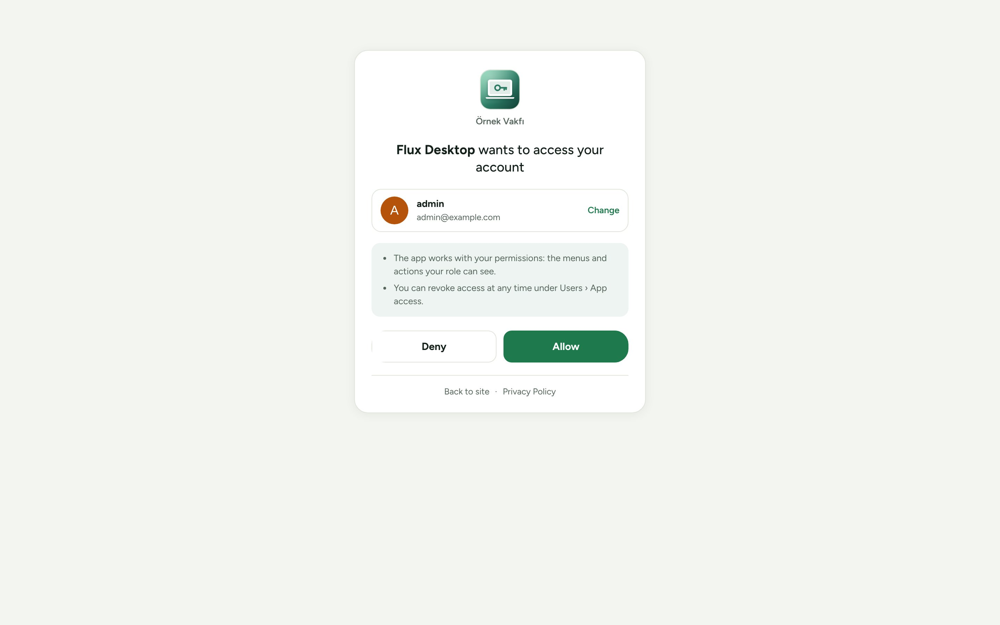
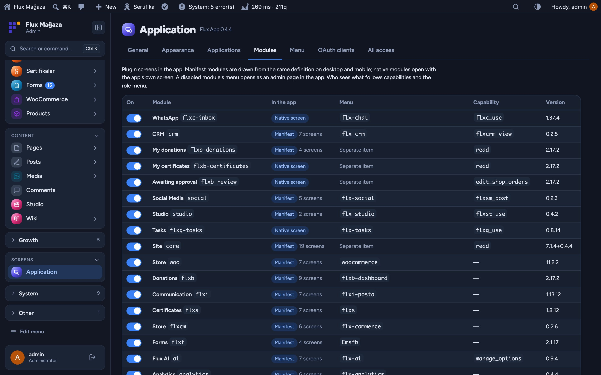
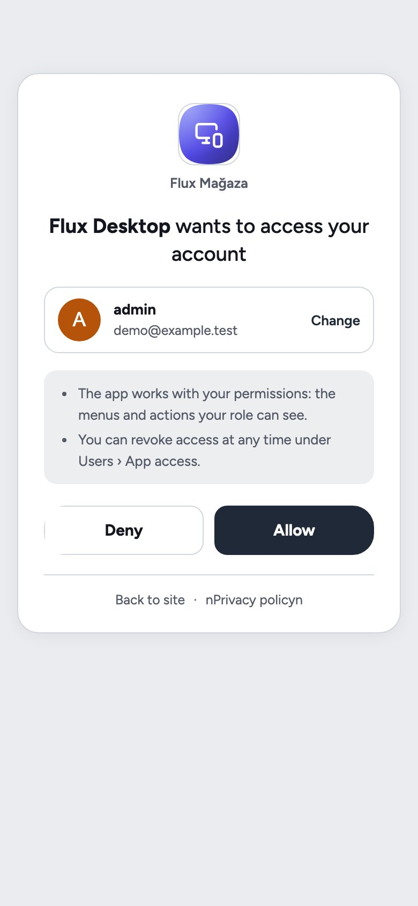

**English** · [Türkçe](README.tr.md)

# Flux App

**Sign-in and API layer for the FluxWP desktop and mobile app, and OAuth for AI assistants.** 
Flux App lets the FluxWP desktop and mobile app (and MCP clients such as Claude) sign in to the site with "Log in": OAuth 2.0 with PKCE, personal API keys, and one-time codes for donors. It also tells the app what to show: a role-based menu, native screens registered by the other FluxWP plugins, counters and shortcuts, all managed from one Application page.

[Features](#features) · [Screenshots](#screenshots) · [Installation](#installation) · [For developers](#for-developers) · [Roadmap](#roadmap)

---

## Why Flux App?

A phone or desktop app for a WordPress site usually means application passwords pasted by hand, or a separate backend. Flux App keeps WordPress the single source:

- 🔐 **Real sign-in.** The app opens the site's own login and a clear consent card; no passwords stored in the app, tokens can be revoked one by one.
- 🧭 **The right menu for each person.** The app receives the admin menu for the user's role and platform, so staff, managers and donors each see their own.
- 📱 **Native where it matters.** Plugins like Flux Call Center, Flux Donation and Flux Studio register native screens; everything else opens as an embedded admin page without the admin chrome.
- 🤖 **AI assistants included.** MCP clients discover the OAuth server and register themselves, so Claude can connect to Flux SEO with "Log in" instead of a copied key.

## Features

### Sign-in
- OAuth 2.0 authorisation code + PKCE (S256) with rotating refresh tokens and revoke; built-in client "Flux Desktop" (`flxmasaustu://` and loopback redirects).
- RFC 8414 / 9728 metadata and dynamic client registration for MCP clients (off by default; turn it on under Application settings). The Flux SEO endpoint accepts these tokens when the token's scope includes `mcp`.
- Personal API keys (`Bearer flxak_…`), with or without expiry.
- **Donor sign-in** with a one-time code by WhatsApp (Flux Call Center) or e-mail; a customer account is created for donors who have orders.
- **Own phone number:** a signed-in donor confirms a number with a code sent only to that phone and saves it on the account. Staff numbers stay with an administrator.
- One-time admin session from the app (`/session`), and `X-FluxWP-Token` fallback for hosts that drop the `Authorization` header.

### What the app shows
- `/flxapp/v1/me`: user, role-based admin menu, native modules, counters and the mobile bottom-bar shortcuts from Flux Admin.
- **Modules:** native screens registered with `flxapp_modules`, each one can be switched off.
- **Menu per platform:** Flux Admin's menu editor marks items for Web, Mobile and Desktop; the app sends `X-FluxWP-Platform` and gets only its own.
- Admin pages opened in the app hide the top bar, side menu and footer.
- **One contract for desktop and mobile:** `/app/bootstrap` (discovery), `/config` (theme and shell per platform), `/manifest` (plugin screens as JSON), `/sync`, `/prefs`, `/devices` and Expo push. Built-in manifests for WordPress, WooCommerce and Flux Donate donors.
- **White-label:** brand OAuth clients (`app_clients`, written by the preset) and an option to allow only the site's own app.

### Application page
- Tabs: General, Appearance, Apps, Modules, Menu, OAuth clients, All access; people see and revoke their own devices, sessions and keys under Users › App access.

## Screenshots

| General settings | Native modules |
|---|---|
|  |  |
| **Menu per role and platform** | **Connected apps** |
|  |  |
| **All sessions and keys** | **Consent screen** |
|  |  |
| **Dark mode with Flux Admin** | **Consent on a phone** |
|  |  |

## Installation

Requirements: WordPress 6.4+, PHP 7.4+. The FluxWP desktop/mobile app or an MCP client. Optional: Flux Admin (menu per platform, bottom bar), Flux Call Center (codes by WhatsApp), Flux Roles.

**From a zip**

1. Download `flx-app.zip` from the latest `flx-app-v*` release on the [Releases](https://github.com/FluxWP/fluxwp/releases) page.
2. **Plugins › Add New › Upload Plugin**, choose the zip, then **Activate**.

**With FluxWP Panel** (recommended on our sites)

**FluxWP Panel › Packages** lists every FluxWP package; click **Install** next to *Flux App*. Updates arrive the same way.

**First steps**

1. Activate Flux App; **Application** appears in the admin menu. The defaults work: access 60 min, session 60 days, MCP self-registration off.
2. In the app, enter the site address and press **Log in**: the site's login and consent screen open, press **Allow**.
3. For Claude and other MCP clients, turn on self-registration, give them `https://your-site/wp-json/flx-mcp/v1/mcp` and sign in, or create an API key.

> ℹ️ Resetting a password or deleting a user closes all of that person's app sessions and keys. If LiteSpeed caches the `.well-known/oauth-*` URLs, purge the cache.

Full setup notes (Turkish): [KURULUM.md](../../docs/flx-app/KURULUM.md) · API reference: [API.md](../../docs/flx-app/API.md) · Release notes: [CHANGELOG.md](CHANGELOG.md)

## For developers

- Register a native screen: `add_filter( 'flxapp_modules', … )` with `title`, `menu`, `api`, `icon`, `version`.
- Register app screens as JSON: `add_filter( 'flxapp_manifest', … )` with `flxapp_manifest_file()`; send notifications with `do_action( 'flxapp_push', $user_ids, $message )`.
- Endpoints `/flxapp/v1/app/bootstrap`, `/config`, `/manifest`, `/me`, `/me/phone`, `/sync`, `/prefs`, `/devices`, `/session`, `/settings/<option>`, `/otp/*`, `/oauth/*`; see [API.md](../../docs/flx-app/API.md).

## Roadmap

| | |
|---|---|
| ✅ | OAuth 2.0 + PKCE, API keys and MCP discovery |
| ✅ | Donor sign-in with one-time codes (saved phone or own email; orders do not open an account). A signed-in donor can confirm and save a phone number |
| ✅ | Role-based menu and native modules |
| ✅ | Menu per platform and the Application page |
| ⬜ | Push notifications |
| ⬜ | Passkey sign-in |

## License

Flux App Released under the [GNU General Public License v2 or later](https://www.gnu.org/licenses/gpl-2.0.html).

Made by FluxWP.
