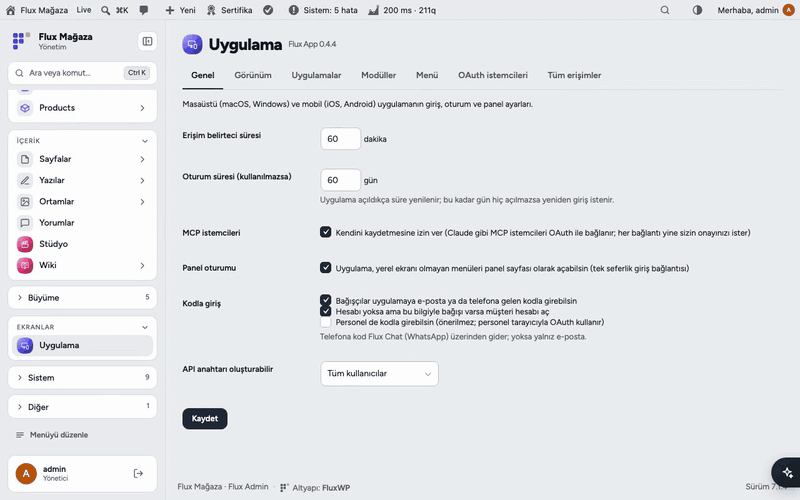
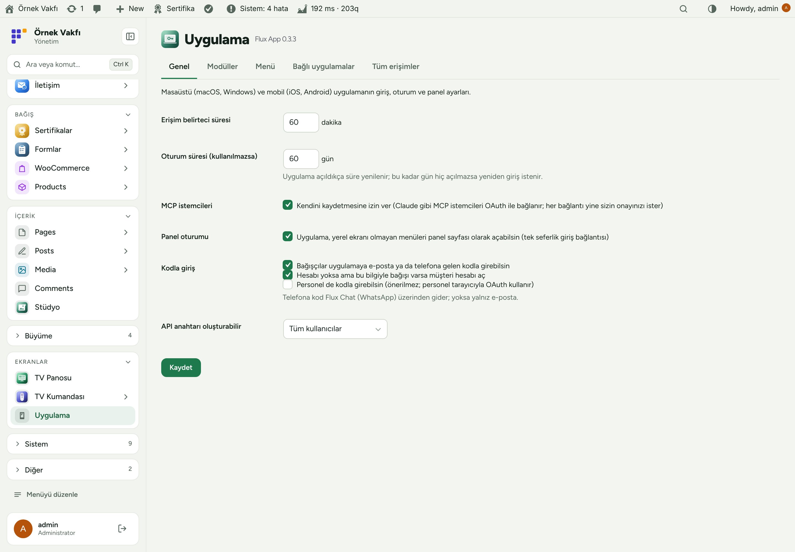
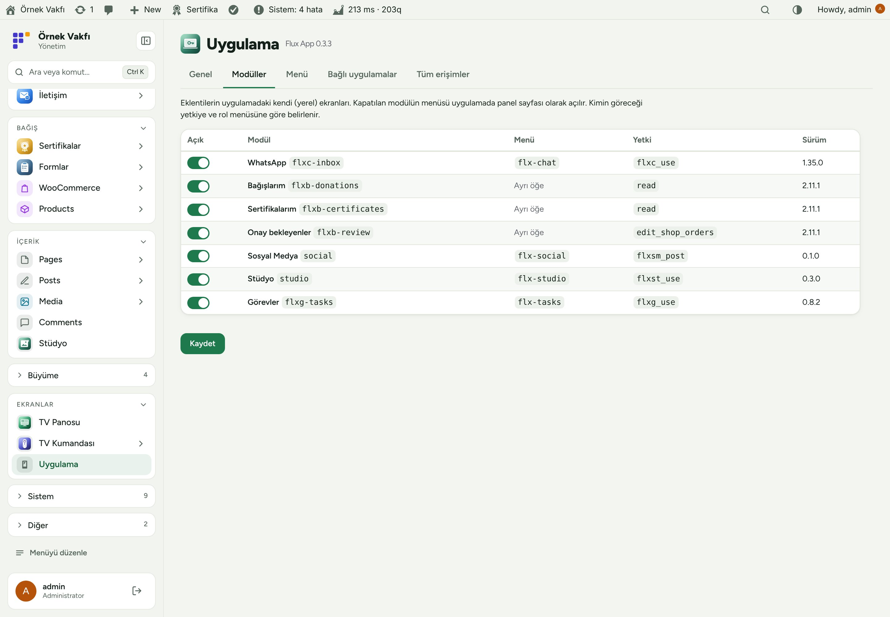
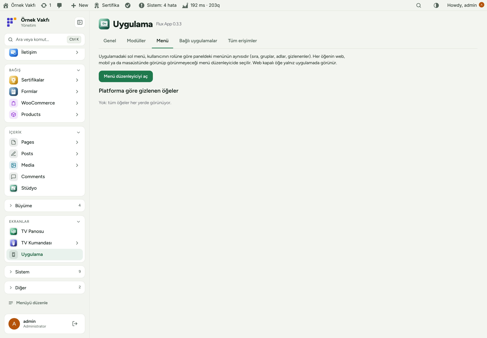
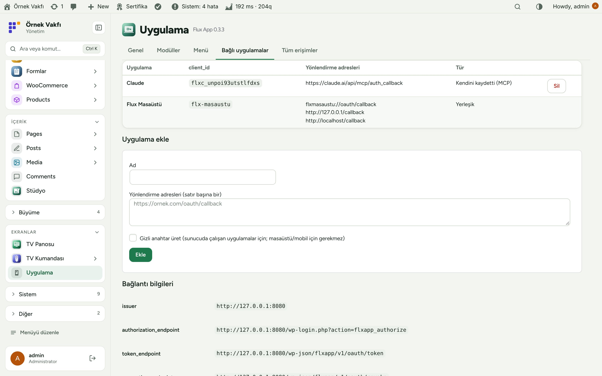
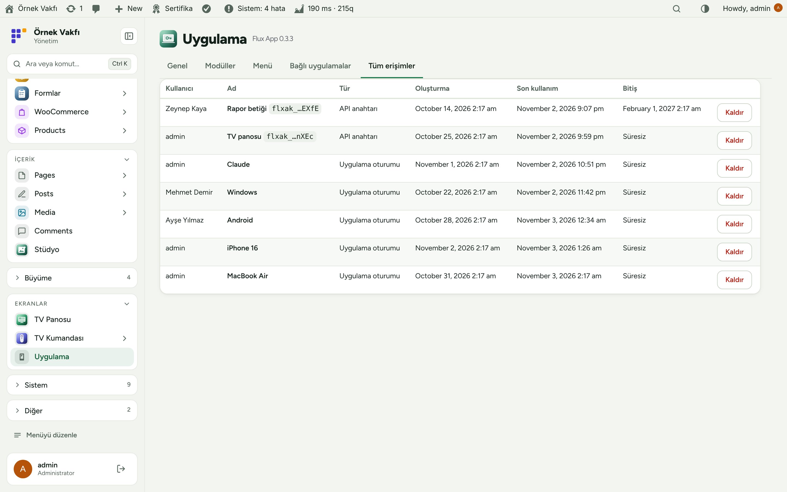
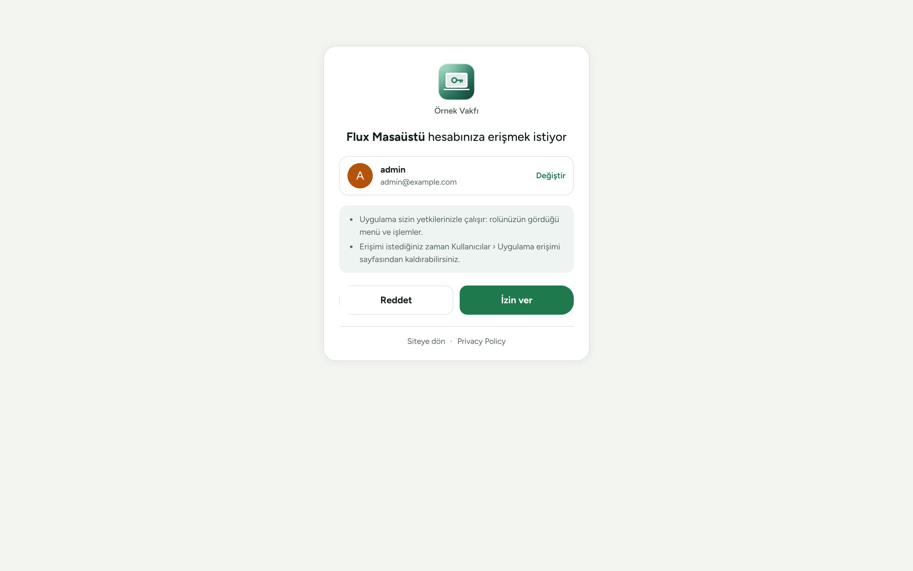
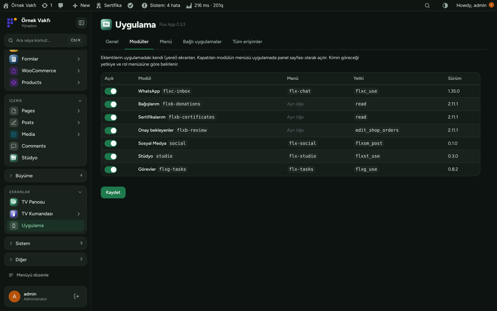
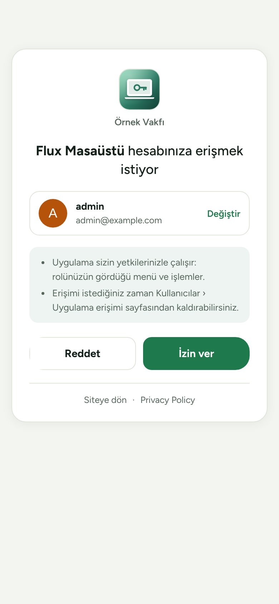

[English](README.md) · **Türkçe**

# Flux App

**FluxWP masaüstü ve mobil uygulaması için giriş ve API katmanı; yapay zekâ asistanları için OAuth.** 
Flux App, FluxWP masaüstü ve mobil uygulamasının (ve Claude gibi MCP istemcilerinin) siteye "Giriş yap" ile bağlanmasını sağlar: PKCE'li OAuth 2.0, kişisel API anahtarları ve bağışçılar için tek kullanımlık kod. Uygulamaya ne göstereceğini de söyler: rol bazlı menü, diğer FluxWP eklentilerinin kaydettiği yerel ekranlar, sayaçlar ve kısayollar; hepsi tek Uygulama sayfasından yönetilir.

[Özellikler](#özellikler) · [Ekran görüntüleri](#ekran-görüntüleri) · [Kurulum](#kurulum) · [Geliştiriciler için](#geliştiriciler-için) · [Yol haritası](#yol-haritası)

---

## Neden Flux App?

Bir WordPress sitesi için telefon ya da masaüstü uygulaması genelde elle yapıştırılan uygulama parolaları ya da ayrı bir arka uç demektir. Flux App tek kaynağı WordPress'te tutar:

- 🔐 **Gerçek giriş.** Uygulama sitenin kendi giriş ekranını ve açık bir izin kartını açar; uygulamada parola saklanmaz, belirteçler tek tek iptal edilir.
- 🧭 **Herkese doğru menü.** Uygulama kullanıcının rolüne ve platformuna göre panel menüsünü alır; personel, idareci ve bağışçı kendi ekranını görür.
- 📱 **Gereken yerde yerel ekran.** Flux Chat, Flux Donate ve Flux Studio gibi eklentiler yerel ekran kaydeder; geri kalan her şey panel çerçevesi olmadan gömülü sayfa olarak açılır.
- 🤖 **Yapay zekâ asistanları dahil.** MCP istemcileri OAuth sunucusunu bulur ve kendini kaydeder; Claude, Flux SEO'ya kopyalanmış anahtar yerine "Giriş yap" ile bağlanır.

## Özellikler

### Giriş
- Dönen yenileme belirteçli ve iptalli OAuth 2.0 yetkilendirme kodu + PKCE (S256); yerleşik "Flux Masaüstü" istemcisi (`flxmasaustu://` ve loopback yönlendirme).
- MCP istemcileri için RFC 8414 / 9728 metadata ve dinamik istemci kaydı; Flux SEO uç noktası bu belirteçleri kabul eder.
- Süreli ya da süresiz kişisel API anahtarları (`Bearer flxak_…`).
- **Bağışçı girişi:** WhatsApp (Flux Chat) ya da e-postayla tek kullanımlık kod; siparişi olan bağışçıya müşteri hesabı açılır.
- Uygulamadan tek seferlik panel oturumu (`/session`); `Authorization` başlığını düşüren sunucular için `X-FluxWP-Token`.

### Uygulama ne gösterir
- `/flxapp/v1/me`: kullanıcı, rol bazlı panel menüsü, yerel modüller, sayaçlar ve Flux Admin'deki mobil alt bar kısayolları.
- **Modüller:** `flxapp_modules` ile kaydedilen yerel ekranlar; her biri kapatılabilir.
- **Platforma göre menü:** Flux Admin menü düzenleyicisinde öğeler Web, Mobil ve Masaüstü için işaretlenir; uygulama `X-FluxWP-Platform` gönderir, yalnız kendisininkini alır.
- Uygulamada açılan panel sayfalarında üst çubuk, sol menü ve altlık gizlenir.

### Uygulama sayfası
- Sekmeler: Genel, Modüller, Menü, Bağlı uygulamalar, Tüm erişimler; kişiler kendi oturum ve anahtarlarını Kullanıcılar › Uygulama erişimi'nde görür ve kaldırır.

## Ekran görüntüleri

| Genel ayarlar | Yerel modüller |
|---|---|
|  |  |
| **Rol ve platforma göre menü** | **Bağlı uygulamalar** |
|  |  |
| **Tüm oturumlar ve anahtarlar** | **İzin ekranı** |
|  |  |
| **Flux Admin ile koyu tema** | **Telefonda izin ekranı** |
|  |  |

## Kurulum

Gereksinimler: WordPress 6.4+, PHP 7.4+. FluxWP masaüstü/mobil uygulaması ya da bir MCP istemcisi. İsteğe bağlı: Flux Admin (platforma göre menü, alt bar), Flux Chat (WhatsApp ile kod), Flux Roles.

**Zip ile**

1. [Releases](https://github.com/FluxWP/fluxwp/releases) sayfasında en son `flx-app-v*` sürümünden `flx-app.zip`'i indirin.
2. **Eklentiler › Yeni ekle › Eklenti yükle**, zip'i seçin, sonra **Etkinleştir**.

**Flux Updater ile** (sitelerimizde önerilen)

**Başlangıç › Güncellemeler** tüm FluxWP paketlerini listeler; *Flux App* satırındaki **Kur**'a basın. Güncellemeler de buradan gelir.

**İlk adımlar**

1. Flux App'yı etkinleştirin; panel menüsünde **Uygulama** çıkar. Varsayılanlar yeterli: erişim 60 dk, oturum 60 gün, MCP kendini kaydedebilir.
2. Uygulamada site adresini girip **Giriş yap**'a basın: sitenin giriş ve izin ekranı açılır, **İzin ver** deyin.
3. Claude ve diğer MCP istemcilerine `https://siteniz/wp-json/flx-mcp/v1/mcp` adresini verip giriş yapın ya da bir API anahtarı oluşturun.

> ℹ️ Parola sıfırlanınca ya da kullanıcı silinince o kişinin tüm uygulama oturumları ve anahtarları kapanır. LiteSpeed `.well-known/oauth-*` adreslerini önbelleğe alırsa önbelleği temizleyin.

Ayrıntılı kurulum notları: [KURULUM.md](../../docs/flx-app/KURULUM.md) · API başvurusu: [API.md](../../docs/flx-app/API.md) · Sürüm notları: [CHANGELOG.md](CHANGELOG.md)

## Geliştiriciler için

- Yerel ekran kaydı: `title`, `menu`, `api`, `icon`, `version` ile `add_filter( 'flxapp_modules', … )`.
- Uçlar `/flxapp/v1/me`, `/counts`, `/session`, `/logout`, `/otp/start`, `/otp/verify`; bkz. [API.md](../../docs/flx-app/API.md).

## Yol haritası

| | |
|---|---|
| ✅ | OAuth 2.0 + PKCE, API anahtarları ve MCP keşfi |
| ✅ | Tek kullanımlık kodla bağışçı girişi |
| ✅ | Rol bazlı menü ve yerel modüller |
| ✅ | Platforma göre menü ve Uygulama sayfası |
| ⬜ | Anlık bildirimler |
| ⬜ | Passkey ile giriş |

## Lisans

Flux App, [GNU Genel Kamu Lisansı v2 veya üzeri](https://www.gnu.org/licenses/gpl-2.0.html) ile yayınlanır.

FluxWP tarafından geliştirilmiştir.
