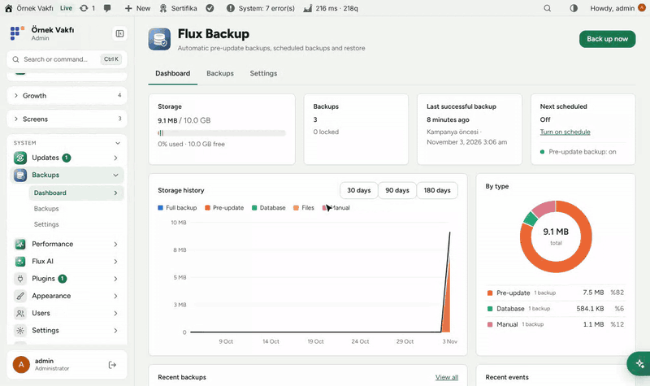
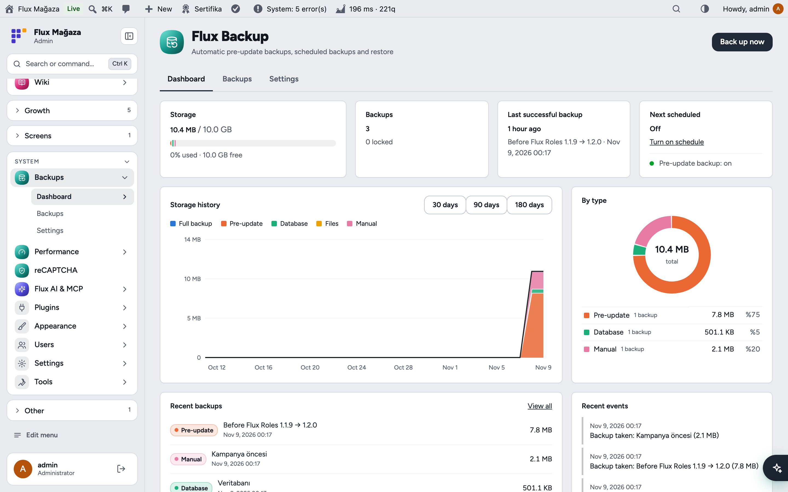
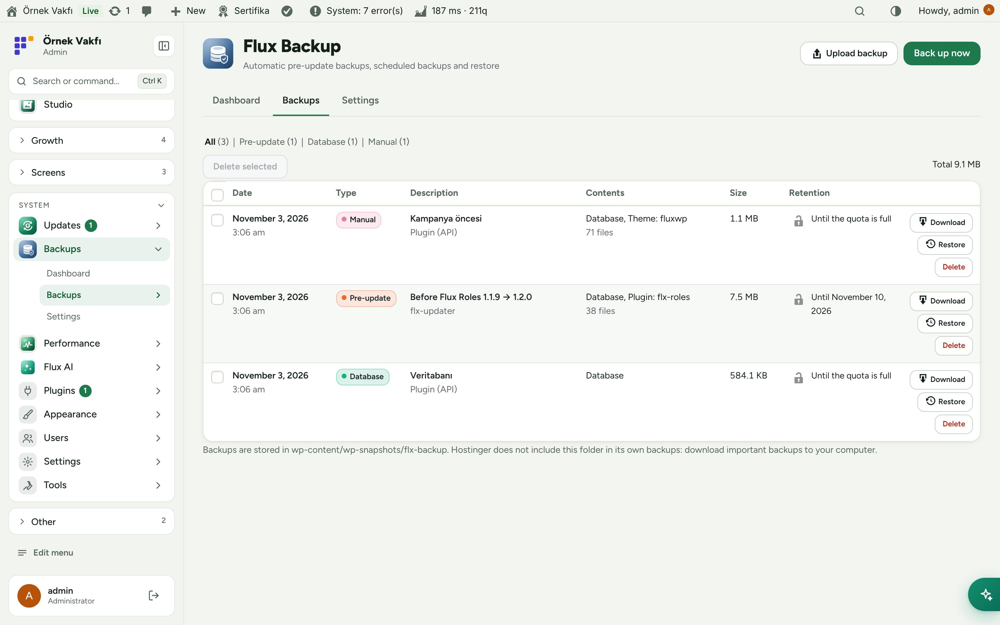
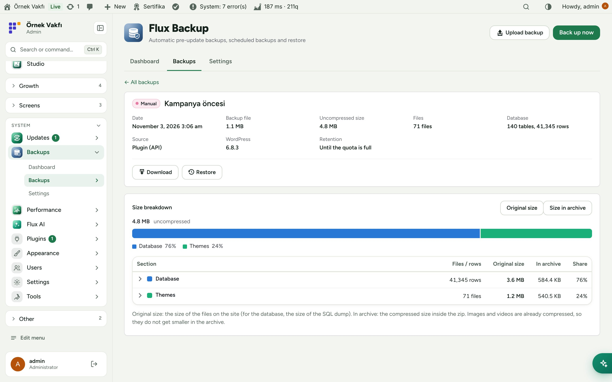
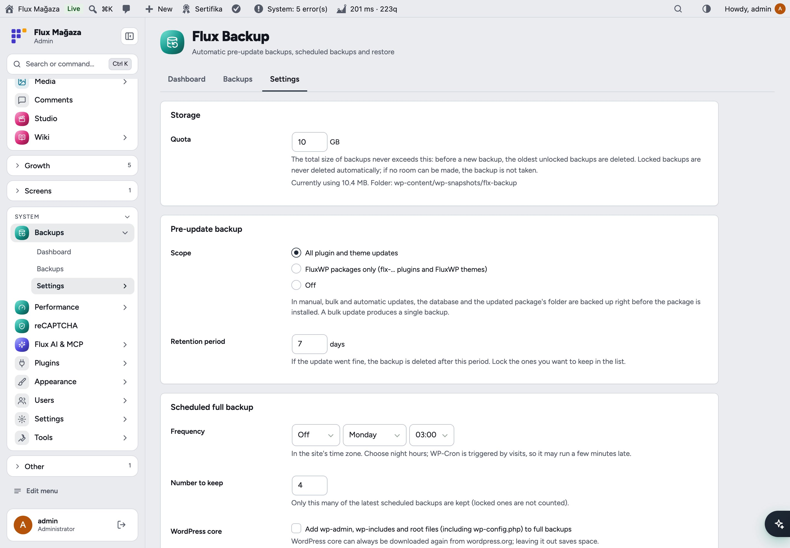
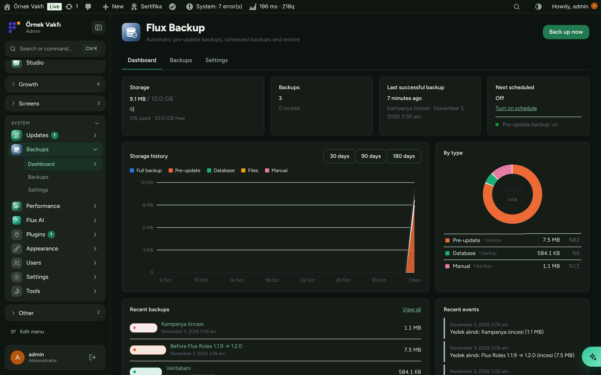
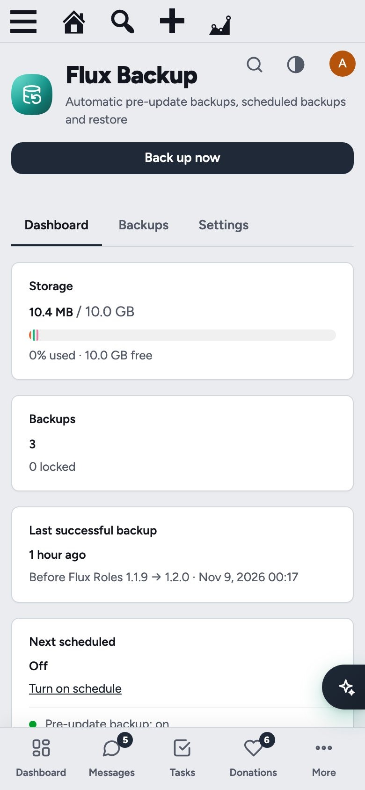

<div align="center">

**English** · [Türkçe](README.tr.md)


# Flux Backup

**A backup before every update, and a clear way back when something breaks.**<br>
Flux Backup takes an automatic backup of the database and the package before every plugin or theme update, runs scheduled full backups, keeps them inside a quota you set and lets you restore just the parts you need. Built for shared hosting: no exec, no mysqldump, small steps that survive timeouts.

[](https://wordpress.org)
[](https://www.php.net)
[](https://www.gnu.org/licenses/gpl-2.0.html)


[Features](#features) · [Screenshots](#screenshots) · [Installation](#installation) · [For developers](#for-developers) · [Roadmap](#roadmap)



</div>

---

## Why Flux Backup?

Hosting backups are daily at best, and restoring one rolls back everything, including today's donations. The risky moment is an update, so Flux Backup protects exactly that moment:

- 🛟 **Automatic pre-update backups** of the database and the updated package, for manual, bulk and automatic updates.
- 🗓️ **Scheduled full backups**, daily or weekly at night.
- 🎯 **Selective restore:** the database, a single plugin or theme folder, or both.
- 📊 **You always know the cost:** quota bar, storage history and space per type.
- 🔒 **Lock** important backups so quota and retention never delete them.
- 🐢 **Shared-hosting friendly:** ~20-second steps continued by WP-Cron; nothing to install on the server.

## Features

### Dashboard
- Storage against quota, number of backups and locked ones, last successful backup and the next scheduled one.
- Storage history chart (30/90/180 days) by type, a breakdown by type and recent backups and events.

### Backups
- List with filters by type (full, pre-update, database, files, manual), download, restore, lock, delete and bulk delete.
- Backup details: size breakdown (database, plugins, themes, uploads, other), original and archived size, WordPress version and retention.
- Upload a backup archive and restore from it.

### Settings
- Quota (default 10 GB); when it fills up the oldest unlocked backup goes first.
- Pre-update scope: all packages, only FluxWP packages, or off; retention in days.
- Scheduled full backup: frequency, time and how many to keep; optionally WordPress core files too.
- Excluded paths (caches, large media folders…).

### Storage
- Backups are stored in `wp-content/wp-snapshots/flx-backup/`, closed to the web, with random file names; downloads are admin-only.

## Screenshots

| Dashboard | Backups |
|---|---|
|  |  |
| **Backup details and restore** | **Settings** |
|  |  |
| **Dark mode with Flux Admin** | **Mobile** |
|  |  |

## Installation

Requirements: WordPress 6.4+, PHP 7.4+. The PHP `zip` extension.

**From a zip**

1. Download `flx-backup.zip` from the latest `flx-backup-v*` release on the [Releases](https://github.com/FluxWP/fluxwp/releases) page.
2. **Plugins › Add New › Upload Plugin**, choose the zip, then **Activate**.

**With Flux Setup** (recommended on our sites)

**Setup › Packages** lists every FluxWP package; click **Install** next to *Flux Backup*. Updates arrive the same way.

**First steps**

1. **Backups › Settings**: set the quota, the pre-update scope and, if you like, a scheduled full backup.
2. **Dashboard › Back up now** for the first full backup.
3. From now on every plugin and theme update is preceded by a backup that is kept for 7 days.

> ⚠️ Hostinger does not include the `wp-snapshots` folder in its own backups. Download important backups to your computer, and keep the hosting backups switched on: Flux Backup works next to them, not instead of them. If `DISABLE_WP_CRON` is set, call `wp-cron.php` from a real cron job every 5–15 minutes.

Full setup notes (Turkish): [KURULUM.md](../../docs/yedek-eklentisi/KURULUM.md) · API reference: [API.md](../../docs/yedek-eklentisi/API.md) · Release notes: [CHANGELOG.md](CHANGELOG.md)

## For developers

Other packages (for example Flux Setup) use the PHP API:

```php
$backup = flxy_backup_create( array(
    'type'    => 'pre_update',
    'paths'   => array( 'wp-content/plugins/flx-forms' ),
    'context' => array( 'source' => 'update' ),
) );
flxy_backup_list( array( 'type' => 'full' ) );
flxy_backup_restore( $id, array( 'db', 'wp-content/plugins/flx-forms' ) );
```

Full reference: [API.md](../../docs/yedek-eklentisi/API.md).

## Roadmap

| | |
|---|---|
| ✅ | Pre-update and scheduled full backups |
| ✅ | Quota, retention, locking and storage dashboard |
| ✅ | Selective restore and uploaded archives |
| ⬜ | Off-site copies (S3-compatible storage, Google Drive) |
| ⬜ | E-mail when a scheduled backup fails |

## License

Flux Backup Released under the [GNU General Public License v2 or later](https://www.gnu.org/licenses/gpl-2.0.html).

Made by FluxWP.
