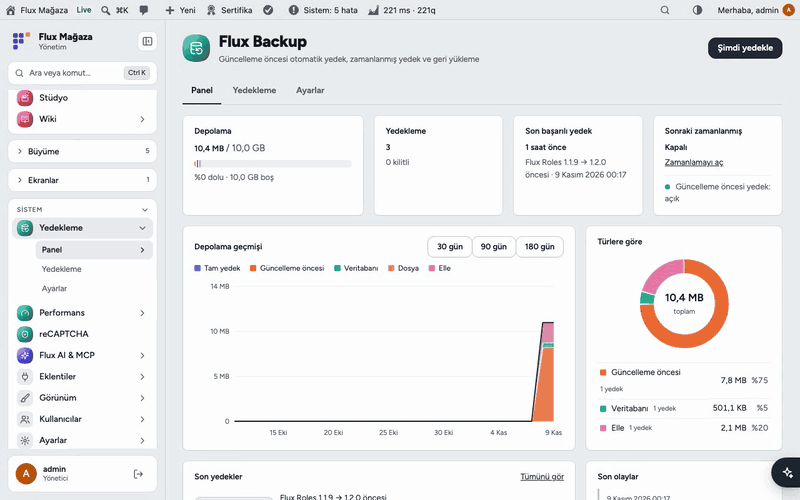
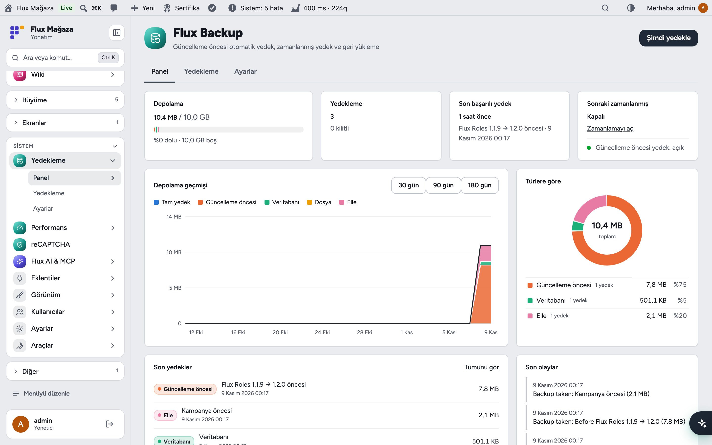
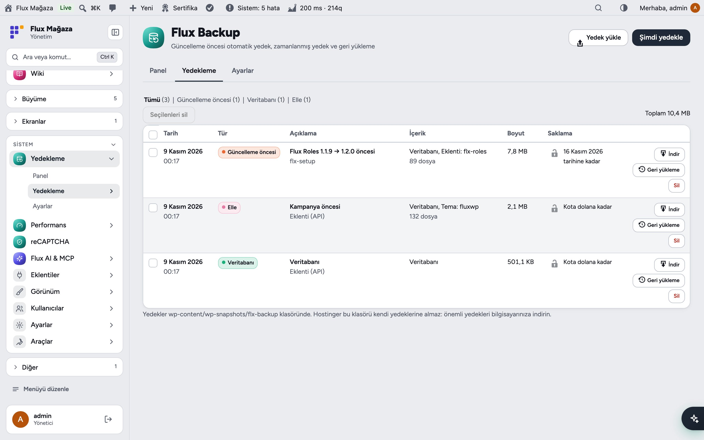
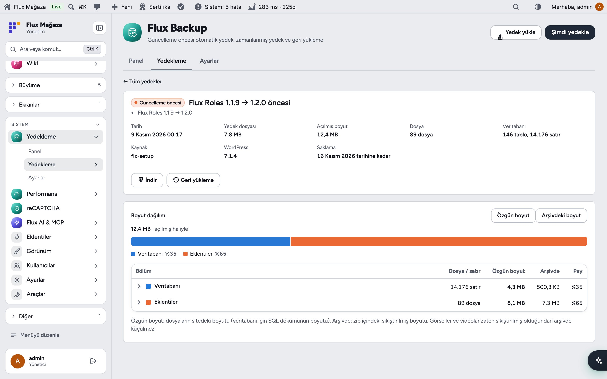
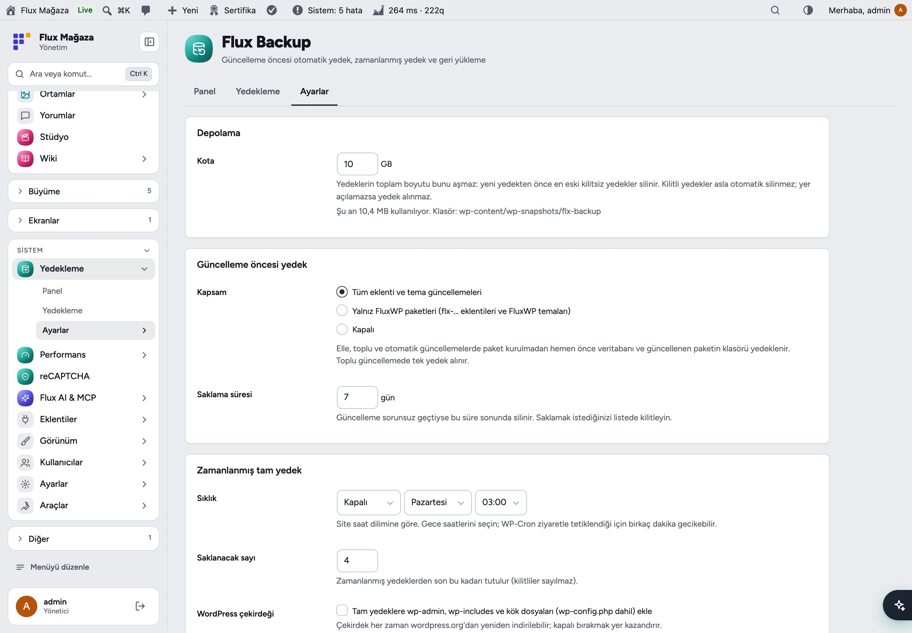
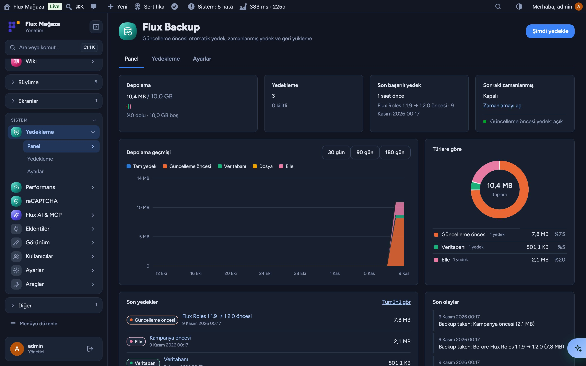
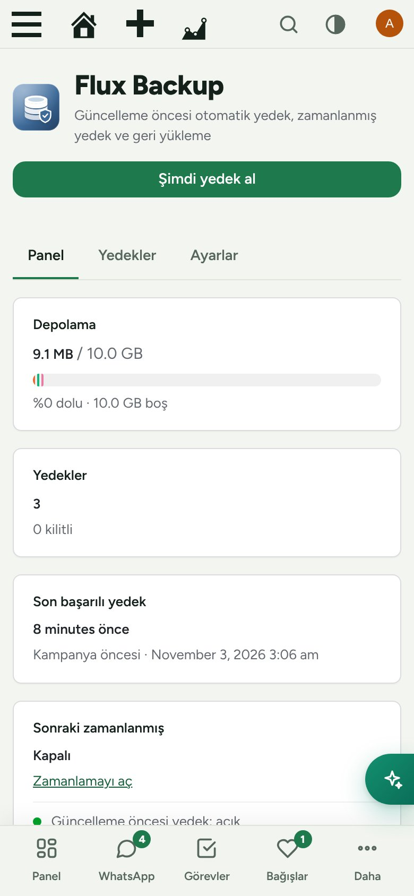

<div align="center">

[English](README.md) · **Türkçe**


# Flux Backup

**Her güncellemeden önce yedek; bir şey bozulursa net bir dönüş yolu.**<br>
Flux Backup her eklenti ya da tema güncellemesinden önce veritabanını ve paketi kendiliğinden yedekler, zamanlanmış tam yedekler alır, bunları belirlediğiniz kotada tutar ve yalnız gereken parçayı geri yüklemenizi sağlar. Paylaşımlı sunucu için yazıldı: exec yok, mysqldump yok; zaman aşımına dayanıklı küçük adımlar.

[](https://wordpress.org)
[](https://www.php.net)
[](https://www.gnu.org/licenses/gpl-2.0.html)


[Özellikler](#özellikler) · [Ekran görüntüleri](#ekran-görüntüleri) · [Kurulum](#kurulum) · [Geliştiriciler için](#geliştiriciler-için) · [Yol haritası](#yol-haritası)



</div>

---

## Neden Flux Backup?

Hosting yedekleri en iyi ihtimalle günlüktür ve geri yüklemek her şeyi, bugünkü bağışlar dahil, geri alır. Riskli an güncellemedir; Flux Backup tam o anı korur:

- 🛟 **Güncelleme öncesi otomatik yedek:** elle, toplu ve otomatik güncellemelerde veritabanı ve güncellenen paket.
- 🗓️ **Zamanlanmış tam yedek:** günlük ya da haftalık, gece.
- 🎯 **Seçerek geri yükleme:** veritabanı, tek bir eklenti/tema klasörü ya da ikisi birden.
- 📊 **Maliyeti hep görürsünüz:** kota çubuğu, depolama geçmişi ve türlere göre alan.
- 🔒 Önemli yedekleri **kilitleyin**; kota ve saklama süresi onları silmez.
- 🐢 **Paylaşımlı sunucu dostu:** ~20 saniyelik adımlar, WP-Cron ile sürer; sunucuya bir şey kurmak gerekmez.

## Özellikler

### Panel
- Kotaya göre kullanılan alan, yedek ve kilitli yedek sayısı, son başarılı yedek ve sıradaki zamanlanmış yedek.
- Türe göre depolama geçmişi grafiği (30/90/180 gün), türlere göre dağılım, son yedekler ve olaylar.

### Yedekler
- Türe göre süzülen liste (tam, güncelleme öncesi, veritabanı, dosyalar, elle); indir, geri yükle, kilitle, sil, toplu sil.
- Yedek ayrıntısı: boyut dağılımı (veritabanı, eklentiler, temalar, yüklemeler, diğer), asıl ve arşiv boyutu, WordPress sürümü ve saklama süresi.
- Yedek arşivi yükleyip ondan geri yükleme.

### Ayarlar
- Kota (varsayılan 10 GB); dolunca önce en eski kilitsiz yedek silinir.
- Güncelleme öncesi kapsam: tüm paketler, yalnız FluxWP paketleri ya da kapalı; saklama süresi (gün).
- Zamanlanmış tam yedek: sıklık, saat ve kaç tane saklanacağı; isterseniz WordPress çekirdek dosyaları da.
- Hariç tutulan yollar (önbellekler, büyük medya klasörleri…).

### Depolama
- Yedekler `wp-content/wp-snapshots/flx-backup/` klasöründe, web'e kapalı ve rastgele adlarla durur; indirme yalnız yöneticiye açık.

## Ekran görüntüleri

| Panel | Yedekler |
|---|---|
|  |  |
| **Yedek ayrıntısı ve geri yükleme** | **Ayarlar** |
|  |  |
| **Flux Admin ile koyu tema** | **Mobil** |
|  |  |

## Kurulum

Gereksinimler: WordPress 6.4+, PHP 7.4+. PHP `zip` uzantısı.

**Zip ile**

1. [Releases](https://github.com/FluxWP/fluxwp/releases) sayfasında en son `flx-backup-v*` sürümünden `flx-backup.zip`'i indirin.
2. **Eklentiler › Yeni ekle › Eklenti yükle**, zip'i seçin, sonra **Etkinleştir**.

**FluxWP Panel ile** (sitelerimizde önerilen)

**FluxWP Panel › Paketler** tüm FluxWP paketlerini listeler; *Flux Backup* satırındaki **Kur**'a basın. Güncellemeler de buradan gelir.

**İlk adımlar**

1. **Yedekler › Ayarlar**: kotayı, güncelleme öncesi kapsamı ve isterseniz zamanlanmış tam yedeği ayarlayın.
2. İlk tam yedek için **Panel › Şimdi yedek al**.
3. Bundan sonra her eklenti ve tema güncellemesinden önce yedek alınır ve 7 gün saklanır.

> ⚠️ Hostinger `wp-snapshots` klasörünü kendi yedeklerine almaz. Önemli yedekleri bilgisayarınıza indirin ve hosting yedeklerini açık tutun: Flux Backup onların yerine değil, yanında çalışır. `DISABLE_WP_CRON` tanımlıysa `wp-cron.php`'yi gerçek bir cron ile 5–15 dakikada bir çağırın.

Ayrıntılı kurulum notları: [KURULUM.md](../../docs/yedek-eklentisi/KURULUM.md) · API başvurusu: [API.md](../../docs/yedek-eklentisi/API.md) · Sürüm notları: [CHANGELOG.md](CHANGELOG.md)

## Geliştiriciler için

Diğer paketler (ör. FluxWP Panel) PHP API'sini kullanır:

```php
$backup = flxy_backup_create( array(
    'type'    => 'pre_update',
    'paths'   => array( 'wp-content/plugins/flx-forms' ),
    'context' => array( 'source' => 'update' ),
) );
flxy_backup_list( array( 'type' => 'full' ) );
flxy_backup_restore( $id, array( 'db', 'wp-content/plugins/flx-forms' ) );
```

Tam başvuru: [API.md](../../docs/yedek-eklentisi/API.md).

## Yol haritası

| | |
|---|---|
| ✅ | Güncelleme öncesi ve zamanlanmış tam yedekler |
| ✅ | Kota, saklama süresi, kilit ve depolama paneli |
| ✅ | Seçerek geri yükleme ve yüklenen arşivler |
| ⬜ | Site dışı kopya (S3 uyumlu depolama, Google Drive) |
| ⬜ | Zamanlanmış yedek başarısız olunca e-posta |

## Lisans

Flux Backup, [GNU Genel Kamu Lisansı v2 veya üzeri](https://www.gnu.org/licenses/gpl-2.0.html) ile yayınlanır.

FluxWP tarafından geliştirilmiştir.

## Arka plan işleri

Asenkron yedekler sağlıklı FluxWP Docker worker varsa otomatik olarak orada çalışır; yönetim ekranı yalnız ilerlemeyi izler. Worker yoksa mevcut cron, loopback ve yönetim ekranı işleyicileri devam eder. Geri yükleme ve güncelleme öncesi senkron yedekler mevcut akışını korur.

[Worker ve yedek çalışma düzeni](../../tools/background/README.tr.md).

## Maintainers

Ahmet Yılmaz — [@sharkpaw](https://github.com/sharkpaw)
