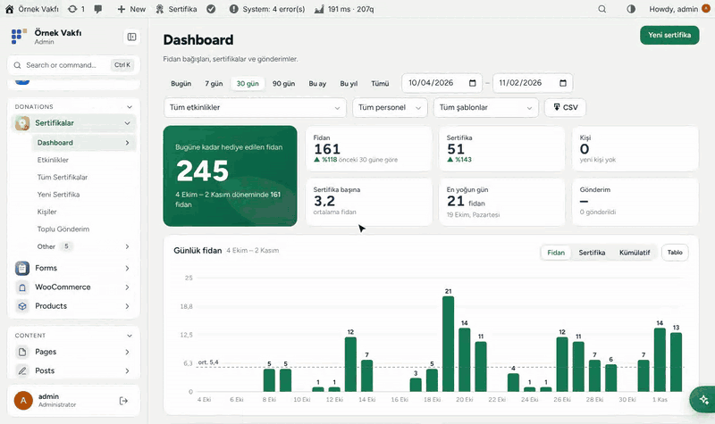
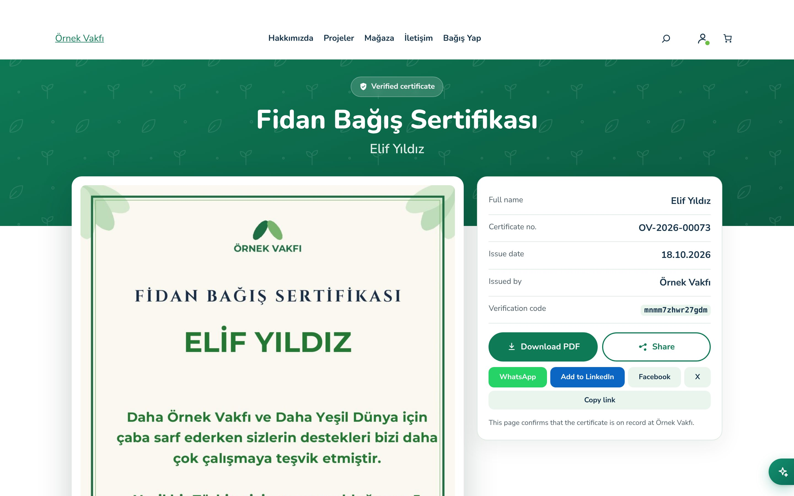
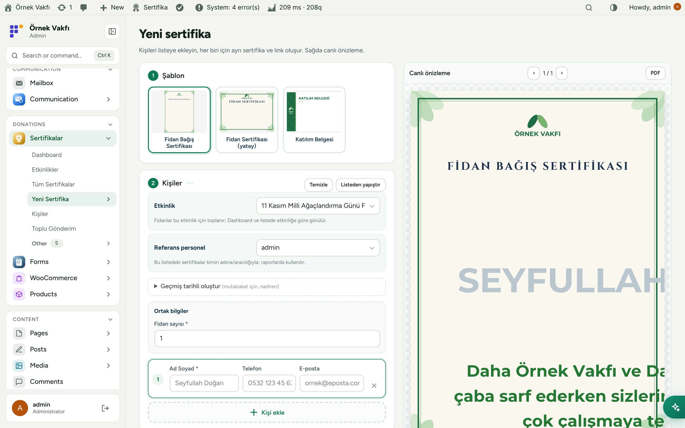
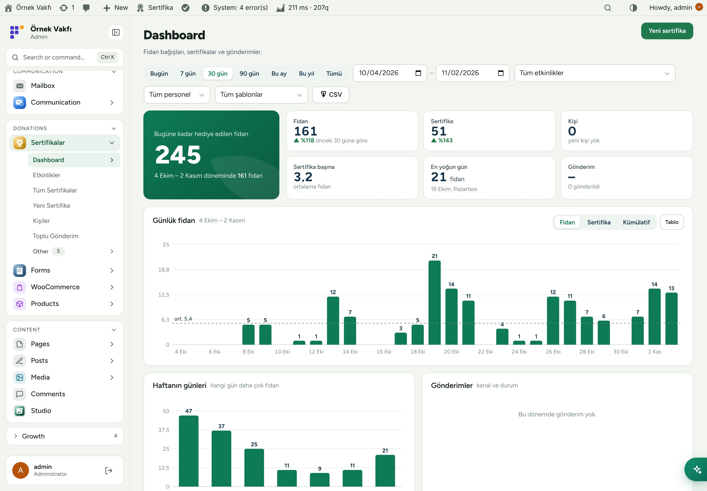
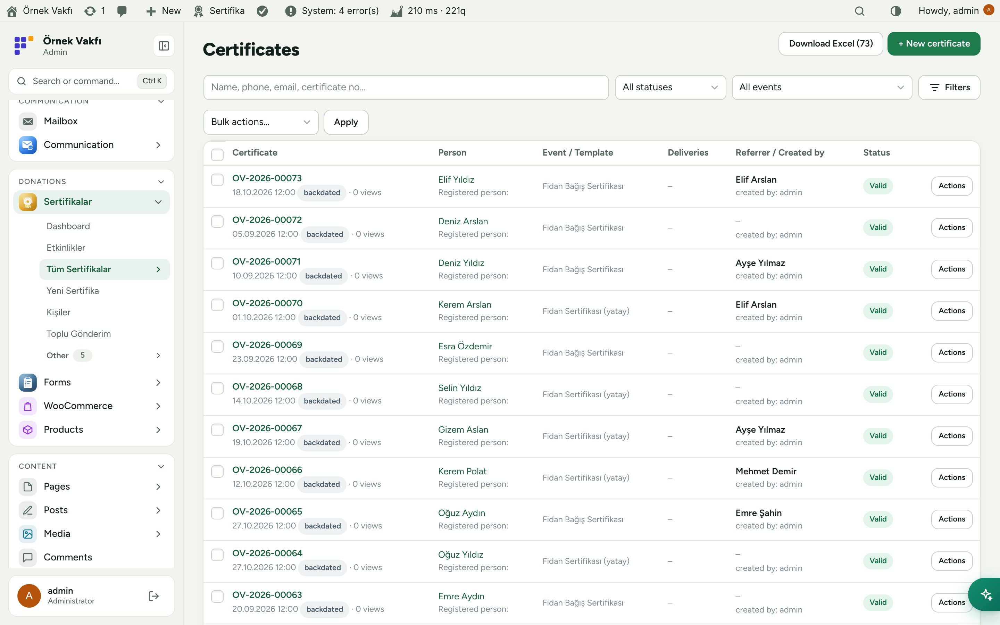
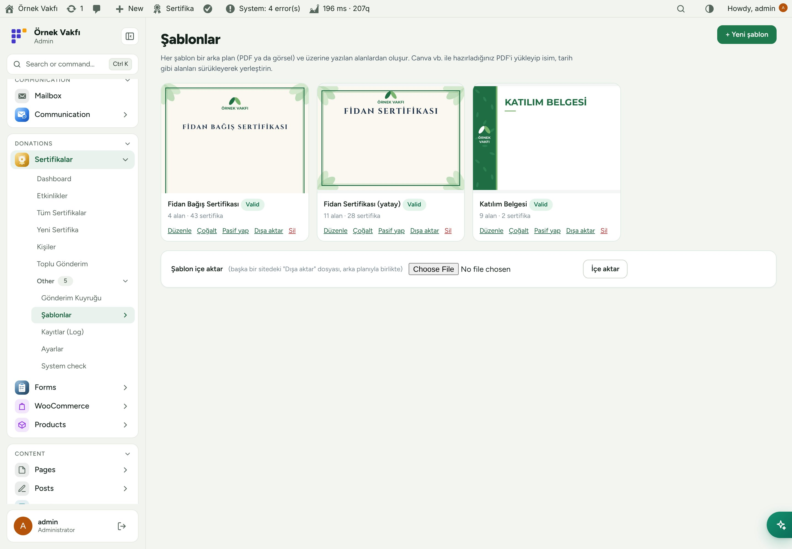
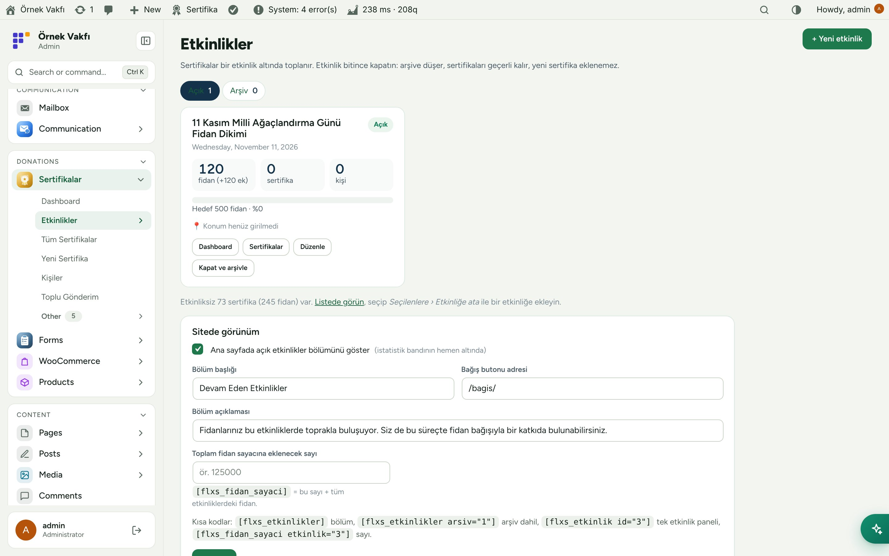
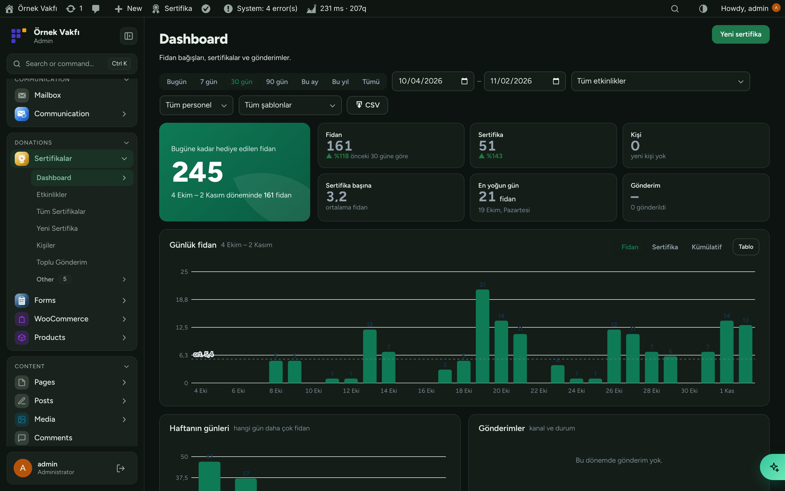
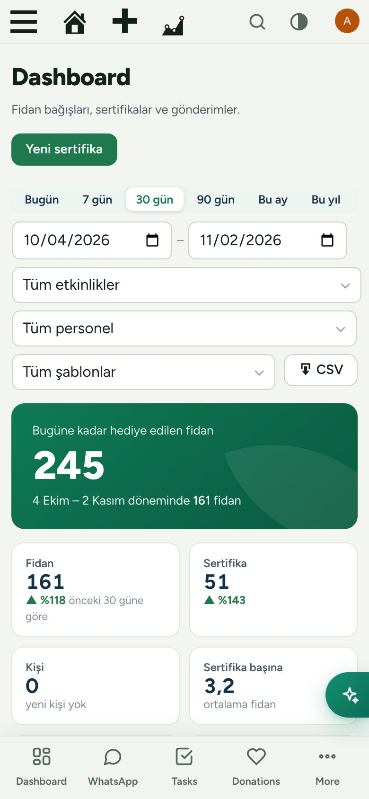
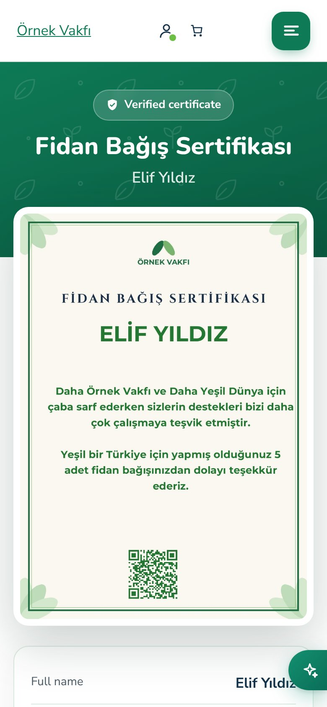

**English** · [Türkçe](README.tr.md)

# Flux Certificate

**A personal certificate, a share link and a PDF for every sapling gifted.** 
Flux Certificate creates sapling donation certificates, e-cards and participation documents from your own designs, gives each one a verified page with a PDF and a share image, and sends it by WhatsApp, SMS or e-mail. Events, referral staff and a live dashboard show where every sapling came from.

[Features](#features) · [Screenshots](#screenshots) · [Installation](#installation) · [For developers](#for-developers) · [Roadmap](#roadmap)

---

## Why Flux Certificate?

A thank-you certificate is often the only thing a donor keeps, and the one thing they share. Making them by hand in Canva and sending them one by one doesn't scale to a planting event with hundreds of people. Flux Certificate turns it into a list:

- 📝 **Type names, get certificates.** One row per person (or paste a list); each gets their own certificate, link and PDF, with a live preview while you type.
- 🔗 **A page people want to share.** `/sertifika/{code}` shows the certificate with a "verified" badge, PDF download and WhatsApp, LinkedIn, Facebook and X buttons; the link preview shows the person's own certificate.
- 🎨 **Your designs.** Upload a PDF from Canva and place the fields on it; 3 certificate templates and 16 Ready-made e-cards come ready.
- 🌳 **Events and targets.** Collect saplings per event (for example 11 November planting) with a target bar on the site.
- 📊 **Know who brought what:** referral staff, templates, busiest days and delivery success on one dashboard.

## Features

### Creating certificates
- **New certificate:** pick a template, add people row by row or **Paste from list** (`Name; phone; e-mail; saplings`), set shared fields once, split a sapling total across people. Live PDF preview on the right.
- People are recognised by phone (or e-mail) and never saved twice; phone numbers are accepted in any format and stored in one.
- Result screen: copy links, send with WhatsApp from your own phone, or download everything as **one PDF**.
- Back-dated certificates for reconciliation (admins only), referral staff per list.

### Delivery
- WhatsApp, SMS and e-mail go through **Flux Contact**; messages are queued and retried after 1, 5, 15 and 30 minutes.
- **Send to someone else** from the result screen or the list (several recipients, address book suggestions).
- Bulk send with a preview of how many people it reaches; message texts with `{name}`, `{link}`, `{saplings}` placeholders.

### Certificate page
- Verified page with the certificate image, details, PDF download and share buttons; 1200×630 share image per certificate.
- PDF, image and share image are produced on the server (TCPDF + FPDI, PHP GD is enough) and, as a fallback, in the browser.
- `[flx_sertifika_sorgula]` lookup form: visitors receive their link on their own registered phone or e-mail.

### Templates
- PDF background (e.g. exported from Canva) with text, multi-line text, date, number, auto number, QR and fixed text fields you drag into place.
- Donor-selectable designs for the donation page (used by Flux Donation); JSON export/import between sites; extra fonts.

### Events and reports
- Events with date, target, extra (certificate-less) saplings, location and a page on the site with a live counter; close and archive when done.
- Dashboard: total saplings gifted, period figures compared with the previous period, daily/weekday charts, deliveries, referral staff and templates, top donors, CSV export. Excel export of the certificate list.
- Staff role that lands straight on **New certificate**; with Flux Roles, staff see only their own records.

## Screenshots

| Public certificate page | New certificate with live preview |
|---|---|
|  |  |
| **Dashboard** | **All certificates** |
|  |  |
| **Templates and e-cards** | **Events** |
|  |  |
| **Dark mode with Flux Admin** | **Mobile: dashboard** |
|  |  |
| **Mobile: certificate page** |   |
|  |   |

## Installation

Requirements: WordPress 6.4+, PHP 7.4+. Pretty permalinks. For WhatsApp/SMS/e-mail delivery: Flux Contact.

**From a zip**

1. Download `flx-certificates.zip` from the latest `flx-certificates-v*` release on the [Releases](https://github.com/FluxWP/fluxwp/releases) page.
2. **Plugins › Add New › Upload Plugin**, choose the zip, then **Activate**.

**With Flux Updater** (recommended on our sites)

**Dashboard › Updates** lists every FluxWP package; click **Install** next to *Flux Certificate*. Updates arrive the same way.

**First steps**

1. Save **Settings › Permalinks** once so `/sertifika/{code}` addresses work.
2. **Certificates › Templates**: the sapling donation certificate is ready; activate the e-cards you want donors to choose from.
3. **Certificates › New certificate**: pick a template, add a person and press **Create**.

> ℹ️ The certificate page, the event sections on the site and the lookup form switch to English with the site language; most admin screens stay in Turkish. Uninstalling keeps the data unless you tick the box under **Settings › Data**.

Full setup notes (Turkish): [KURULUM.md](../../docs/sertifika-sistemi/KURULUM.md) · Release notes: [CHANGELOG.md](CHANGELOG.md)

## For developers

- Create certificates from other packages: `flxs_create_certificate( $template_id, $person_id, $values, $ref, $date )`, people with `flxs_upsert_person()`.
- Donor-selectable designs: `flxs_donor_templates()` (filter `flxs_donor_templates`).
- Shortcodes: `[flxs_etkinlikler]`, `[flxs_etkinlik id="3"]`, `[flxs_fidan_sayaci]`, `[flx_sertifika_sorgula]`.
- Capabilities `flxs_manage`, `flxs_dashboard`, `flxs_own_ref` are registered with Flux Roles; checks are registered with `flx_system_checks`.

## Roadmap

| | |
|---|---|
| ✅ | List-based certificates with live PDF preview |
| ✅ | WhatsApp, SMS and e-mail delivery with a queue |
| ✅ | Events with targets and site pages |
| ✅ | Server-side PDF and share images, 16 e-cards |
| ✅ | Shared list filters (Flux Admin) and Excel export |
| ⬜ | English admin screens |
| ⬜ | Apple Wallet / Google Wallet pass |

## License

Flux Certificate Released under the [GNU General Public License v2 or later](https://www.gnu.org/licenses/gpl-2.0.html).

Made by FluxWP.
