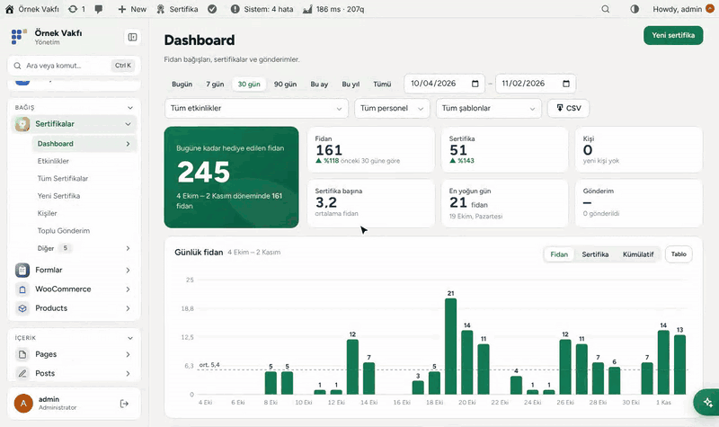
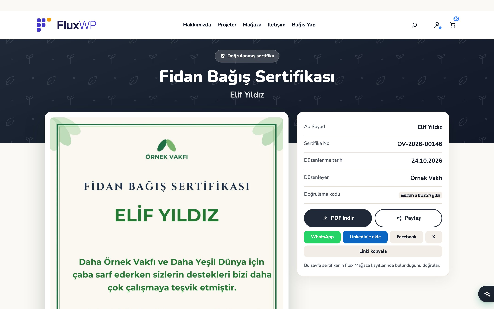
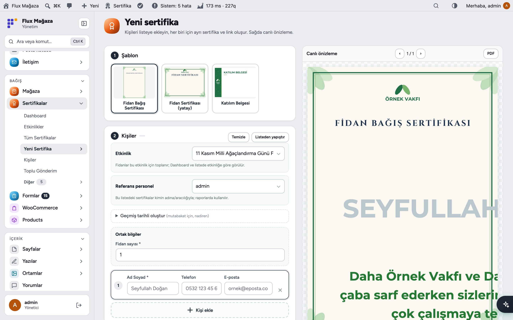
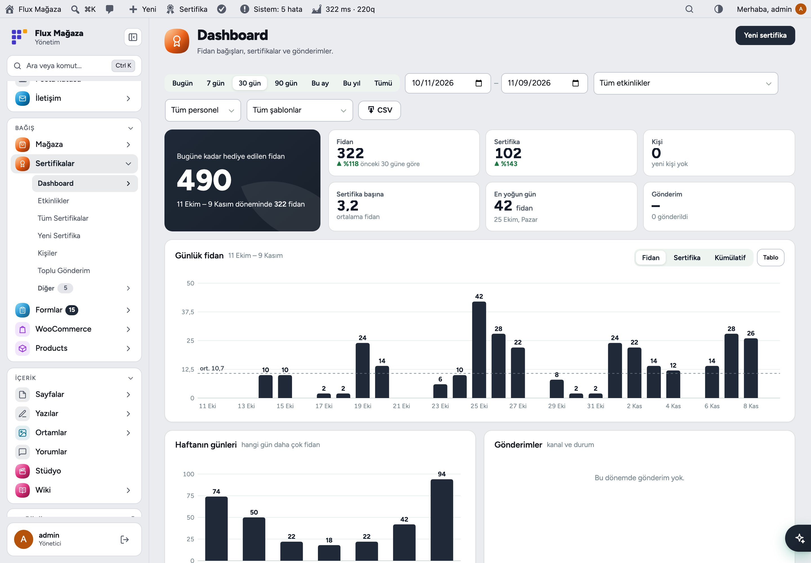
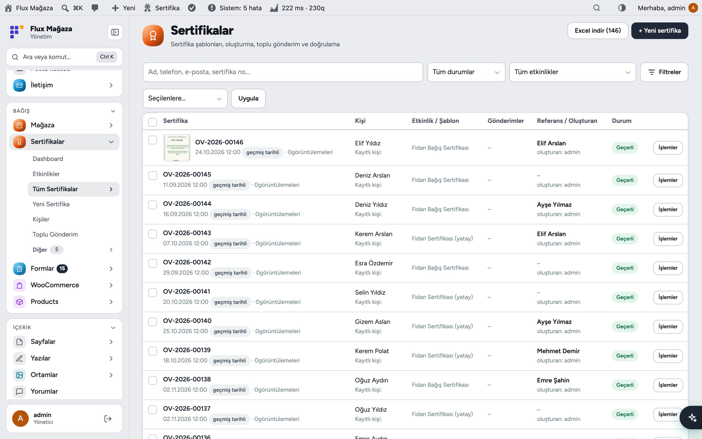
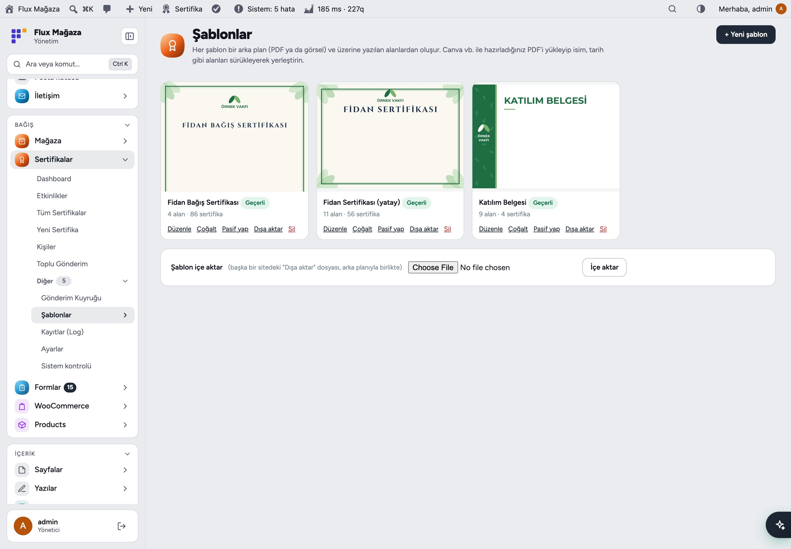
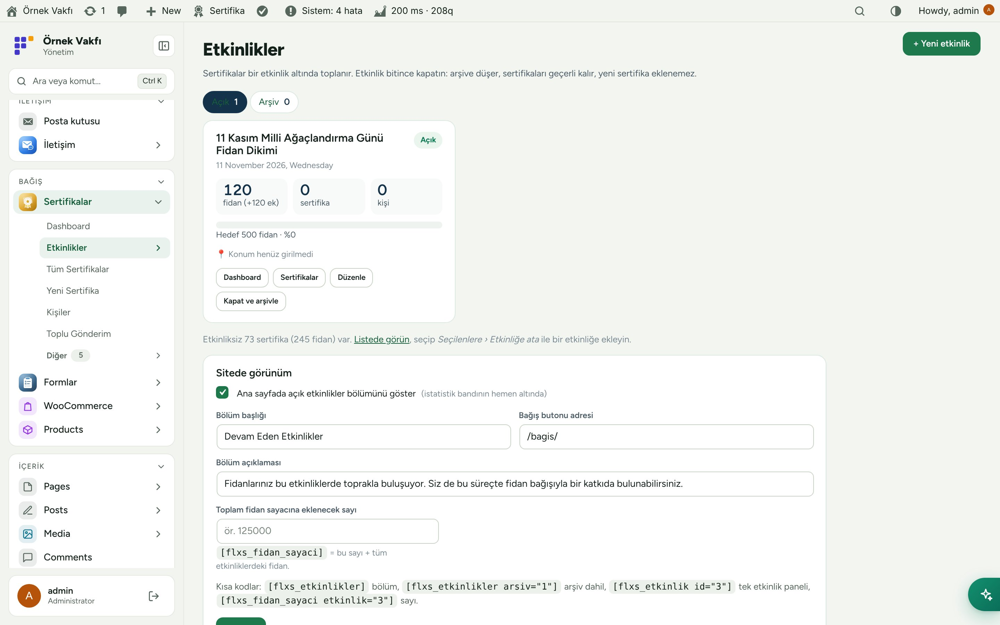
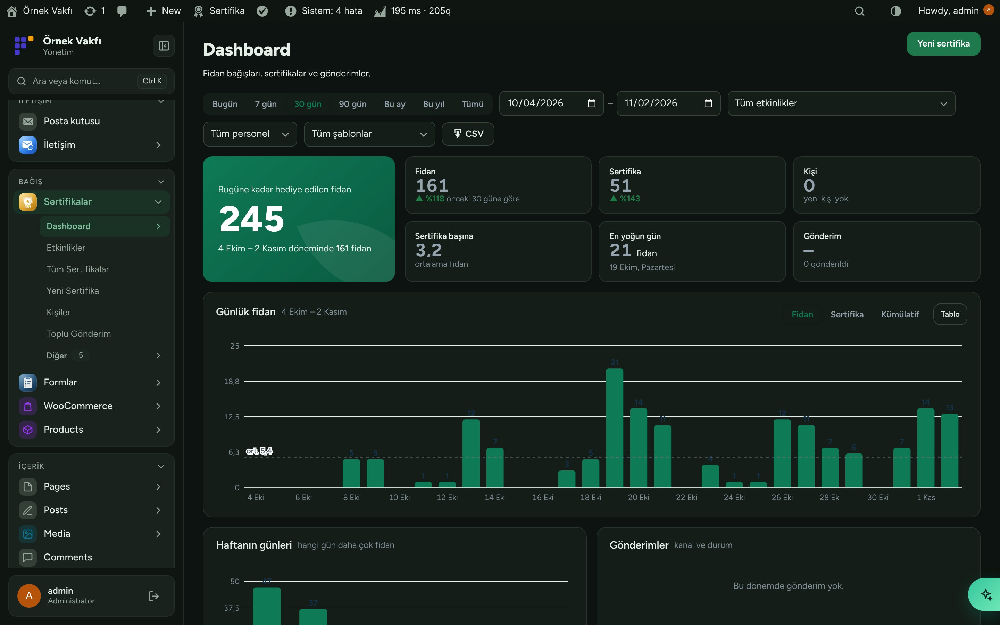
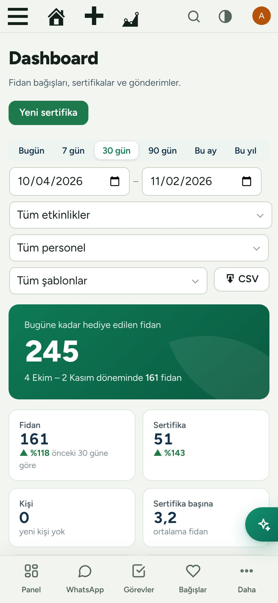
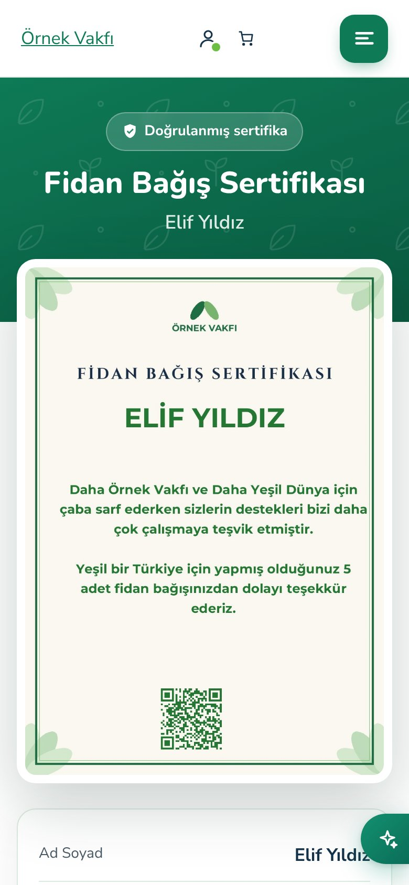

[English](README.md) · **Türkçe**

# Flux Certificates

**Hediye edilen her fidan için kişiye özel sertifika, paylaşım linki ve PDF.** 
Flux Certificates kendi tasarımlarınızdan fidan bağış sertifikası, e-kart ve katılım belgesi üretir; her birine PDF'i ve paylaşım görseliyle doğrulanmış bir sayfa açar ve WhatsApp, SMS ya da e-postayla gönderir. Etkinlikler, referans personel ve canlı Dashboard her fidanın nereden geldiğini gösterir.

[Özellikler](#özellikler) · [Ekran görüntüleri](#ekran-görüntüleri) · [Kurulum](#kurulum) · [Geliştiriciler için](#geliştiriciler-için) · [Yol haritası](#yol-haritası)

---

## Neden Flux Certificates?

Teşekkür sertifikası çoğu zaman bağışçının sakladığı ve paylaştığı tek şeydir. Canva'da tek tek hazırlayıp tek tek göndermek, yüzlerce kişilik bir fidan dikimine yetişmez. Flux Certificates bunu bir listeye çevirir:

- 📝 **İsmi yaz, sertifika hazır.** Her kişi bir satır (ya da listeden yapıştır); herkese ayrı sertifika, link ve PDF; yazarken canlı önizleme.
- 🔗 **Paylaşılası bir sayfa.** `/sertifika/{kod}` "doğrulanmış" rozetiyle sertifikayı, PDF indirmeyi ve WhatsApp, LinkedIn, Facebook, X düğmelerini gösterir; link önizlemesinde kişinin kendi sertifikası çıkar.
- 🎨 **Kendi tasarımlarınız.** Canva'dan PDF yükleyip alanları üstüne yerleştirin; 3 sertifika şablonu ve 16 Örnek Vakfı e-kartı hazır gelir.
- 🌳 **Etkinlik ve hedef.** Fidanları etkinlik bazında toplayın (ör. 11 Kasım fidan dikimi), sitede hedef çubuğuyla.
- 📊 **Kim ne getirdi, belli:** referans personel, şablonlar, en yoğun günler ve gönderim başarısı tek Dashboard'da.

## Özellikler

### Sertifika oluşturma
- **Yeni sertifika:** şablon seçin, kişileri satır satır ekleyin ya da **Listeden yapıştır** (`Ad Soyad; telefon; e-posta; fidan sayısı`), ortak alanları bir kez yazın, toplam fidanı kişilere dağıtın. Sağda canlı PDF önizlemesi.
- Kişiler telefona (yoksa e-postaya) göre tanınır, iki kez kaydedilmez; telefon her biçimde yazılır, tek biçimde saklanır.
- Sonuç ekranı: linkleri kopyala, kendi telefonundan WhatsApp'la gönder ya da hepsini **tek PDF** indir.
- Mutabakat için geçmiş tarihli sertifika (yalnız yönetici), liste başına referans personel.

### Gönderim
- WhatsApp, SMS ve e-posta **Flux Mail** üzerinden gider; mesajlar kuyruğa alınır, hata olursa 1, 5, 15 ve 30 dakika sonra yeniden denenir.
- Sonuç ekranından ya da listeden **Başka birine gönder** (birden çok alıcı, rehberden öneri).
- Kaç kişiye gideceğini önizleyerek toplu gönderim; `{ad}`, `{link}`, `{fidan_sayisi}` değişkenli mesaj metinleri.

### Sertifika sayfası
- Sertifika görseli, bilgiler, PDF indirme ve paylaşım düğmeli doğrulanmış sayfa; her sertifikaya 1200×630 paylaşım görseli.
- PDF, görsel ve paylaşım görseli sunucuda üretilir (TCPDF + FPDI, PHP GD yeterli); yedek olarak tarayıcıda.
- `[flx_sertifika_sorgula]` sorgulama formu: ziyaretçi linkini yalnız kendi kayıtlı telefonuna ya da e-postasına alır.

### Şablonlar
- PDF arka plan (ör. Canva'dan) üzerine sürükleyip yerleştirilen metin, çok satırlı metin, tarih, sayı, otomatik numara, QR ve sabit metin alanları.
- Bağış sayfasında bağışçının seçebileceği tasarımlar (Flux Donate kullanır); siteler arası JSON dışa/içe aktarma; ek yazı tipleri.

### Etkinlikler ve raporlar
- Tarih, hedef, ek (sertifikasız) fidan, konum ve sitede canlı sayaçlı sayfası olan etkinlikler; bitince kapat ve arşivle.
- Dashboard: bugüne kadar hediye edilen fidan, önceki dönemle karşılaştırmalı rakamlar, günlük ve haftanın günü grafikleri, gönderimler, referans personel ve şablonlar, en çok fidan hediye edenler, CSV. Sertifika listesinin Excel'e aktarımı.
- Girişte doğrudan **Yeni sertifika**'ya düşen personel rolü; Flux Roles ile personel yalnız kendi kayıtlarını görür.

## Ekran görüntüleri

| Sitedeki sertifika sayfası | Canlı önizlemeli yeni sertifika |
|---|---|
|  |  |
| **Dashboard** | **Tüm sertifikalar** |
|  |  |
| **Şablonlar ve e-kartlar** | **Etkinlikler** |
|  |  |
| **Flux Admin ile koyu tema** | **Mobil: Dashboard** |
|  |  |
| **Mobil: sertifika sayfası** |   |
|  |   |

## Kurulum

Gereksinimler: WordPress 6.4+, PHP 7.4+. Kalıcı bağlantılar açık. WhatsApp/SMS/e-posta gönderimi için Flux Mail.

**Zip ile**

1. [Releases](https://github.com/FluxWP/fluxwp/releases) sayfasında en son `flx-certificates-v*` sürümünden `flx-certificates.zip`'i indirin.
2. **Eklentiler › Yeni ekle › Eklenti yükle**, zip'i seçin, sonra **Etkinleştir**.

**FluxWP Panel ile** (sitelerimizde önerilen)

**FluxWP Panel › Paketler** tüm FluxWP paketlerini listeler; *Flux Certificates* satırındaki **Kur**'a basın. Güncellemeler de buradan gelir.

**İlk adımlar**

1. `/sertifika/{kod}` adresleri çalışsın diye **Ayarlar › Kalıcı bağlantılar**'ı bir kez kaydedin.
2. **Sertifikalar › Şablonlar**: fidan bağış sertifikası hazır; bağışçının seçmesini istediğiniz e-kartları etkinleştirin.
3. **Sertifikalar › Yeni sertifika**: şablon seçin, bir kişi ekleyin ve **Oluştur**'a basın.

> ℹ️ Sertifika sayfası, sitedeki etkinlik bölümleri ve sorgulama formu site diline göre İngilizceye geçer; yönetim ekranlarının çoğu Türkçe kalır. Eklenti silinince veriler, **Ayarlar › Veri**'deki kutu işaretlenmedikçe silinmez.

Ayrıntılı kurulum notları: [KURULUM.md](../../docs/sertifika-sistemi/KURULUM.md) · Sürüm notları: [CHANGELOG.md](CHANGELOG.md)

## Geliştiriciler için

- Diğer paketlerden sertifika oluşturma: `flxs_create_certificate( $template_id, $person_id, $values, $ref, $date )`, kişi için `flxs_upsert_person()`.
- Bağışçının seçebileceği tasarımlar: `flxs_donor_templates()` (filtre `flxs_donor_templates`).
- Kısa kodlar: `[flxs_etkinlikler]`, `[flxs_etkinlik id="3"]`, `[flxs_fidan_sayaci]`, `[flx_sertifika_sorgula]`.
- `flxs_manage`, `flxs_dashboard`, `flxs_own_ref` yetkileri Flux Roles'e, kontroller `flx_system_checks`'e kayıtlıdır.

## Yol haritası

| | |
|---|---|
| ✅ | Canlı PDF önizlemeli liste bazlı sertifika |
| ✅ | Kuyruklu WhatsApp, SMS ve e-posta gönderimi |
| ✅ | Hedefli ve site sayfalı etkinlikler |
| ✅ | Sunucuda PDF ve paylaşım görseli, 16 e-kart |
| ✅ | Ortak liste süzgeçleri (Flux Admin) ve Excel |
| ⬜ | İngilizce yönetim ekranları |
| ⬜ | Apple Wallet / Google Wallet kartı |

## Lisans

Flux Certificates, [GNU Genel Kamu Lisansı v2 veya üzeri](https://www.gnu.org/licenses/gpl-2.0.html) ile yayınlanır.

FluxWP tarafından geliştirilmiştir.

## Arka plan işleri

Sertifika gönderim kuyruğu ve sunucuda üretilen PDF/görseller sağlıklı FluxWP Docker worker varsa otomatik olarak orada çalışır. Normal kurulumlarda hazır Action Scheduler veya WordPress cron kullanılır. Tarayıcıdaki canlı önizleme ve dosya yükleme çalışmaya devam eder; eksik dosyalar sınırlı yeniden denemeyle workera aktarılır.

[Worker ve yedek çalışma düzeni](../../tools/background/README.tr.md).

## Maintainers

Ahmet Yılmaz — [@sharkpaw](https://github.com/sharkpaw)
