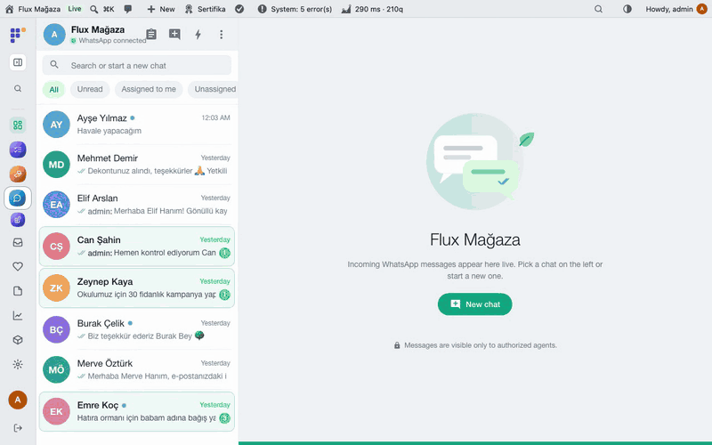
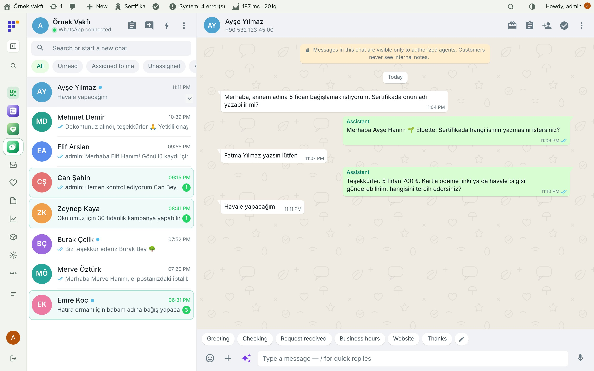
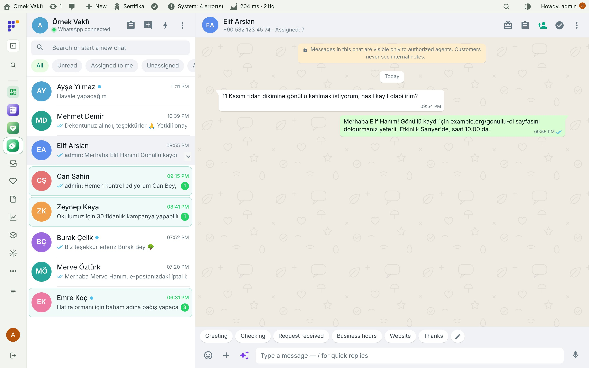
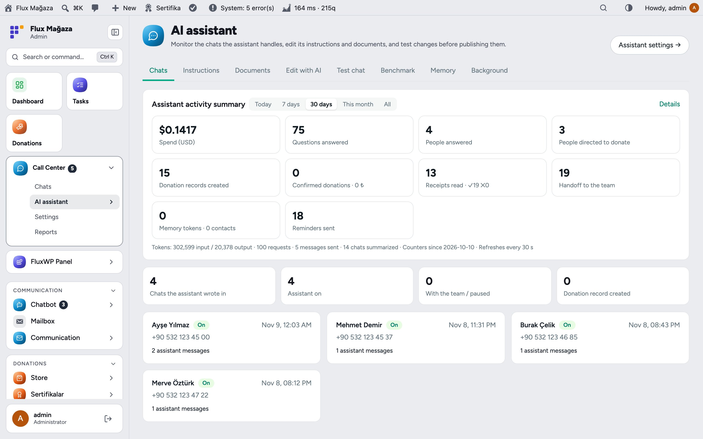
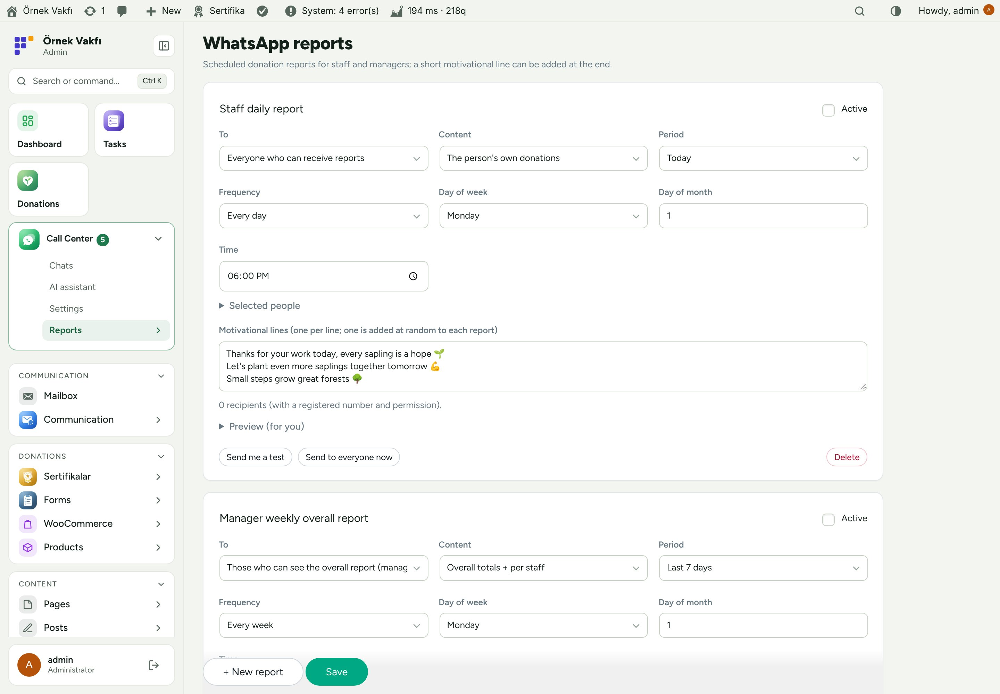
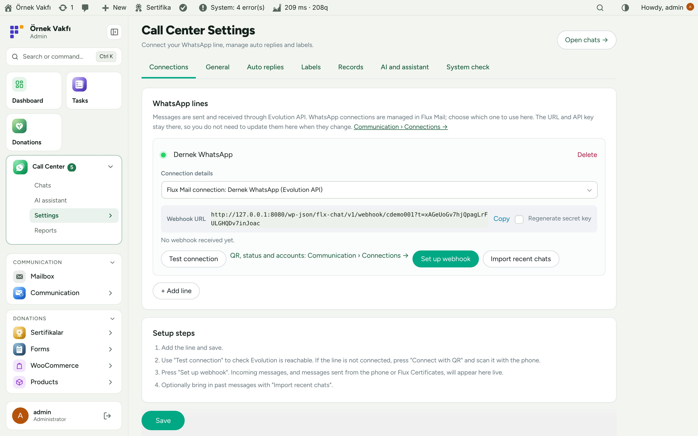
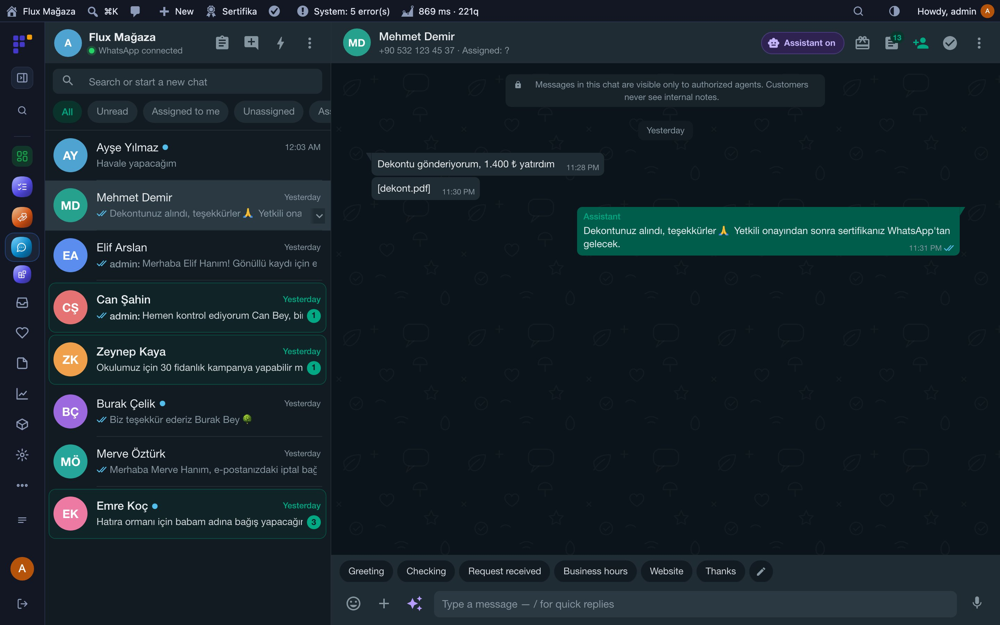
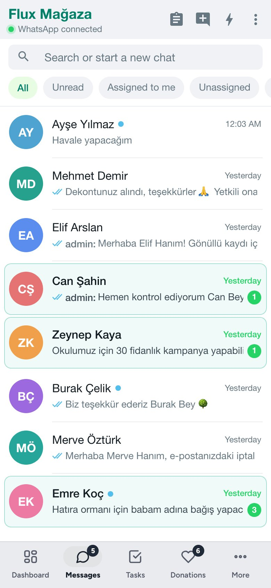
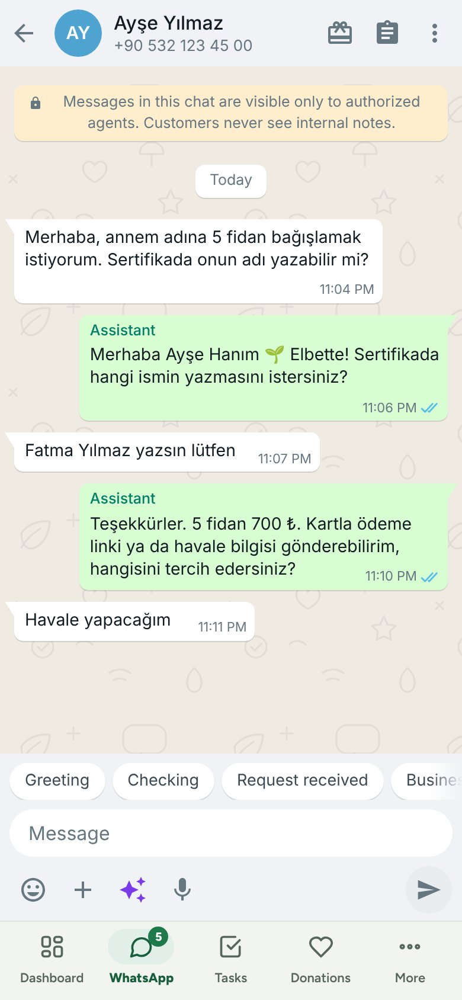

**English** · [Türkçe](README.tr.md)

# Flux Call Center

**A WhatsApp inbox inside WordPress, with an AI assistant that takes donations.** 
Flux Call Center shows every chat of your WhatsApp line live in the admin: incoming and outgoing messages, ones written on the phone and certificate messages. The team answers with quick replies, labels, assignment and internal notes; donations (Flux Donation) and certificates (Flux Certificate) are recorded from the chat, and an AI assistant can talk to donors, read bank receipts and hand off to a person when needed.

[Features](#features) · [Screenshots](#screenshots) · [Installation](#installation) · [Roadmap](#roadmap)

---

## Why Flux Call Center?

A charity's busiest channel is WhatsApp on one phone: "How do I donate?", "Here is my receipt", "Can the certificate say my mother's name?". On a phone the team can't share it, nothing is linked to the donation, and evenings and weekends go unanswered. Flux Call Center moves the line into WordPress:

- 💬 **Shared inbox.** Everyone with access sees the same chats live, assigns them, labels them, leaves internal notes the donor never sees.
- 🌱 **Donations from the chat.** Open a donation, send a payment link or the IBAN, match the receipt, create and send the certificate, without leaving the conversation.
- 🤖 **An assistant that knows the rules.** It answers questions, takes the order, writes the names for the certificates, reads the receipt, and says "an authorised person will approve it" instead of promising. Anything it can't do goes to the team.
- 📈 **Reports to WhatsApp.** Daily or weekly donation summaries to staff and managers, with a motivating line at the end.

## Features

### Inbox
- Live chat list with unread, assigned to me and unassigned filters; search or start a new chat; several lines (one per branch).
- Quick replies (type `/`), labels, assignment, internal notes, reminders, auto replies and office hours.
- Photos, voice messages, documents, contact cards, replies and reactions; old messages are paged in from Evolution.
- Contact panel: donations, certificates, consents, memory and a short AI summary of the chat. Block list for people who don't want messages.
- Works on mobile and in the Flux App as a native WhatsApp screen.

### Donations and certificates
- Open a donation from the chat (one donation, one payment, a certificate per name), send a payment link or bank details, cancel an unpaid one with confirmation.
- Receipts sent on WhatsApp are read and matched to the donation, with a warning if a receipt was used before; approval stays with an authorised person.
- Create a certificate in the chat and send it; the person it is for and the referring staff member get theirs too.

### AI assistant (through Flux AI)
- **AI assistant** page: activity summary (spend, questions, donations, receipts, hand-offs), the chats it handled, instructions with versions, documents, *Edit with AI*, a test chat with files and a tool-call log, a benchmark with scenarios and a judge, memory and background jobs.
- Reply suggestions for agents, voice-to-text, chat summaries, images in answers when a renderer is available.
- Staff tools: staff recognised by their Flux Roles number can open donations for donors, resend certificates and ask for reports.

### Reports
- **WhatsApp reports:** scheduled donation reports for staff (their own) and managers (totals per staff), daily, weekly or monthly, with a preview and "Send me a test".

## Screenshots

| Chat with assistant replies | Volunteer question |
|---|---|
|  |  |
| **AI assistant: activity and chats** | **Scheduled WhatsApp reports** |
|  |  |
| **Lines and webhook** | **Dark mode with Flux Admin** |
|  |  |
| **Mobile: chat list** | **Mobile: chat** |
|  |  |

## Installation

Requirements: WordPress 6.4+, PHP 7.4+. A WhatsApp line through Flux Contact (Evolution API 2.3+, Flux WPAPI or Cloud API). Optional: Flux Donation and Flux Certificate (donations and certificates from the chat), Flux AI (assistant and suggestions), Flux Roles (staff), Flux App.

**From a zip**

1. Download `flx-chat.zip` from the latest `flx-chat-v*` release on the [Releases](https://github.com/FluxWP/fluxwp/releases) page.
2. **Plugins › Add New › Upload Plugin**, choose the zip, then **Activate**.

**With FluxWP Panel** (recommended on our sites)

**FluxWP Panel › Packages** lists every FluxWP package; click **Install** next to *Flux Call Center*. Updates arrive the same way.

**First steps**

1. In **Communication › Connections** (Flux Contact) add the WhatsApp number and connect it.
2. **Call Center › Settings › Connections**: pick that line, **Test connection**, then **Set up webhook**; optionally **Import recent chats**.
3. Add quick replies and labels under **Settings**, and turn on the assistant under **Settings › AI and assistant** once Flux AI has a key.
4. Open **Call Center › Chats** and answer the first message.

> ⚠️ On Hostinger the live refresh runs every 10 seconds to stay inside the rate limit. Keep the webhook secret private: anyone with the address could post fake messages, so regenerate it if it leaks.

Full setup notes (Turkish): [KURULUM.md](../../docs/cagri-merkezi/KURULUM.md) · Release notes: [CHANGELOG.md](CHANGELOG.md)

## Roadmap

| | |
|---|---|
| ✅ | Live shared inbox with quick replies, labels and assignment |
| ✅ | Donations, receipts and certificates from the chat |
| ✅ | AI donation assistant with benchmark and memory |
| ✅ | Scheduled WhatsApp reports for staff and managers |
| ✅ | Cloud API and Flux WPAPI lines, native screen in Flux App |
| ⬜ | Broadcast lists with opt-in |
| ⬜ | Satisfaction question after a chat closes |

## License

Flux Call Center Released under the [GNU General Public License v2 or later](https://www.gnu.org/licenses/gpl-2.0.html).

Made by FluxWP.
