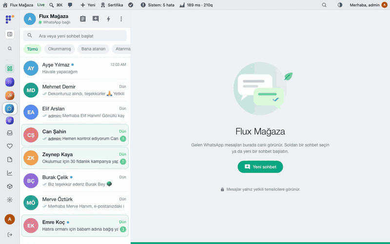
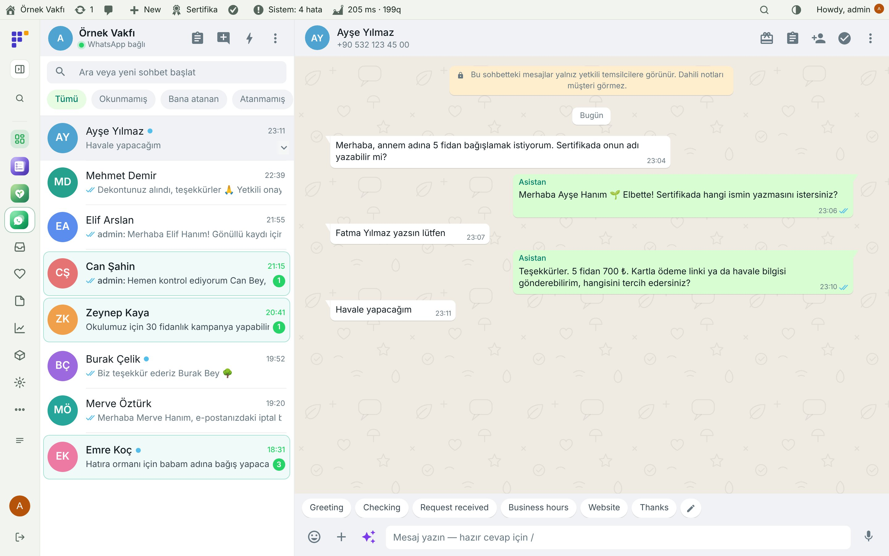
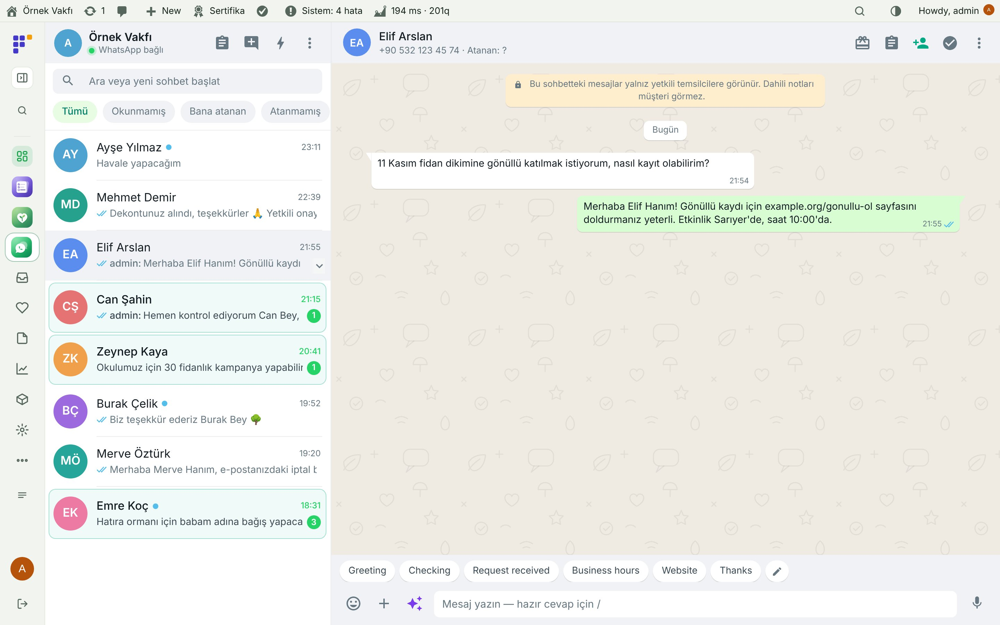
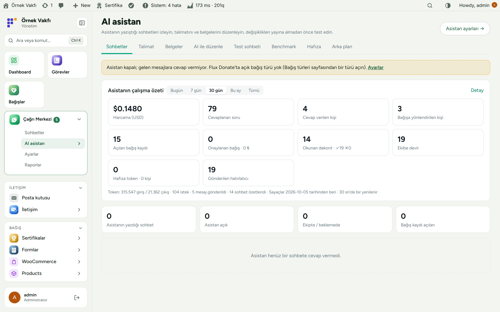
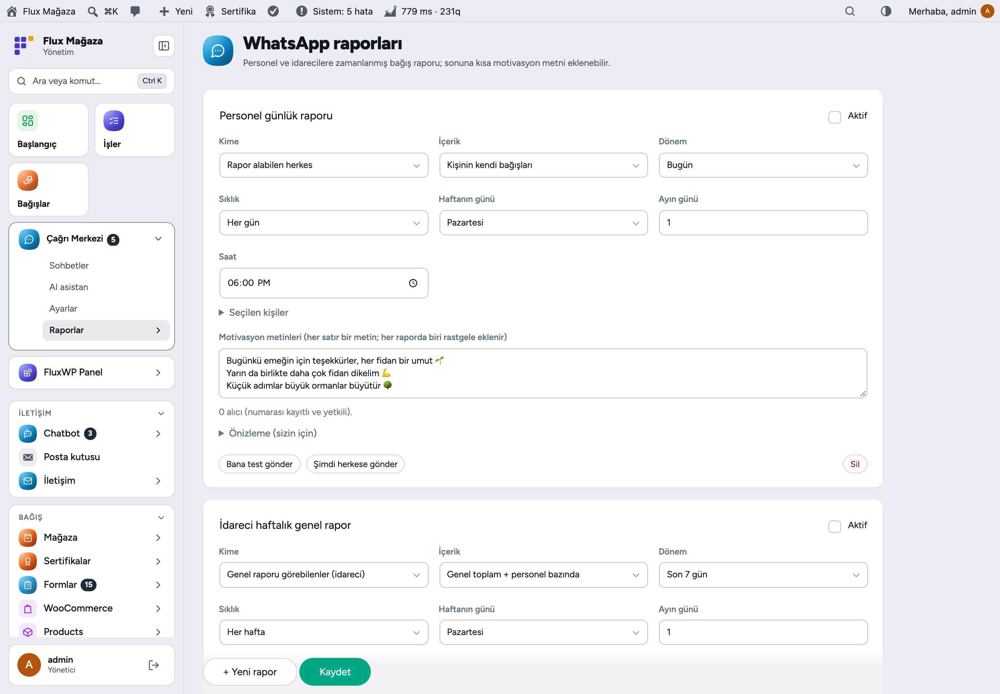
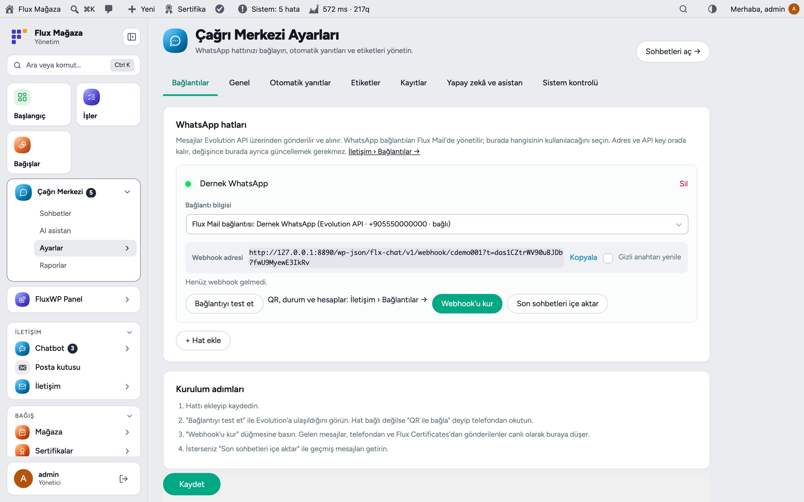
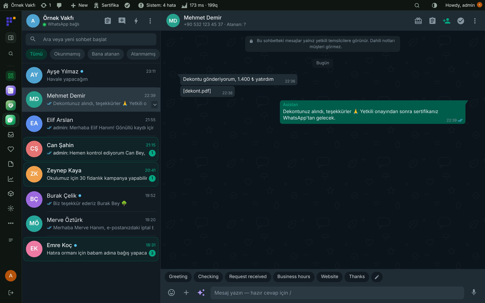
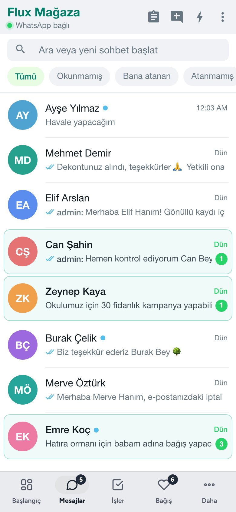
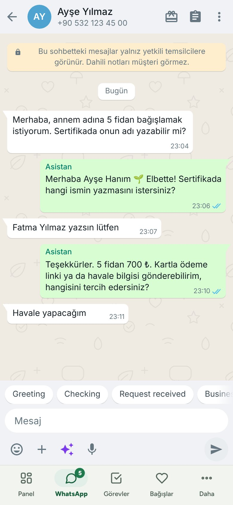

[English](README.md) · **Türkçe**

# Flux Chat

**WordPress içinde WhatsApp gelen kutusu; bağış alan bir yapay zekâ asistanıyla.** 
Flux Chat WhatsApp hattınızın tüm sohbetlerini panelde canlı gösterir: gelen ve giden mesajlar, telefondan yazılanlar ve sertifika mesajları. Ekip hazır cevaplar, etiketler, atama ve dahili notlarla cevap verir; bağış (Flux Donate) ve sertifika (Flux Certificates) sohbetten kaydedilir. Yapay zekâ asistanı bağışçıyla konuşur, dekontu okur, gerekince bir kişiye devreder.

[Özellikler](#özellikler) · [Ekran görüntüleri](#ekran-görüntüleri) · [Kurulum](#kurulum) · [Yol haritası](#yol-haritası)

---

## Neden Flux Chat?

Bir derneğin en yoğun kanalı tek bir telefondaki WhatsApp'tır: "Nasıl bağış yaparım?", "Dekontum ekte", "Sertifikaya annemin adı yazılabilir mi?". Telefonda ekip bunu paylaşamaz, hiçbir şey bağışa bağlanmaz, akşamlar ve hafta sonları cevapsız kalır. Flux Chat hattı WordPress'e taşır:

- 💬 **Ortak gelen kutusu.** Yetkisi olan herkes aynı sohbetleri canlı görür; atar, etiketler, bağışçının görmediği dahili not bırakır.
- 🌱 **Sohbetten bağış.** Konuşmadan çıkmadan bağış açın, ödeme linki ya da IBAN gönderin, dekontu eşleştirin, sertifikayı oluşturup gönderin.
- 🤖 **Kuralları bilen asistan.** Soruları cevaplar, siparişi alır, sertifika isimlerini yazar, dekontu okur; söz vermek yerine "yetkili onaylayacak" der. Yapamadığını ekibe devreder.
- 📈 **WhatsApp'a raporlar.** Personele ve yöneticilere günlük ya da haftalık bağış özetleri, sonunda bir motivasyon cümlesiyle.

## Özellikler

### Gelen kutusu
- Okunmamış, bana atanan ve atanmamış süzgeçli canlı sohbet listesi; ara ya da yeni sohbet başlat; birden çok hat (şube başına bir hat).
- Hazır cevaplar (`/` yazın), etiketler, atama, dahili notlar, hatırlatıcılar, otomatik yanıtlar ve mesai saatleri.
- Fotoğraf, sesli mesaj, belge, kişi kartı, alıntı ve tepkiler; eski mesajlar Evolution'dan sayfa sayfa gelir.
- Kişi paneli: bağışlar, sertifikalar, izinler, hafıza ve sohbetin kısa AI özeti. Mesaj istemeyenler için kara liste.
- Mobilde ve Flux App'da yerel WhatsApp ekranı olarak çalışır.

### Bağış ve sertifika
- Sohbetten bağış açma (tek bağış, tek ödeme, her isme ayrı sertifika), ödeme linki ya da banka bilgisi gönderme, ödenmemiş bağışı onayla iptal.
- WhatsApp'tan gelen dekont okunur ve bağışla eşleştirilir; daha önce kullanılmış dekontta uyarı verir; onay yetkili kişide kalır.
- Sohbette sertifika oluşturup gönderme; adına bağış yapılan kişiye ve referans personele de gider.

### Yapay zekâ asistanı (Flux AI üzerinden)
- **AI asistan** sayfası: çalışma özeti (harcama, sorular, bağışlar, dekontlar, devirler), yazdığı sohbetler, sürümlü talimat, belgeler, *AI ile düzenle*, dosya ve araç logu olan test sohbeti, senaryolu ve hakemli benchmark, hafıza ve arka plan işleri.
- Temsilciye cevap önerisi, sesli mesajı yazıya çevirme, sohbet özetleri, çevirici varsa cevapta görsel.
- Personel araçları: Flux Roles numarasıyla tanınan personel bağışçı adına bağış açar, sertifikayı yeniden gönderir, rapor ister.

### Raporlar
- **WhatsApp raporları:** personele (kendi bağışları) ve yöneticilere (personel başına toplamlar) günlük, haftalık ya da aylık zamanlanmış bağış raporları; önizleme ve "Bana test gönder".

## Ekran görüntüleri

| Asistan cevaplı sohbet | Gönüllülük sorusu |
|---|---|
|  |  |
| **AI asistan: özet ve sohbetler** | **Zamanlanmış WhatsApp raporları** |
|  |  |
| **Hatlar ve webhook** | **Flux Admin ile koyu tema** |
|  |  |
| **Mobil: sohbet listesi** | **Mobil: sohbet** |
|  |  |

## Kurulum

Gereksinimler: WordPress 6.4+, PHP 7.4+. Flux Mail üzerinden bir WhatsApp hattı (Evolution API 2.3+, Flux WPAPI ya da Cloud API). İsteğe bağlı: Flux Donate ve Flux Certificates (sohbetten bağış ve sertifika), Flux AI (asistan ve öneriler), Flux Roles (personel), Flux App.

**Zip ile**

1. [Releases](https://github.com/FluxWP/fluxwp/releases) sayfasında en son `flx-chat-v*` sürümünden `flx-chat.zip`'i indirin.
2. **Eklentiler › Yeni ekle › Eklenti yükle**, zip'i seçin, sonra **Etkinleştir**.

**FluxWP Panel ile** (sitelerimizde önerilen)

**FluxWP Panel › Paketler** tüm FluxWP paketlerini listeler; *Flux Chat* satırındaki **Kur**'a basın. Güncellemeler de buradan gelir.

**İlk adımlar**

1. **İletişim › Bağlantılar**'da (Flux Mail) WhatsApp numarasını ekleyip bağlayın.
2. **Çağrı Merkezi › Ayarlar › Bağlantılar**: o hattı seçin, **Bağlantıyı test et**, ardından **Webhook'u kur**; isterseniz **Son sohbetleri içe aktar**.
3. **Ayarlar**'da hazır cevapları ve etiketleri ekleyin; Flux AI'de anahtar varsa asistanı **Ayarlar › Yapay zekâ ve asistan**'dan açın.
4. **Çağrı Merkezi › Sohbetler**'i açıp ilk mesaja cevap verin.

> ⚠️ Hostinger'da hız sınırına takılmamak için canlı yenileme 10 saniyede bir çalışır (cevap akarken 3 sn, değişiklik yoksa 15 sn'ye kadar; arka plandaki sekme dakikada bir bakar). Webhook'taki gizli anahtarı paylaşmayın: adresi bilen sahte mesaj gönderebilir, sızarsa anahtarı yenileyin.

Ayrıntılı kurulum notları: [KURULUM.md](../../docs/cagri-merkezi/KURULUM.md) · Sürüm notları: [CHANGELOG.md](CHANGELOG.md)

## Yol haritası

| | |
|---|---|
| ✅ | Hazır cevaplı, etiketli ve atamalı canlı ortak gelen kutusu |
| ✅ | Sohbetten bağış, dekont ve sertifika |
| ✅ | Benchmark ve hafızalı AI bağış asistanı |
| ✅ | Personel ve yöneticilere zamanlanmış WhatsApp raporları |
| ✅ | Cloud API ve Flux WPAPI hatları, Flux App'da yerel ekran |
| ⬜ | İzinli toplu duyuru listeleri |
| ⬜ | Sohbet kapanınca memnuniyet sorusu |

## Lisans

Flux Chat, [GNU Genel Kamu Lisansı v2 veya üzeri](https://www.gnu.org/licenses/gpl-2.0.html) ile yayınlanır.

FluxWP tarafından geliştirilmiştir.
