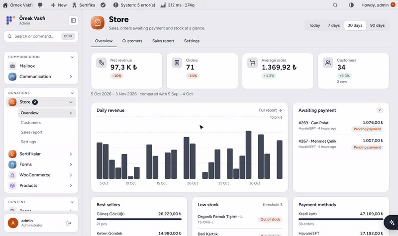
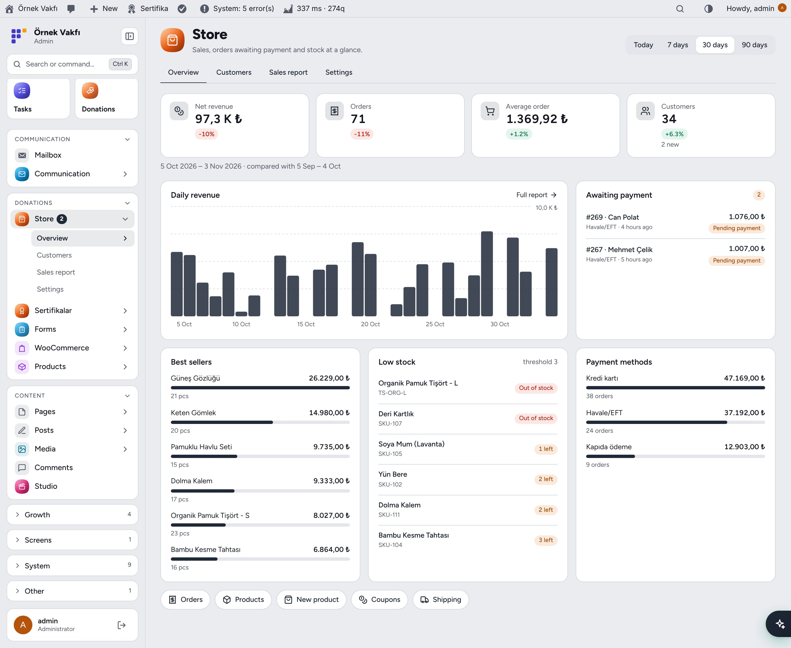
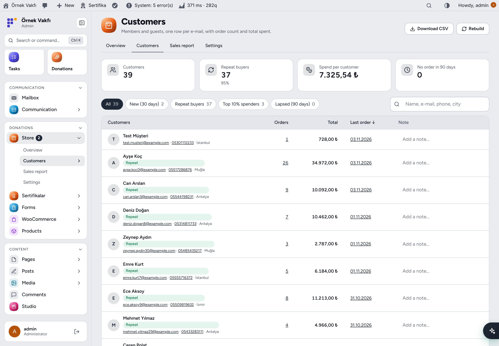
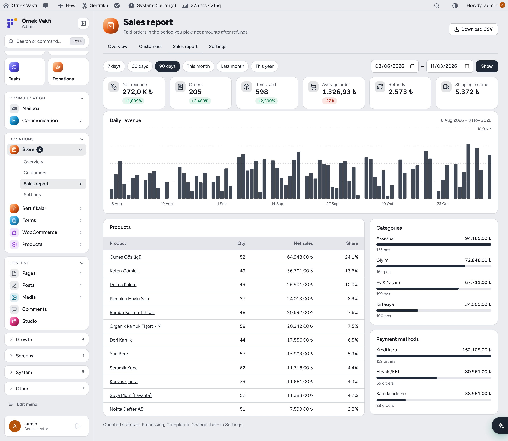
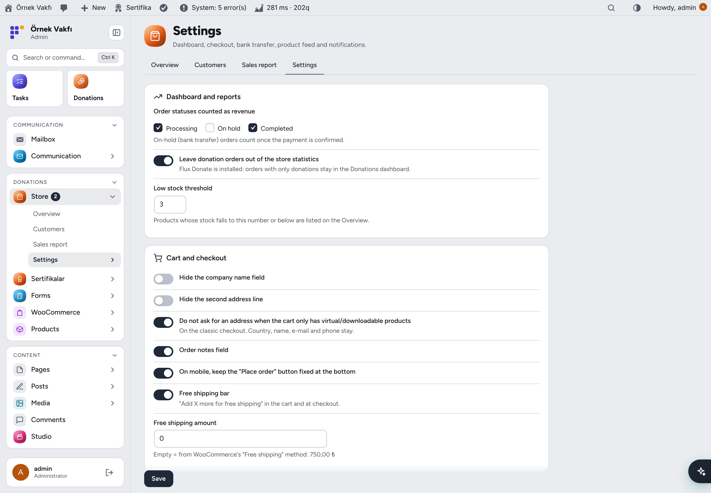
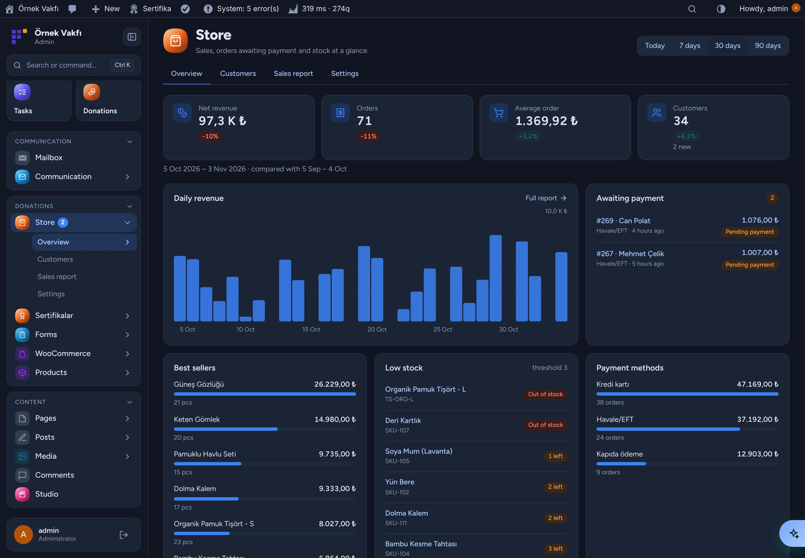
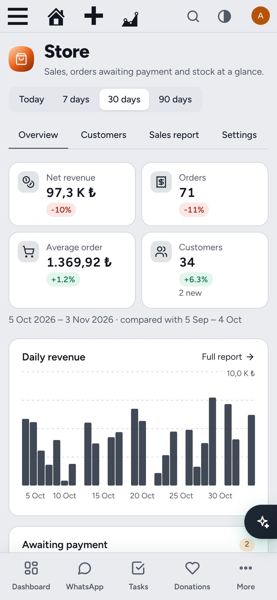
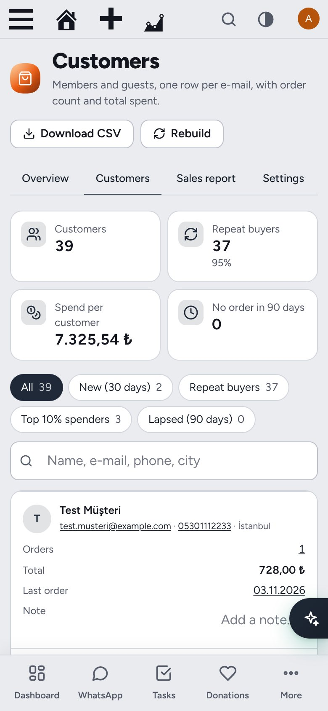

**English** · [Türkçe](README.tr.md)

# Flux Commerce

**A sales dashboard, customers and a better checkout for any WooCommerce store.** 
Flux Commerce sits on top of WooCommerce and adds what a small shop checks every day: revenue and orders at a glance, the customers who keep coming back, a sales report you can read, and bank transfers that customers can pay and prove on the site. It works for any store; nothing in it is about donations.

[Features](#features) · [Screenshots](#screenshots) · [Installation](#installation) · [For developers](#for-developers) · [Roadmap](#roadmap)

---

## Why Flux Commerce?

WooCommerce's own analytics are powerful but slow to read and need background jobs. Turkish shops also live on bank transfers that end up as screenshots in WhatsApp. Flux Commerce covers both:

- 📊 **One screen for the day:** net revenue, orders, average order and customers, compared with the previous period.
- 🏦 **Bank transfer that closes itself:** an order-specific reference, copyable IBAN, receipt upload on the site, one-click "Confirm payment".
- 👥 **Customers, not just users:** guests and members per e-mail, with repeat buyers, top spenders and lapsed customers.
- 🚚 **Small nudges that sell:** a free-shipping bar and a leaner checkout.
- 🛒 **Feeds and messages:** a Google Merchant feed and WhatsApp notifications through Flux Mail.

## Features

### Overview
- Today / 7 / 30 / 90 days: net revenue, orders, average order, customers (new ones too) with change against the previous period.
- Daily revenue chart, best sellers, orders awaiting payment (with "receipt in"), low stock, payment methods. A "Store · today" widget on the Dashboard.

### Customers
- One row per e-mail for members and guests: orders, total spent, first and last order, phone (WhatsApp link), city, an inline note.
- Segments: New (30 days), Repeat buyers, Top 10% spenders, Lapsed (90 days). Search, sort, CSV export.
- Kept up to date on every order status change; older orders are scanned once in chunks of 100.

### Sales report
- Presets or any date range: net revenue, orders, items, average order, refunds, shipping income with change.
- Products, categories and payment methods; CSV with summary, daily rows and every breakdown.

### Bank transfer with receipt upload
- Order-specific reference (`{kod} {ad}` → `SP1042 Ayşe Yılmaz`), copy buttons for recipient, IBAN, amount and reference on the thank-you page and in My account.
- Receipt upload (PDF/JPG/PNG/WEBP/HEIC) into a protected folder; the admin gets an e-mail (and WhatsApp).
- "Confirm payment" on the order screen and as an order action; a Transfer column in the orders list; optional auto-cancel after N days.
- Classic and block checkout. Hides itself when Flux Donate's bank transfer is on.

### Cart and checkout
- Hide company and address line 2; no address for virtual-only carts (classic); order notes on/off; sticky "Place order" on mobile.
- Free-shipping bar in the cart, checkout and mini cart, updated live in the cart block. Threshold from the settings or WooCommerce's Free shipping method.

### Product feed and notifications
- Google Merchant RSS with variations, sale prices, stock, GTIN/MPN and categories at a keyed address.
- WhatsApp through Flux Mail: bank details and payment confirmation to the customer, receipt and new-order alerts to the admin.

## Screenshots

| Store overview | Customers and segments |
|---|---|
|  |  |
| **Sales report** | **Settings** |
|  |  |
| **Dark mode** | **Mobile** |
|  |  |
| **Customers on mobile** |   |
|  |   |

## Installation

Requirements: WordPress 6.4+, PHP 7.4+. WooCommerce 8.0+. Optional: Flux Mail with a WhatsApp connection, Flux Admin.

**From a zip**

1. Download `flx-commerce.zip` from the latest `flx-commerce-v*` release on the [Releases](https://github.com/FluxWP/fluxwp/releases) page.
2. **Plugins › Add New › Upload Plugin**, choose the zip, then **Activate**.

**With Flux Updater** (recommended on our sites)

**Dashboard › Updates** lists every FluxWP package; click **Install** next to *Flux Commerce*. Updates arrive the same way.

**First steps**

1. Open **Store** in the admin menu.
2. **Store › Customers › Rebuild** once to bring in older orders.
3. Turn on **WooCommerce › Settings › Payments › Bank transfer (with receipt upload)**; the IBAN comes from "Direct bank transfer" if left empty.
4. Pick checkout options, the free-shipping amount and the feed under **Store › Settings**.

Full setup notes (Turkish): [KURULUM.md](../../docs/flx-commerce/KURULUM.md) · API reference: [API.md](../../docs/flx-commerce/API.md) · Release notes: [CHANGELOG.md](CHANGELOG.md)

## For developers

- `FLXCM_Stats::summary( $from, $to )` returns the whole report as an array; `flxcm_count_order` filters orders out of the statistics.
- Hooks: `flxcm_bank_placed`, `flxcm_receipt_uploaded`, `flxcm_bank_confirmed`; REST `POST flx-commerce/v1/receipt`.
- Full list: [API.md](../../docs/flx-commerce/API.md).

## Roadmap

| | |
|---|---|
| ✅ | Overview, customers, sales report |
| ✅ | Bank transfer with receipt upload, checkout options, free-shipping bar |
| ✅ | Google Merchant feed, WhatsApp notifications |
| ⬜ | Abandoned cart reminders over WhatsApp and e-mail |
| ⬜ | Customer detail page with order timeline |
| ⬜ | Stock alerts and reorder list |

## License

Flux Commerce Released under the [GNU General Public License v2 or later](https://www.gnu.org/licenses/gpl-2.0.html).

Made by FluxWP.
