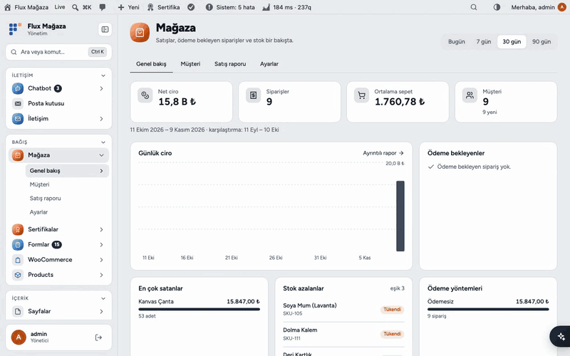
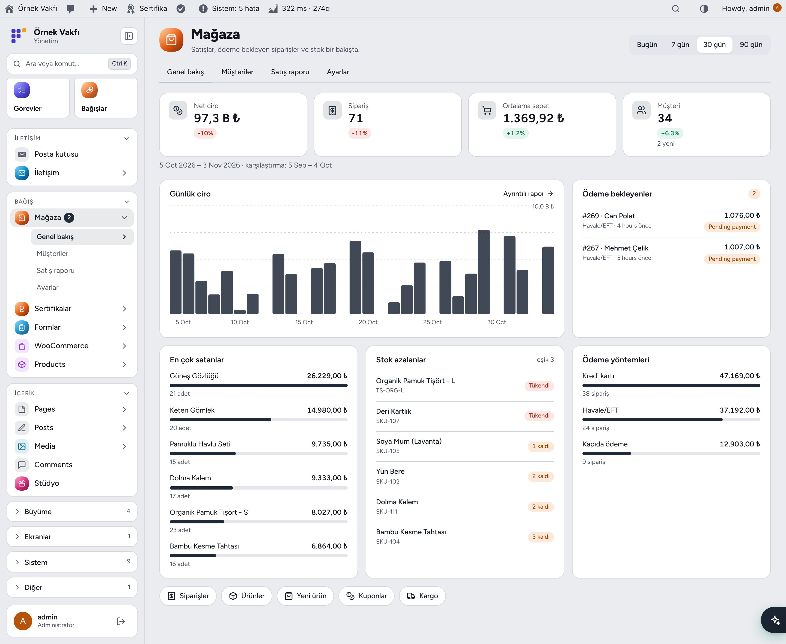
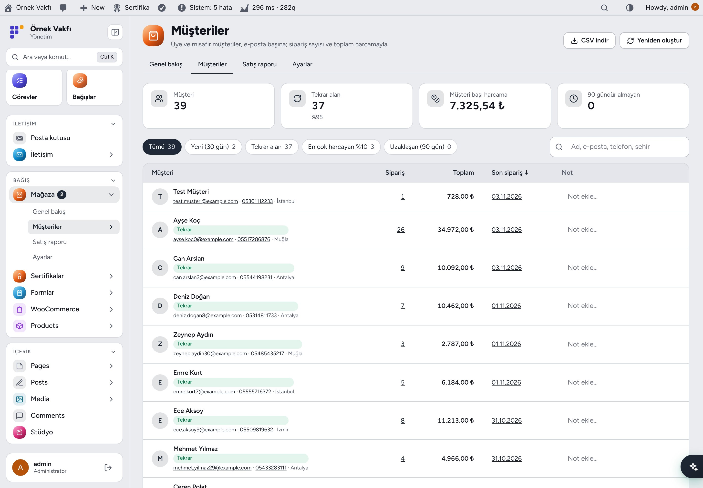
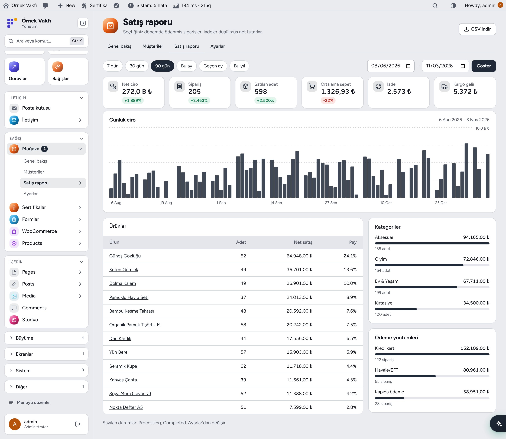
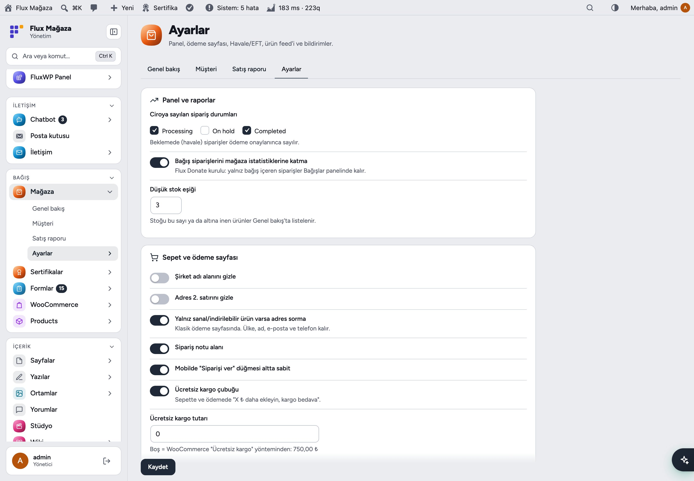
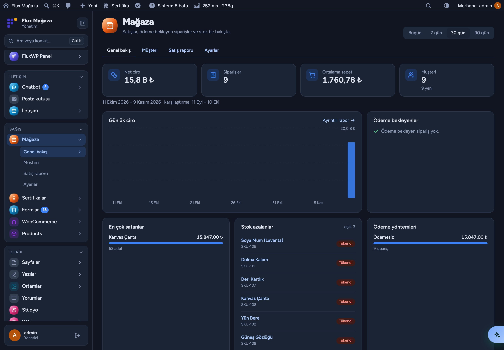
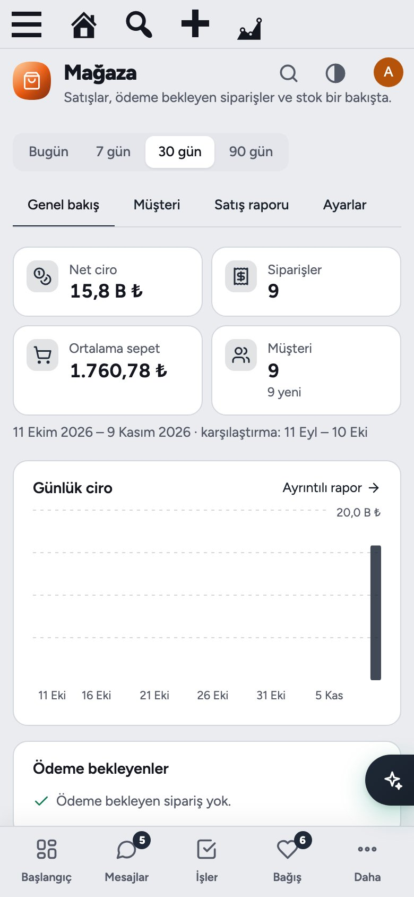
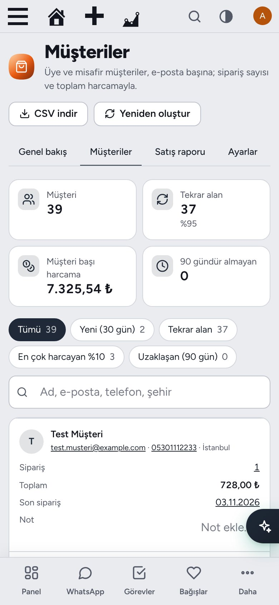

[English](README.md) · **Türkçe**

# Flux Commerce

**Her WooCommerce mağazası için satış paneli, müşteriler ve daha iyi bir ödeme sayfası.** 
Flux Commerce WooCommerce'in üzerine, küçük bir mağazanın her gün baktığı şeyleri ekler: bir bakışta ciro ve siparişler, tekrar gelen müşteriler, okunur bir satış raporu ve müşterinin sitede ödeyip dekontunu yükleyebildiği Havale/EFT. Her mağaza kullanabilir; içinde bağışa özgü bir şey yoktur.

[Özellikler](#özellikler) · [Ekran görüntüleri](#ekran-görüntüleri) · [Kurulum](#kurulum) · [Geliştiriciler için](#geliştiriciler-için) · [Yol haritası](#yol-haritası)

---

## Neden Flux Commerce?

WooCommerce'in kendi analizi güçlü ama okuması yavaş ve arka plan işi ister. Türkiye'de mağazalar da havaleyle yaşar; dekontlar WhatsApp'ta ekran görüntüsü olarak kalır. Flux Commerce ikisini de çözer:

- 📊 **Günün tek ekranı:** net ciro, sipariş, ortalama sepet ve müşteri; önceki döneme göre.
- 🏦 **Kendini kapatan havale:** siparişe özel açıklama kodu, kopyalanır IBAN, sitede dekont yükleme, tek tıkla "Ödemeyi onayla".
- 👥 **Kullanıcı değil müşteri:** üye ve misafirler e-posta başına; tekrar alanlar, en çok harcayanlar, uzaklaşanlar.
- 🚚 **Satışa küçük dokunuşlar:** ücretsiz kargo çubuğu ve sade ödeme sayfası.
- 🛒 **Feed ve mesajlar:** Google Merchant feed'i ve Flux Mail üzerinden WhatsApp bildirimleri.

## Özellikler

### Genel bakış
- Bugün / 7 / 30 / 90 gün: net ciro, sipariş, ortalama sepet, müşteri (yeniler dahil); önceki döneme göre değişim.
- Günlük ciro grafiği, en çok satanlar, ödeme bekleyenler ("dekont geldi" rozetiyle), stok azalanlar, ödeme yöntemleri. Başlangıç'ta "Mağaza · bugün" kartı.

### Müşteriler
- Üye ve misafir müşteriler e-posta başına tek satır: sipariş, toplam harcama, ilk/son sipariş, telefon (WhatsApp bağlantısı), şehir, satır içi not.
- Bölümler: Yeni (30 gün), Tekrar alan, En çok harcayan %10, Uzaklaşan (90 gün). Arama, sıralama, CSV.
- Her sipariş durumu değişiminde güncellenir; eski siparişler bir kez 100'lük parçalarla taranır.

### Satış raporu
- Hazır dönemler ya da tarih aralığı: net ciro, sipariş, adet, ortalama sepet, iade, kargo geliri ve değişim.
- Ürün, kategori ve ödeme yöntemi kırılımı; özet, günlük satırlar ve tüm kırılımlarla CSV.

### Dekont yüklemeli Havale/EFT
- Siparişe özel açıklama (`{kod} {ad}` → `SP1042 Ayşe Yılmaz`); teşekkür sayfasında ve Hesabım'da alıcı, IBAN, tutar ve açıklama için Kopyala düğmeleri.
- Korumalı klasöre dekont yükleme (PDF/JPG/PNG/WEBP/HEIC); yöneticiye e-posta (ve WhatsApp).
- Sipariş ekranında ve sipariş işlemlerinde "Ödemeyi onayla"; siparişler listesinde Havale sütunu; isteğe bağlı N gün sonra iptal.
- Klasik ve blok ödeme. Flux Donate'in havalesi açıksa kendini gizler.

### Sepet ve ödeme sayfası
- Şirket ve adres 2 gizleme; yalnız sanal ürünlü sepette adres sormama (klasik); sipariş notu aç/kapa; mobilde sabit "Siparişi ver".
- Sepet, ödeme ve mini sepette ücretsiz kargo çubuğu; blok sepette adet değişince canlı güncellenir. Eşik ayardan ya da WooCommerce "Ücretsiz kargo" yönteminden.

### Ürün feed'i ve bildirimler
- Varyasyon, indirimli fiyat, stok, GTIN/MPN ve kategorili Google Merchant RSS; anahtarlı adres.
- Flux Mail üzerinden WhatsApp: müşteriye havale bilgisi ve ödeme onayı, yöneticiye dekont ve yeni sipariş bildirimi.

## Ekran görüntüleri

| Mağaza genel bakış | Müşteriler ve bölümler |
|---|---|
|  |  |
| **Satış raporu** | **Ayarlar** |
|  |  |
| **Koyu mod** | **Mobil** |
|  |  |
| **Mobilde müşteriler** |   |
|  |   |

## Kurulum

Gereksinimler: WordPress 6.4+, PHP 7.4+. WooCommerce 8.0+. İsteğe bağlı: WhatsApp bağlantılı Flux Mail, Flux Admin.

**Zip ile**

1. [Releases](https://github.com/FluxWP/fluxwp/releases) sayfasında en son `flx-commerce-v*` sürümünden `flx-commerce.zip`'i indirin.
2. **Eklentiler › Yeni ekle › Eklenti yükle**, zip'i seçin, sonra **Etkinleştir**.

**Flux Setup ile** (sitelerimizde önerilen)

**Setup › Paketler** tüm FluxWP paketlerini listeler; *Flux Commerce* satırındaki **Kur**'a basın. Güncellemeler de buradan gelir.

**İlk adımlar**

1. Yönetim menüsünde **Mağaza**'yı açın.
2. Eski siparişler için bir kez **Mağaza › Müşteriler › Yeniden oluştur**.
3. **WooCommerce › Ayarlar › Ödemeler › Havale/EFT (dekont yüklemeli)**'yi açın; IBAN boşsa "Doğrudan banka havalesi"nden gelir.
4. Ödeme sayfası seçeneklerini, ücretsiz kargo tutarını ve feed'i **Mağaza › Ayarlar**'dan seçin.

Ayrıntılı kurulum notları: [KURULUM.md](../../docs/flx-commerce/KURULUM.md) · API başvurusu: [API.md](../../docs/flx-commerce/API.md) · Sürüm notları: [CHANGELOG.md](CHANGELOG.md)

## Geliştiriciler için

- `FLXCM_Stats::summary( $from, $to )` raporun tamamını dizi olarak verir; `flxcm_count_order` siparişi istatistikten çıkarır.
- Kancalar: `flxcm_bank_placed`, `flxcm_receipt_uploaded`, `flxcm_bank_confirmed`; REST `POST flx-commerce/v1/receipt`.
- Tam liste: [API.md](../../docs/flx-commerce/API.md).

## Yol haritası

| | |
|---|---|
| ✅ | Genel bakış, müşteriler, satış raporu |
| ✅ | Dekont yüklemeli Havale/EFT, ödeme seçenekleri, ücretsiz kargo çubuğu |
| ✅ | Google Merchant feed'i, WhatsApp bildirimleri |
| ⬜ | WhatsApp ve e-postayla terk edilen sepet hatırlatması |
| ⬜ | Sipariş zaman çizelgeli müşteri sayfası |
| ⬜ | Stok uyarıları ve yeniden sipariş listesi |

## Lisans

Flux Commerce, [GNU Genel Kamu Lisansı v2 veya üzeri](https://www.gnu.org/licenses/gpl-2.0.html) ile yayınlanır.

FluxWP tarafından geliştirilmiştir.
