

**English** · [Türkçe](README.tr.md)

# Flux CRM

**Donors, customers, volunteers and leads in one contact card, with a timeline, RFM scoring and segments.** 
Flux CRM turns the people already on your site into contacts: every donation, order, form and WhatsApp chat lands on one card per person. It scores everyone by recency, frequency and value, shows who is drifting away, and keeps live segments you can send to from Flux Mail.

[Features](#features) · [Screenshots](#screenshots) · [Installation](#installation) · [For developers](#for-developers) · [Roadmap](#roadmap)

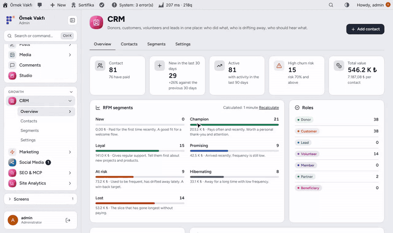

---

## Why Flux CRM?

Donations live in Flux Donate, orders in WooCommerce, messages in Flux Chat and sign-ups in Flux Forms. The same person shows up four times and nobody sees the whole picture. Flux CRM ties them together:

- 👤 **One card per person:** matched by source, account, e-mail and phone; what you type by hand is never overwritten.
- 🕒 **The whole story:** donations, orders, forms, WhatsApp, notes and calls on one timeline.
- 📉 **Who is drifting away:** RFM segments and a churn risk based on each person's own rhythm.
- 🎯 **Segments you can send to:** rule-based live lists that appear as recipients in Flux Mail, consent checked at send time.

## Features

### Contacts
- Roles (Donor, Customer, Lead, Volunteer, Member, Partner, Beneficiary and your own), tags, owner, short note.
- Consents per channel (e-mail, SMS, WhatsApp, ad audiences); every change is written to the timeline.
- Search, filters by role, RFM segment, saved segment, tag and consent; bulk tag, role, archive and delete; CSV export.

### Timeline
- Donations, orders (minus refunds), form answers, WhatsApp (one line per day), notes, calls, meetings, role and segment changes.
- Filters for payments, messages, forms and notes, with links back to the original record.

### Sources
- Flux Donate, WooCommerce (donation-only orders skipped), Flux Chat, Flux Forms and site members.
- New records arrive instantly; "Sync everything" imports the past in chunks of 100. Every event has a unique key, so syncing twice never duplicates anything.

### RFM scoring
- Recency, frequency (distinct paid days) and value in quintiles: New, Champion, Loyal, Promising, At risk, Hibernating, Lost.
- Churn risk follows the person's own payment gap: a monthly donor is at risk after 45 days, a yearly one is not. Recalculated daily, about 20 seconds at a time, continuing from the last contact.

### Segments
- Rule editor with a live count and sample contacts: role, tag, RFM, value, paid days, last payment, last activity, churn, consent, source, city.
- Use a segment as recipients in Flux Mail; only people who allowed that channel receive it.

### Journeys
- A journey starts when a contact enters a value group, gets a tag or role, has an event, or is added; steps wait, send e-mail / WhatsApp / SMS, tag, or continue only if a condition holds.
- New journeys are drafts until you turn them on. Only people who allowed the channel get messages, never in quiet hours, at most 3 per week; a donation can end the journey early.
- AI and MCP can draft and edit journeys; turning one on needs your approval.

## Screenshots

| Overview | Contacts |
|---|---|
| 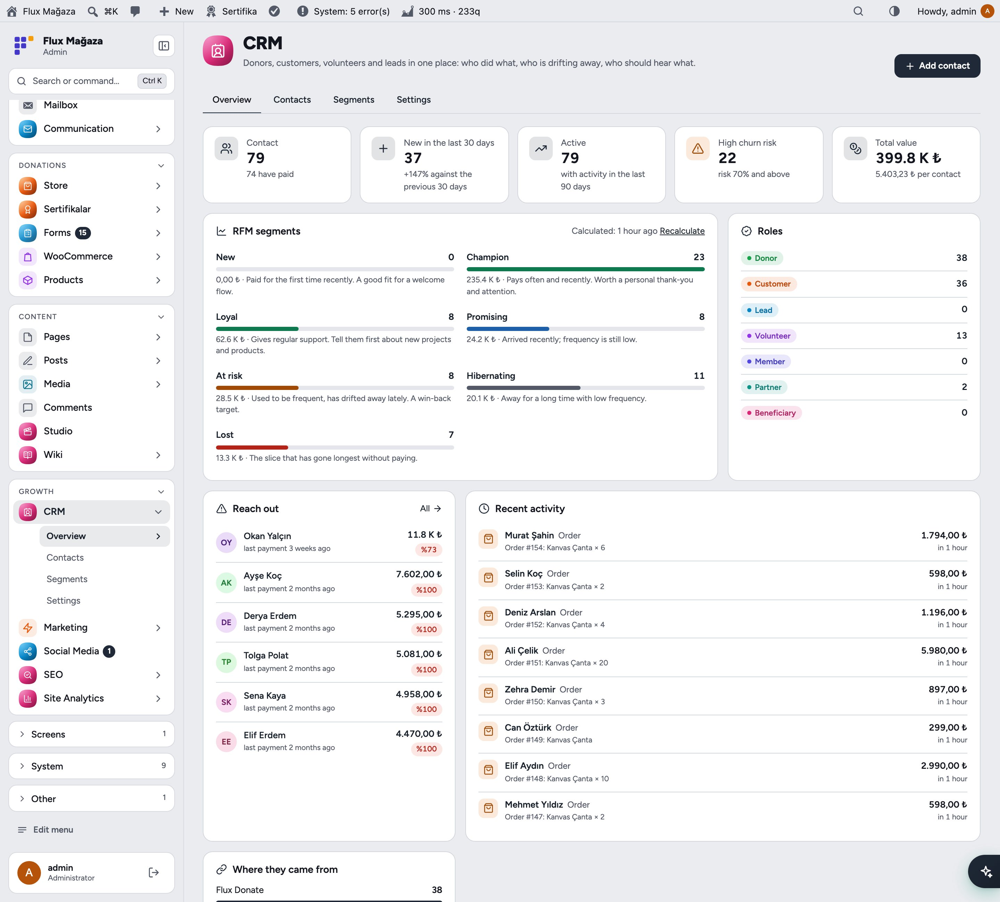 | 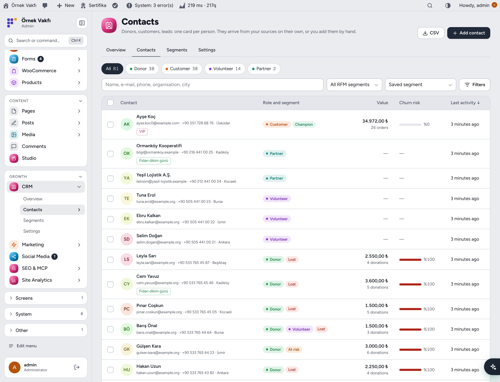 |
| **Contact card and timeline** | **Segments** |
| 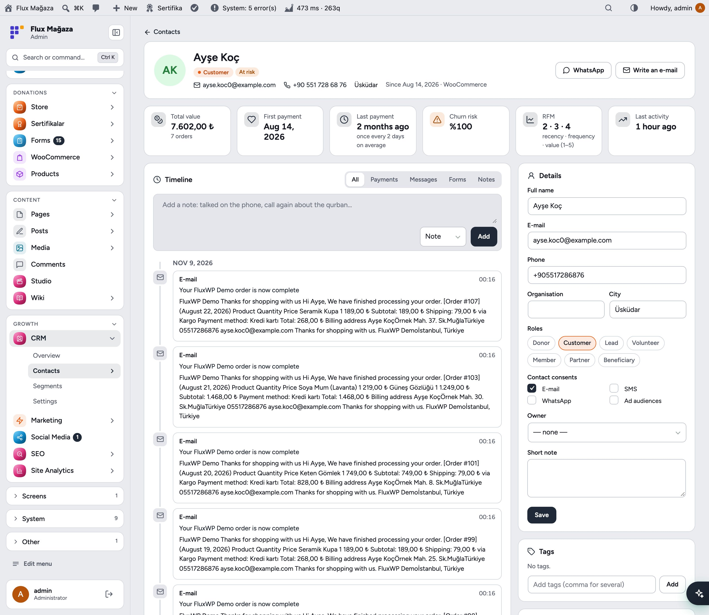 | 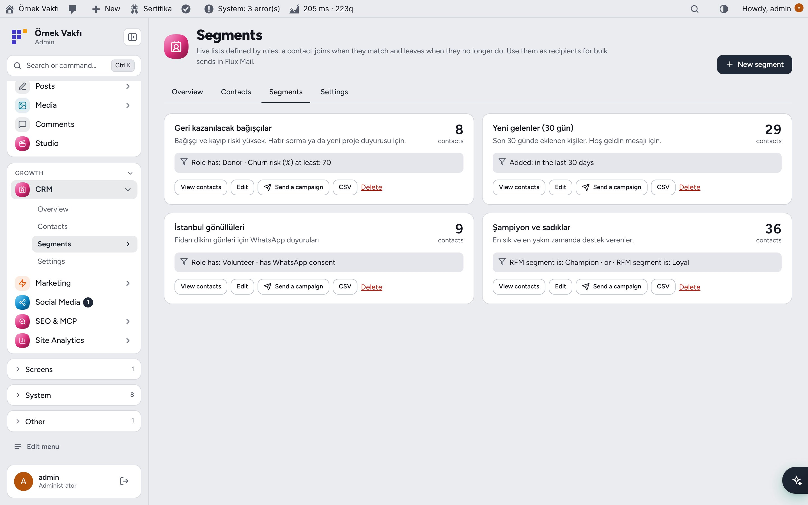 |
| **Segment rule editor** | **Settings** |
| 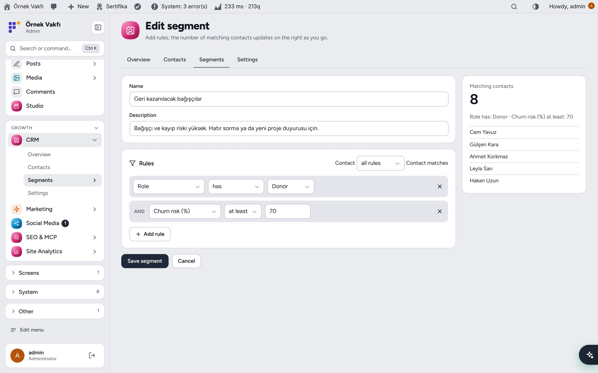 | 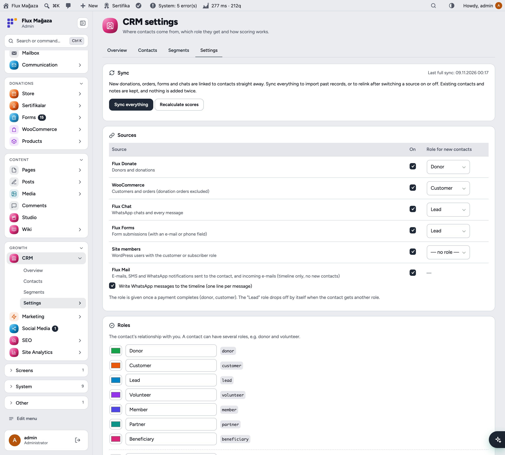 |
| **Dark mode** | **Contact card in dark mode** |
| 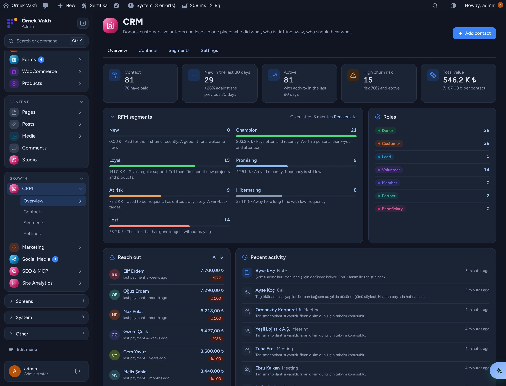 | 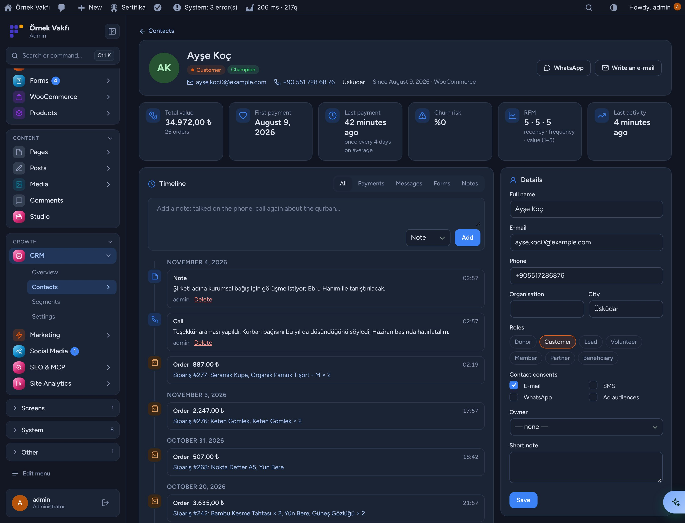 |
| **Mobile** | **Contact on mobile** |
| 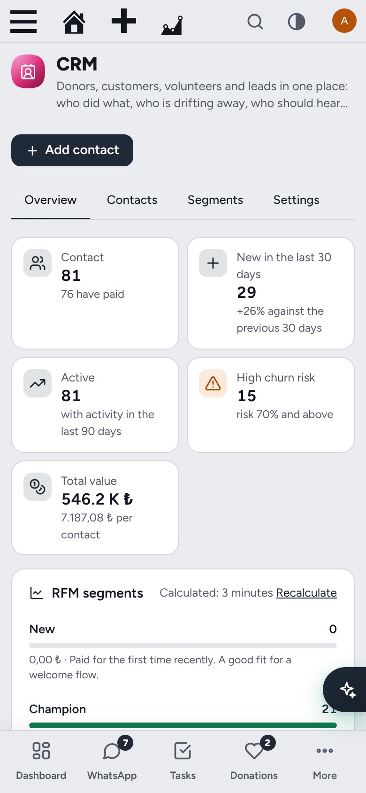 | 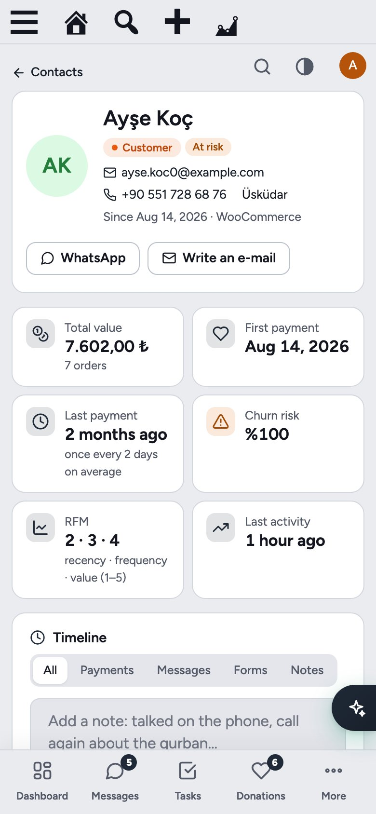 |

## Installation

Requirements: WordPress 6.4+, PHP 7.4+. Optional sources: Flux Donate, WooCommerce, Flux Chat, Flux Forms. Optional: Flux Mail (sending), Flux AI, Flux Admin.

**From a zip**

1. Download `flx-crm.zip` from the latest `flx-crm-v*` release on the [Releases](https://github.com/FluxWP/fluxwp/releases) page.
2. **Plugins › Add New › Upload Plugin**, choose the zip, then **Activate**.

**With FluxWP Panel** (recommended on our sites)

**FluxWP Panel › Packages** lists every FluxWP package; click **Install** next to *Flux CRM*. Updates arrive the same way.

**First steps**

1. Open **CRM** in the admin menu.
2. **CRM › Settings › Sync everything** once to bring in past donations, orders, forms and chats.
3. Pick which role each source gives new contacts, and the churn threshold.
4. Build a segment under **CRM › Segments** and send to it from **Flux Mail › Send**.

Full setup notes (Turkish): [KURULUM.md](../../docs/flx-crm/KURULUM.md) · API reference: [API.md](../../docs/flx-crm/API.md) · Release notes: [CHANGELOG.md](CHANGELOG.md)

## For developers

- `FLXCRM_Contacts::upsert()`, `FLXCRM_Events::add()` with a `uniq` key, `FLXCRM_Contacts::ids( array( 'rules' => … ) )`.
- Actions: `flxcrm_event`, `flxcrm_contact_created`, `flxcrm_role_added`, `flxcrm_segment_changed`, `flxcrm_consent_changed`; filters `flxcrm_roles`, `flxcrm_segment_fields`, `flxcrm_fx_rate`, `flxcrm_sync_sources`.
- REST `flx-crm/v1` and 25 AI & MCP tools (one registry, `flxcrm_tools`): read and edit contacts, roles, tags, consents, timeline, segments and settings from Flux AI or any MCP client; delete, merge, bulk and send need approval. Full list: [API.md](../../docs/flx-crm/API.md).

## Roadmap

| | |
|---|---|
| ✅ | Contacts, roles, tags, consents, timeline |
| ✅ | Sources: Flux Donate, WooCommerce, Flux Chat, Flux Forms, site members |
| ✅ | RFM scoring, churn risk, segments for Flux Mail |
| ⬜ | Pipelines (donation follow-up, partnership, volunteering) |
| ✅ | Journeys: welcome, win-back and your own flows with frequency caps and quiet hours |
| ⬜ | Flux Ads: ad audiences and conversions as a separate plugin |

## License

Flux CRM Released under the [GNU General Public License v2 or later](https://www.gnu.org/licenses/gpl-2.0.html).

Made by FluxWP.
