

[English](README.md) · **Türkçe**

# Flux CRM

**Bağışçı, müşteri, gönüllü ve adaylar tek kişi kartında: zaman tüneli, RFM skorlama ve segmentler.** 
Flux CRM sitede zaten olan insanları kişiye dönüştürür: her bağış, sipariş, form ve WhatsApp sohbeti kişi başına tek karta düşer. Herkesi yenilik, sıklık ve değere göre puanlar, kimin uzaklaştığını gösterir ve Flux Mail'den gönderim yapabileceğiniz canlı segmentler tutar.

[Özellikler](#özellikler) · [Ekran görüntüleri](#ekran-görüntüleri) · [Kurulum](#kurulum) · [Geliştiriciler için](#geliştiriciler-için) · [Yol haritası](#yol-haritası)

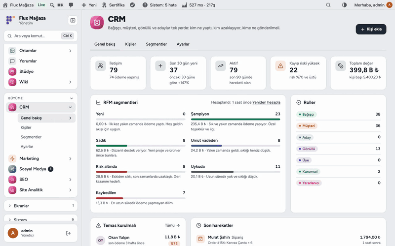

---

## Neden Flux CRM?

Bağışlar Flux Donate'te, siparişler WooCommerce'te, mesajlar Flux Chat'te, başvurular Flux Forms'ta. Aynı kişi dört yerde görünür, kimse resmin tamamını görmez. Flux CRM hepsini birleştirir:

- 👤 **Kişi başına tek kart:** kaynak, hesap, e-posta ve telefonla eşleşir; elle yazdığınız bilgi ezilmez.
- 🕒 **Hikâyenin tamamı:** bağış, sipariş, form, WhatsApp, not ve aramalar tek zaman tünelinde.
- 📉 **Kim uzaklaşıyor:** RFM segmentleri ve kişinin kendi ritmine göre kayıp riski.
- 🎯 **Gönderilebilir segmentler:** kurallı canlı listeler Flux Mail'de alıcı olarak görünür, izin gönderim anında kontrol edilir.

## Özellikler

### Kişiler
- Roller (Bağışçı, Müşteri, Aday, Gönüllü, Üye, Kurumsal, Yararlanıcı ve kendi rolleriniz), etiketler, sorumlu, kısa not.
- Kanal başına izin (e-posta, SMS, WhatsApp, reklam kitleleri); her değişiklik zaman tünelinde.
- Arama; rol, RFM segmenti, kayıtlı segment, etiket ve izin filtreleri; toplu etiket, rol, arşiv ve silme; CSV.

### Zaman tüneli
- Bağış, sipariş (iadeler düşülür), form yanıtları, WhatsApp (günde bir satır), not, arama, görüşme, rol ve segment değişimleri.
- Ödemeler, mesajlar, formlar ve notlar filtresi; asıl kayda bağlantı.

### Kaynaklar
- Flux Donate, WooCommerce (yalnız bağış içeren siparişler hariç), Flux Chat, Flux Forms ve site üyeleri.
- Yeni kayıtlar anında gelir; "Tümünü eşitle" geçmişi 100'lük parçalarla alır. Her olayın tekil anahtarı var, iki kez eşitlemek hiçbir şeyi çiftlemez.

### RFM skorlama
- Yenilik, sıklık (ödeme yapılan gün) ve değer beşte birlik dilimlerle: Yeni, Şampiyon, Sadık, Umut vadeden, Risk altında, Uykuda, Kaybedilen.
- Kayıp riski kişinin kendi ödeme aralığına göre: ayda bir bağış yapan 45 gün gelmeyince riskli, yılda bir yapan değil. Her gün, kaldığı kişiden devam ederek yaklaşık 20 saniyelik parçalarla yeniden hesaplanır.

### Segmentler
- Canlı sayı ve örnek kişilerle kural düzenleyici: rol, etiket, RFM, değer, ödeme günü, son ödeme, son hareket, kayıp riski, izin, kaynak, şehir.
- Segmenti Flux Mail'de alıcı olarak seçin; yalnız o kanala izin verenler alır.

### Yolculuklar
- Kişi bir değer grubuna girince, etiket ya da rol alınca, bir olay olunca veya eklenince başlar; adımlar bekler, e-posta / WhatsApp / SMS gönderir, etiketler ya da koşul tutarsa devam eder.
- Yeni yolculuk siz açana kadar taslaktır. Mesaj yalnız o kanala izin verenlere, sessiz saatler dışında, haftada en fazla 3 kez gider; bağış gelirse yolculuk erken biter.
- AI ve MCP yolculuk taslağı yazar ve düzenler; açmak sizin onayınızla olur.

## Ekran görüntüleri

| Genel bakış | Kişiler |
|---|---|
| 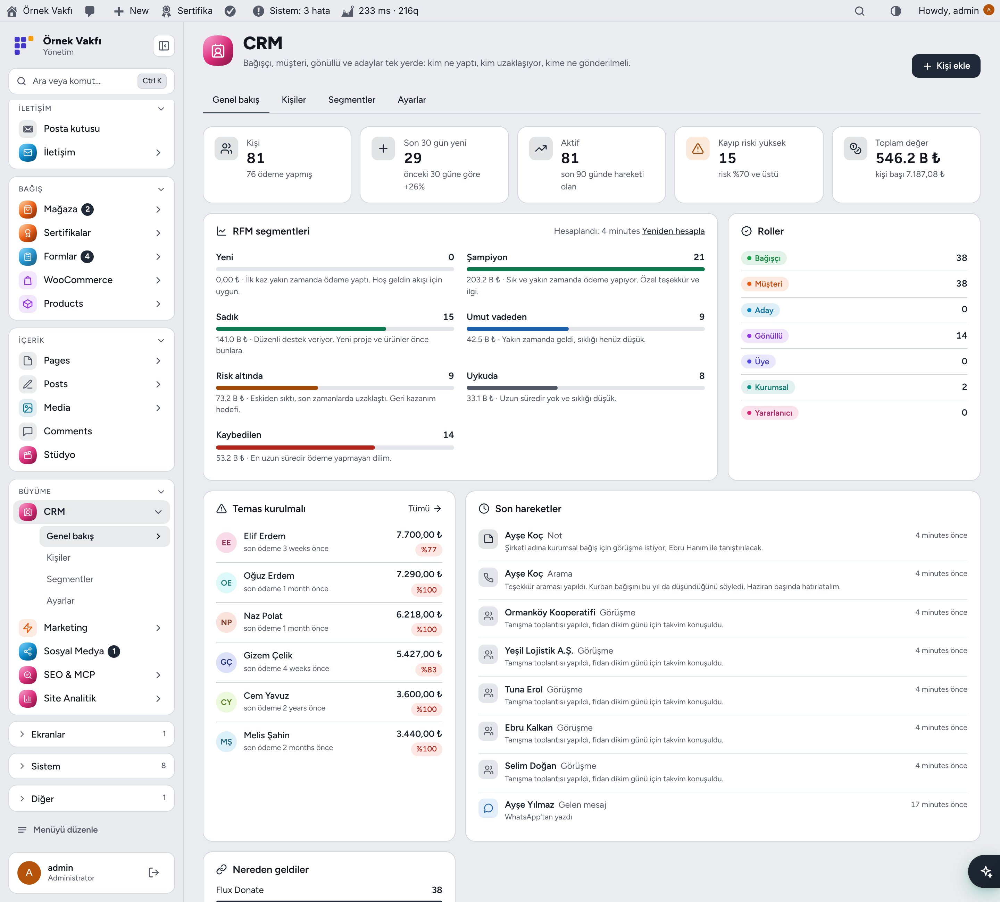 | 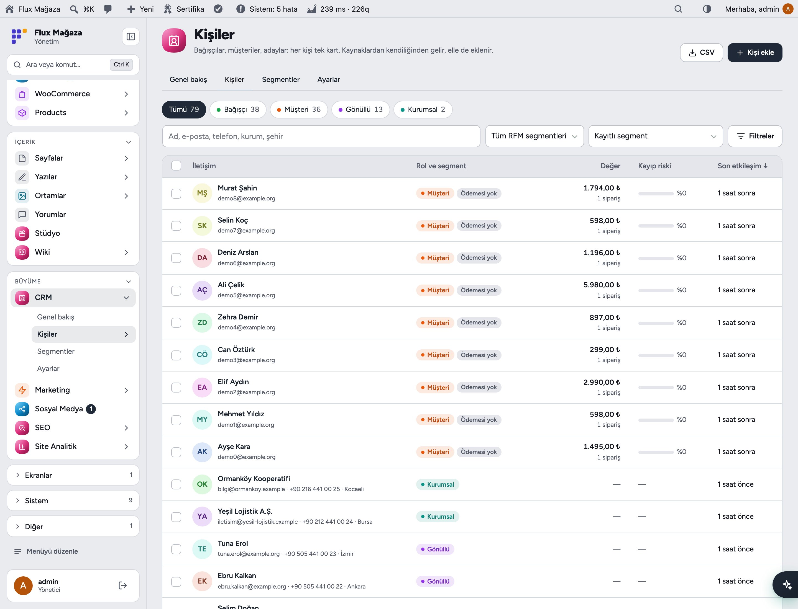 |
| **Kişi kartı ve zaman tüneli** | **Segmentler** |
| 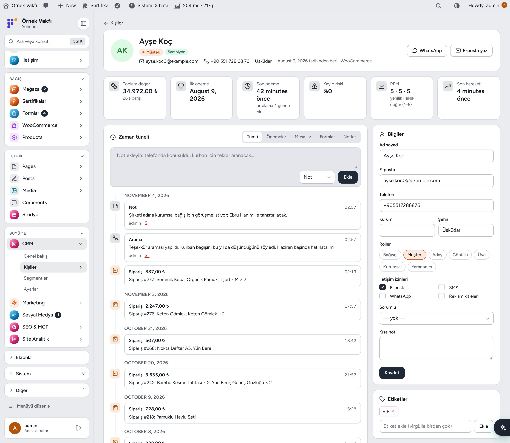 | 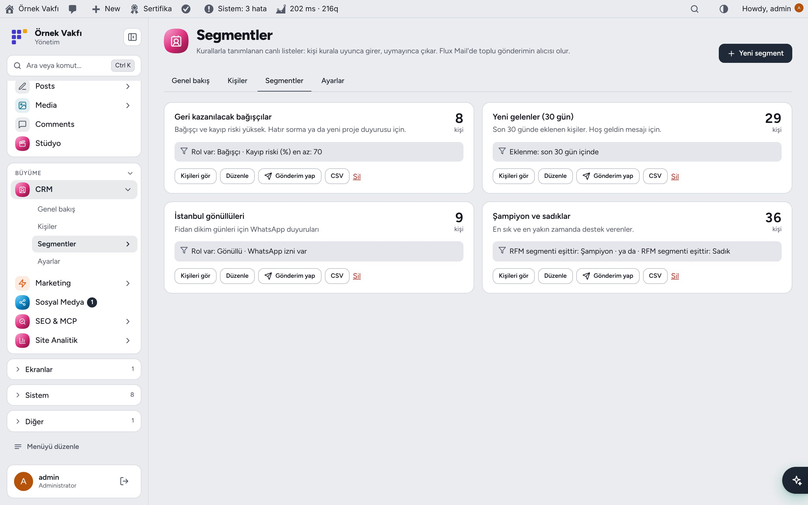 |
| **Segment kural düzenleyici** | **Ayarlar** |
| 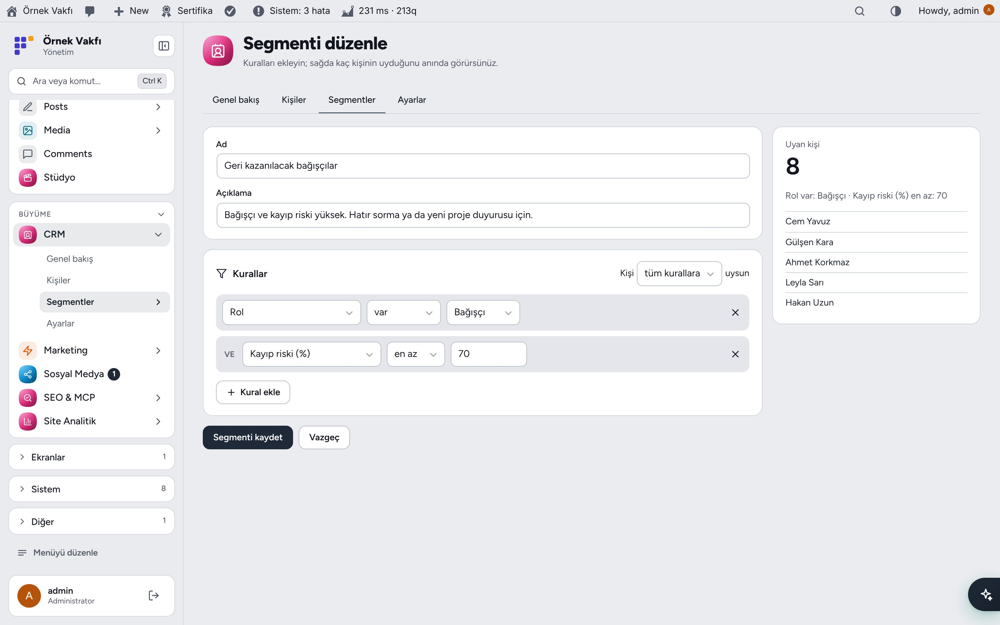 | 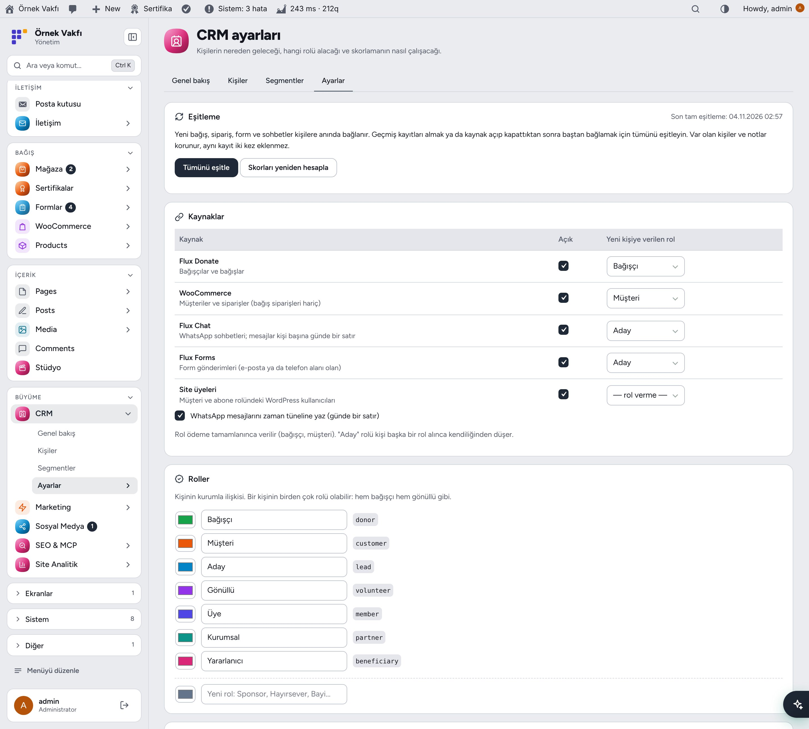 |
| **Koyu mod** | **Koyu modda kişi kartı** |
| 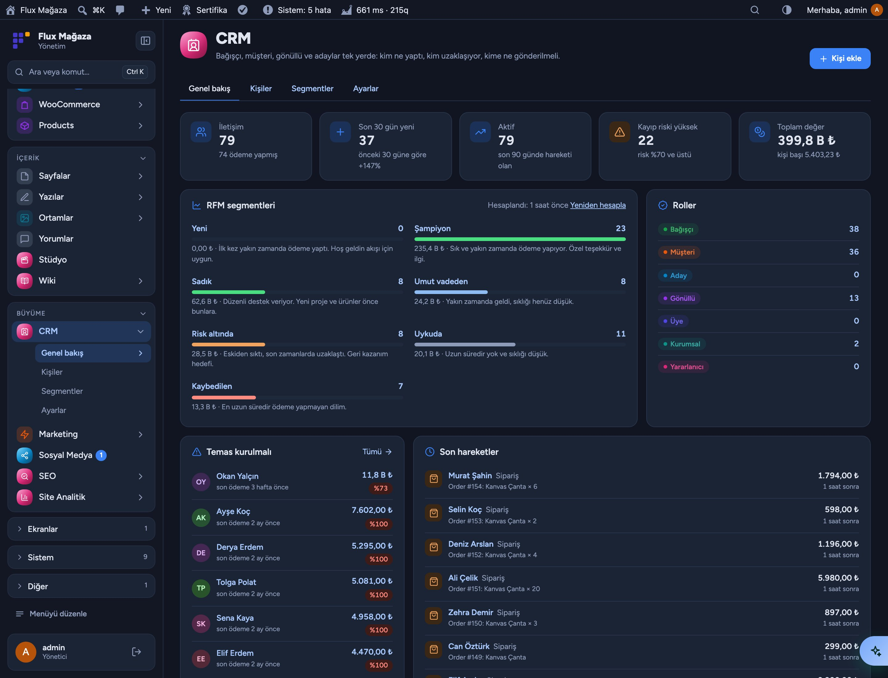 | 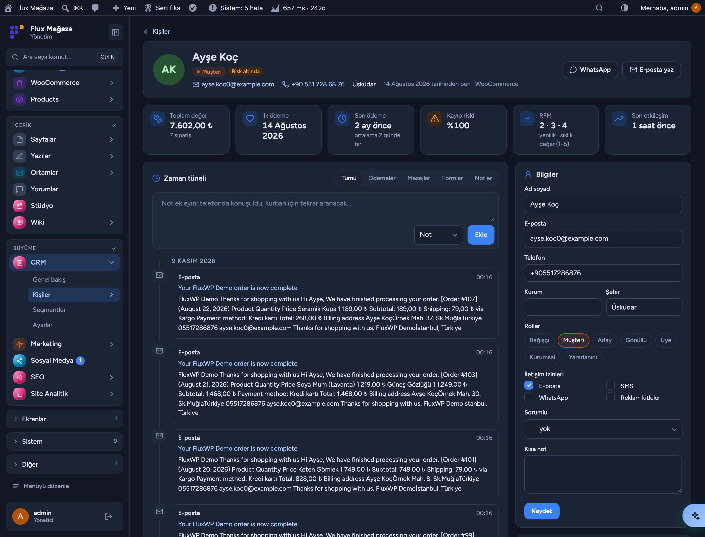 |
| **Mobil** | **Mobilde kişi** |
| 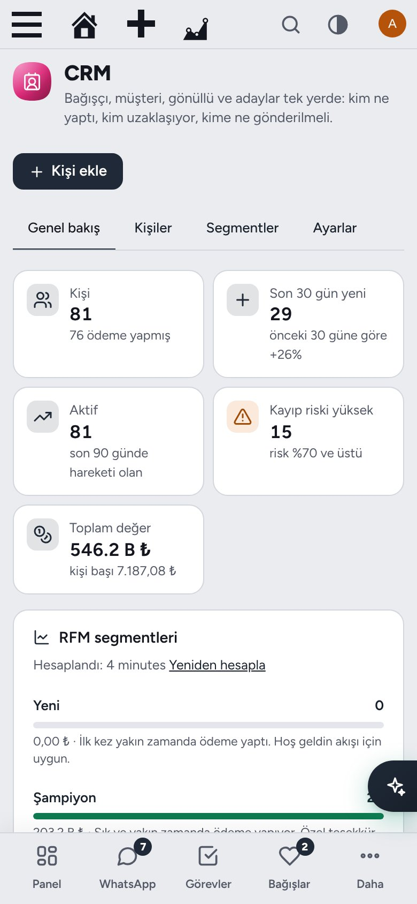 | 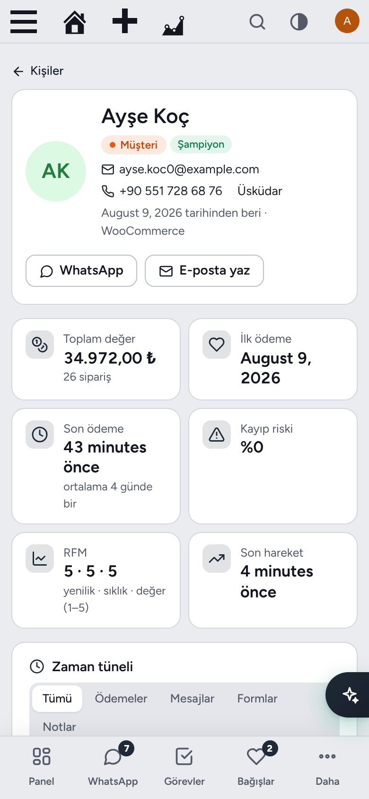 |

## Kurulum

Gereksinimler: WordPress 6.4+, PHP 7.4+. İsteğe bağlı kaynaklar: Flux Donate, WooCommerce, Flux Chat, Flux Forms. İsteğe bağlı: Flux Mail (gönderim), Flux AI, Flux Admin.

**Zip ile**

1. [Releases](https://github.com/FluxWP/fluxwp/releases) sayfasında en son `flx-crm-v*` sürümünden `flx-crm.zip`'i indirin.
2. **Eklentiler › Yeni ekle › Eklenti yükle**, zip'i seçin, sonra **Etkinleştir**.

**FluxWP Panel ile** (sitelerimizde önerilen)

**FluxWP Panel › Paketler** tüm FluxWP paketlerini listeler; *Flux CRM* satırındaki **Kur**'a basın. Güncellemeler de buradan gelir.

**İlk adımlar**

1. Yönetim menüsünde **CRM**'i açın.
2. Geçmiş bağış, sipariş, form ve sohbetler için bir kez **CRM › Ayarlar › Tümünü eşitle**.
3. Her kaynağın yeni kişiye vereceği rolü ve kayıp riski eşiğini seçin.
4. **CRM › Segmentler**'de segment kurun, **Flux Mail › Gönder**'den o segmente gönderin.

Ayrıntılı kurulum notları: [KURULUM.md](../../docs/flx-crm/KURULUM.md) · API başvurusu: [API.md](../../docs/flx-crm/API.md) · Sürüm notları: [CHANGELOG.md](CHANGELOG.md)

## Geliştiriciler için

- `FLXCRM_Contacts::upsert()`, `uniq` anahtarlı `FLXCRM_Events::add()`, `FLXCRM_Contacts::ids( array( 'rules' => … ) )`.
- Eylemler: `flxcrm_event`, `flxcrm_contact_created`, `flxcrm_role_added`, `flxcrm_segment_changed`, `flxcrm_consent_changed`; filtreler `flxcrm_roles`, `flxcrm_segment_fields`, `flxcrm_fx_rate`, `flxcrm_sync_sources`.
- REST `flx-crm/v1` ve 25 yapay zekâ & MCP aracı (tek kayıt, `flxcrm_tools`): kişi, rol, etiket, izin, zaman tüneli, segment ve ayarlar Flux AI ya da herhangi bir MCP istemcisinden okunur ve düzenlenir; silme, birleştirme, toplu işlem ve gönderim onay ister. Tam liste: [API.md](../../docs/flx-crm/API.md).

## Yol haritası

| | |
|---|---|
| ✅ | Kişiler, roller, etiketler, izinler, zaman tüneli |
| ✅ | Kaynaklar: Flux Donate, WooCommerce, Flux Chat, Flux Forms, site üyeleri |
| ✅ | RFM skorlama, kayıp riski, Flux Mail için segmentler |
| ⬜ | Süreçler (bağış takibi, kurumsal ortaklık, gönüllülük) |
| ✅ | Yolculuklar: hoş geldin, geri kazanım ve kendi akışlarınız; sıklık sınırı ve sessiz saatler |
| ⬜ | Flux Ads: reklam kitleleri ve dönüşümler, ayrı eklenti |

## Lisans

Flux CRM, [GNU Genel Kamu Lisansı v2 veya üzeri](https://www.gnu.org/licenses/gpl-2.0.html) ile yayınlanır.

FluxWP tarafından geliştirilmiştir.
