

[English](README.md) · **Türkçe**

# Flux Donate

**WooCommerce üzerinde fidan ve kampanya bağışları; her bağışa sertifika.** 
Flux Donate WooCommerce'i bir bağış sistemine çevirir: sabit paketli, adetli ya da serbest tutarlı bağış türleri ve kampanyalar, kısa bir bağış formu, kart, havale ve aylık bağış, bağışçı kartları ve Dashboard. Bağış ödenince Flux Certificates sertifikayı hazırlar, WhatsApp'tan ve e-postayla gönderir.

[Özellikler](#özellikler) · [Ekran görüntüleri](#ekran-görüntüleri) · [Kurulum](#kurulum) · [Geliştiriciler için](#geliştiriciler-için) · [Yol haritası](#yol-haritası)

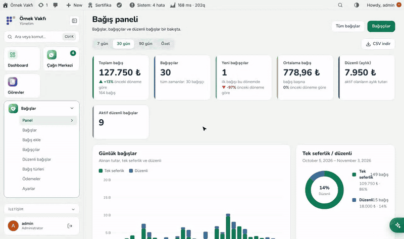

---

## Neden Flux Donate?

Mağaza ödeme sayfası kargo için tasarlanmıştır: teslimat adresi, şirket, posta kodu, "Sipariş ver". Bağışçı ise "5 fidan" seçmek, sertifikaya bir isim yazmak ve ödemek ister. Flux Donate WooCommerce'in ödeme ve sipariş altyapısını korur, ama tüm yolu bağışa göre kurar:

- 🌱 **Ürün değil, bağış türü.** Paketler (1, 5, 10 fidan), − / + adet, hazır tutarlı serbest bağış, hedefli ve tarihli kampanyalar. Fiyat her zaman türden gelir, tarayıcıdan gelen tutara bakılmaz.
- 🧾 **Kısa ödeme sayfası.** Tek iletişim alanı (telefon ya da e-posta), adres yok, tek Şartlar onayı ve altta sabit "Ödeme yap" çubuğu.
- 🏦 **Kart, havale ve aylık bağış.** Sayfada taksitli kart alanları (iyzico), kişiye özel açıklama kodlu ve dekont yüklemeli havale, kayıtlı kartla aylık bağış.
- 🎓 **Kişi başına sertifika.** Birkaç kişi adına yapılan bağışta her isme ayrı sertifika; WhatsApp ve e-postayla gider.
- 📊 **Rakamlar tek yerde:** toplamlar, bağışçılar, düzenli gelir, tür ve kampanyaya göre bağışlar, en çok bağış yapanlar.

## Özellikler

### Bağış
- **Bağış seçenekleri** bloğu / `[flx_bagis_secenekleri]`: sekme olarak türler, rozetli paket kartları (En popüler, Avantajlı, Aile paketi), − / + adet, hazır tutar düğmeli serbest tutar, "Her ay tekrarla".
- "Kendim için" ya da "Başkası adına" (isim sertifikaya yazılır), sertifika için WhatsApp ve e-posta, "Bana da gönder", Flux Certificates'dan bağışçının seçebileceği tasarımlar.
- Tek iletişim bölümlü, zorunlu Şartlar onaylı ve sabit toplam çubuklu klasik ve blok ödeme sayfası.
- **Havale:** IBAN tek yerden, kişiye özel açıklama kodu, teşekkür sayfasında ya da **Hesabım › Bekleyen bağışlarım**'da dekont yükleme; tek tıkla **Ödemeyi onayla** sertifikayı gönderir.
- **Kart (iyzico):** ödeme sayfasında kart alanları, taksit, 3D Secure, "Kartımı kaydet". **Aylık bağış** kayıtlı kartla yenilenir, olmazsa 1 ve 3 gün sonra tekrar dener.

### Yönetim
- **Dashboard:** toplam bağış, bağışçı, yeni bağışçı, ortalama bağış, aylık düzenli gelir, aktif düzenli bağış, günlük grafik, tek seferlik/düzenli, türe ve forma göre, en çok bağış yapanlar, CSV.
- **Bağışlar:** süzgeçler, sepet başına tek satır, kalem ve isimli ayrıntı, yazdırılabilir makbuz, WooCommerce üzerinden iade, dekont önizlemeli ve tekrar eden dekont uyarılı havale onay kartı.
- **Bağışçılar:** kişi başına tek kart (telefon ya da e-postayla eşleşir, adla asla); geçmiş, düzenli bağışlar, sertifikalar ve izinler.
- **Bağış türleri ve kampanyalar:** kategori, seçenek ve fiyat, serbest tutar, adet, düzenli bağış, tarihler, ilerlemeli hedef, açık/kapalı/arşiv; başlamak için örnek setler. Her türün gizli bir WooCommerce ürünü vardır.
- Başka yolla gelen bağışlar için **Bağış ekle**; Flux Roles ile bağış başına **referans**, personel yalnız kendisininkileri görür.
- iyzico ve Google Merchant Center için `bagis-urunleri.xml` ürün listesi; isteğe bağlı Kurban modülü.

## Ekran görüntüleri

| Bağış paneli | Sitedeki bağış formu |
|---|---|
| 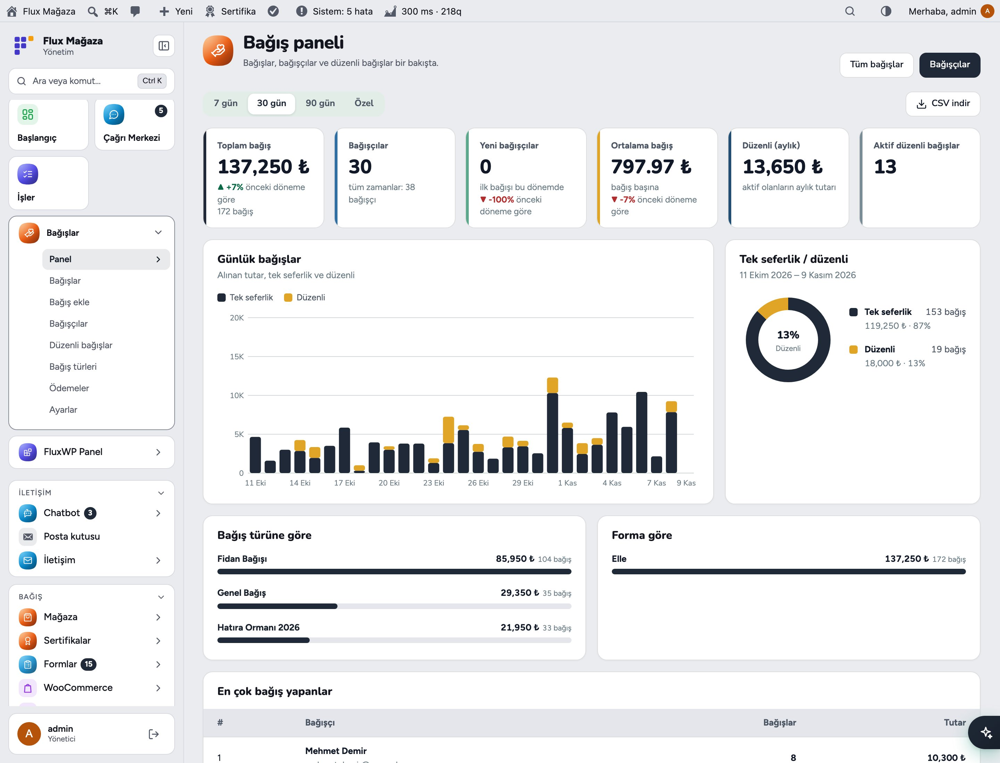 | 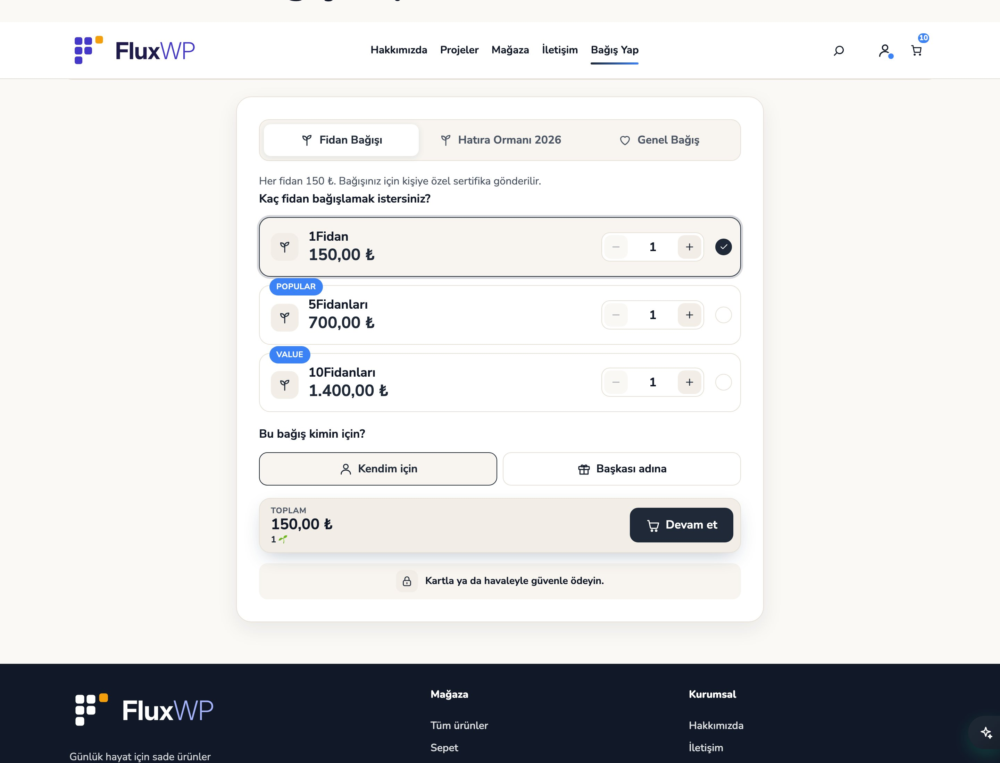 |
| **Bağışlar** | **Bağış ayrıntısı** |
| 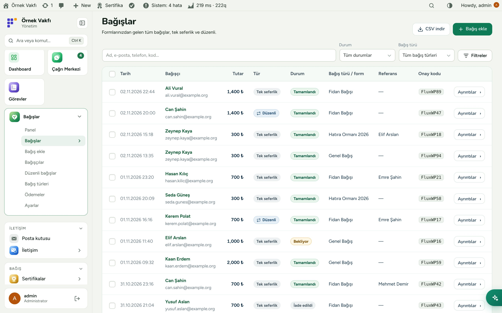 | 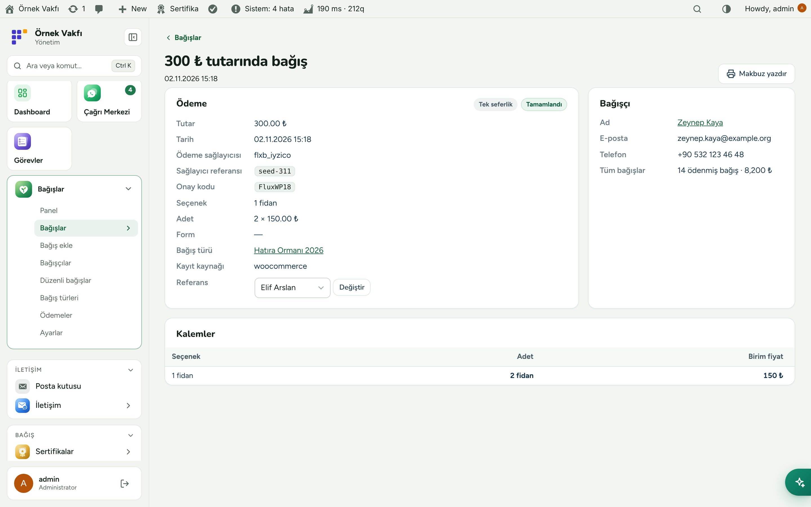 |
| **Bağış türleri ve kampanyalar** | **Bağışçı kartı** |
| 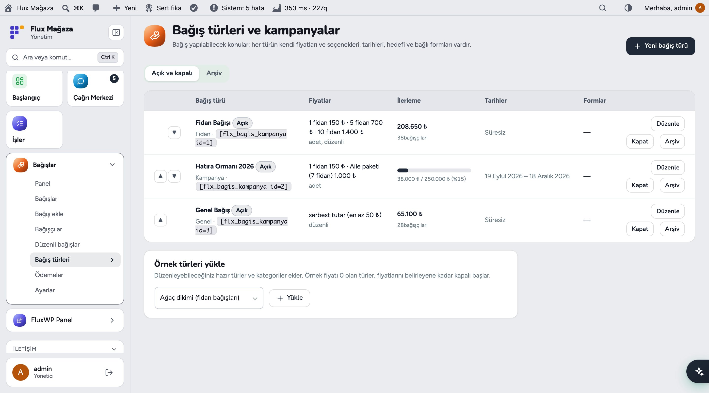 | 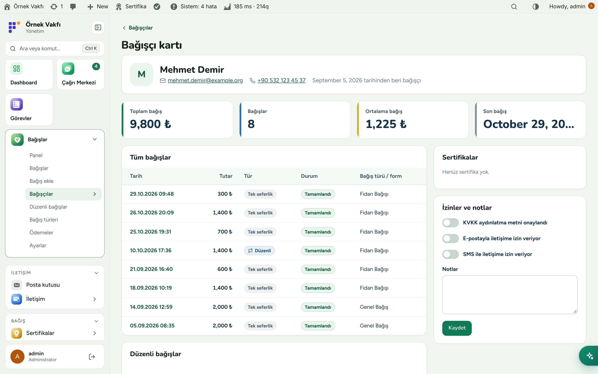 |
| **Düzenli bağışlar** | **Kısa ödeme sayfası** |
| 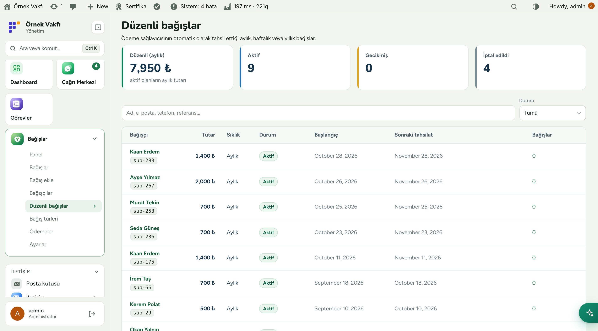 | 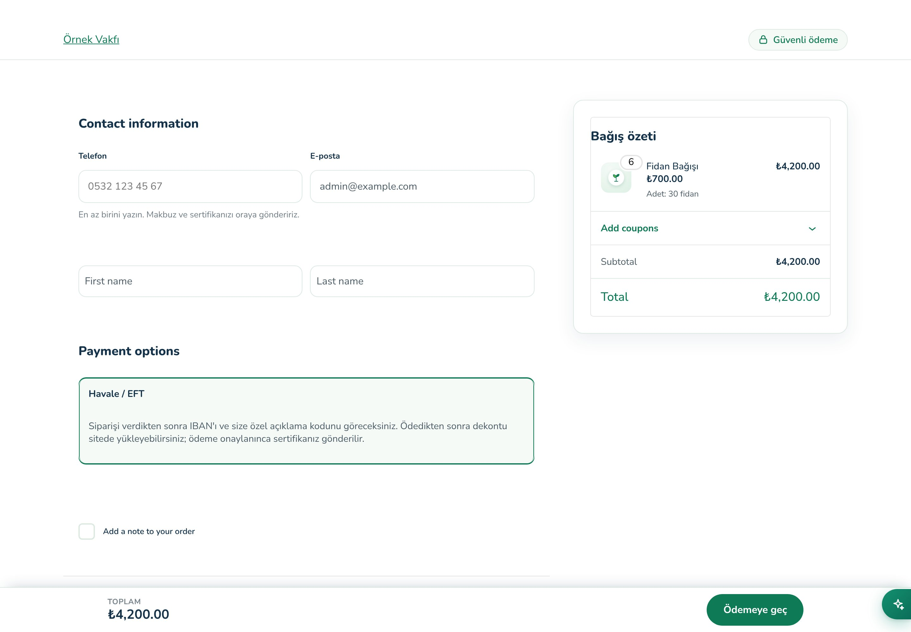 |
| **Flux Admin ile koyu tema** | **Mobil: panel** |
| 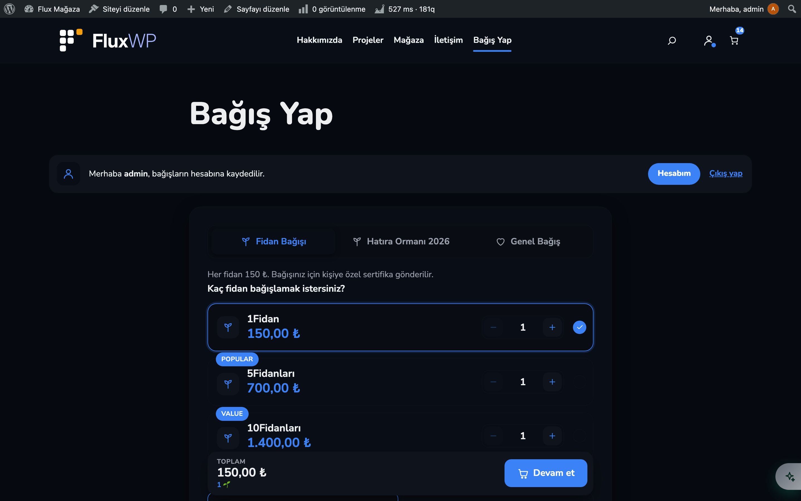 | 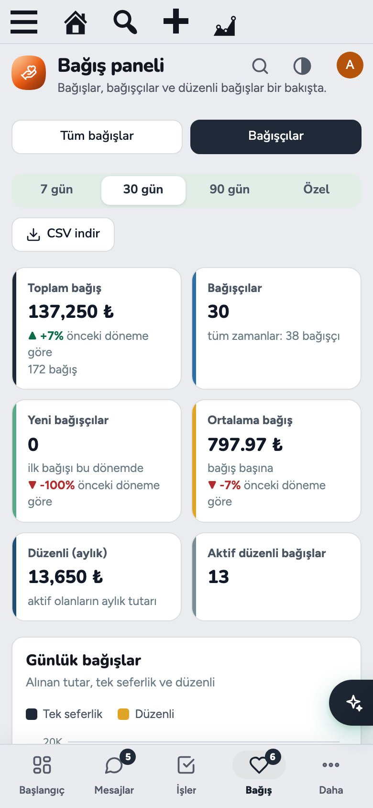 |
| **Mobil: bağış formu** |   |
| 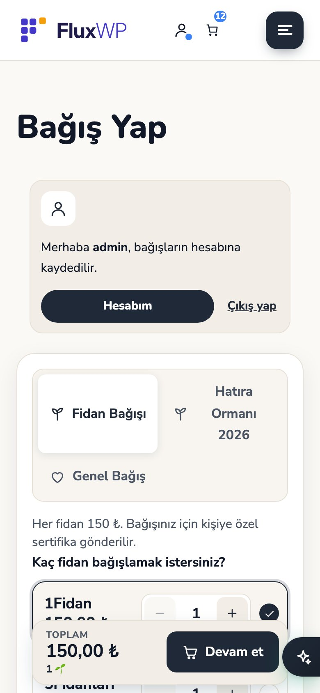 |   |

## Kurulum

Gereksinimler: WordPress 6.4+, PHP 7.4+. WooCommerce 8.0+. İsteğe bağlı: Flux Certificates 1.2+ (sertifika), Flux Mail (e-posta, WhatsApp), Flux Forms 2.1+ (ödeme formları), iyzico WooCommerce eklentisi.

**Zip ile**

1. [Releases](https://github.com/FluxWP/fluxwp/releases) sayfasında en son `flx-donate-v*` sürümünden `flx-donate.zip`'i indirin.
2. **Eklentiler › Yeni ekle › Eklenti yükle**, zip'i seçin, sonra **Etkinleştir**.

**Flux Setup ile** (sitelerimizde önerilen)

**Setup › Paketler** tüm FluxWP paketlerini listeler; *Flux Donate* satırındaki **Kur**'a basın. Güncellemeler de buradan gelir.

**İlk adımlar**

1. WooCommerce'i kurup etkinleştirin (para birimi TRY), ardından Flux Donate'ı.
2. **Bağışlar › Bağış türleri**: bir tür oluşturun (ya da **Örnek türleri yükle**) ve *Bağış seçenekleri bloğunda göster*'i işaretleyin.
3. **Bağışlar › Ayarlar › WooCommerce › Online bağış sayfasını oluştur**; sonra **WooCommerce › Ayarlar › Ödemeler**'de *Havale (bağış)* ve *Kart (iyzico)* yöntemlerini açın.
4. **Ayarlar › Sistem kontrolü**'nü (Flux Speed varsa **Performans › Sistem Kontrolü**) açıp kırmızı satırları düzeltin.

> ⚠️ Aylık bağış için WP-Cron gerçek bir cron'la çalışmalı. Flux WooCommerce Bağış (`flx-wc-bagis`) emekli: yaptığı her şey Flux Donate'ın içinde, ikisini birlikte açmayın.

Ayrıntılı kurulum notları: [KURULUM.md](../../docs/bagis-eklentisi/KURULUM.md) · API başvurusu: [API.md](../../docs/bagis-eklentisi/API.md)

## Geliştiriciler için

- Tema için okuma API'si: `flxb_get_types()`, `flxb_get_type()`, `flxb_type_state()`, REST `/wp-json/flxb/v1/types`, ön seçim `?flxb_opt=…&flxb_qty=…`.
- Diğer paketlerden kayıt: `flxb_create_order()` (önerilen) ya da `FLXB_Donations::record()`; onay rozetleri için `flxb_pending_count()`.
- Flux App için `flxb/v1/me*` ve `flxb/v1/app/*` uçları; Flux Roles için `flxb_view_own`, `flxb_create_ref`, `flxb_donors_own`, `flxb_dashboard` yetkileri.
- Kısa kodlar: `[flx_bagis_secenekleri]`, `[flx_bagis_kampanya slug="fidan"]`.

## Yol haritası

| | |
|---|---|
| ✅ | Bağış türleri, kampanyalar ve bağış paneli |
| ✅ | Kart, havale ve aylık bağışlı WooCommerce ödeme sayfası |
| ✅ | Kişi başına sertifika ve bağışçının seçtiği tasarımlar |
| ✅ | Flux Roles ile referans ve personel görünümleri |
| ✅ | Mobil uygulamada onay |
| ⬜ | Postayla basılı sertifika |
| ⬜ | Bağışçının aylık tutarını kendisinin değiştirmesi |

## Lisans

Flux Donate, [GNU Genel Kamu Lisansı v2 veya üzeri](https://www.gnu.org/licenses/gpl-2.0.html) ile yayınlanır.

FluxWP tarafından geliştirilmiştir.
