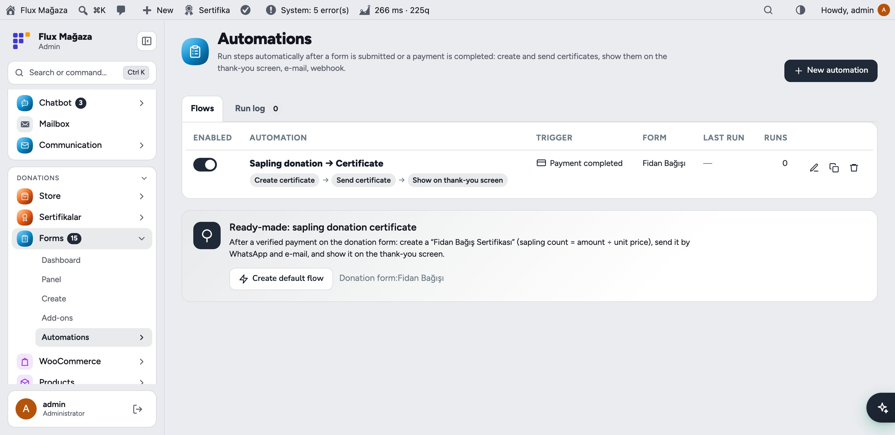
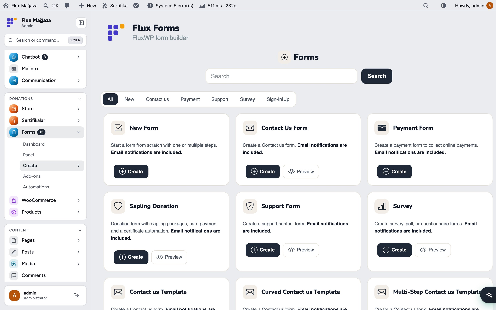
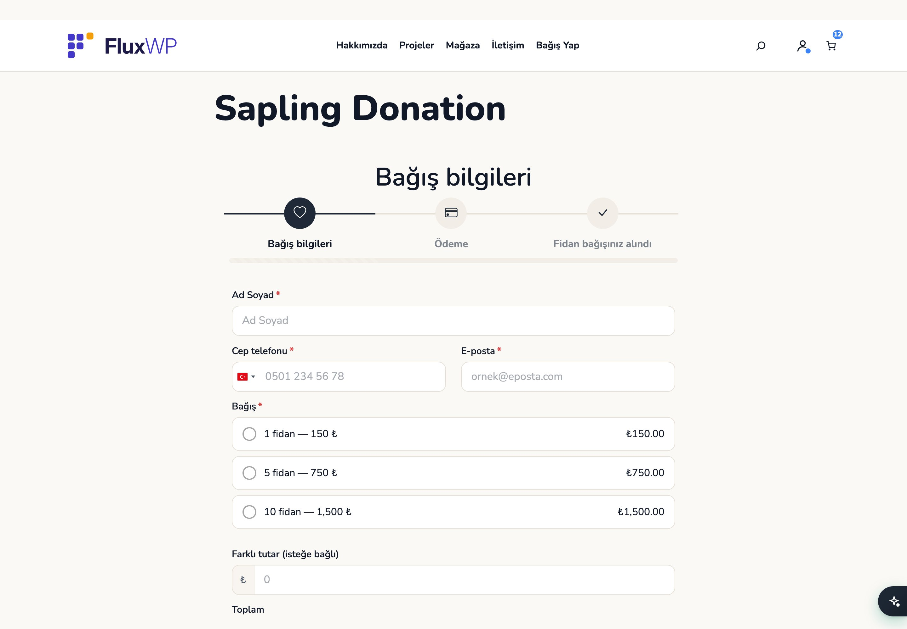
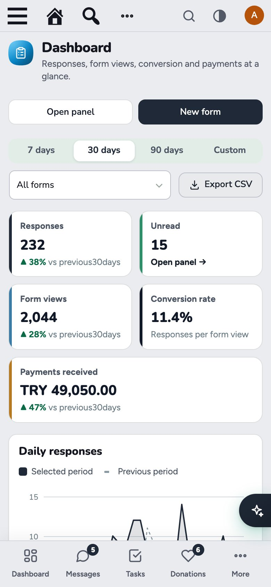
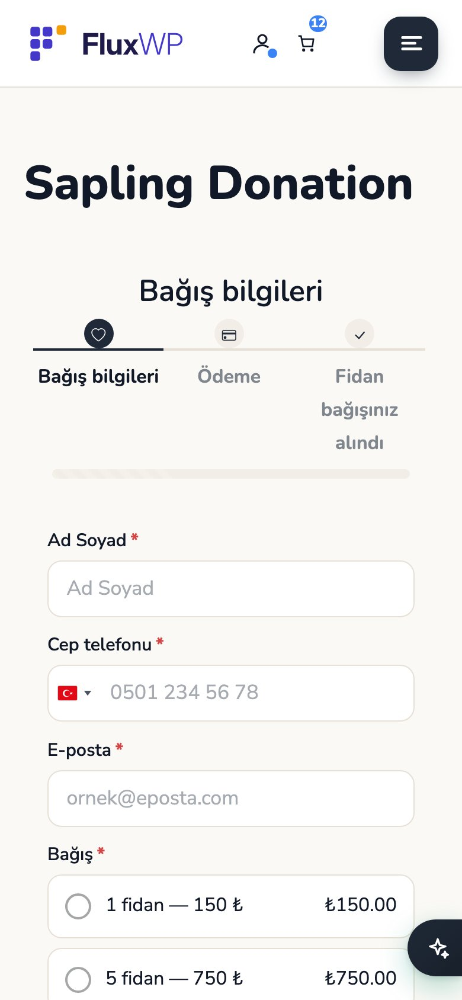

**English** · [Türkçe](README.tr.md)

# Flux Forms

**Drag-and-drop forms that look like your site, with payments and automations built in.** 
Flux Forms is our fork of Easy Form Builder with every feature unlocked and nothing phoning home. Build contact, survey, support and sapling donation forms with 50+ field types, take payments, follow responses on a dashboard and let automations create and send a certificate when a donation is paid.

[Features](#features) · [Screenshots](#screenshots) · [Installation](#installation) · [For developers](#for-developers) · [Roadmap](#roadmap)

---

## Why Flux Forms?

Form plugins usually lock the useful parts (payments, conditional logic, file uploads) behind a licence and call home to check it. We needed one that is fully ours, runs on shared hosting and works with our donation and certificate packages. Flux Forms is that:

- 🔓 **Everything unlocked.** No licence checks, remote add-on downloads or telemetry; Stripe, conditional logic and offline country/city lists rewritten.
- 🎨 **Looks like the site.** Forms use the theme's colours, fonts and dark mode automatically; the builder shows the form exactly as it will appear.
- 📈 **Know what works.** Responses, form views, conversion rate and payments per form, compared with the previous period.
- 🌱 **Donation to certificate, automatically.** A paid sapling donation creates a certificate (Flux Certificate), sends it by WhatsApp and e-mail and shows it on the thank-you screen.
- 🔐 **Hardened:** stored XSS, tracking-code IDOR, upload folder and IP detection fixes on top of the original.

## Features

### Builder
- 50+ elements: text, name, e-mail, phone with country picker, number, date, file and drag-and-drop upload, address and country/province/district lists, map location picker (OpenStreetMap), signature, rating, NPS, image picker, terms (KVKK), payment options, price and total fields, audio/video/screen recording and more.
- Element panel with search and categories, settings panel that opens when you click a field, multi-step forms with a custom last-step title.
- **Conditional logic**: show/hide fields or steps, make required, disable, block submission; rules are enforced on the server too.
- Ready templates: Contact, Support, Survey, Payment, **Sapling donation**, multi-step contact, customer feedback, login and registration.

### Responses
- Panel with every form and its shortcode `[EMS_Form_Builder id=3]`; Elementor and WPBakery widgets.
- Response list with unread markers, a detail view with payment info and totals, tracking codes, replies and CSV export.
- E-mails go through Flux Contact's shared design when it is active (editable templates under **Contact › E-mails**).

### Dashboard
- Responses, unread, form views, conversion rate and payments received, each compared with the previous period.
- Daily responses chart, payment status, responses per form, a day-and-hour heat map and the latest responses; filter by form and period, CSV export.

### Payments and automations
- With Flux Donation, the **Pay** step puts the chosen amount into the WooCommerce checkout (card, bank transfer, monthly donation); without it, built-in Stripe with server-side amount checks and webhooks.
- **Automations**: when a form is submitted or a payment completes, run steps such as *Create certificate*, *Send certificate*, *Show on thank-you screen*, *Send e-mail* and *Webhook*. A ready-made "Sapling donation → Certificate" flow is one click away.

## Screenshots

| Dashboard | Drag-and-drop builder |
|---|---|
|  |  |
| **Responses** | **Automations** |
|  |  |
| **Form templates** | **The form on the site** |
|  |  |
| **Dark mode with Flux Admin** | **Mobile: dashboard** |
|  |  |
| **Mobile: form** |   |
|  |   |

## Installation

Requirements: WordPress 6.4+, PHP 7.4+.

**From a zip**

1. Download `flx-forms.zip` from the latest `flx-forms-v*` release on the [Releases](https://github.com/FluxWP/fluxwp/releases) page.
2. **Plugins › Add New › Upload Plugin**, choose the zip, then **Activate**.

**With Flux Setup** (recommended on our sites)

**Setup › Packages** lists every FluxWP package; click **Install** next to *Flux Forms*. Updates arrive the same way.

**First steps**

1. If the original Easy Form Builder is installed, **deactivate it (don't delete it)** before activating Flux Forms: both use the same tables, so your forms and responses come over as they are.
2. **Forms › Create**: pick a template, adjust it and **Save**.
3. Copy the shortcode from **Forms › Panel** into a page with a *Shortcode* block.
4. For donations: **Forms › Automations › Create default flow** connects the sapling donation form to Flux Certificate.

> ℹ️ The interface follows the site language: Turkish on a Turkish site, English otherwise.

Full setup notes (Turkish): [KURULUM.md](../../docs/form-builder/KURULUM.md)

## For developers

- Theme styling can be turned off with `add_filter( 'flxf_theme_style', '__return_false' )`; the original builder look with `flxf_builder_skin`.
- External payments (used by Flux Donation): `do_action( 'flxf_external_payment', $ctx )` runs a response's "payment completed" flows once per tracking code; `flxf_automations_form_issues_certificate( $form_id )` prevents duplicate certificates.
- Sapling price: `flxf_sapling_unit_price` filter (default 150 ₺; Flux Donation's price wins when installed).
- Payment provider guide: [docs/PAYMENT-PROVIDERS.md](docs/PAYMENT-PROVIDERS.md).

## Roadmap

| | |
|---|---|
| ✅ | Fork of Easy Form Builder with every feature unlocked and no telemetry |
| ✅ | Theme-aware forms and the new builder skin |
| ✅ | Dashboard with views, conversion and payments |
| ✅ | Automations with Flux Certificate |
| ✅ | Payments through WooCommerce with Flux Donation |
| ⬜ | Saved drafts for long multi-step forms |
| ⬜ | Spam scoring without reCAPTCHA |

## License

Flux Forms Released under the [GNU General Public License v2 or later](https://www.gnu.org/licenses/gpl-2.0.html).

Flux Forms is a fork of **Easy Form Builder 4.2.0** by [WhiteStudio](https://whitestudio.team) (GPL v2+); the original copyright and licence notices are kept. Third-party: Leaflet (BSD-2), Leaflet.FullScreen (MIT), country-state-city data (GPL-3.0).

Made by FluxWP.
