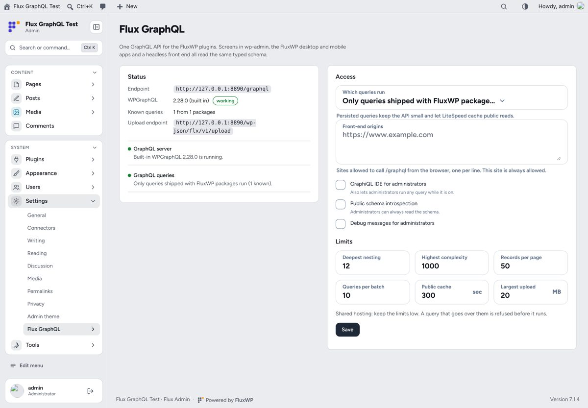
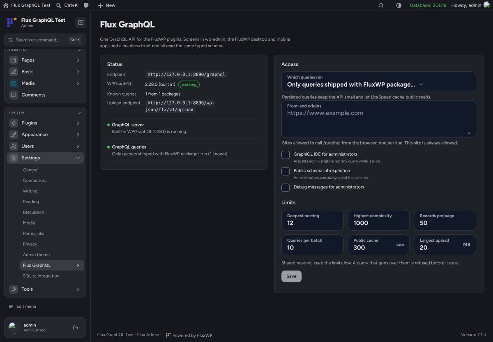
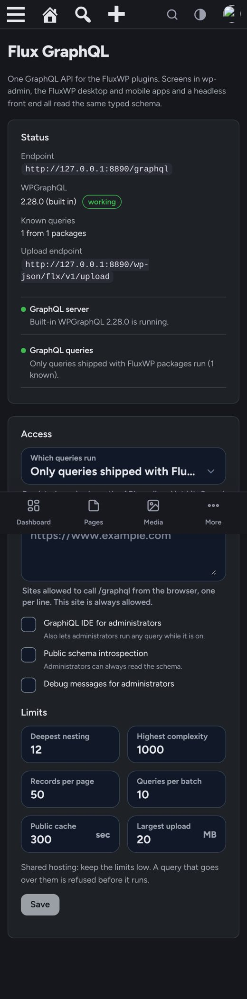

<div align="center">

**English** · [Türkçe](README.tr.md)


# Flux GraphQL

**One typed GraphQL API for every FluxWP plugin, with WPGraphQL built in.**<br>
wp-admin screens, the FluxWP desktop and mobile apps and a headless front end all read the same schema. Flux GraphQL ships a pinned, tested copy of WPGraphQL and a small kit that keeps every package's types, permissions and errors the same.

[](https://wordpress.org)
[](https://www.php.net)
[](LICENSE)




</div>

---

## Why Flux GraphQL?

Every FluxWP plugin used to bring its own REST routes, response shapes and error texts. Flux GraphQL gives them one endpoint (`/graphql`) and one set of rules, so a screen written once works in wp-admin, in the apps and on a headless site, with types generated end to end.

- 🔒 **Safe by default.** Only the queries shipped with FluxWP packages run (persisted queries). Every field needs a capability; a field without one is refused at registration.
- ⚡ **Built for shared hosting.** Depth, complexity, page size and batch limits refuse a heavy query before it runs. Public persisted reads are cacheable by LiteSpeed, and writes purge them by tag.
- 🧩 **One kit for every package.** Shared types (`FlxDateTime`, `FlxMoney`, `FlxPhone`, `FlxFile`, `FlxPerson`), Relay connections, DataLoader batching, typed user errors and settings types generated from `flx_settings_schema`.
- 📦 **No second plugin to manage.** WPGraphQL is built in and updated weekly by CI after the tests pass. A separately installed WPGraphQL is detected; if its version is unsupported, one click switches back to the built-in copy.

## Features

- Endpoint `/graphql` (GET and POST, batches up to the limit).
- Query modes: **strict** (persisted only), **admins** (administrators may send any query), **open** (public headless API).
- Persisted query manifests per package (`graphql/persisted-queries.json`, sha256 → document) through the `flx_gql_persisted_manifests` filter.
- Registration helpers: `flx_gql_type`, `flx_gql_input`, `flx_gql_enum`, `flx_gql_query`, `flx_gql_field`, `flx_gql_mutation`, `flx_gql_connection`, `flx_gql_node_loader`.
- Errors carry `extensions.code` (`UNAUTHENTICATED`, `FORBIDDEN`, `NOT_FOUND`, `INVALID_INPUT`, `CONFLICT`, `RATE_LIMITED`, `INTERNAL`); validation errors come back in the mutation payload's `errors` list.
- `flxSettings` / `flxSettingsUpdate` for every option declared in `flx_settings_schema` (secrets are never exposed).
- One upload endpoint for every package: `POST /wp-json/flx/v1/upload` returns an `uploadId` that a mutation takes over.
- CORS allowlist for front-end origins; the GraphiQL IDE and public introspection are off unless turned on.
- PHP 8.1 to 8.5: newer functions come with polyfills.
- System check rows on the FluxWP system check screen.

## Screenshots

| Settings (light) | Settings (dark, Flux Admin) | Mobile |
|---|---|---|
|  |  |  |

## Installation

Requirements: WordPress 6.5+, PHP 8.1+. Do not install WPGraphQL separately: it is included.

1. Download `flx-graphql.zip` from the latest `flx-graphql-v*` release on the [Releases](https://github.com/FluxWP/fluxwp/releases) page, or install it from **FluxWP Panel › Packages**.
2. **Plugins › Add New › Upload Plugin**, choose the zip, then **Activate**.
3. **Settings › Flux GraphQL**: check the status card. The defaults suit shared hosting.

## For package authors

```php
add_action( 'flx_gql_register', function () {
	flx_gql_type( 'FlxTask', array(
		'node'   => 'FLXG_Task_Loader',
		'fields' => array( 'title' => array( 'type' => 'String!' ) ),
	) );
	flx_gql_query( 'flxTask', array(
		'type'    => 'FlxTask',
		'cap'     => 'read',
		'args'    => array( 'id' => array( 'type' => 'ID!' ) ),
		'resolve' => fn ( $root, $args ) => flxg_service()->task( $args['id'] ),
	) );
} );
```

Rules and the full API: `docs/graphql/` in this repository.

## Development

- `tools/update-wpgraphql.sh [version|--latest]`: pins the embedded WPGraphQL (Appsero telemetry removed).
- `tools/i18n.py [--check]`: builds the `.pot`, Turkish `.po`/`.mo`/`.l10n.php`.
- `tools/tests/wp-graphql/run.sh` (repository root): test site, kit contract tests, HTTP tests and polyfill tests.

## License

GPL-3.0-or-later. WPGraphQL is © WPGraphQL contributors, GPL-3.0; see [NOTICE](NOTICE).

## Maintainers

Ahmet Yılmaz ([@sharkpaw](https://github.com/sharkpaw)) · support: info@fluxwp.com
