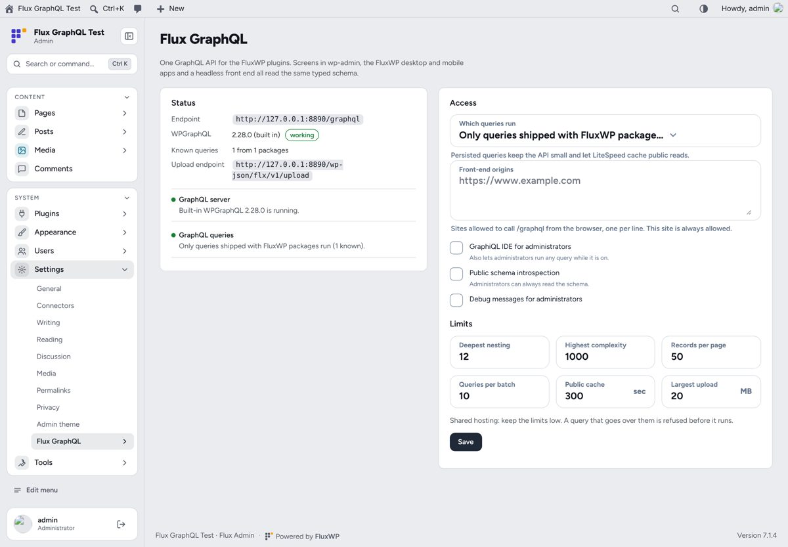
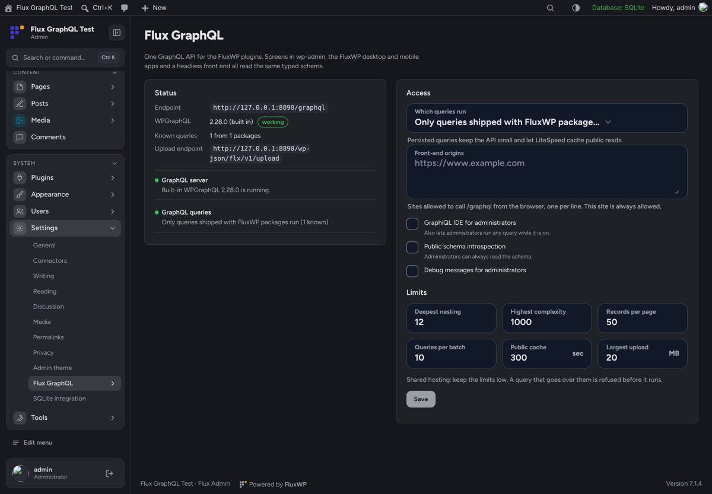
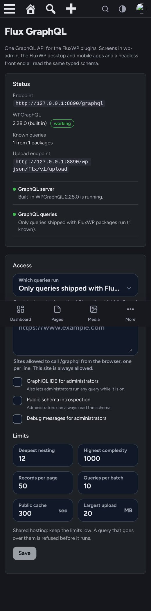

[English](README.md) · **Türkçe**

# Flux GraphQL

**Tüm FluxWP eklentileri için tek, tipli GraphQL API; WPGraphQL içinde gelir.** 
wp-admin ekranları, FluxWP masaüstü ve mobil uygulamaları ve headless ön yüz aynı şemayı okur. Flux GraphQL test edilmiş, sabitlenmiş bir WPGraphQL kopyası ve her paketin tiplerini, yetkilerini ve hatalarını aynı tutan küçük bir kit taşır.

---

## Neden Flux GraphQL?

Her FluxWP eklentisi kendi REST uçlarını, yanıt biçimini ve hata metinlerini getiriyordu. Flux GraphQL hepsine tek uç (`/graphql`) ve tek kural seti verir: bir kez yazılan ekran wp-admin'de, uygulamalarda ve headless sitede çalışır, tipler uçtan uca üretilir.

- 🔒 **Varsayılan olarak güvenli.** Yalnız FluxWP paketleriyle gelen sorgular çalışır (persisted query). Her alan bir yetki ister; yetkisiz alan kayıtta reddedilir.
- ⚡ **Paylaşımlı hosting için.** Derinlik, karmaşıklık, sayfa boyu ve batch sınırları ağır sorguyu çalışmadan reddeder. Herkese açık kayıtlı okumalar LiteSpeed'de önbelleğe alınır, yazmalar etiketle temizler.
- 🧩 **Her paket için tek kit.** Ortak tipler (`FlxDateTime`, `FlxMoney`, `FlxPhone`, `FlxFile`, `FlxPerson`), Relay connection'lar, DataLoader, tipli kullanıcı hataları ve `flx_settings_schema`'dan üretilen ayar tipleri.
- 📦 **Ayrı eklenti yok.** WPGraphQL içinde gelir, testler geçince CI her hafta günceller. Ayrı kurulu WPGraphQL fark edilir; sürümü desteklenmiyorsa tek tıkla dahili kopyaya dönülür.

## Özellikler

- `/graphql` ucu (GET ve POST, sınır kadar batch).
- Sorgu kipleri: **strict** (yalnız kayıtlı), **admins** (yöneticiler her sorguyu gönderebilir), **open** (herkese açık headless API).
- Paket başına kayıtlı sorgu dosyası (`graphql/persisted-queries.json`, sha256 → belge), `flx_gql_persisted_manifests` filtresiyle.
- Kayıt yardımcıları: `flx_gql_type`, `flx_gql_input`, `flx_gql_enum`, `flx_gql_query`, `flx_gql_field`, `flx_gql_mutation`, `flx_gql_connection`, `flx_gql_node_loader`.
- Hatalarda `extensions.code` (`UNAUTHENTICATED`, `FORBIDDEN`, `NOT_FOUND`, `INVALID_INPUT`, `CONFLICT`, `RATE_LIMITED`, `INTERNAL`); doğrulama hataları mutation yanıtındaki `errors` listesinde döner.
- `flx_settings_schema`'da bildirilen her ayar için `flxSettings` / `flxSettingsUpdate` (gizli değerler asla açılmaz).
- Tüm paketler için tek yükleme ucu: `POST /wp-json/flx/v1/upload` bir `uploadId` döner, mutation dosyayı devralır.
- Ön yüz adresleri için CORS izin listesi; GraphiQL IDE ve herkese açık introspection açılmadıkça kapalı.
- PHP 8.1–8.5: yeni fonksiyonlar polyfill ile gelir.
- FluxWP sistem kontrolü ekranında satırlar.

## Ekran görüntüleri

| Ayarlar (açık) | Ayarlar (koyu, Flux Admin) | Mobil |
|---|---|---|
|  |  |  |

## Kurulum

Gereksinim: WordPress 6.5+, PHP 8.1+. WPGraphQL'i ayrıca kurmayın, içinde gelir.

1. [Releases](https://github.com/FluxWP/fluxwp/releases) sayfasındaki son `flx-graphql-v*` sürümünden `flx-graphql.zip`'i indirin ya da **FluxWP Panel › Paketler**'den kurun.
2. **Eklentiler › Yeni Ekle › Eklenti Yükle**, zip'i seçip **Etkinleştir**.
3. **Ayarlar › Flux GraphQL**: durum kartına bakın. Varsayılanlar paylaşımlı hosting'e uygundur.

## Paket geliştiricileri için

Örnek kod ve tam API: [README.md](README.md#for-package-authors) ve bu depodaki `docs/graphql/`.

## Geliştirme

- `tools/update-wpgraphql.sh [sürüm|--latest]`: gömülü WPGraphQL'i sabitler (Appsero telemetrisi çıkarılır).
- `tools/i18n.py [--check]`: `.pot` ve Türkçe `.po`/`.mo`/`.l10n.php` üretir.
- `tools/tests/wp-graphql/run.sh` (depo kökü): test sitesi, kit sözleşme testleri, HTTP ve polyfill testleri.

## Lisans

GPL-3.0-or-later. WPGraphQL © WPGraphQL katkıcıları, GPL-3.0; bkz. [NOTICE](NOTICE).

## Bakımcılar

Ahmet Yılmaz ([@sharkpaw](https://github.com/sharkpaw)) · destek: info@fluxwp.com
