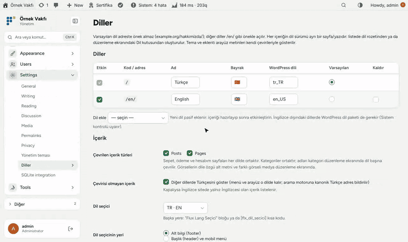
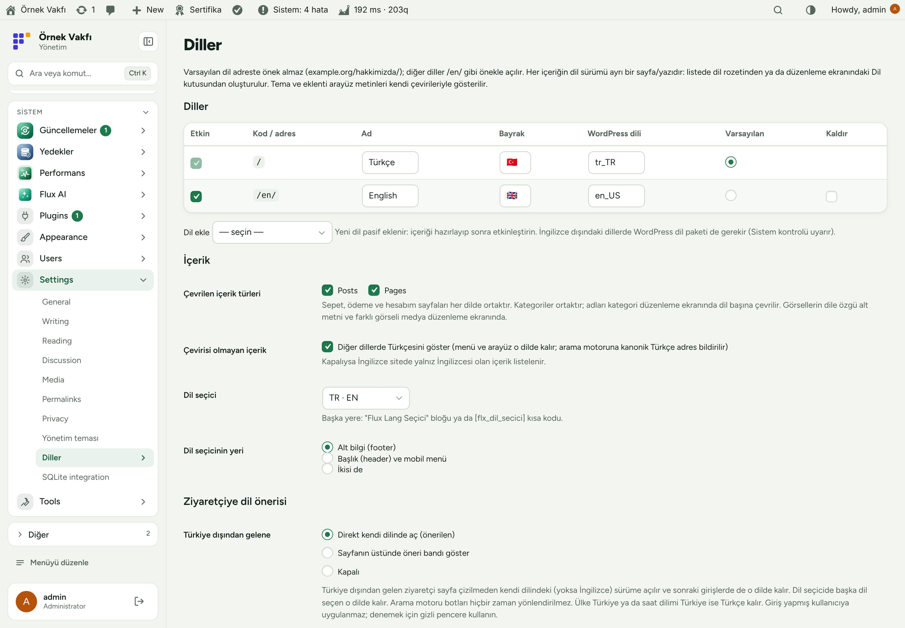
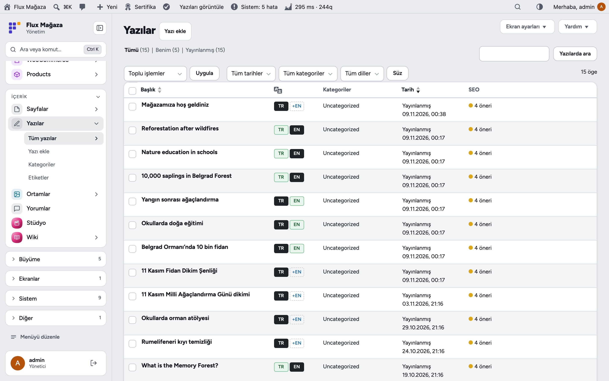
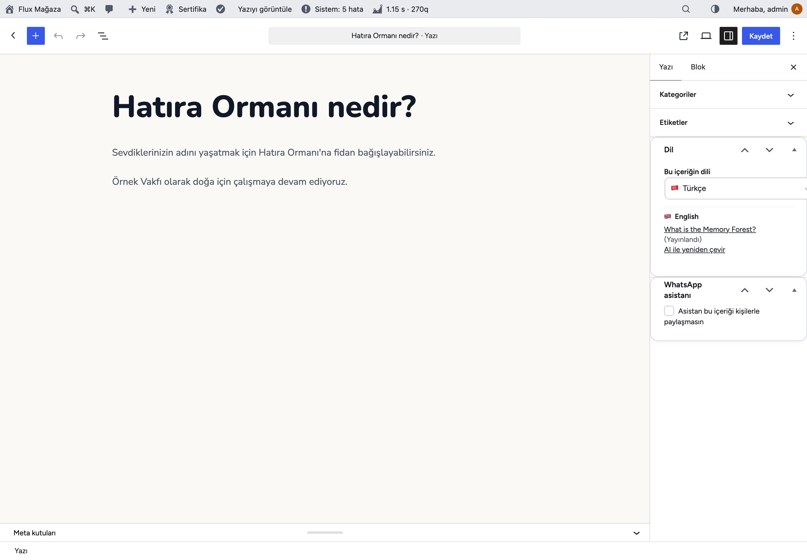
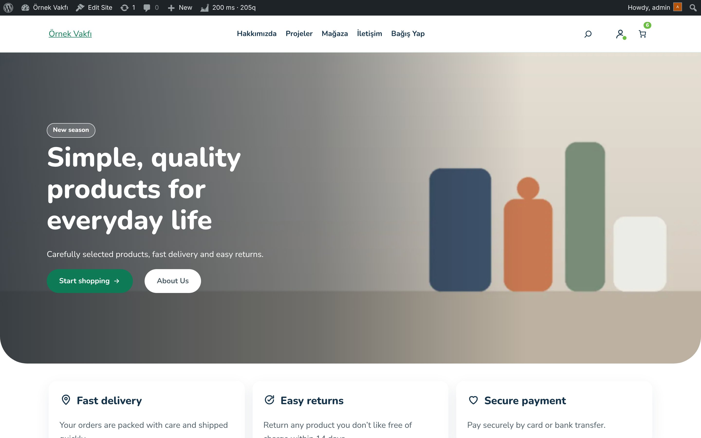
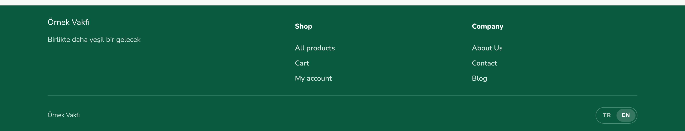
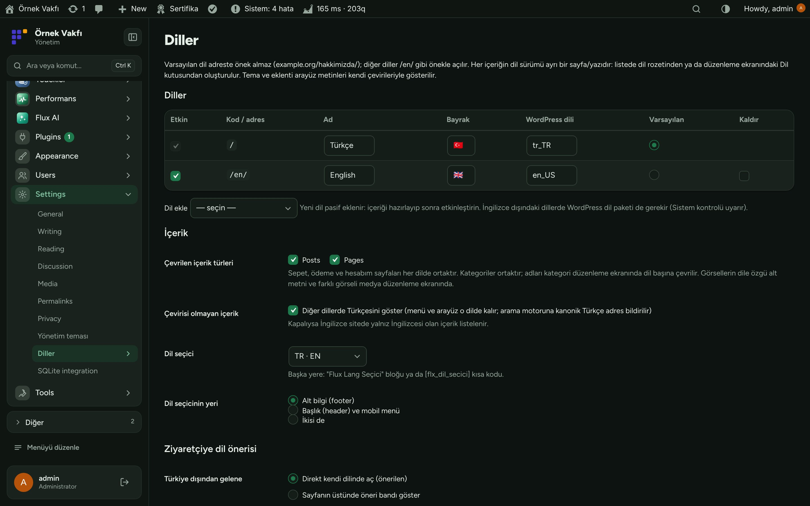
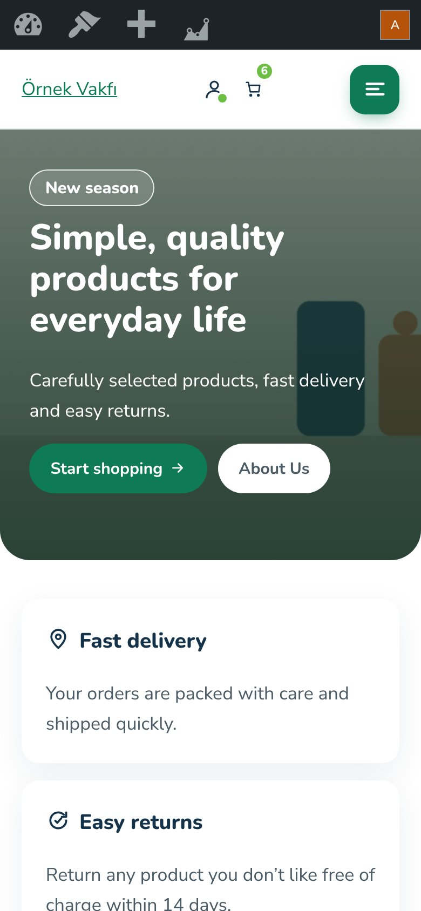

[English](README.md) · **Türkçe**

# Flux Lang

**WordPress için hafif çok dil katmanı: varsayılan Türkçe, /en/ altında İngilizce, Flux AI ile çeviri.** 
Flux Lang siteyi ağır bir eklenti olmadan çok dilli yapar. Her yazı, sayfa, proje ya da etkinliğin kendi slug'ı, görseli ve SEO'su olan İngilizce (ya da Almanca…) sürümü olabilir; menüler ve bağlantılar dile uyar, dil seçici alt bilgidedir. Türkiye dışından gelen ziyaretçi doğrudan İngilizce açar; Flux AI bir sayfayı tek tıkla çevirir.

[Özellikler](#özellikler) · [Ekran görüntüleri](#ekran-görüntüleri) · [Kurulum](#kurulum) · [Geliştiriciler için](#geliştiriciler-için) · [Yol haritası](#yol-haritası)

---

## Neden Flux Lang?

Çok dil eklentileri genelde bir WordPress sitesinin en ağır parçasıdır: ek tablolar, rewrite kuralları, binlerce satırlık metin çeviri ekranı. Türkçe içerikli ve uluslararası kitlesi olan bir derneğin ihtiyacı daha azdır:

- 🌍 **Gereken yerde İngilizce.** Önemli sayfaları çevirin; henüz çevrilmeyen her şey /en/ altında 404 yerine Türkçesiyle açılır.
- 🔗 **Dile uyan bağlantılar.** Menüler, düğmeler ve içerikteki bağlantılar temaya dokunmadan İngilizce sürüme gider.
- 🧭 **İlk seferde doğru dil.** Yurt dışından gelen ziyaretçi sayfa çizilmeden İngilizce görür; dil seçicideki tercihi hatırlanır.
- 🤖 **Tek tıkla çeviri.** Flux AI ile başlık, özet, SEO alanları ve gövde parça parça çevrilir, kontrol için editörde açılır.

## Özellikler

### İçerik
- Yazı, sayfa, proje ve etkinlik başına ayrı dil sürümü: kendi başlık, gövde, slug, öne çıkan görsel ve SEO.
- Listelerde dil rozetleri: kendi dili, çevrildi, taslak ya da çeviri oluşturmak için **+EN**.
- Editörde Dil kutusu: dil, çeviriler, **Kopyala ve çevir** ya da **AI ile çevir**.
- Dile göre kategori/etiket adı ve açıklaması; dile göre görsel alt metni ve "İngilizcede bu görseli göster".
- Ana sayfa, yazılar sayfası ve WooCommerce sayfalarının dildeki karşılığı; sepet, ödeme ve hesabım ortak; siparişe ziyaretçinin dili yazılır.

### Site
- Varsayılan dil öneksiz, diğerleri `/en/…` altında; rewrite flush gerekmez. Tema ve eklenti metinleri kendi çevirilerinden gelir.
- Dile göre site adı, slogan ve Flux SEO ana sayfa başlığı.
- Alt bilgide (ya da başlık / mobil menüde) dil seçici, blok ve `[flx_dil_secici]` kısa kodu.
- Türkiye dışındaki ziyaretçi doğrudan İngilizceye (Cloudflare ülke başlığı ya da saat dilimi), botlar hariç; istenirse yerine öneri bandı.

### SEO ve AI
- `hreflang` + `x-default`, `og:locale:alternate`, kanonik, sitemap'te tüm diller; çevirisiz sayfaların kanoniği Türkçe.
- Flux AI ve MCP araçları: `flxl_languages`, `flxl_untranslated`, `flxl_save_translation`, `flxl_set_language`, `flxl_image_language`, `flxl_term_translation`, `flxl_site_texts`; Flux SEO içerik araçlarında `lang`.
- REST: `lang` ve `translations` alanları, `?lang=en` süzgeci.

## Ekran görüntüleri

| Diller ayarları | Yazı listesinde dil rozetleri |
|---|---|
|  |  |
| **Editörde Dil kutusu** | **İngilizce ana sayfa** |
|  |  |
| **Alt bilgide dil seçici** | **Flux Admin ile koyu tema** |
|  |  |
| **Mobil, İngilizce** |   |
|  |   |

## Kurulum

Gereksinimler: WordPress 6.4+, PHP 7.4+. İsteğe bağlı: tek tık çeviri için Flux AI, dile göre SEO için Flux SEO, WooCommerce.

**Zip ile**

1. [Releases](https://github.com/FluxWP/fluxwp/releases) sayfasında en son `flx-lang-v*` sürümünden `flx-lang.zip`'i indirin.
2. **Eklentiler › Yeni ekle › Eklenti yükle**, zip'i seçin, sonra **Etkinleştir**.

**FluxWP Panel ile** (sitelerimizde önerilen)

**FluxWP Panel › Paketler** tüm FluxWP paketlerini listeler; *Flux Lang* satırındaki **Kur**'a basın. Güncellemeler de buradan gelir.

**İlk adımlar**

1. Flux Lang'i etkinleştirip **Ayarlar › Diller**'i açın: İngilizce önerilen ayarlarla açık gelir; kaydedin.
2. **Dile göre site metinleri › English**'te site adı, slogan ve ana sayfa başlığını girin.
3. **Sayfalar**'da bir sayfanın yanındaki **+EN**'e basın, çevirin (ya da **AI ile çevir**) ve yayınlayın.
4. Sayfa önbelleğini temizleyip `/en/` adresini açın.

> ℹ️ Mevcut içerik Türkçe sayılır, taşıma yapılmaz. Taslak çeviri sitede görünmez.

Ayrıntılı kurulum notları: [KURULUM.md](../../docs/flx-lang/KURULUM.md) · API başvurusu: [API.md](../../docs/flx-lang/API.md) · Sürüm notları: [CHANGELOG.md](CHANGELOG.md)

## Geliştiriciler için

- `flxl_post_language()`, `flxl_get_translations()`, `flxl_get_translation()`, `flxl_link_translations()`; `flxseo_indexnow_urls` süzgeci diğer dil adreslerini ekler.
- Yazılarda REST `lang` / `translations` alanları; bkz. [API.md](../../docs/flx-lang/API.md).

## Yol haritası

| | |
|---|---|
| ✅ | Kendi slug'ı, görseli ve SEO'su olan dil sürümleri |
| ✅ | Dil bağlantıları, seçici ve ziyaretçi dili |
| ✅ | hreflang ve çok dilli sitemap |
| ✅ | Flux AI ile tek tık çeviri |
| ⬜ | Almanca ve Arapça arayüz metinleri |
| ⬜ | Bölüm bazında çeviri durumu raporu |

## Lisans

Flux Lang, [GNU Genel Kamu Lisansı v2 veya üzeri](https://www.gnu.org/licenses/gpl-2.0.html) ile yayınlanır.

FluxWP tarafından geliştirilmiştir.
