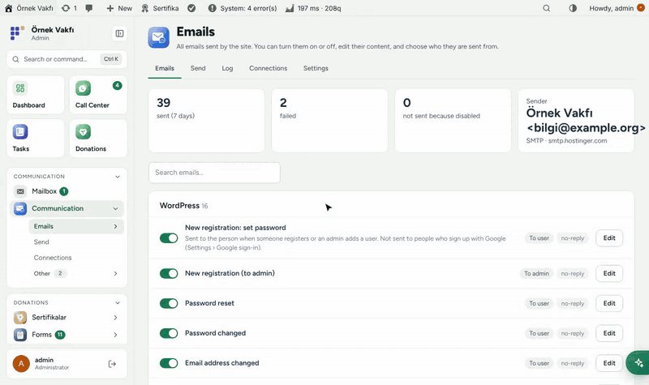
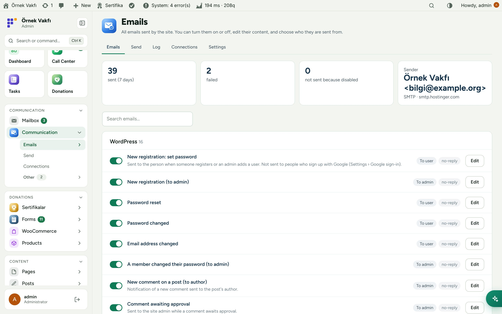
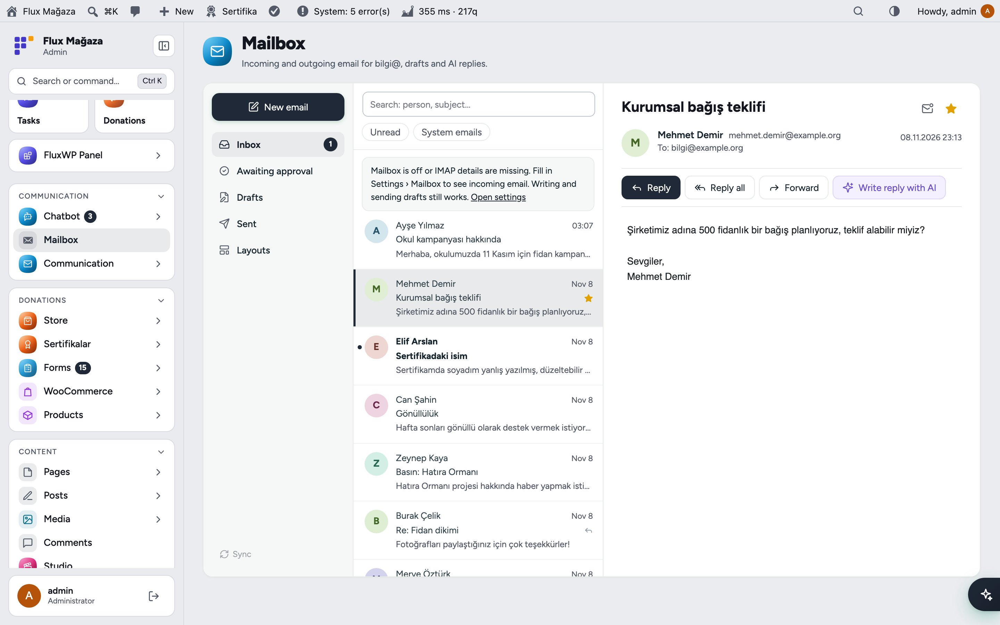
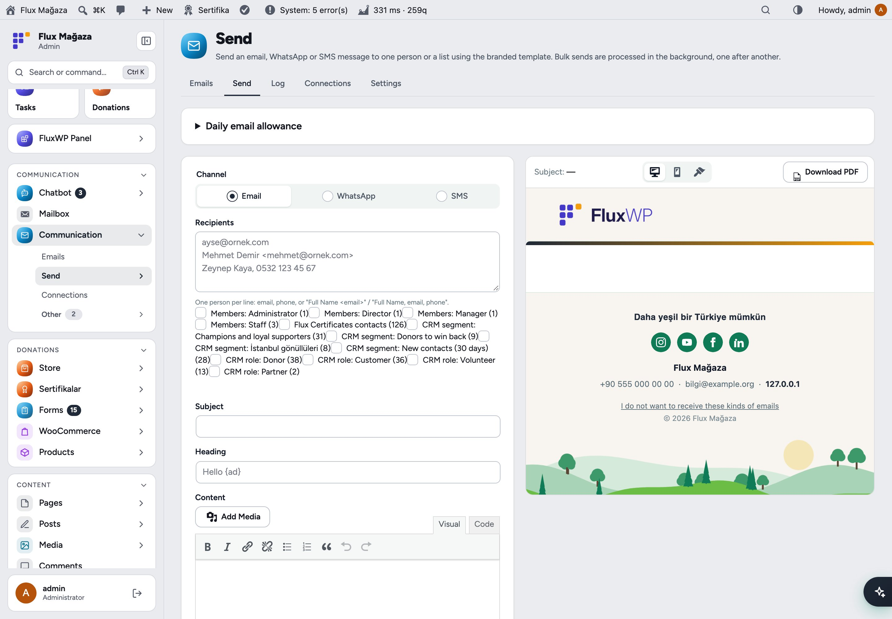
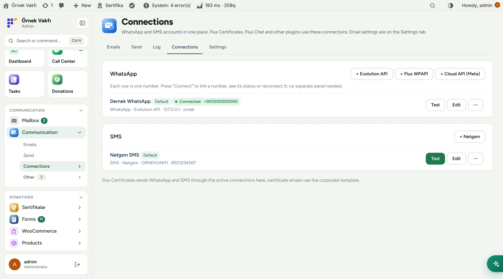
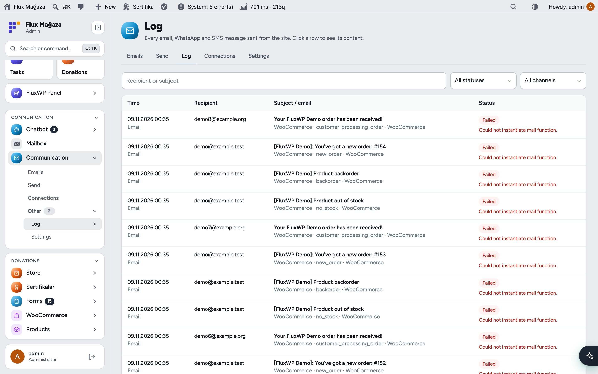
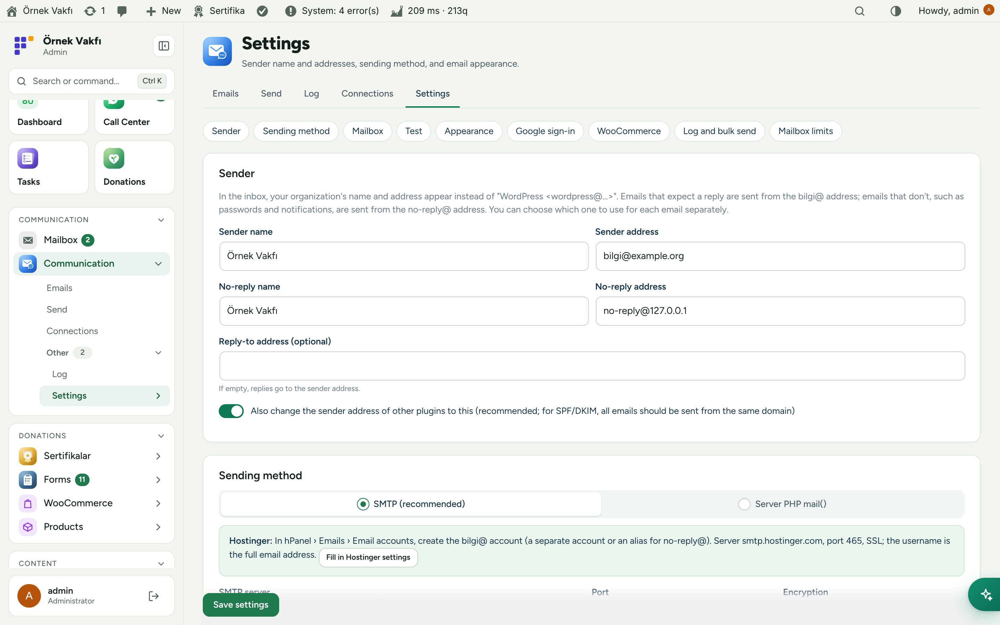
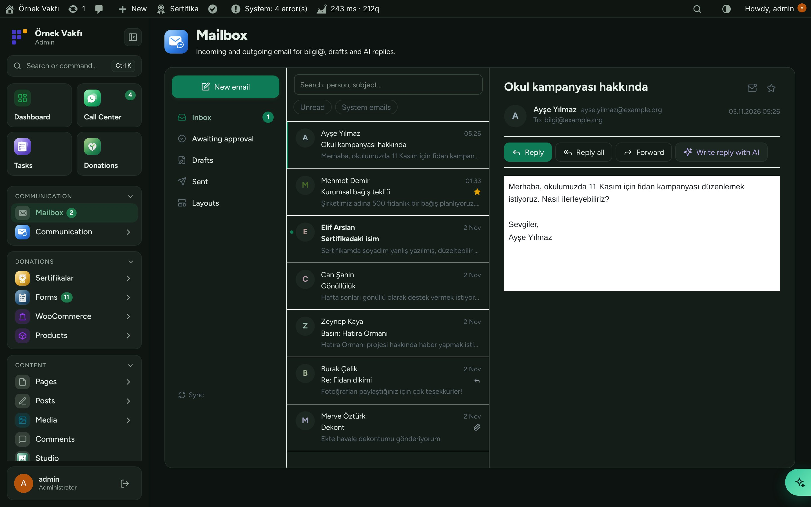
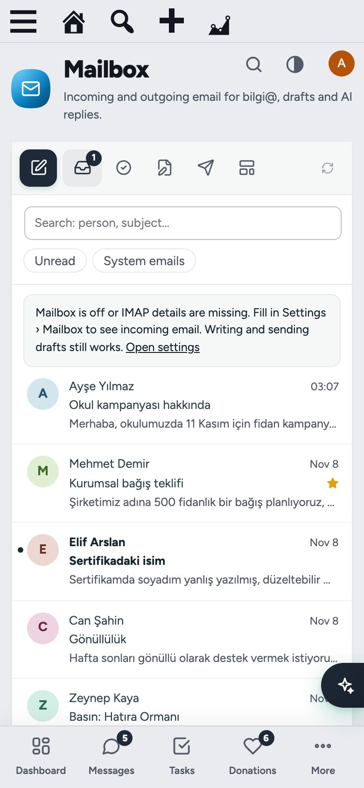
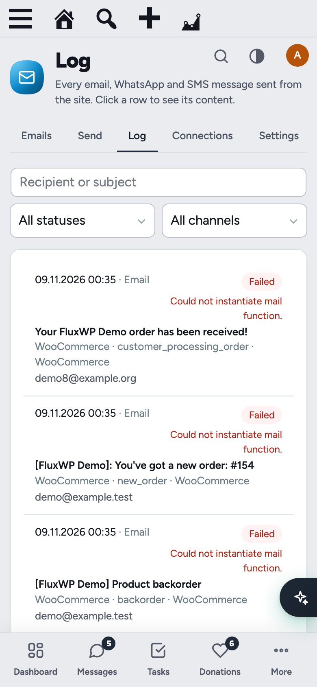

**English** · [Türkçe](README.tr.md)

# Flux Contact

**Every e-mail the site sends, its mailbox, and its WhatsApp and SMS lines in one place.** 
Flux Contact replaces "WordPress <wordpress@…>" with your organisation: a sender name and address, SMTP, a branded mobile-friendly template for every WordPress, WooCommerce and FluxWP e-mail, a log of everything sent, single and bulk sending, and a mailbox for bilgi@ with AI replies. WhatsApp (Evolution API, Flux WPAPI, Cloud API) and SMS (Netgsm) connections live here too, and other plugins send through them.

[Features](#features) · [Screenshots](#screenshots) · [Installation](#installation) · [Use it with AI assistants (MCP)](#use-it-with-ai-assistants-mcp) · [For developers](#for-developers) · [Roadmap](#roadmap)

---

## Why Flux Contact?

Out of the box, WordPress sends plain text from `wordpress@your-host`, every plugin has its own look, nothing is logged, and replies go nowhere. A charity notices this the day a donor says "your certificate went to spam". Flux Contact fixes the whole path:

- ✉️ **One sender, one look.** bilgi@ for e-mails that expect a reply, no-reply@ for passwords and notices, one branded template for WordPress, WooCommerce and every FluxWP package.
- 🗂️ **Every e-mail in a list.** Turn any of them on or off, edit the subject, heading, text and button, preview on desktop, phone and dark mode, send yourself a test.
- 📬 **A real mailbox.** bilgi@ inside the admin over IMAP: read, reply, forward, drafts, approval for AI-written replies.
- 💬 **WhatsApp and SMS for everyone.** Connect numbers once; Flux Certificate, Flux Call Center and the rest use them through one API.
- 🧾 **Proof.** Every e-mail, WhatsApp and SMS message is logged with its content, status and error.

## Features

### E-mail
- **Sender:** organisation name, bilgi@ and no-reply@ addresses, reply-to; other plugins' sender is changed too (for SPF/DKIM).
- **Sending method:** SMTP with a "Fill in Hostinger settings" button, a separate no-reply@ account, passwords stored encrypted or in `wp-config.php`; falls back to bilgi@ if no-reply@ fails.
- **E-mails:** every e-mail of WordPress, WooCommerce and FluxWP packages, grouped, with on/off, editor, sender choice, desktop/phone/dark preview and "Send me a test". Unknown e-mails join the list the first time they are sent.
- **Appearance:** logo for light and dark backgrounds, colours, tagline, address, social links, a tree silhouette footer; images (WebP too) are embedded so every mail program shows them; "Apply appearance to WooCommerce"; PDF download of any preview.
- **DNS check** for SPF, DKIM and DMARC; Google sign-up users don't get "set your password" mails.

### Mailbox, sending and log
- **Mailbox:** bilgi@ over IMAP with unread and system-mail filters, starred, attachments, reply/reply all/forward, drafts, layouts and **Write reply with AI** (lands in *Awaiting approval*).
- **Send:** e-mail, WhatsApp or SMS to one person or a list (members by role, Flux Certificate contacts), live preview, background queue that respects Hostinger's daily and per-message limits.
- **Log:** every message with time, recipient, subject, source plugin, channel and status; click for the content. Block list from Flux Call Center is honoured.

### WhatsApp and SMS
- **Connections:** WhatsApp via Evolution API, Flux WPAPI or Cloud API (Meta), SMS via Netgsm; several numbers, a default per channel, QR or pairing-code connect, status, restart, log out.
- **Test** a connection with text, image, voice message, document or (Cloud API) a template.

## Screenshots

| E-mails with on/off and editor | Mailbox with an open e-mail |
|---|---|
|  |  |
| **Send with live preview** | **WhatsApp and SMS connections** |
|  |  |
| **Send log** | **Settings: sender and SMTP** |
|  |  |
| **Dark mode with Flux Admin** | **Mobile: mailbox** |
|  |  |
| **Mobile: log** |   |
|  |   |

## Installation

Requirements: WordPress 6.2+, PHP 7.4+. An e-mail account for bilgi@ (and optionally no-reply@). Optional: an Evolution API 2.3+ or Flux WPAPI server for WhatsApp, a Netgsm account for SMS, Flux AI for AI replies, Flux Call Center for the block list.

**From a zip**

1. Download `flx-mail.zip` from the latest `flx-mail-v*` release on the [Releases](https://github.com/FluxWP/fluxwp/releases) page.
2. **Plugins › Add New › Upload Plugin**, choose the zip, then **Activate**.

**With FluxWP Panel** (recommended on our sites)

**FluxWP Panel › Packages** lists every FluxWP package; click **Install** next to *Flux Contact*. Updates arrive the same way.

**First steps**

1. Activate Flux Contact: WordPress e-mails switch to bilgi@ / no-reply@ and the branded template right away.
2. **Communication › Settings › Sending method › SMTP › Fill in Hostinger settings**, enter the password, save and **Send test email**.
3. **Settings › Test › Check DNS** and add any missing SPF, DKIM or DMARC record.
4. **Settings › Mailbox**: turn on the mailbox for bilgi@ (IMAP fills in from SMTP).
5. **Communication › Connections**: add a WhatsApp number (QR) and Netgsm for SMS.

> ⚠️ Hostinger allows 100 e-mails a day and 100 recipients per message; bulk sends are queued to stay inside that. Run only one SMTP plugin: System Check warns if WP Mail SMTP or LiteSpeed SMTP is also active.

Full setup notes (Turkish): [KURULUM.md](../../docs/iletisim/KURULUM.md) · API reference: [API.md](../../docs/iletisim/API.md) · Release notes: [CHANGELOG.md](CHANGELOG.md)

## Use it with AI assistants (MCP)

Flux Contact adds tools to the site's MCP server (**Flux SEO**) and to the **Flux AI** chat, so an assistant can check and fix e-mail without the panel:

- `flxi_email_log`, `flxi_templates`, `flxi_update_template`, `flxi_settings`, `flxi_send_test`, `flxi_mail_quota`, `flxi_campaigns`
- Mailbox (Flux AI): `flxi_mail_list`, `flxi_mail_read`, `flxi_mail_layouts`, `flxi_mail_draft`, and `flxi_mail_send_draft` (asks for approval)

> "Why didn't yesterday's certificate e-mails go out?" · "Write a reply to the school campaign e-mail and leave it for my approval."

Passwords and API keys are never readable or writable through any tool.

## For developers

- Templates: `flxi_email_types` filter; send with `flxi_send_email( $key, $to, $vars )`.
- WhatsApp / SMS: `flxi_send_message()`; new providers with `flxi_connection_types`.
- Mailbox: `flxi_mailbox_query()`, `flxi_mailbox_new_draft()` (also `POST /wp-json/flxi/v1/mailbox/new-draft`).
- Block list: `flx_contact_blocked`; quota: `flxi_quota_left()`.

## Roadmap

| | |
|---|---|
| ✅ | Branded template and editor for every e-mail |
| ✅ | SMTP, DNS check and send log |
| ✅ | WhatsApp and SMS connections shared by all FluxWP packages |
| ✅ | Mailbox with AI replies and approval |
| ✅ | Images, voice and documents on WhatsApp |
| ⬜ | Open and click statistics for bulk sends |
| ⬜ | Shared inbox with assignment between staff |

## License

Flux Contact Released under the [GNU General Public License v2 or later](https://www.gnu.org/licenses/gpl-2.0.html).

Made by FluxWP.

## Background jobs

Campaign queues automatically prefer a healthy FluxWP Docker worker. Without a worker, the existing WordPress cron and request-driven queue continue to work. Mailbox quotas, batch sizes and retry limits still apply. Single-email APIs and diagnostic sends remain synchronous.

[Worker contract and fallback](../../docs/background-workers/API.md).

## Maintainers

Ahmet Yılmaz — [@sharkpaw](https://github.com/sharkpaw)
