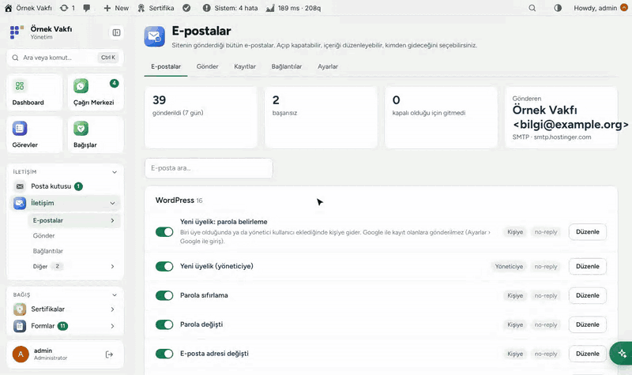
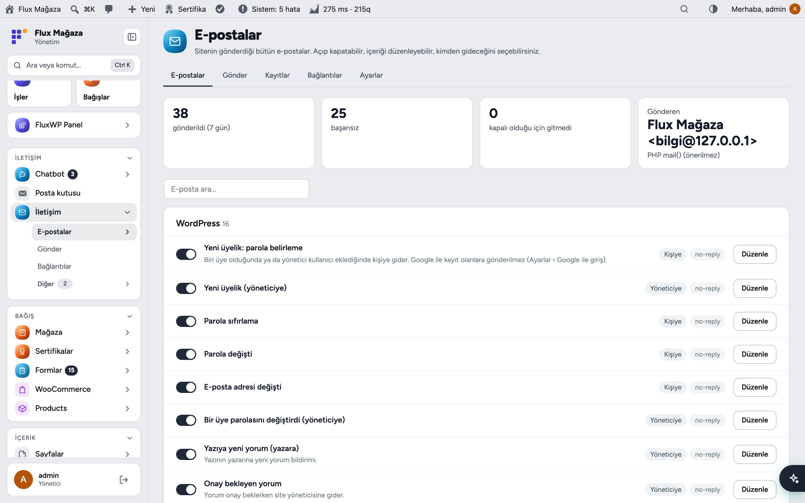
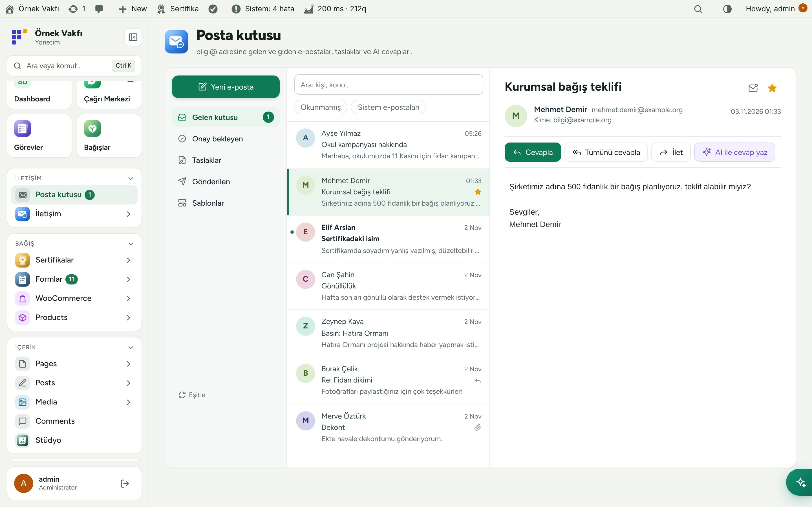
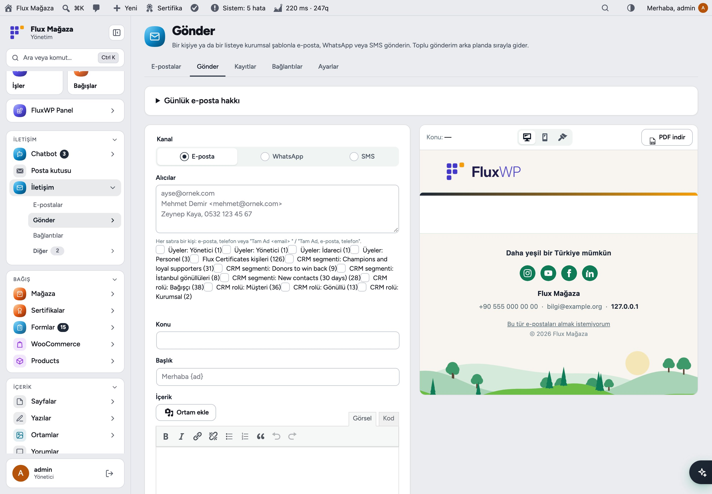
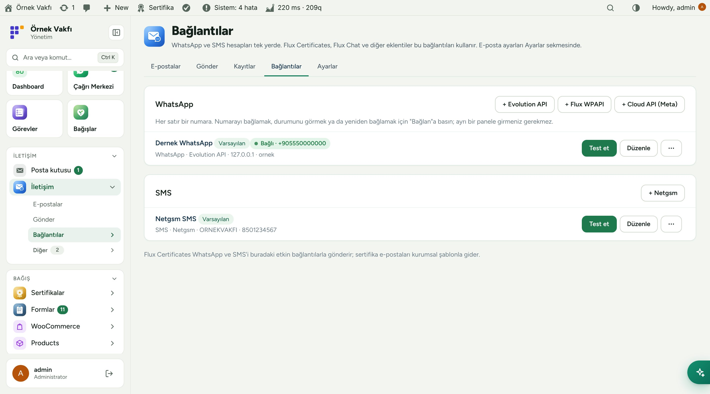
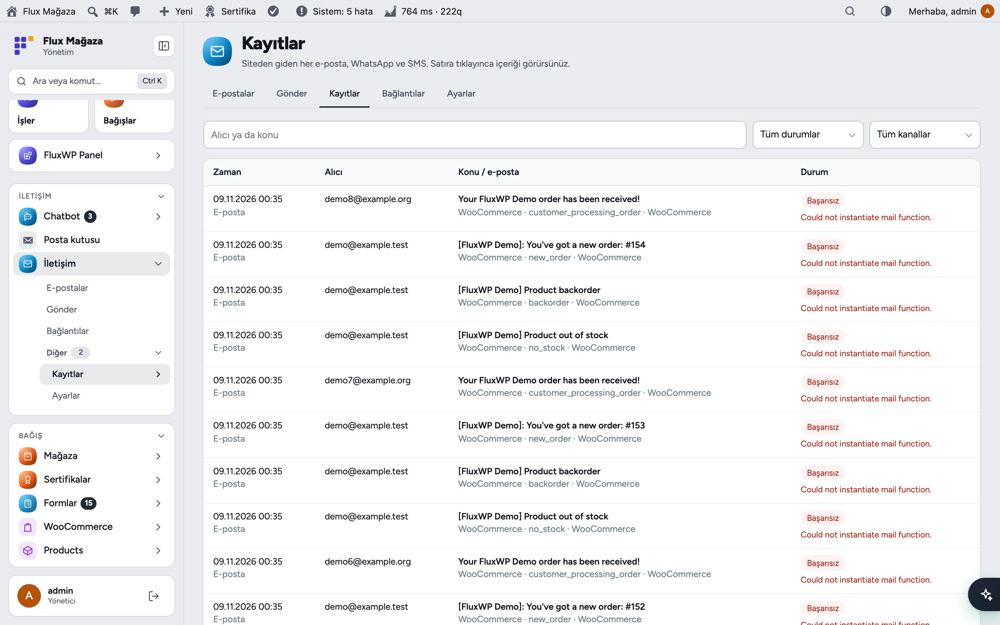
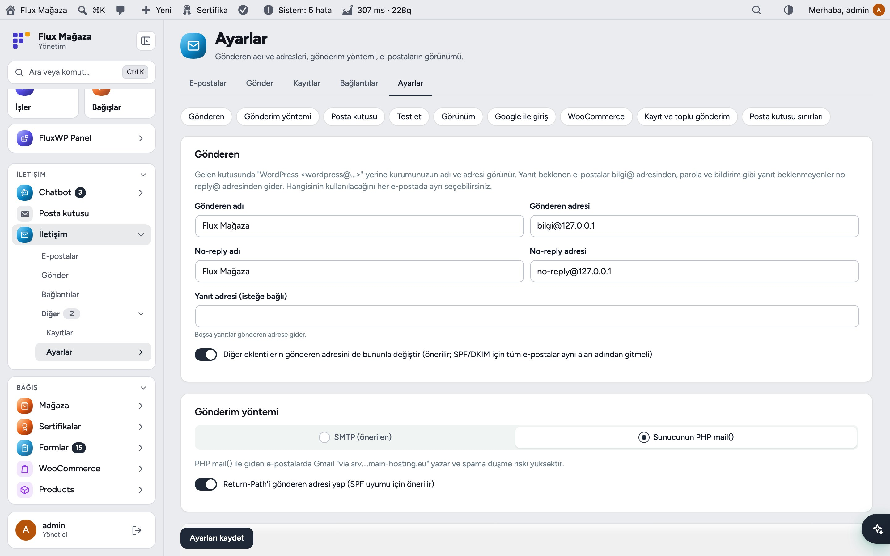
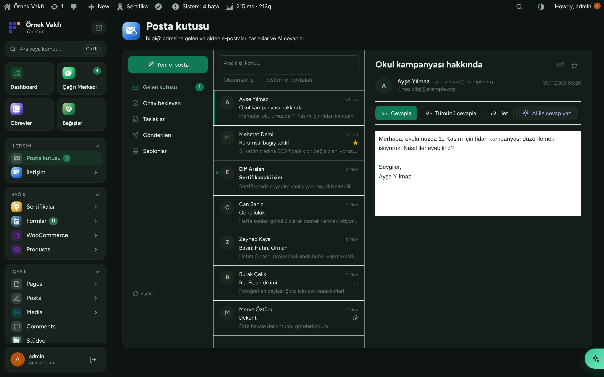
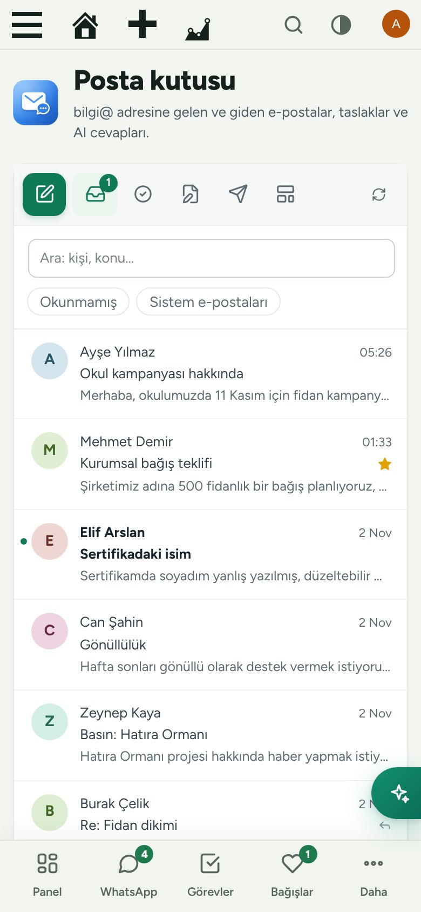
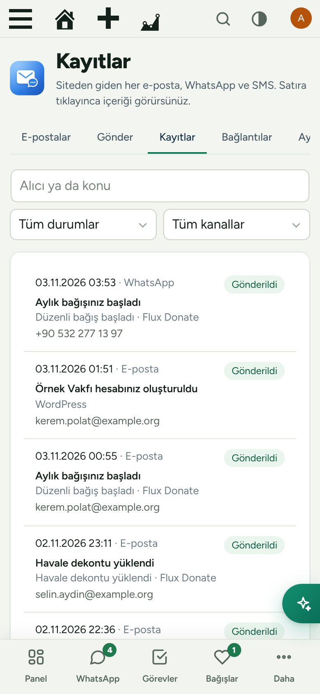

[English](README.md) · **Türkçe**

# Flux Mail

**Sitenin gönderdiği her e-posta, posta kutusu, WhatsApp ve SMS hatları tek yerde.** 
Flux Mail "WordPress <wordpress@…>" yerine kurumunuzu koyar: gönderen adı ve adresi, SMTP, WordPress, WooCommerce ve FluxWP e-postaları için logolu ve mobil uyumlu tek şablon, tüm gönderimlerin kaydı, tekil ve toplu gönderim, AI cevaplı bilgi@ posta kutusu. WhatsApp (Evolution API, Flux WPAPI, Cloud API) ve SMS (Netgsm) bağlantıları da burada; diğer eklentiler bunlar üzerinden gönderir.

[Özellikler](#özellikler) · [Ekran görüntüleri](#ekran-görüntüleri) · [Kurulum](#kurulum) · [Yapay zekâ asistanlarıyla kullanım (MCP)](#yapay-zekâ-asistanlarıyla-kullanım-mcp) · [Geliştiriciler için](#geliştiriciler-için) · [Yol haritası](#yol-haritası)

---

## Neden Flux Mail?

WordPress kendi hâlinde `wordpress@sunucu` adresinden düz metin gönderir; her eklentinin görünüşü ayrıdır, hiçbir şey kayda geçmez, cevaplar boşa gider. Bir dernek bunu, bağışçı "sertifikanız spama düştü" dediği gün fark eder. Flux Mail tüm yolu düzeltir:

- ✉️ **Tek gönderen, tek görünüş.** Cevap beklenen e-postalar bilgi@'den, parola ve bildirimler no-reply@'den; WordPress, WooCommerce ve tüm FluxWP paketleri için tek kurumsal şablon.
- 🗂️ **Her e-posta bir listede.** İstediğinizi açıp kapatın; konu, başlık, metin ve düğmeyi değiştirin; masaüstü, telefon ve koyu modda önizleyin, kendinize test gönderin.
- 📬 **Gerçek bir posta kutusu.** IMAP ile bilgi@ panelin içinde: okuma, cevaplama, iletme, taslaklar, AI'ın yazdığı cevaplar için onay.
- 💬 **Herkes için WhatsApp ve SMS.** Numaraları bir kez bağlayın; Flux Certificates, Flux Chat ve diğerleri tek API ile kullanır.
- 🧾 **Kanıt.** Her e-posta, WhatsApp ve SMS mesajı içeriği, durumu ve hatasıyla kayıtlı.

## Özellikler

### E-posta
- **Gönderen:** kurum adı, bilgi@ ve no-reply@ adresleri, cevap adresi; diğer eklentilerin göndereni de değişir (SPF/DKIM için).
- **Gönderim yöntemi:** "Hostinger ayarlarını doldur" düğmeli SMTP, no-reply@ için ayrı hesap, şifreli ya da `wp-config.php`'de saklanan şifre; no-reply@ girişi olmazsa bilgi@ ile gider.
- **E-postalar:** WordPress, WooCommerce ve FluxWP paketlerinin tüm e-postaları gruplu; aç/kapa, düzenleyici, gönderen seçimi, masaüstü/telefon/koyu önizleme ve "Bana test gönder". Listede olmayan e-posta ilk gönderildiğinde listeye eklenir.
- **Görünüm:** açık ve koyu zemin için logo, renkler, slogan, adres, sosyal medya, ağaç silüetli alt kısım; görseller (WebP dahil) gömülür, her programda görünür; "WooCommerce'e uygula"; her önizlemeyi PDF indirme.
- SPF, DKIM ve DMARC için **DNS kontrolü**; Google ile kayıt olana "parolanızı belirleyin" e-postası gitmez.

### Posta kutusu, gönderim ve kayıtlar
- **Posta kutusu:** IMAP ile bilgi@; okunmamış ve sistem e-postası süzgeçleri, yıldız, ekler, cevapla/tümünü cevapla/ilet, taslaklar, şablonlar ve **AI ile cevap yaz** (*Onay bekleyen*'e düşer).
- **Gönder:** bir kişiye ya da listeye (role göre üyeler, Flux Certificates kişileri) e-posta, WhatsApp ya da SMS; canlı önizleme; Hostinger'ın günlük ve ileti başı sınırlarına uyan arka plan kuyruğu.
- **Kayıtlar:** her mesaj zaman, alıcı, konu, kaynak eklenti, kanal ve durumla; tıklayınca içerik. Flux Chat'ndeki kara listeye uyulur.

### WhatsApp ve SMS
- **Bağlantılar:** WhatsApp için Evolution API, Flux WPAPI ya da Cloud API (Meta), SMS için Netgsm; birden çok numara, kanal başına varsayılan, QR ya da eşleştirme koduyla bağlanma, durum, yeniden başlatma, oturum kapatma.
- Bir bağlantıyı metin, resim, sesli mesaj, belge ya da (Cloud API) şablonla **test edin**.

## Ekran görüntüleri

| Aç/kapa ve düzenleyicili e-postalar | Açık bir iletiyle posta kutusu |
|---|---|
|  |  |
| **Canlı önizlemeli gönderim** | **WhatsApp ve SMS bağlantıları** |
|  |  |
| **Gönderim kayıtları** | **Ayarlar: gönderen ve SMTP** |
|  |  |
| **Flux Admin ile koyu tema** | **Mobil: posta kutusu** |
|  |  |
| **Mobil: kayıtlar** |   |
|  |   |

## Kurulum

Gereksinimler: WordPress 6.2+, PHP 7.4+. bilgi@ için bir e-posta hesabı (isteğe bağlı no-reply@). İsteğe bağlı: WhatsApp için Evolution API 2.3+ ya da Flux WPAPI sunucusu, SMS için Netgsm hesabı, AI cevaplar için Flux AI, kara liste için Flux Chat.

**Zip ile**

1. [Releases](https://github.com/FluxWP/fluxwp/releases) sayfasında en son `flx-mail-v*` sürümünden `flx-mail.zip`'i indirin.
2. **Eklentiler › Yeni ekle › Eklenti yükle**, zip'i seçin, sonra **Etkinleştir**.

**FluxWP Panel ile** (sitelerimizde önerilen)

**FluxWP Panel › Paketler** tüm FluxWP paketlerini listeler; *Flux Mail* satırındaki **Kur**'a basın. Güncellemeler de buradan gelir.

**İlk adımlar**

1. Flux Mail'i etkinleştirin: WordPress e-postaları hemen bilgi@ / no-reply@ adresine ve kurumsal şablona geçer.
2. **İletişim › Ayarlar › Gönderim yöntemi › SMTP › Hostinger ayarlarını doldur**; şifreyi girip kaydedin ve **Test e-postası gönder**'e basın.
3. **Ayarlar › Test › DNS'i kontrol et**; eksik SPF, DKIM ya da DMARC kaydını ekleyin.
4. **Ayarlar › Posta kutusu**: bilgi@ için posta kutusunu açın (IMAP bilgileri SMTP'den gelir).
5. **İletişim › Bağlantılar**: WhatsApp numarası (QR) ve SMS için Netgsm ekleyin.

> ⚠️ Hostinger günde 100 e-posta ve ileti başına 100 alıcıya izin verir; toplu gönderim bu sınırda kalacak şekilde kuyruğa alınır. Tek bir SMTP eklentisi kullanın: WP Mail SMTP ya da LiteSpeed SMTP de açıksa Sistem Kontrolü uyarır.

Ayrıntılı kurulum notları: [KURULUM.md](../../docs/iletisim/KURULUM.md) · API başvurusu: [API.md](../../docs/iletisim/API.md) · Sürüm notları: [CHANGELOG.md](CHANGELOG.md)

## Yapay zekâ asistanlarıyla kullanım (MCP)

Flux Mail sitenin MCP sunucusuna (**Flux SEO**) ve **Flux AI** sohbetine araçlar ekler; asistan e-postayı panele girmeden kontrol eder ve düzeltir:

- `flxi_email_log`, `flxi_templates`, `flxi_update_template`, `flxi_settings`, `flxi_send_test`, `flxi_mail_quota`, `flxi_campaigns`
- Posta kutusu (Flux AI): `flxi_mail_list`, `flxi_mail_read`, `flxi_mail_layouts`, `flxi_mail_draft` ve `flxi_mail_send_draft` (onay ister)

> "Dünkü sertifika e-postaları neden gitmedi?" · "Okul kampanyası e-postasına bir cevap yaz, onayıma bırak."

Şifreler ve API anahtarları hiçbir araçla okunmaz ya da yazılmaz.

## Geliştiriciler için

- Şablonlar: `flxi_email_types` filtresi; gönderim `flxi_send_email( $key, $to, $vars )`.
- WhatsApp / SMS: `flxi_send_message()`; yeni sağlayıcı için `flxi_connection_types`.
- Posta kutusu: `flxi_mailbox_query()`, `flxi_mailbox_new_draft()` (ayrıca `POST /wp-json/flxi/v1/mailbox/new-draft`).
- Kara liste: `flx_contact_blocked`; kota: `flxi_quota_left()`.

## Yol haritası

| | |
|---|---|
| ✅ | Her e-posta için kurumsal şablon ve düzenleyici |
| ✅ | SMTP, DNS kontrolü ve gönderim kayıtları |
| ✅ | Tüm FluxWP paketlerinin ortak WhatsApp ve SMS bağlantıları |
| ✅ | AI cevaplı ve onaylı posta kutusu |
| ✅ | WhatsApp'ta resim, ses ve belge |
| ⬜ | Toplu gönderimde açılma ve tıklama istatistikleri |
| ⬜ | Personel arasında atamalı ortak gelen kutusu |

## Lisans

Flux Mail, [GNU Genel Kamu Lisansı v2 veya üzeri](https://www.gnu.org/licenses/gpl-2.0.html) ile yayınlanır.

FluxWP tarafından geliştirilmiştir.
