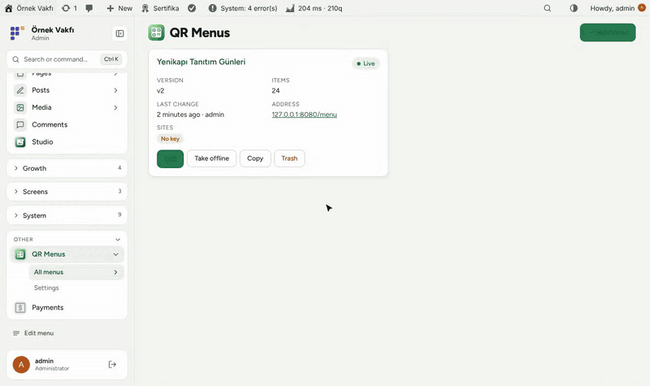
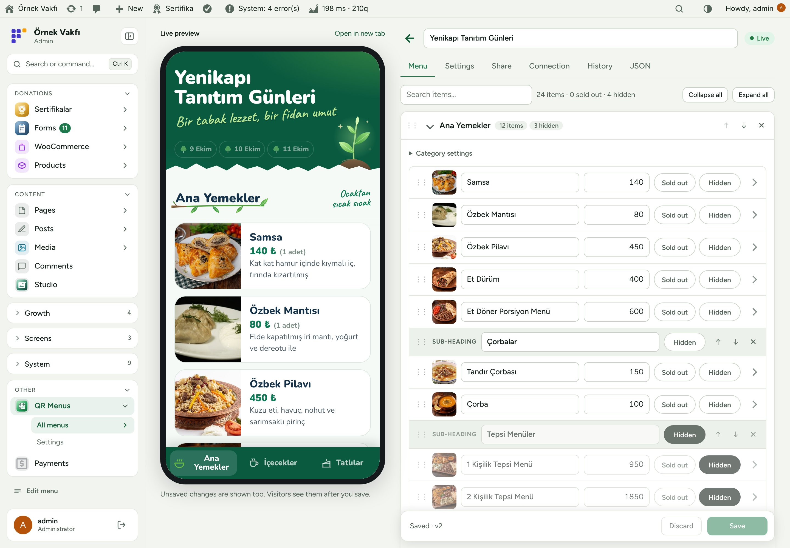
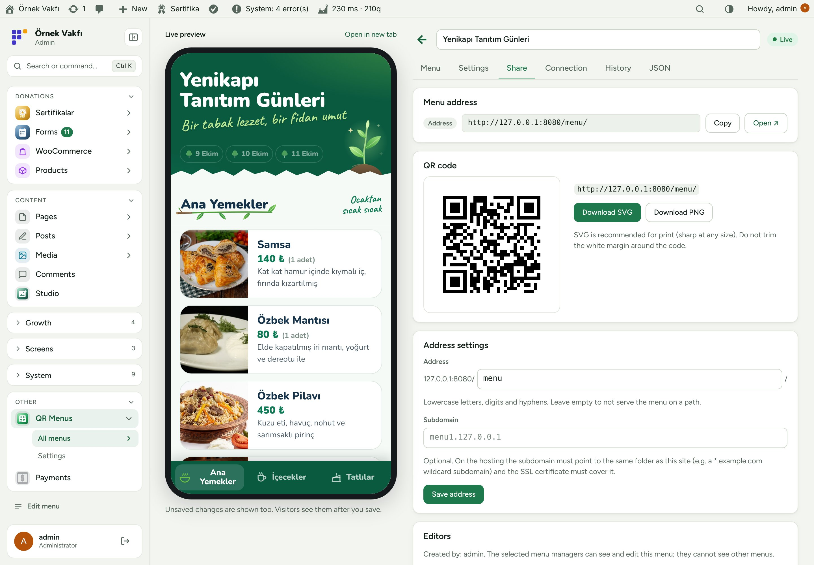
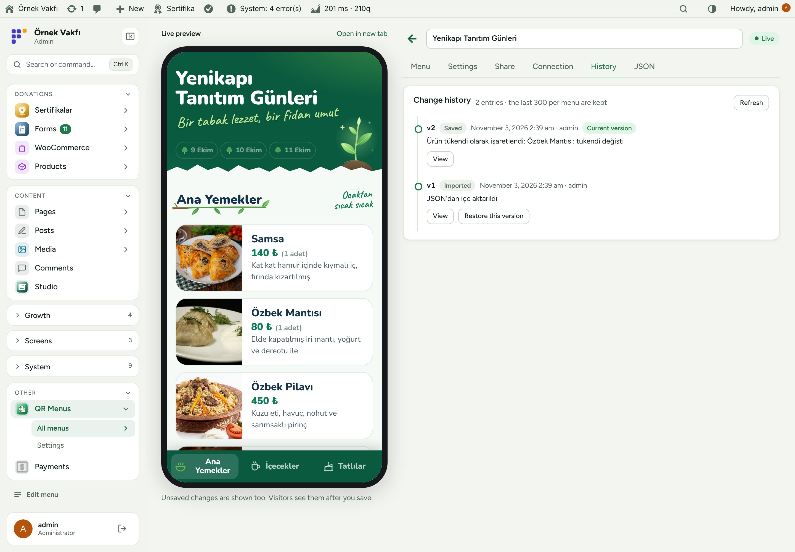
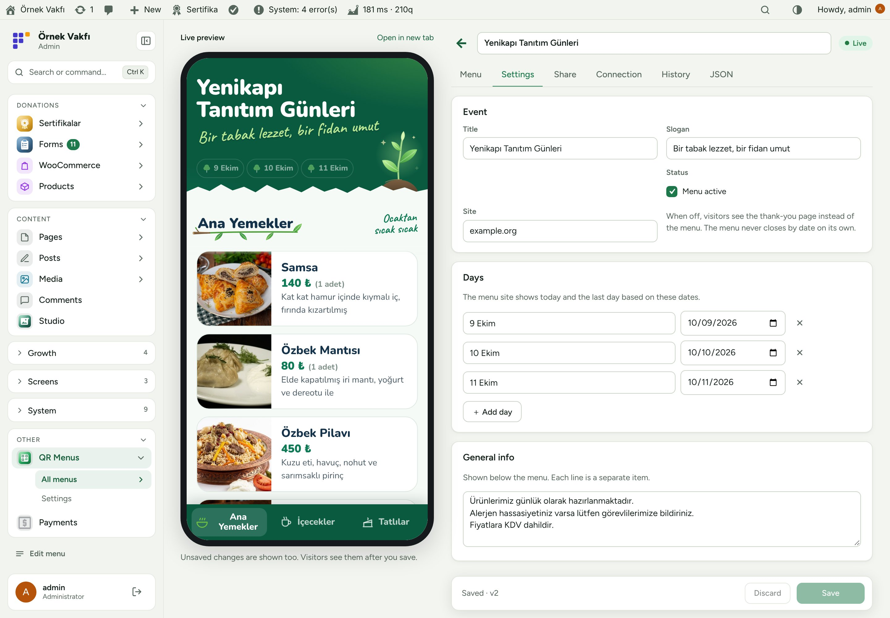
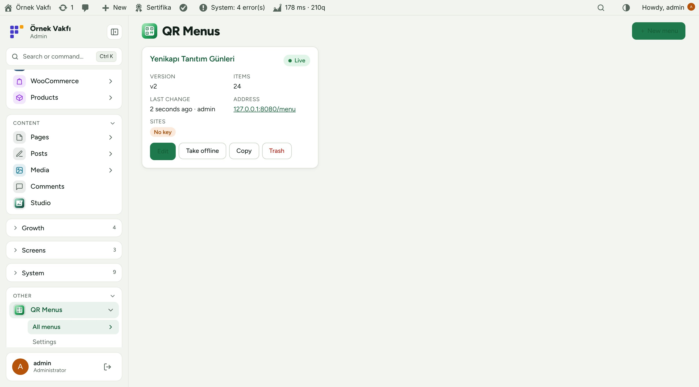
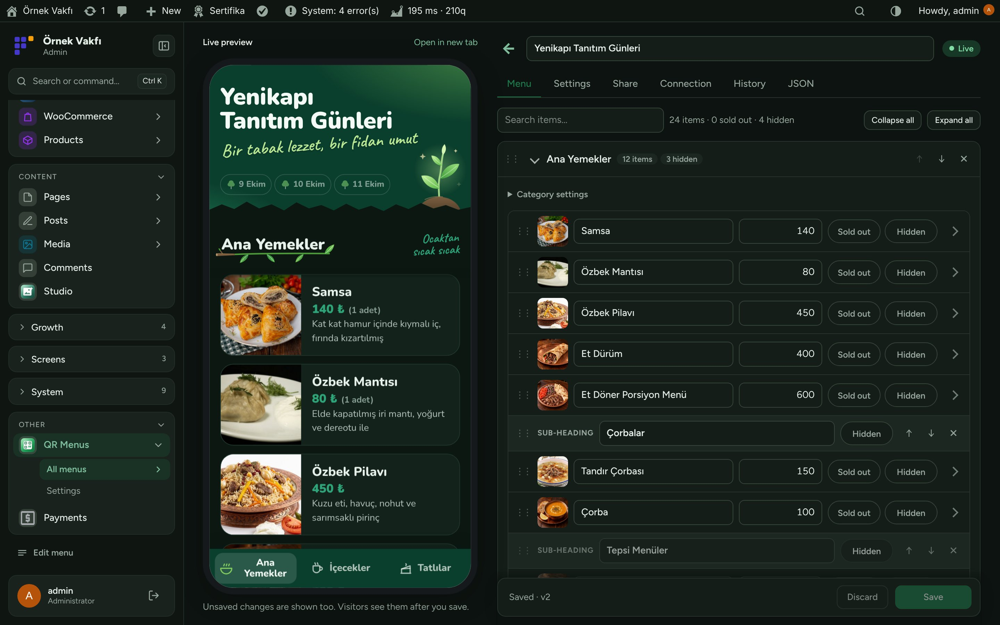
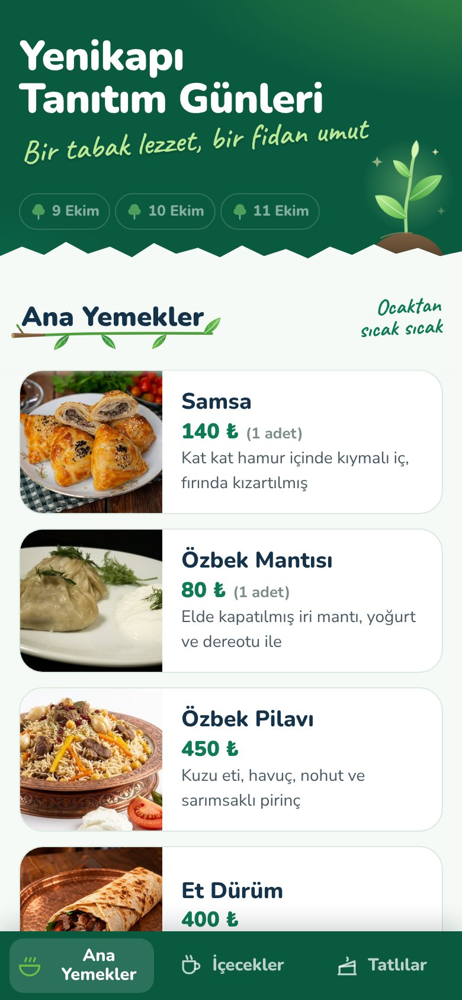
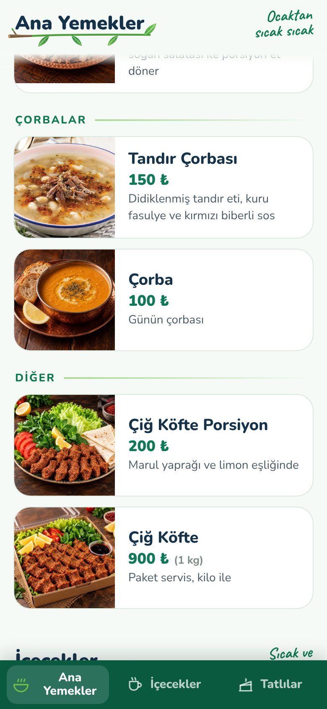

**English** · [Türkçe](README.tr.md)

# Flux QR Menu

**QR menus for events and stands, edited in WordPress and live on phones within seconds.** 
Flux QR Menu lets you build menus for a charity food stand or event in the WordPress admin: categories, items with photos, prices, badges and "sold out". A live phone preview sits next to the editor. Menus are published on the same site (for example `/menu/` or `menu1.example.org`) with a printable QR code, or fed to separate menu sites. Every change is kept in a history you can restore.

[Features](#features) · [Screenshots](#screenshots) · [Installation](#installation) · [For developers](#for-developers) · [Roadmap](#roadmap)

---

## Why Flux QR Menu?

At a fundraising stand the menu changes by the hour: a dish runs out, a price changes, a new tray arrives. Printed menus can't keep up and a PDF on a link is unreadable on a phone. Flux QR Menu keeps one QR code on the table and the menu always right:

- 📱 **Made for phones.** A fast, app-like menu with category tabs, photos and prices; no PDF, no zoom.
- ⚡ **Changes in seconds.** Mark something sold out on your phone; open menus refresh themselves within about 20 seconds.
- 👥 **Delegate safely.** Menu managers edit only the menus they are given, without access to the rest of the site.
- 🕘 **Nothing is lost.** Every save is in the history with a readable summary and one-click restore.

## Features

### Editing
- Categories with icon, note and bottom-bar tab; items with name, price, old price, unit, description, photo, badge, link and large image.
- **Sold out** and **Hidden** buttons on every row (big on phones), drag to reorder, move between categories, copy, search.
- **Live preview** in a phone frame next to the editor, including unsaved changes.
- Event settings: title, slogan, days with dates, general info lines, **Menu active** switch with a thank-you page.
- Start empty, from the sample menu (24 items with photos) or by importing JSON.

### Publishing
- Publish on this site at a path (`/menu/`) and/or a subdomain; optionally as the home page.
- **Share** tab: QR code with **SVG** (print) and **PNG** download, copyable addresses.
- Open menus check for a new version every ~20 seconds and reload in place; menu pages are never cached.
- Separate menu sites (the `qr-menu` app) connect with a key and are notified on every save.

### Control
- **History:** every change with a readable diff summary, view any version, restore.
- **Menu manager** role with per-menu access; capability `flxq_manage_menus` for all menus.
- REST data endpoint and MCP tools; system checks.

## Screenshots

| Editor with live phone preview | Share: address and QR code |
|---|---|
|  |  |
| **Change history** | **Event settings** |
|  |  |
| **Menus** | **Dark mode with Flux Admin** |
|  |  |
| **The menu on a phone** | **The menu on a phone** |
|  |  |

## Installation

Requirements: WordPress 6.4+, PHP 7.4+. Permalinks other than "Plain" if menus are published on this site.

**From a zip**

1. Download `flx-qr-menu.zip` from the latest `flx-qr-menu-v*` release on the [Releases](https://github.com/FluxWP/fluxwp/releases) page.
2. **Plugins › Add New › Upload Plugin**, choose the zip, then **Activate**.

**With Flux Updater** (recommended on our sites)

**Dashboard › Updates** lists every FluxWP package; click **Install** next to *Flux QR Menu*. Updates arrive the same way.

**First steps**

1. Activate Flux QR Menu; **QR Menus** appears in the admin menu.
2. **QR Menus › New menu**: name it and start from the sample menu, empty, or JSON.
3. Edit categories and items; the preview on the left updates as you type. **Save**.
4. **Share** tab: set the address (for example `menu`), save, then download the QR code.

> ℹ️ Menu pages send no-cache headers so LiteSpeed never serves an old menu. To use a subdomain, point it to the same folder as the site and make sure the SSL certificate covers it.

Full setup notes (Turkish): [KURULUM.md](../../docs/qr-menu/KURULUM.md) · API reference: [API.md](../../docs/qr-menu/API.md) · Release notes: [CHANGELOG.md](CHANGELOG.md)

## For developers

- Data endpoint and connection flow for separate menu sites, plus the REST API: [API.md](../../docs/qr-menu/API.md).
- Theme for a dedicated menu domain: [`themes/flx-menu-theme`](../../themes/flx-menu-theme).

## Roadmap

| | |
|---|---|
| ✅ | Editor with live phone preview |
| ✅ | Publishing on this site with QR code |
| ✅ | History and restore |
| ✅ | Menu manager role |
| ⬜ | Multiple languages per menu |
| ⬜ | Allergen icons |

## License

Flux QR Menu Released under the [GNU General Public License v2 or later](https://www.gnu.org/licenses/gpl-2.0.html).

Made by FluxWP.
