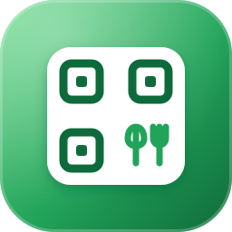

[English](README.md) · **Türkçe**

# Flux QR Menu

**Etkinlik ve stantlar için QR menüler: WordPress'te düzenlenir, saniyeler içinde telefonlarda.** 
Flux QR Menu bir dernek yemek standı ya da etkinlik için menüyü WordPress panelinde kurmanızı sağlar: kategoriler, fotoğraflı ürünler, fiyat, rozet ve "tükendi". Düzenleyicinin yanında canlı telefon önizlemesi durur. Menüler aynı sitede (ör. `/menu/` ya da `menu1.ornek.org`) basılabilir QR koduyla yayınlanır ya da ayrı menü sitelerine beslenir. Her değişiklik geri yüklenebilir bir geçmişte tutulur.

[Özellikler](#özellikler) · [Kurulum](#kurulum) · [Geliştiriciler için](#geliştiriciler-için) · [Yol haritası](#yol-haritası)

---

## Neden Flux QR Menu?

Bir bağış standında menü saat saat değişir: bir yemek biter, fiyat değişir, yeni tepsi gelir. Basılı menü yetişemez, bağlantıdaki PDF telefonda okunmaz. Flux QR Menu masada tek bir QR kod tutar, menüyü hep doğru tutar:

- 📱 **Telefon için.** Kategori sekmeli, fotoğraflı, fiyatlı, uygulama gibi hızlı bir menü; PDF yok, yakınlaştırma yok.
- ⚡ **Saniyeler içinde değişiklik.** Telefondan bir ürünü tükendi yapın; açık menüler yaklaşık 20 saniyede kendini yeniler.
- 👥 **Güvenle devret.** Menü yöneticileri sitenin geri kalanına erişmeden yalnız kendilerine verilen menüleri düzenler.
- 🕘 **Hiçbir şey kaybolmaz.** Her kayıt okunur özetiyle geçmişte, tek tıkla geri yüklenir.

## Özellikler

### Düzenleme
- İkonlu, notlu, alt çubuk sekmeli kategoriler; ad, fiyat, eski fiyat, birim, açıklama, fotoğraf, rozet, bağlantı ve büyük görselli ürünler.
- Her satırda **Tükendi** ve **Gizli** düğmeleri (telefonda büyük), sürükleyerek sıralama, kategoriler arası taşıma, kopyalama, arama.
- Düzenleyicinin yanında telefon çerçevesinde **canlı önizleme**; kaydedilmemiş değişiklikler dahil.
- Etkinlik ayarları: başlık, slogan, tarihli günler, genel bilgi satırları, teşekkür sayfalı **Menü aktif** anahtarı.
- Boş, örnek menüden (24 fotoğraflı ürün) ya da JSON içe aktararak başlama.

### Yayın
- Bu sitede bir adreste (`/menu/`) ve/veya alt alan adında; istenirse ana sayfa olarak.
- **Paylaş** sekmesi: **SVG** (baskı) ve **PNG** indirmeli QR kod, kopyalanabilir adresler.
- Açık menüler ~20 saniyede bir yeni sürüme bakar, yerinde yenilenir; menü sayfaları hiç önbelleğe alınmaz.
- Ayrı menü siteleri (`qr-menu` uygulaması) anahtarla bağlanır, her kayıtta bildirim alır.

### Kontrol
- **Geçmiş:** okunur fark özetli her değişiklik, herhangi bir sürümü görme, geri yükleme.
- Menü başına erişimli **Menü yöneticisi** rolü; tüm menüler için `flxq_manage_menus` yetkisi.
- REST veri ucu ve MCP araçları; sistem kontrolleri.

## Kurulum

Gereksinimler: WordPress 6.4+, PHP 7.4+. Menüler bu sitede yayınlanacaksa kalıcı bağlantılar "Düz" olmamalı.

**Zip ile**

1. [Releases](https://github.com/FluxWP/fluxwp/releases) sayfasında en son `flx-qr-menu-v*` sürümünden `flx-qr-menu.zip`'i indirin.
2. **Eklentiler › Yeni ekle › Eklenti yükle**, zip'i seçin, sonra **Etkinleştir**.

**Flux Updater ile** (sitelerimizde önerilen)

**Başlangıç › Güncellemeler** tüm FluxWP paketlerini listeler; *Flux QR Menu* satırındaki **Kur**'a basın. Güncellemeler de buradan gelir.

**İlk adımlar**

1. Flux QR Menu'yü etkinleştirin; panel menüsünde **QR Menüler** çıkar.
2. **QR Menüler › Yeni menü**: ad verin, örnek menüden, boş ya da JSON ile başlayın.
3. Kategori ve ürünleri düzenleyin; soldaki önizleme yazdıkça güncellenir. **Kaydet**.
4. **Paylaş** sekmesi: adresi girin (ör. `menu`), kaydedin, QR kodu indirin.

> ℹ️ Menü sayfaları önbelleksiz başlıklar gönderir, LiteSpeed eski menü göstermez. Alt alan adı için alan adını sitenin klasörüne yönlendirin ve SSL sertifikasının onu kapsadığından emin olun.

Ayrıntılı kurulum notları: [KURULUM.md](../../docs/qr-menu/KURULUM.md) · API başvurusu: [API.md](../../docs/qr-menu/API.md) · Sürüm notları: [CHANGELOG.md](CHANGELOG.md)

## Geliştiriciler için

- Ayrı menü siteleri için veri ucu ve bağlantı akışı, REST API: [API.md](../../docs/qr-menu/API.md).
- Ayrı menü alan adı için tema: [`themes/flx-menu-theme`](../../themes/flx-menu-theme).

## Yol haritası

| | |
|---|---|
| ✅ | Canlı telefon önizlemeli düzenleyici |
| ✅ | QR kodlu, bu sitede yayın |
| ✅ | Geçmiş ve geri yükleme |
| ✅ | Menü yöneticisi rolü |
| ⬜ | Menü başına çok dil |
| ⬜ | Alerjen ikonları |

## Lisans

Flux QR Menu, [GNU Genel Kamu Lisansı v2 veya üzeri](https://www.gnu.org/licenses/gpl-2.0.html) ile yayınlanır.

FluxWP tarafından geliştirilmiştir.
