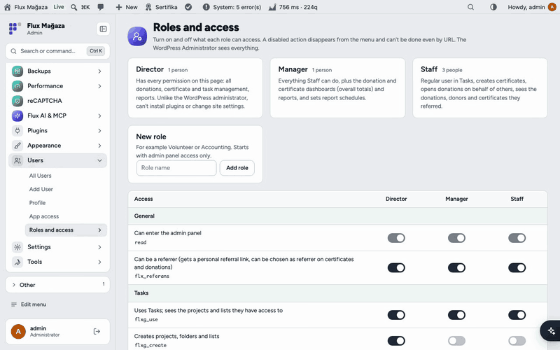
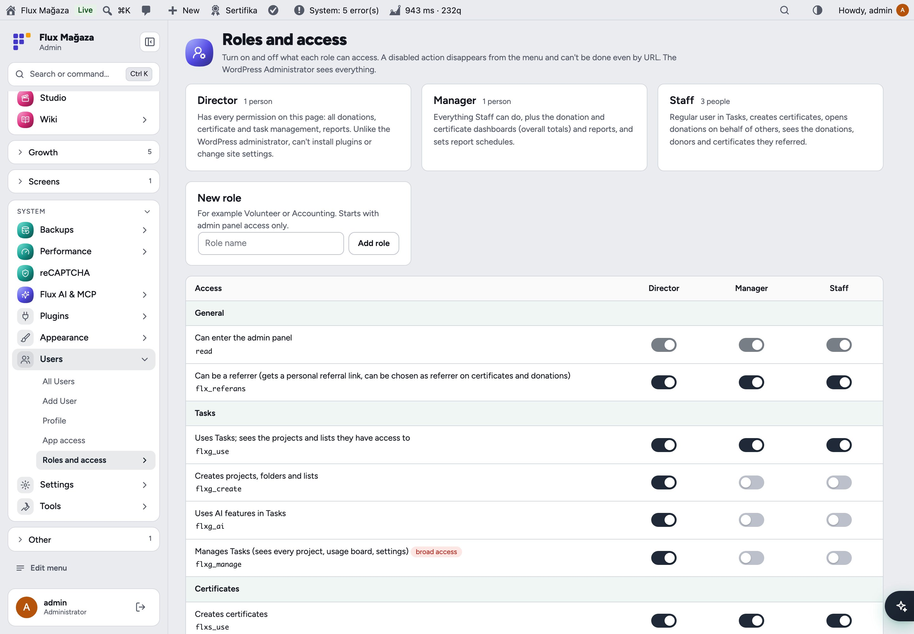
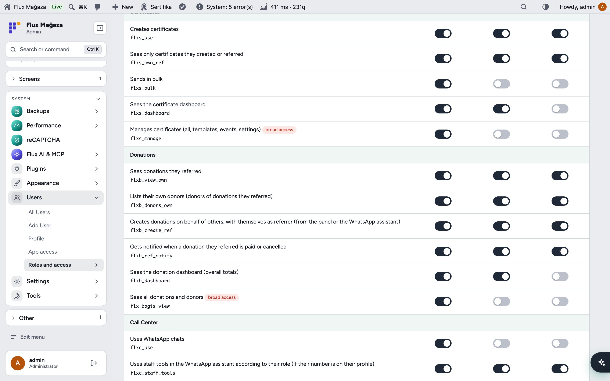
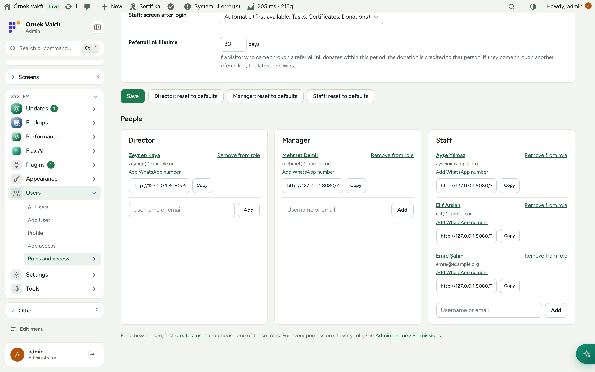
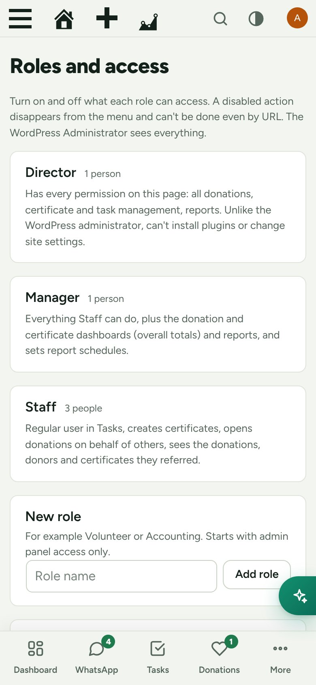

**English** · [Türkçe](README.tr.md)

# Flux Roles

**Give staff and volunteers exactly the access they need, from one page.** 
Flux Roles adds Staff, Manager and Director roles (and any role you create in the panel), and lets you switch each role's access to tasks, certificates, donations, the call center, the studio and reports on or off with a toggle. It also manages personal referral links and the phone numbers the WhatsApp assistant uses to recognise staff.

[Features](#features) · [Screenshots](#screenshots) · [Installation](#installation) · [For developers](#for-developers) · [Roadmap](#roadmap)

---

## Why Flux Roles?

WordPress roles are built for blogs: Editor, Author, Contributor. A foundation needs "this volunteer can create certificates and see the donations they referred, but nothing else". Flux Roles turns that into toggles:

- 🎚️ **One table, real permissions.** Each row is a real WordPress capability. Switching it off removes the menu *and* blocks the address.
- 👥 **Roles that match the organisation:** Staff, Manager and Director, plus any role you add (Volunteer, Accounting…).
- 🔗 **Personal referral links** for everyone who may refer donors; donations through the link are credited to them.
- 📱 **WhatsApp-aware:** a staff member's phone number lets the call-center assistant recognise them and act within their role.
- 🧩 **Grows with the other packages:** new FluxWP packages register their capabilities here automatically.

## Features

### Roles
- **Staff** (everyday work), **Manager** (Staff plus the donation and certificate dashboards and reports) and **Director** (every permission on the page, but not a WordPress administrator: cannot install plugins or change site settings).
- Add a new role from the panel; it starts with admin access only and you switch on what it needs. Roles created here can be deleted.
- "Reset to defaults" per role.

### Access table
- Grouped by package: General, Tasks, Certificates, Donations, Call Center, Studio, Reports.
- Packages that aren't installed show a "not installed" badge; settings are kept and apply as soon as the package arrives.
- Choose the screen each role lands on after login (or let it pick the first available).

### People and referrals
- Add or remove people per role by username or e-mail.
- Personal referral link (`?ref=code`) with a copy button on the profile and in the people list; the last clicked link wins and lasts 30 days (configurable). The referrer is written to the WooCommerce order.
- Phone number per user (admins only) for the WhatsApp assistant in Flux Call Center.

## Screenshots

| Roles and the access table | Access per package |
|---|---|
|  |  |
| **People and referral links** | **Mobile** |
|  |  |

## Installation

Requirements: WordPress 6.4+, PHP 7.4+.

**From a zip**

1. Download `flx-roles.zip` from the latest `flx-roles-v*` release on the [Releases](https://github.com/FluxWP/fluxwp/releases) page.
2. **Plugins › Add New › Upload Plugin**, choose the zip, then **Activate**.

**With Flux Setup** (recommended on our sites)

**Setup › Packages** lists every FluxWP package; click **Install** next to *Flux Roles*. Updates arrive the same way.

**First steps**

1. **Users › Roles and access** opens with the roles ready and default permissions set.
2. Add people: create the user under **Users › Add New** and choose Staff/Manager, or type an existing username in **People › Add**.
3. Switch rows on or off and press **Save**.

Full setup notes (Turkish): [KURULUM.md](../../docs/flx-roles/KURULUM.md) · API reference: [API.md](../../docs/flx-roles/API.md) · Release notes: [CHANGELOG.md](CHANGELOG.md)

## For developers

- Packages check **capabilities, never role names**: `user_can( $user, 'flxb_dashboard' )`.
- Register a package's capabilities for the table with the `flx_role_caps_supported` filter; list roles with `flxr_roles()` (filter `flxr_roles`).
- Full capability list and contract: [API.md](../../docs/flx-roles/API.md).

## Roadmap

| | |
|---|---|
| ✅ | Staff and Manager roles with a single access page |
| ✅ | Director role, custom roles, WhatsApp numbers |
| ✅ | Studio capabilities |
| ⬜ | Per-project task permissions from the same page |
| ⬜ | Audit log of permission changes |

## License

Flux Roles Released under the [GNU General Public License v2 or later](https://www.gnu.org/licenses/gpl-2.0.html).

Made by FluxWP.
