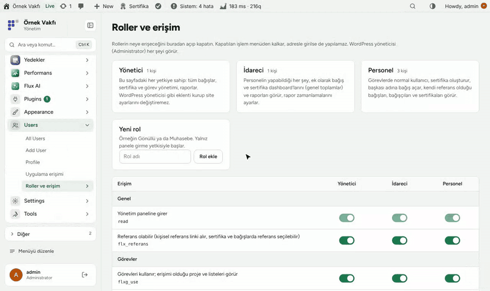
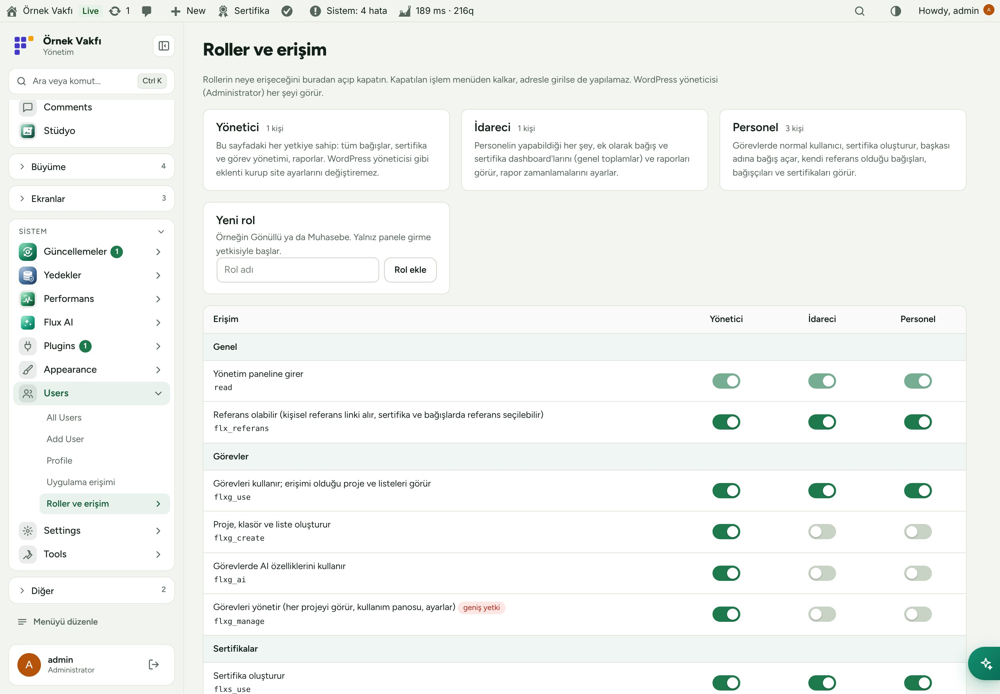
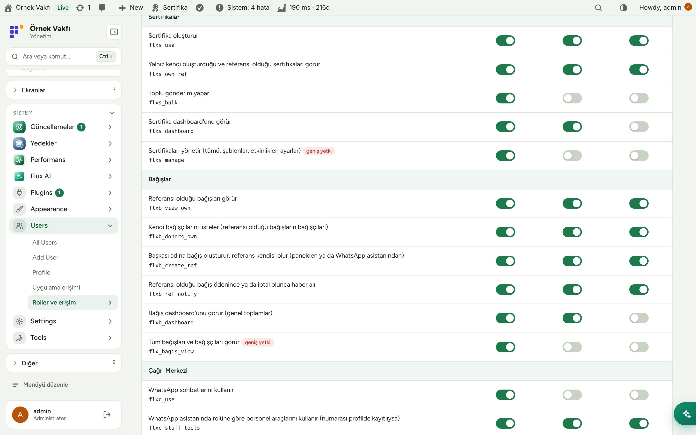
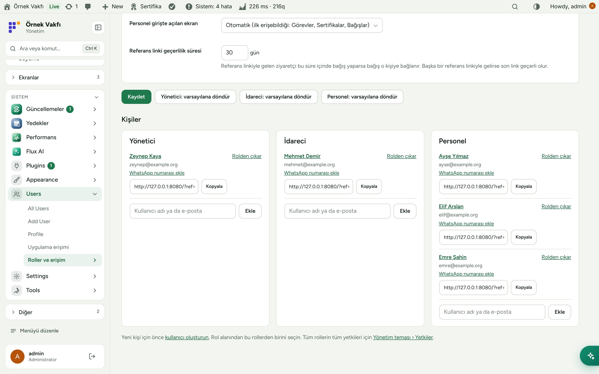
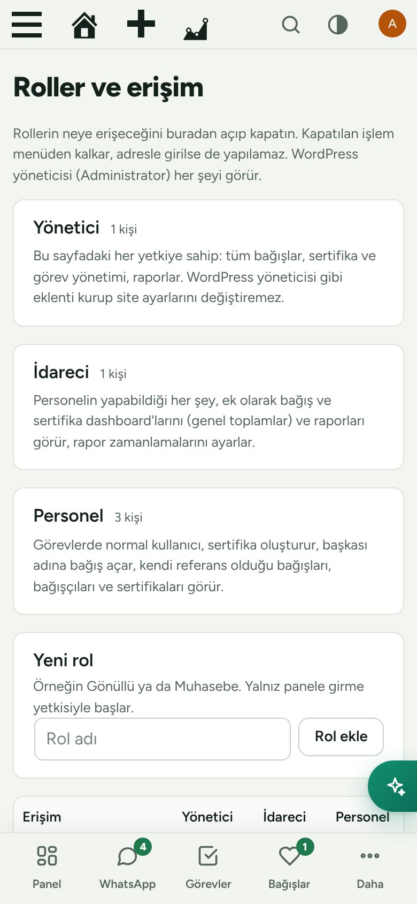

[English](README.md) · **Türkçe**

# Flux Roles

**Personele ve gönüllülere tam ihtiyaç duydukları erişimi tek sayfadan verin.** 
Flux Roles Personel, İdareci ve Yönetici rollerini (ve panelden ekleyeceğiniz her rolü) ekler; her rolün görevlere, sertifikalara, bağışlara, çağrı merkezine, stüdyoya ve raporlara erişimini tek düğmeyle açıp kapatırsınız. Kişisel referans bağlantılarını ve WhatsApp asistanının personeli tanıdığı telefon numaralarını da burada yönetirsiniz.

[Özellikler](#özellikler) · [Ekran görüntüleri](#ekran-görüntüleri) · [Kurulum](#kurulum) · [Geliştiriciler için](#geliştiriciler-için) · [Yol haritası](#yol-haritası)

---

## Neden Flux Roles?

WordPress rolleri blog için düşünülmüş: Editör, Yazar, Katılımcı. Bir derneğin ihtiyacı ise "bu gönüllü sertifika oluşturabilsin ve getirdiği bağışları görsün, başka bir şey değil". Flux Roles bunu düğmelere çevirir:

- 🎚️ **Tek tablo, gerçek yetki.** Her satır gerçek bir WordPress yetkisidir. Kapatınca menüden kalkar *ve* adresle de girilemez.
- 👥 **Kuruma uygun roller:** Personel, İdareci ve Yönetici; artı sizin ekleyeceğiniz roller (Gönüllü, Muhasebe…).
- 🔗 **Kişisel referans bağlantıları:** bağlantıyla gelen bağış o kişiye yazılır.
- 📱 **WhatsApp'la uyumlu:** personelin telefon numarası sayesinde çağrı merkezi asistanı onu tanır ve rolünün izin verdiği işleri yapar.
- 🧩 **Diğer paketlerle büyür:** yeni FluxWP paketleri yetkilerini buraya kendiliğinden kaydeder.

## Özellikler

### Roller
- **Personel** (günlük iş), **İdareci** (Personel + bağış ve sertifika dashboard'ları, raporlar) ve **Yönetici** (sayfadaki her yetki; ama WordPress yöneticisi değil, eklenti kuramaz, site ayarını değiştiremez).
- Panelden yeni rol ekleyin; yalnız panele girişle başlar, gereken yetkileri açarsınız. Burada eklenen roller silinebilir.
- Her rol için "Varsayılana döndür".

### Erişim tablosu
- Pakete göre gruplu: Genel, Görevler, Sertifikalar, Bağışlar, Çağrı Merkezi, Stüdyo, Raporlar.
- Kurulu olmayan paketler "kurulu değil" rozetiyle görünür; ayar saklanır, paket gelince geçerli olur.
- Her rolün girişten sonra açılacak ekranı (ya da ilk erişilebilir ekran).

### Kişiler ve referanslar
- Kullanıcı adı ya da e-postayla role kişi ekleme/çıkarma.
- Profilde ve kişiler listesinde kopyala düğmeli kişisel referans bağlantısı (`?ref=kod`); son tıklanan bağlantı geçerli, 30 gün (ayarlanabilir). Referans WooCommerce siparişine yazılır.
- Kullanıcı başına telefon numarası (yalnız yönetici yazar): Flux Chat'ndeki WhatsApp asistanı için.

## Ekran görüntüleri

| Roller ve erişim tablosu | Pakete göre erişim |
|---|---|
|  |  |
| **Kişiler ve referans bağlantıları** | **Mobil** |
|  |  |

## Kurulum

Gereksinimler: WordPress 6.4+, PHP 7.4+.

**Zip ile**

1. [Releases](https://github.com/FluxWP/fluxwp/releases) sayfasında en son `flx-roles-v*` sürümünden `flx-roles.zip`'i indirin.
2. **Eklentiler › Yeni ekle › Eklenti yükle**, zip'i seçin, sonra **Etkinleştir**.

**Flux Updater ile** (sitelerimizde önerilen)

**Başlangıç › Güncellemeler** tüm FluxWP paketlerini listeler; *Flux Roles* satırındaki **Kur**'a basın. Güncellemeler de buradan gelir.

**İlk adımlar**

1. **Kullanıcılar › Roller ve erişim** roller hazır ve varsayılan yetkilerle açılır.
2. Kişi ekleyin: **Kullanıcılar › Yeni ekle**'de oluşturup Personel/İdareci seçin ya da var olan kullanıcıyı **Kişiler › Ekle**'ye yazın.
3. Satırları açıp kapatın ve **Kaydet**'e basın.

Ayrıntılı kurulum notları: [KURULUM.md](../../docs/flx-roles/KURULUM.md) · API başvurusu: [API.md](../../docs/flx-roles/API.md) · Sürüm notları: [CHANGELOG.md](CHANGELOG.md)

## Geliştiriciler için

- Paketler **rol adına değil, yetkiye** bakar: `user_can( $user, 'flxb_dashboard' )`.
- Paketin yetkilerini tabloya `flx_role_caps_supported` filtresiyle kaydedin; roller `flxr_roles()` ile (filtre `flxr_roles`).
- Tam yetki listesi ve sözleşme: [API.md](../../docs/flx-roles/API.md).

## Yol haritası

| | |
|---|---|
| ✅ | Tek erişim sayfasıyla Personel ve İdareci rolleri |
| ✅ | Yönetici rolü, özel roller, WhatsApp numaraları |
| ✅ | Stüdyo yetkileri |
| ⬜ | Aynı sayfadan proje bazlı görev yetkileri |
| ⬜ | Yetki değişikliklerinin kaydı |

## Lisans

Flux Roles, [GNU Genel Kamu Lisansı v2 veya üzeri](https://www.gnu.org/licenses/gpl-2.0.html) ile yayınlanır.

FluxWP tarafından geliştirilmiştir.
