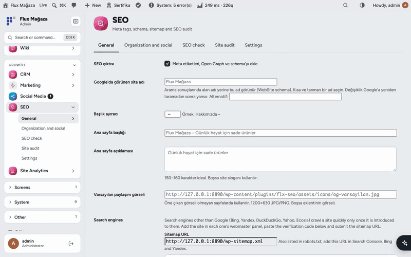
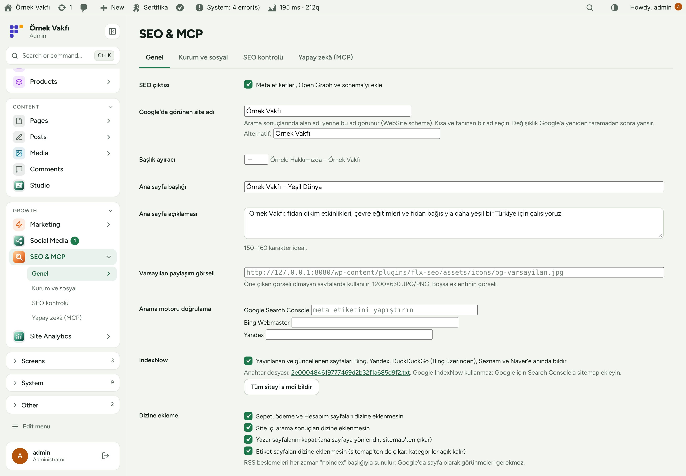
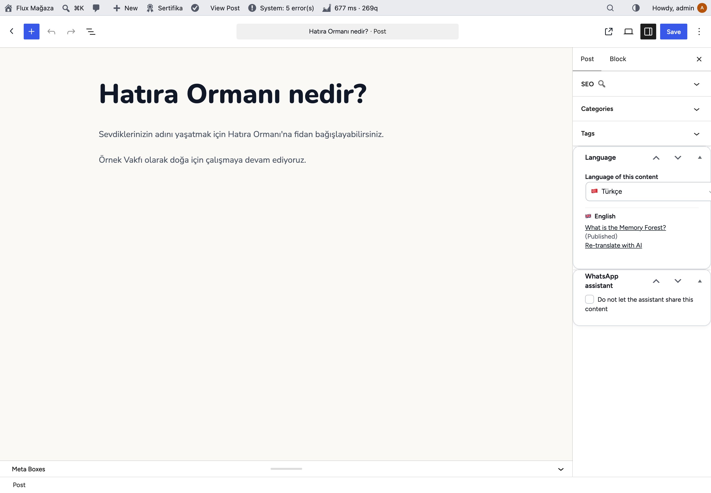
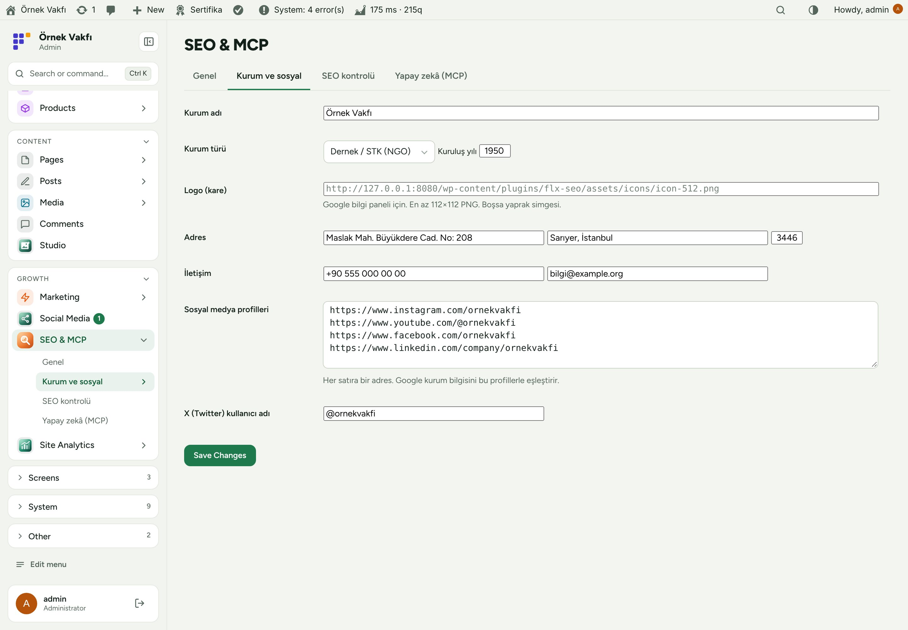
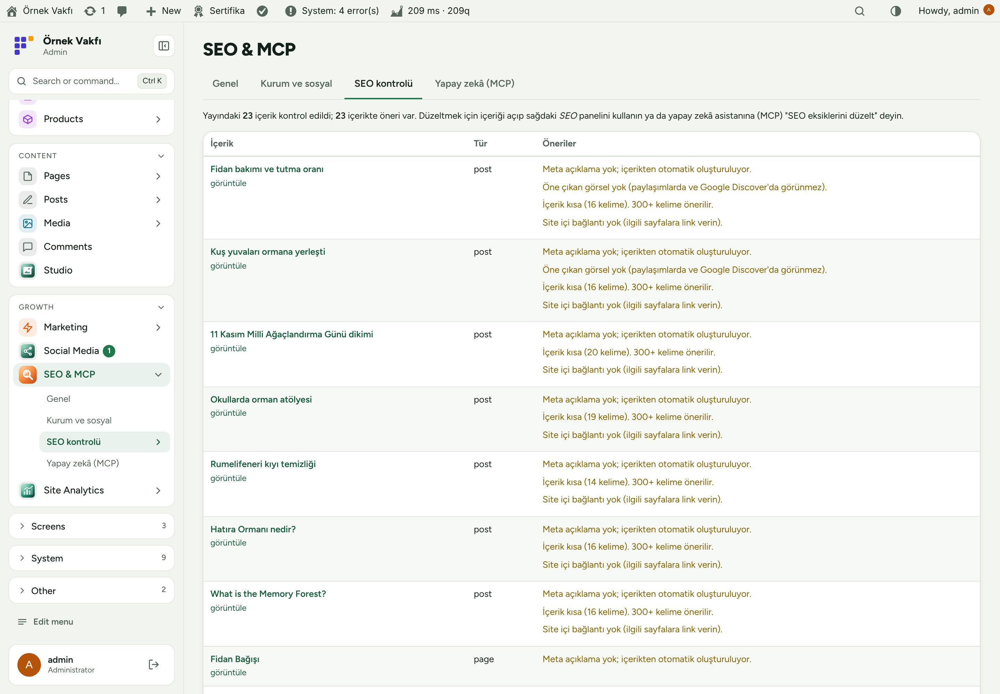
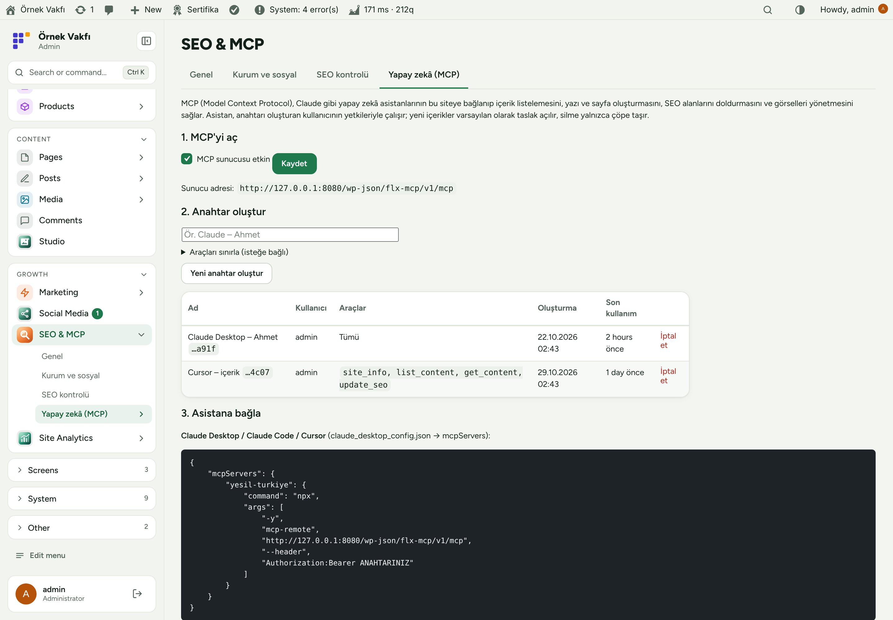
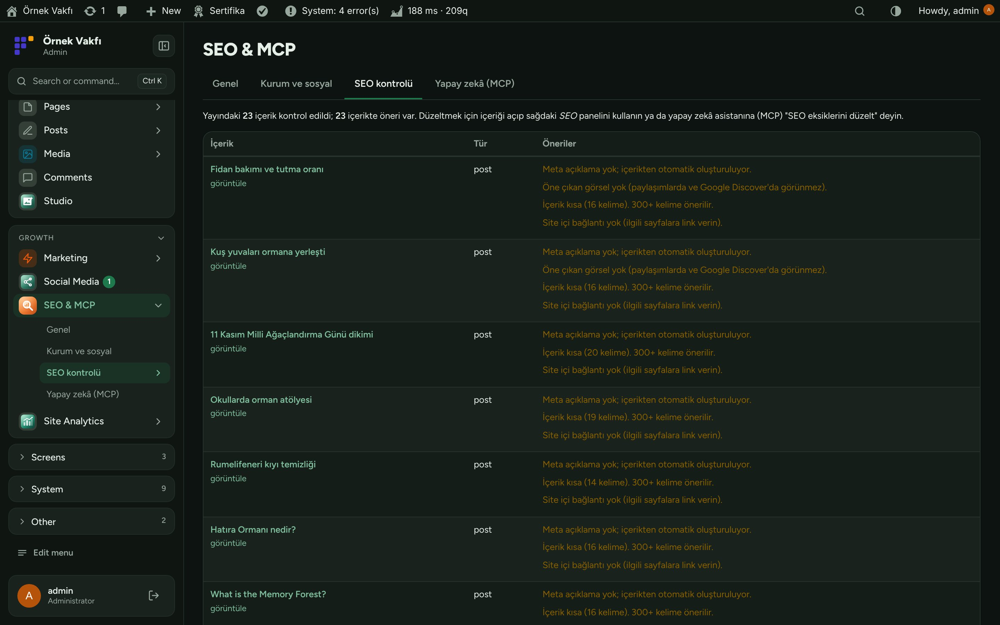
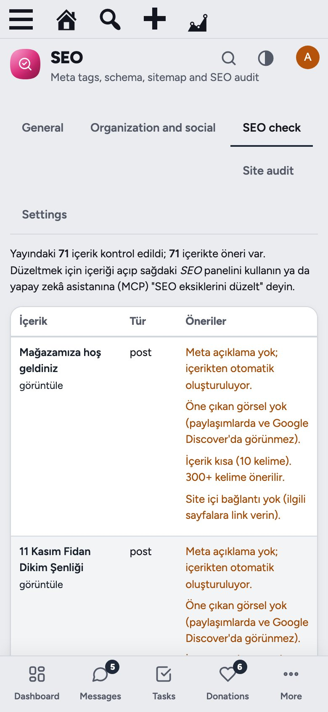

<div align="center">

**English** · [Türkçe](README.tr.md)


# Flux SEO

**Lightweight SEO for WordPress, plus an MCP server so Claude and other AI assistants can manage your content.**<br>
Flux SEO adds what a charity site needs to be found: meta titles and descriptions, canonical, Open Graph with sharp WhatsApp previews, schema (Organization, WebSite, Breadcrumb, Article), sitemap fixes, IndexNow, favicon and browser caching, with an SEO check for every page. It also runs an MCP server, so Claude Desktop, Claude Code, Cursor or claude.ai can list, write and fix content with a per-user key.

[](https://wordpress.org)
[](https://www.php.net)
[](https://www.gnu.org/licenses/gpl-2.0.html)


[Features](#features) · [Screenshots](#screenshots) · [Installation](#installation) · [Use it with AI assistants (MCP)](#use-it-with-ai-assistants-mcp) · [Roadmap](#roadmap)



</div>

---

## Why Flux SEO?

Big SEO plugins bring dozens of screens, upsells and their own database tables; a small team only needs the basics done right and a way to keep them done. Flux SEO keeps it short:

- 🔎 **The basics, correct.** Titles, descriptions, canonical, Open Graph, schema and sitemap with sensible defaults, no setup wizard.
- ✅ **A list of what to fix.** The SEO check reads every page and says what is missing: long titles, empty descriptions, no featured image, thin content, no internal links.
- 🤖 **Let the assistant do it.** Connect Claude (or any MCP client) with a key and say "fix the SEO gaps": it reads the same list and fills the fields, with the permissions of the user who made the key.
- 📣 **Search engines told at once.** IndexNow pings Bing, Yandex, Seznam and Naver when a page is published or updated.

## Features

### SEO
- Meta title and description per post, page and term, with a separator and home page title; automatic description from the content when empty.
- **Editor panel:** Google preview, character counters, focus keyword with checks (in title, description, content, H2, length, image alt), noindex toggle.
- Canonical, robots meta, Open Graph and Twitter cards; `og:image` saved as a 1200×630 JPEG copy so WhatsApp previews stay sharp.
- Schema: Organization or NGO (name, logo, address, contact, founding year, social profiles), WebSite with site name, BreadcrumbList, Article.
- Sitemap: noindex content, shop-only pages, authors and (optionally) tags removed; `lastmod` added; `/sitemap.xml` redirects to `/wp-sitemap.xml`.
- Noindex for cart/checkout/account, search results, author archives and tags; search engine verification for Google, Bing and Yandex.
- **IndexNow** with its key file served automatically and a "Notify the whole site" button.
- Favicon set from one image, automatic image alt text, browser caching rules for Apache and LiteSpeed.
- **SEO check:** every published page with its problems and suggestions.

### MCP server
- `/wp-json/flx-mcp/v1/mcp` with per-user keys; keys can be limited to chosen tools; last use shown.
- Tools: site info, list/get/create/update/delete content, set SEO, SEO audit, patterns, media upload and alt text, terms, site SEO settings; prompts for "fix SEO gaps", "write a news post" and "build a page".
- Other FluxWP plugins add their own tools through `flxseo_mcp_tools` (orders, system checks and fixes are already there).
- New content is created as a draft; delete only moves to trash. Every call is logged.

## Screenshots

| General settings | SEO panel in the editor |
|---|---|
|  |  |
| **Organisation and social profiles** | **SEO check** |
|  |  |
| **MCP server and keys** | **Dark mode with Flux Admin** |
|  |  |
| **Mobile SEO check** |   |
|  |   |

## Installation

Requirements: WordPress 6.5+, PHP 7.4+. An MCP client (Claude Desktop, Claude Code, Cursor, claude.ai) if you want AI access.

**From a zip**

1. Download `flx-seo.zip` from the latest `flx-seo-v*` release on the [Releases](https://github.com/FluxWP/fluxwp/releases) page.
2. **Plugins › Add New › Upload Plugin**, choose the zip, then **Activate**.

**With Flux Setup** (recommended on our sites)

**Setup › Packages** lists every FluxWP package; click **Install** next to *Flux SEO*. Updates arrive the same way.

**First steps**

1. Activate Flux SEO and open **SEO & MCP › General**: check the site name, home title and description.
2. Fill **Organisation and social** so Google can show your knowledge panel.
3. Open **SEO check** and work through the list, by hand or with the assistant.

> ℹ️ The settings screens are in Turkish for now; front-end output follows the site language.

Full setup notes (Turkish): [KURULUM.md](../../docs/seo-mcp/KURULUM.md) · Release notes: [CHANGELOG.md](CHANGELOG.md)

## Use it with AI assistants (MCP)

1. **SEO & MCP › AI (MCP)**: turn on the MCP server and create a key (optionally limited to some tools).
2. Add it to your client, for example Claude Code:

```bash
claude mcp add --transport http yesil-turkiye https://example.org/wp-json/flx-mcp/v1/mcp --header "Authorization: Bearer YOUR_KEY"
```

3. Ask: *"List posts with SEO gaps and fix them."* The assistant works with the permissions of the user who created the key.

Adding tools from your own plugin: [MCP-API.md](../../docs/seo-mcp/MCP-API.md).

## Roadmap

| | |
|---|---|
| ✅ | Meta, Open Graph, schema and sitemap |
| ✅ | SEO check and editor panel |
| ✅ | MCP server with scoped keys |
| ✅ | IndexNow and sharp WhatsApp previews |
| ⬜ | English settings screens |
| ⬜ | Redirect manager for changed slugs |

## License

Flux SEO Released under the [GNU General Public License v2 or later](https://www.gnu.org/licenses/gpl-2.0.html).

Made by FluxWP.
