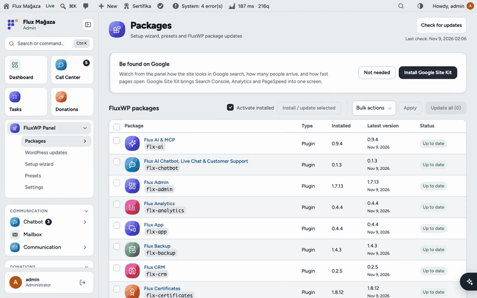
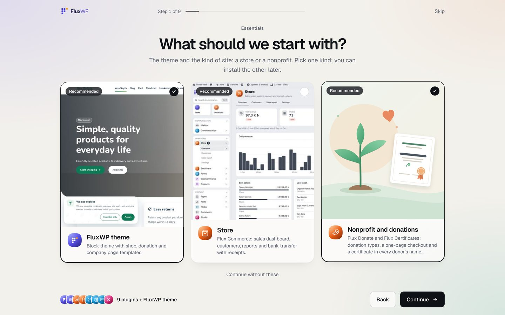
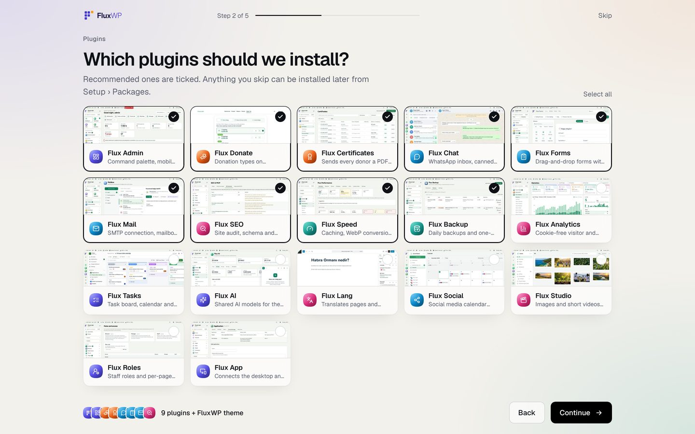
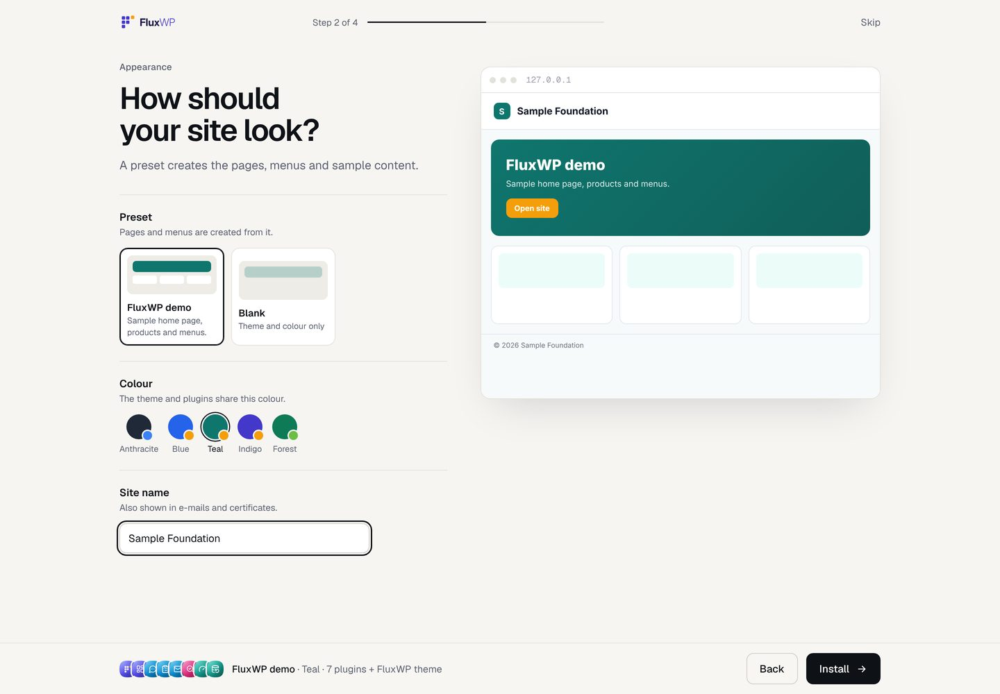
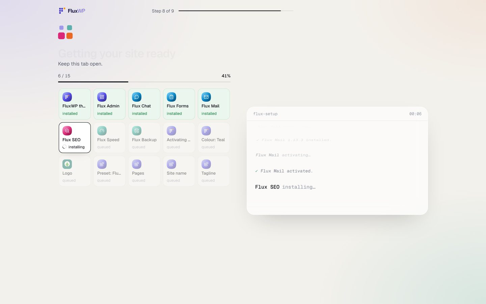
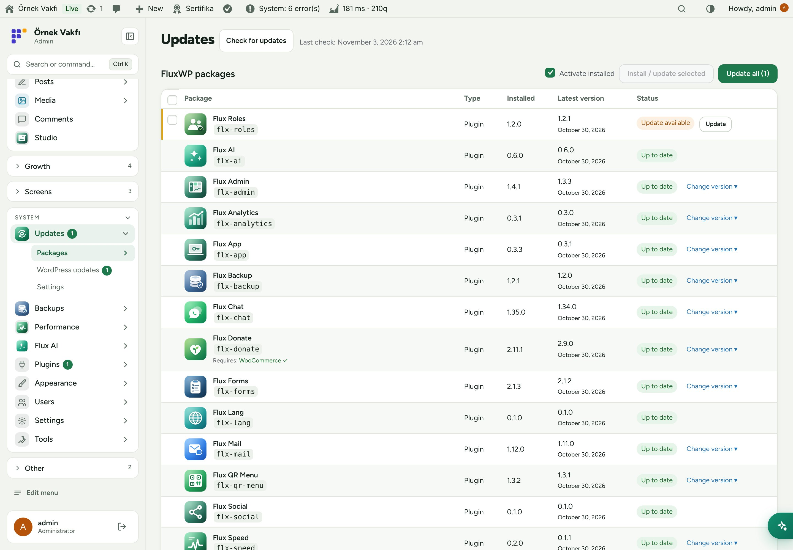
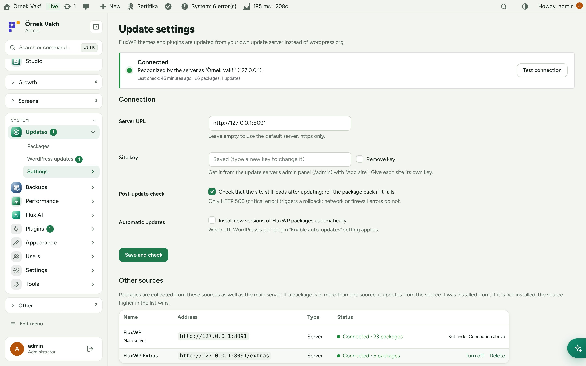
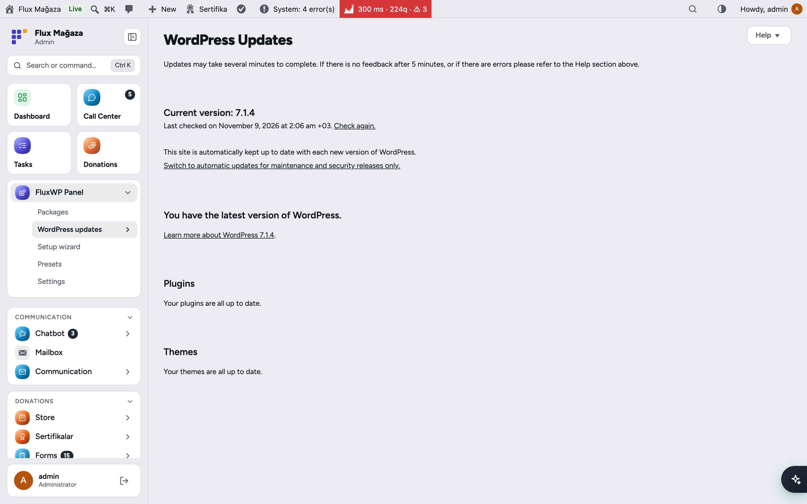
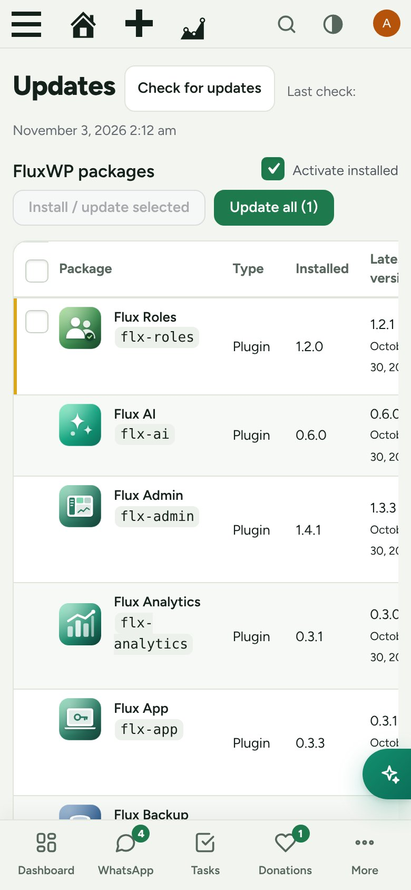

<div align="center">

**English** · [Türkçe](README.tr.md)


# FluxWP Panel

**Set up a FluxWP site in three steps, then keep it updated.**<br>
FluxWP Panel is the first plugin you install. A short wizard picks the plugins, a preset and a colour and installs everything. After that it brings our FluxWP themes and plugins into the normal WordPress update screens through our own update server, with a backup before every change.

[](https://wordpress.org)
[](https://www.php.net)
[](https://www.gnu.org/licenses/gpl-2.0.html)


[Features](#features) · [Screenshots](#screenshots) · [Installation](#installation) · [For developers](#for-developers) · [Roadmap](#roadmap)



</div>

---

## Why FluxWP Panel?

Our packages live in a private GitHub repository and are not on WordPress.org. Without FluxWP Panel, a new site means uploading a dozen zips by hand and every update means doing it again. With it:

- 🧭 **A three-step setup wizard.** Opens after activation: intro, plugin cards with screenshots, preset and colour, then a live install log. It can be skipped and opened again later.
- 🔄 **Normal WordPress updates.** FluxWP packages appear in **Dashboard › Updates** and the plugin list, with release notes, like any other plugin.
- 🔐 **No GitHub token on the site.** Sites talk only to our update server with their own key; the token stays on the server.
- 🛟 **Safe by default.** A backup is taken before every update (Flux Backup), and if the site returns HTTP 500 afterwards the package is rolled back automatically.
- ⏪ **Switch versions.** Install any of the last 20 releases, for example to roll back.
- 📦 **One list for everything:** what is installed, what is new and what can be installed with one click.

## Features

### Setup wizard
- Presentation-style: every step fits one landscape screen, no scrolling; steps slide sideways. Steps: intro › theme and site type (store or nonprofit, pick one) › plugins by category, one screen each › appearance › install › done. **Skip** at any time; open it again from **FluxWP Panel › Setup wizard**.
- Appearance step in tabs with a fixed live preview on the right: **Identity** (site name, tagline, logo upload), **Preset**, **Colour** (each style shown as a small site) and **Pages** (Blog, About us, Contact, FAQ).
- **What should we start with?** The FluxWP theme and Flux Commerce on their own screen, both recommended, with a quiet **Continue without these**. Then the other plugins with a screenshot and one line each; recommended ones are ticked.
- Appearance: preset (FluxWP demo, installed preset packages or Blank), one of the theme's colour styles with a live preview, and the site name.
- Install: one row per package (finished rows sharp, upcoming ones blurred), a console log and progress. Required plugins such as WooCommerce come from WordPress.org. Failed steps are listed at the end.

### Presets
- One `preset.json` sets up the organisation profile, plugin settings, colours and fonts, header/footer, templates, pages, menus and media.
- Preview, apply and undo; your manual edits are kept; preset migrations are applied one by one. Several presets on one site.
- Export the site as a preset; AI and MCP tools (`preset_schema`, `preset_export`, `preset_patch_preview`, `preset_patch_apply`, `preset_revert`).

### Packages
- **Setup** in the left menu with a pending-count badge; FluxWP packages table with logo, type, installed and latest version and status.
- **Install** packages that aren't on the site yet, **Update** one, several or all of them (WordPress's own bulk updater).
- Version switch: choose one of the last 20 releases from the server. A backup is taken first.
- Optional automatic updates for all FluxWP packages; when it is off, WordPress's per-plugin auto-update setting applies.

### Safety
- Post-update check: the front end and the admin are requested after each update; on HTTP 500 the previous version is restored.
- History: who updated what, from which version to which, the result and a link to the backup. Backups of updates are removed automatically after 1–90 days.

### Connection
- Server address and site key are entered once in the panel (or with `FLX_UPDATE_SERVER` / `FLX_UPDATE_KEY` in `wp-config.php`).
- Connection card: connected / error / not connected, the site's name on the server, package and update counts, and **Test connection**.
- Pre-release versions (`1.3.0-beta.1`) reach only sites set to the beta channel on the server.

## Screenshots

| Setup wizard: what to start with | Setup wizard: plugins |
|---|---|
|  |  |
| **Setup wizard: appearance** | **Setup wizard: install** |
|  |  |
| **FluxWP packages** | **Connection settings** |
|  |  |
| **In the standard Updates screen** | **Mobile** |
|  |  |

## Installation

Requirements: WordPress 6.6+, PHP 7.4+.

**From a zip**

1. Download `flx-setup.zip` from the latest `flx-setup-v*` release on the [Releases](https://github.com/FluxWP/fluxwp/releases) page.
2. **Plugins › Add New › Upload Plugin**, choose the zip, then **Activate**.

**With FluxWP Panel** (recommended on our sites)

**FluxWP Panel › Packages** lists every FluxWP package; click **Install** next to *FluxWP Panel*. Updates arrive the same way.

**First steps**

1. Activate FluxWP Panel; the setup wizard opens. Pick the plugins, a preset and a colour, then **Install**.
2. Public packages need no key. For private ones: on the update server's admin panel, **Add site**, copy the key, and paste it in **FluxWP Panel › Settings**.
3. Install or update FluxWP packages any time from **FluxWP Panel › Packages**.

Full setup notes (Turkish): [KURULUM.md](../../docs/guncelleme-sistemi/KURULUM.md) · Release notes: [CHANGELOG.md](CHANGELOG.md)

## For developers

How the pieces fit together:

```
FluxWP/fluxwp (push → GitHub Actions → <slug>-v<version> release + <slug>.zip)
        │ GitHub token (read-only, only on the server)
        ▼
wp-update-server   /v1/check · /v1/download/<slug>/<version>.zip · /admin
        ▲ X-FluxWP-Site-Key (one key per site)
WordPress sites (FluxWP Panel)
```

- The update server is a separate repository: [FluxWP/updater](https://github.com/FluxWP/updater).
- A new release is published by bumping a package's `Version:` header on `main`; see the repository [README](../../README.md).
- Package logos: filter `flxu_package_icons`, or ship `assets/icon.svg` in the package.
- Wizard filters: `flxk_onboarding_intro`, `flxk_onboarding_core`, `flxk_onboarding_presets`, `flxk_onboarding_cap`.
- Preset format: [docs/flx-setup/FORMAT.md](../../docs/flx-setup/FORMAT.md) · For packages: [API.md](API.md).
- Upgrading from Flux Updater: the old plugin is deactivated on activation; settings (`flxu_*`) are kept.

## Roadmap

| | |
|---|---|
| ✅ | Setup wizard with plugin cards, presets and a live install log |
| ✅ | Private updates through our own server, logos and release notes |
| ✅ | Bulk updates, version switch and automatic rollback |
| ✅ | Backups before every update (Flux Backup) and update history |
| ⬜ | Staged roll-out (update one site first, others later) |
| ⬜ | E-mail summary of updates |

## License

FluxWP Panel Released under the [GNU General Public License v2 or later](https://www.gnu.org/licenses/gpl-2.0.html).

Made by FluxWP.
