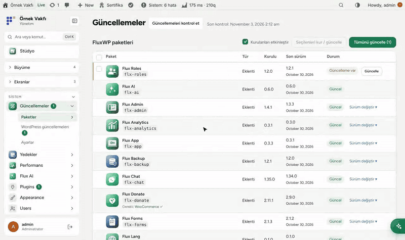
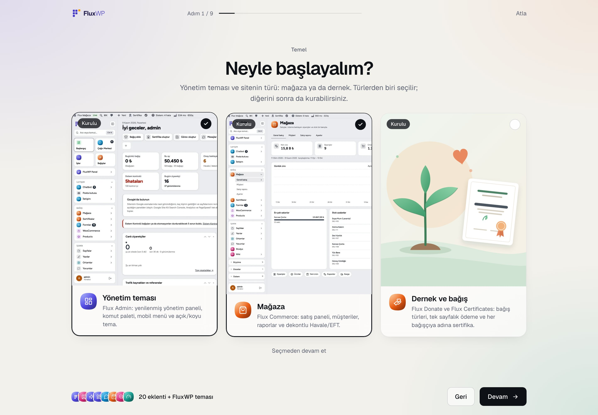
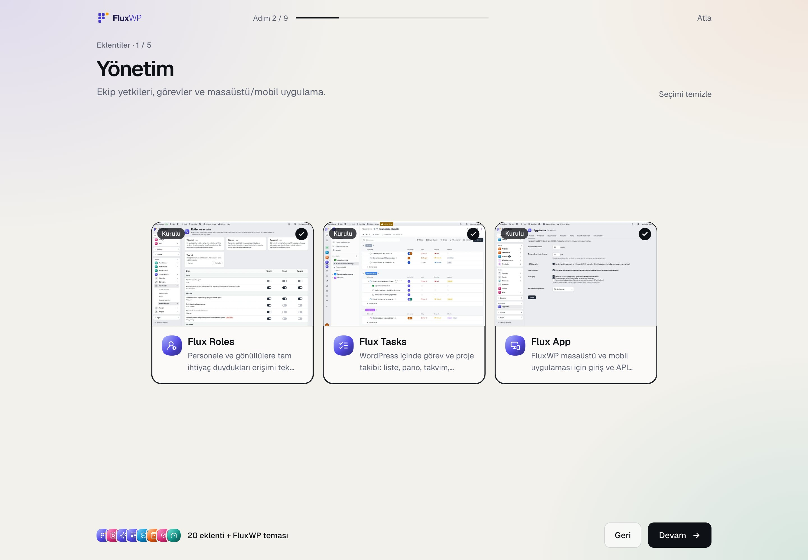
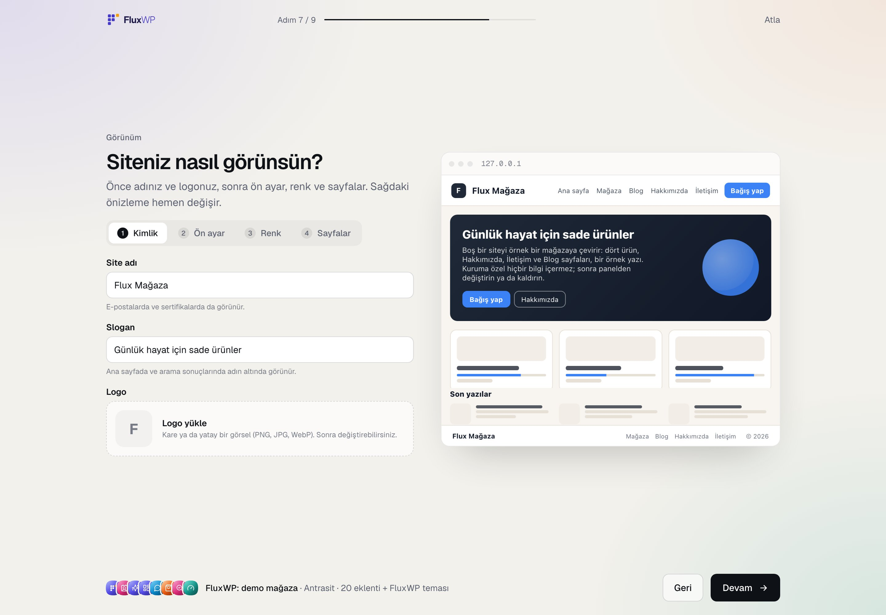
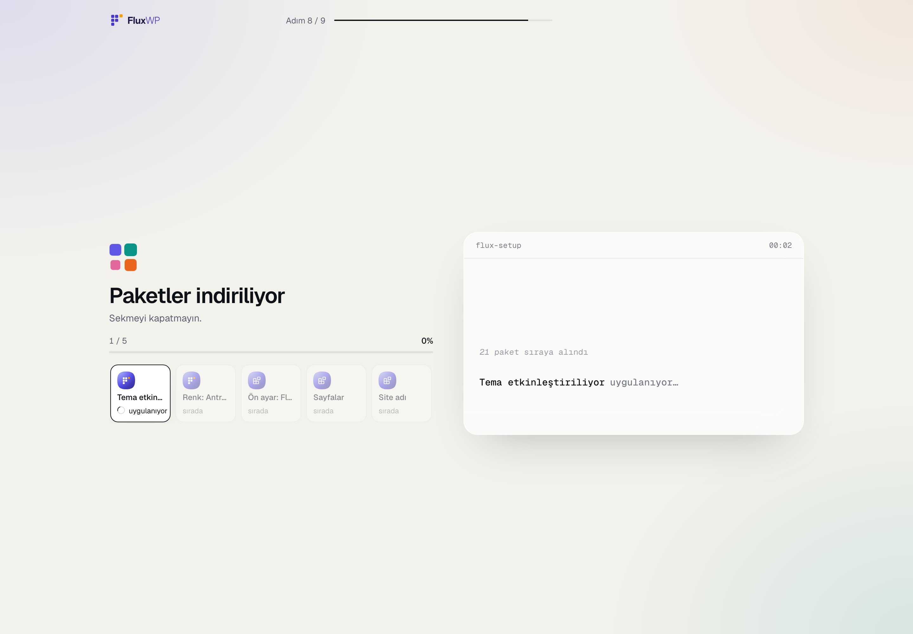
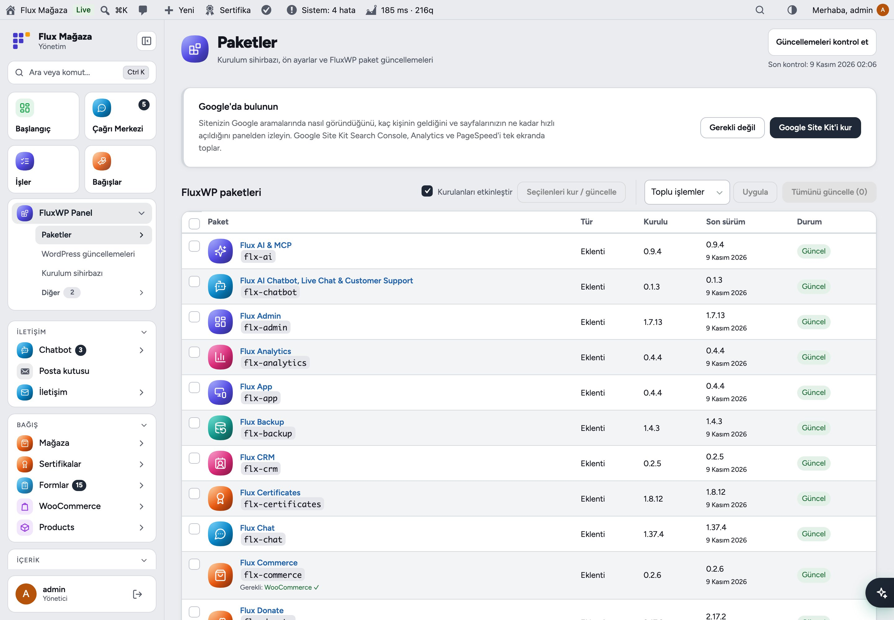
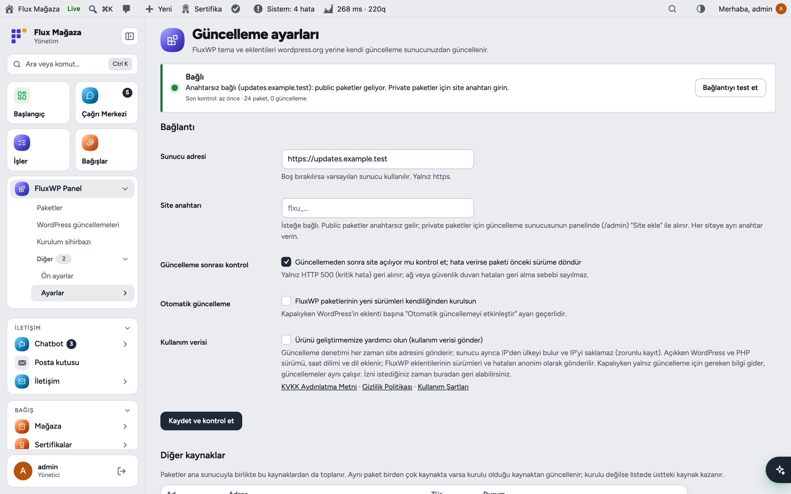
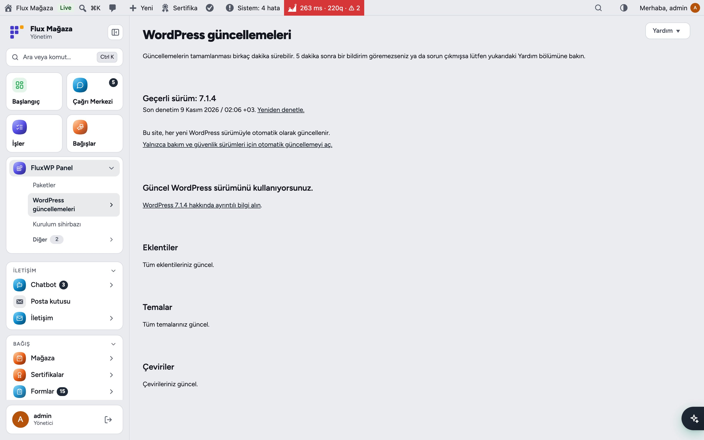
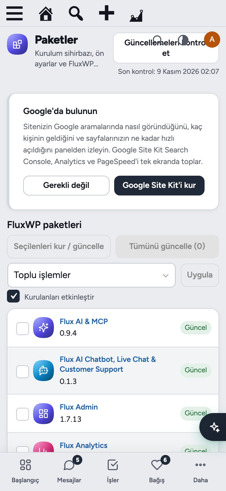

<div align="center">

[English](README.md) · **Türkçe**


# FluxWP Panel

**FluxWP sitesini üç adımda kurun, sonra güncel tutun.**<br>
FluxWP Panel ilk kurulan eklentidir. Kısa bir sihirbazla eklentileri, ön ayarı ve rengi seçersiniz, gerisini o kurar. Sonrasında FluxWP tema ve eklentilerini kendi güncelleme sunucumuz üzerinden WordPress'in normal güncelleme ekranlarına getirir; her değişiklikten önce yedek alınır.

[](https://wordpress.org)
[](https://www.php.net)
[](https://www.gnu.org/licenses/gpl-2.0.html)


[Özellikler](#özellikler) · [Ekran görüntüleri](#ekran-görüntüleri) · [Kurulum](#kurulum) · [Geliştiriciler için](#geliştiriciler-için) · [Yol haritası](#yol-haritası)



</div>

---

## Neden FluxWP Panel?

Paketlerimiz özel bir GitHub deposunda duruyor, WordPress.org'da yok. FluxWP Panel olmadan yeni bir site düzinelerce zip'i elle yüklemek, her güncelleme de aynısını tekrar yapmak demek. FluxWP Panel ile:

- 🧭 **Üç adımlı kurulum sihirbazı.** Etkinleştirince açılır: tanıtım, ekran görüntülü eklenti kartları, ön ayar ve renk, sonra canlı kurulum kaydı. Atlanabilir, sonra yeniden açılır.
- 🔄 **Normal WordPress güncellemesi.** FluxWP paketleri **Başlangıç › Güncellemeler**'de ve eklenti listesinde, sürüm notlarıyla, diğer eklentiler gibi görünür.
- 🔐 **Sitede GitHub token'ı yok.** Siteler yalnız kendi anahtarlarıyla güncelleme sunucusuna bağlanır; token sunucuda kalır.
- 🛟 **Varsayılan olarak güvenli.** Her güncellemeden önce yedek alınır (Flux Backup); güncellemeden sonra site HTTP 500 verirse paket kendiliğinden eski sürüme döner.
- ⏪ **Sürüm değiştirme.** Son 20 sürümden birini kurun; örneğin geri almak için.
- 📦 **Hepsi tek listede:** kurulu olan, yenisi çıkan ve tek tıkla kurulabilen paketler.

## Özellikler

### Kurulum sihirbazı
- Sunum düzeni: her adım tek yatay ekrana sığar, kaydırma yok; adımlar yana kayar. Adımlar: tanıtım › tema ve site türü (mağaza ya da dernek, biri seçilir) › kategori kategori eklentiler, her biri ayrı ekran › görünüm › kurulum › bitti. İstediğiniz an **Atla**; sonra **FluxWP Panel › Kurulum sihirbazı**'ndan yeniden açılır.
- Görünüm adımı sekmeli, sağda sabit canlı önizleme: **Kimlik** (site adı, slogan, logo yükleme), **Ön ayar**, **Renk** (her stil küçük bir site olarak) ve **Sayfalar** (Blog, Hakkımızda, İletişim, SSS).
- **Neyle başlayalım?** FluxWP teması ve Flux Commerce kendi ekranında, ikisi de önerilen; altta sade bir **Seçmeden devam et**. Sonra ekran görüntüsü ve tek satır açıklamalı diğer eklentiler; önerilenler işaretli.
- Görünüm: ön ayar (FluxWP demo, kurulu ön ayar paketleri ya da Boş), canlı önizlemeli tema renk stili ve site adı.
- Kurulum: paket başına bir satır (bitenler net, sıradakiler bulanık), konsol kaydı ve ilerleme. WooCommerce gibi gerekli eklentiler WordPress.org'dan gelir. Hatalı adımlar sonda listelenir.

### Ön ayarlar
- Tek `preset.json` kurum profilini, eklenti ayarlarını, renk ve yazı tiplerini, header/footer'ı, şablonları, sayfaları, menüleri ve medyayı kurar.
- Önizle, uygula, geri al; elle yaptığınız değişiklikler korunur; ön ayar geçişleri tek tek uygulanır. Bir sitede birden fazla ön ayar.
- Siteyi ön ayar olarak dışa aktarma; AI ve MCP araçları (`preset_schema`, `preset_export`, `preset_patch_preview`, `preset_patch_apply`, `preset_revert`).

### Paketler
- Sol menüde bekleyen güncelleme rozetli **Setup**; logo, tür, kurulu ve son sürüm, durum sütunlu FluxWP paketleri tablosu.
- Sitede olmayan paketi **Kur**, bir, birkaç ya da tüm paketi **Güncelle** (WordPress'in kendi toplu güncelleyicisi).
- Sürüm değiştirme: sunucudaki son 20 sürümden birine geçiş. Önce yedek alınır.
- Tüm FluxWP paketleri için isteğe bağlı otomatik güncelleme; kapalıyken WordPress'in eklenti başına otomatik güncelleme ayarı geçerli.

### Güvenlik
- Güncelleme sonrası kontrol: her güncellemeden sonra ön yüz ve panel istenir; HTTP 500 gelirse önceki sürüm geri kurulur.
- Geçmiş: kim neyi hangi sürümden hangisine güncelledi, sonuç ve yedek bağlantısı. Güncelleme yedekleri 1–90 gün sonra kendiliğinden silinir.

### Bağlantı
- Sunucu adresi ve site anahtarı panelden bir kez girilir (ya da `wp-config.php`'de `FLX_UPDATE_SERVER` / `FLX_UPDATE_KEY`).
- Bağlantı kartı: bağlı / hata / bağlı değil, sunucudaki site adı, paket ve güncelleme sayısı, **Bağlantıyı test et**.
- Ön sürümler (`1.3.0-beta.1`) yalnız sunucuda beta kanalına alınmış sitelere gelir.

## Ekran görüntüleri

| Kurulum sihirbazı: neyle başlayalım | Kurulum sihirbazı: eklentiler |
|---|---|
|  |  |
| **Kurulum sihirbazı: görünüm** | **Kurulum sihirbazı: kurulum** |
|  |  |
| **FluxWP paketleri** | **Bağlantı ayarları** |
|  |  |
| **WordPress Güncellemeler ekranında** | **Mobil** |
|  |  |

## Kurulum

Gereksinimler: WordPress 6.6+, PHP 7.4+.

**Zip ile**

1. [Releases](https://github.com/FluxWP/fluxwp/releases) sayfasında en son `flx-setup-v*` sürümünden `flx-setup.zip`'i indirin.
2. **Eklentiler › Yeni ekle › Eklenti yükle**, zip'i seçin, sonra **Etkinleştir**.

**FluxWP Panel ile** (sitelerimizde önerilen)

**FluxWP Panel › Paketler** tüm FluxWP paketlerini listeler; *FluxWP Panel* satırındaki **Kur**'a basın. Güncellemeler de buradan gelir.

**İlk adımlar**

1. FluxWP Panel'i etkinleştirin; kurulum sihirbazı açılır. Eklentileri, ön ayarı ve rengi seçip **Kur**'a basın.
2. Public paketler anahtar istemez. Özel paketler için güncelleme sunucusunun panelinde **Site ekle** deyin, anahtarı **FluxWP Panel › Ayarlar**'a yapıştırın.
3. FluxWP paketlerini istediğiniz zaman **FluxWP Panel › Paketler**'den kurun ya da güncelleyin.

Ayrıntılı kurulum notları: [KURULUM.md](../../docs/guncelleme-sistemi/KURULUM.md) · Sürüm notları: [CHANGELOG.md](CHANGELOG.md)

## Geliştiriciler için

Parçalar nasıl birleşiyor:

```
FluxWP/fluxwp (push → GitHub Actions → <slug>-v<version> release + <slug>.zip)
        │ GitHub token (read-only, yalnız sunucuda)
        ▼
wp-update-server   /v1/check · /v1/download/<slug>/<version>.zip · /admin
        ▲ X-FluxWP-Site-Key (her siteye bir anahtar)
WordPress siteleri (FluxWP Panel)
```

- Güncelleme sunucusu ayrı bir depoda: [FluxWP/updater](https://github.com/FluxWP/updater).
- Yeni sürüm, paketin `Version:` başlığı artırılıp `main`'e gönderilince yayınlanır; bkz. deponun [README](../../README.md) dosyası.
- Paket logoları: `flxu_package_icons` filtresi ya da paketteki `assets/icon.svg`.
- Sihirbaz filtreleri: `flxk_onboarding_core`, `flxk_onboarding_presets`, `flxk_onboarding_cap`.
- Ön ayar biçimi: [docs/flx-setup/FORMAT.md](../../docs/flx-setup/FORMAT.md) · Paketler için: [API.md](API.md).
- Flux Updater'dan geçiş: etkinleştirince eski eklenti kapatılır; ayarlar (`flxu_*`) korunur.

## Yol haritası

| | |
|---|---|
| ✅ | Eklenti kartları, ön ayar ve canlı kurulum kaydıyla kurulum sihirbazı |
| ✅ | Kendi sunucumuz üzerinden özel güncelleme, logolar ve sürüm notları |
| ✅ | Toplu güncelleme, sürüm değiştirme ve otomatik geri alma |
| ✅ | Her güncellemeden önce yedek (Flux Backup) ve güncelleme geçmişi |
| ⬜ | Kademeli yayın (önce bir site, sonra diğerleri) |
| ⬜ | Güncellemelerin e-posta özeti |

## Lisans

FluxWP Panel, [GNU Genel Kamu Lisansı v2 veya üzeri](https://www.gnu.org/licenses/gpl-2.0.html) ile yayınlanır.

FluxWP tarafından geliştirilmiştir.

Paketler ekranında eklenti adına veya ikonuna tıklayın: kısa tanıtım, örnek ekran görüntüleri ve ayrıntılar için “Sitede aç” bağlantısı gösterilir. Kurulum/güncelleme düğmeleri ayrı çalışır.

Açıklama, SVG ikon, galeri ve site bağlantıları her GitHub deposunun `catalog/packages.json` dosyasından yönetilir. Updater bunları önbelleğe alıp dağıtır; sitelerde gömülü tanıtım kataloğu tutulmaz.
