

**English** · [Türkçe](README.tr.md)

# Flux Social

**Plan, approve and publish social media posts from WordPress.** 
Flux Social is a social media planner that runs inside the site: connect Facebook, Instagram, YouTube, X, LinkedIn, TikTok, Pinterest, Google Business and WhatsApp, write once with separate text per account, schedule on a calendar, send posts through approval, and see posts, engagement and followers on one dashboard. No Mixpost or Postiz server is needed.

-lightgrey)

[Features](#features) · [Screenshots](#screenshots) · [Installation](#installation) · [Use it with AI assistants (MCP)](#use-it-with-ai-assistants-mcp) · [Roadmap](#roadmap)

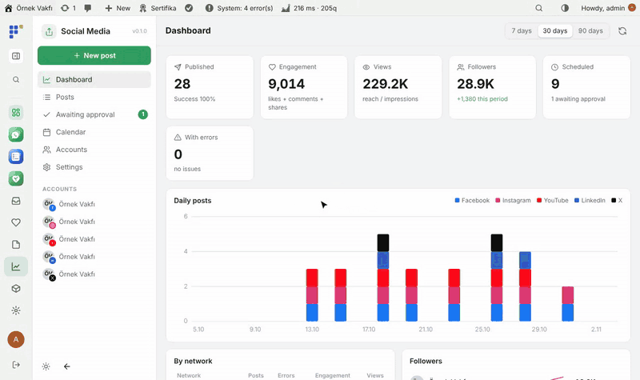

---

## Why Flux Social?

Self-hosted planners like Mixpost and Postiz need their own server, Redis and queue workers; shared hosting has none of them. SaaS planners put the charity's accounts and drafts in someone else's tool and charge per seat. Flux Social does the useful part inside WordPress:

- 🗓️ **One composer, every network.** Common text with per-account overrides, character counters, media rules and a live preview for each network.
- ✅ **Approval built in.** Volunteers prepare, a manager approves; permissions come from Flux Roles.
- 📊 **Numbers in one place.** Daily posts per network, engagement, views, follower growth and the top posts.
- ⏱️ **Works on shared hosting.** An external trigger URL (cron-job.org) or the open panel sends scheduled posts; no workers needed.
- 🤖 **AI where you write.** Flux AI helps write and adapt text per network; assistants can plan posts through MCP.

## Features

### Writing and scheduling
- **New post:** pick accounts, write common text or separate text per account, add images or video from the media library or Flux Studio, signature, hashtags, link UTM.
- Live preview per network, character and media limits checked before publishing, **Write with AI** and **Adapt to networks** (Flux AI).
- Save draft, send for approval, schedule, share now; repeat a post after N days.
- **Calendar:** month and list view, drag and drop to move a post, filter by account.

### Team and approval
- **Awaiting approval** list: posts by people without publishing permission wait for an approver.
- Permissions `flxsm_post`, `flxsm_publish`, `flxsm_manage` through Flux Roles; *Only mine* filter in the post list.

### Dashboard and accounts
- **Dashboard** for 7, 30 or 90 days: published, engagement, views, followers, scheduled, errors; daily posts per network, per-network table, follower trends, top posts, upcoming posts.
- **Accounts:** Facebook pages, Instagram (with or without a Facebook page), YouTube, X, LinkedIn, TikTok, Pinterest, Google Business Profile, WhatsApp status and groups (via Flux Contact or Flux Call Center).
- Edit or delete a published post on the network where the API allows it; metrics are fetched daily.

### Settings
- App keys per network (stored encrypted), X tier and monthly limit, auto-sharing when a site post is published, external trigger URL, log.

## Screenshots

| Dashboard | Posts |
|---|---|
| 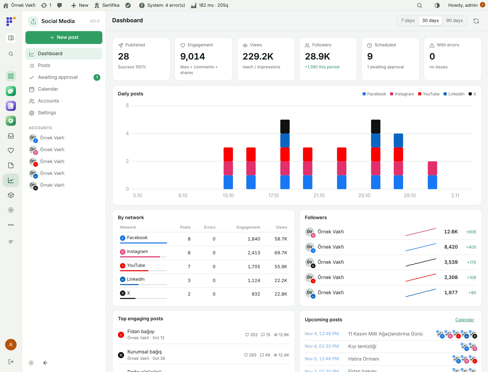 | 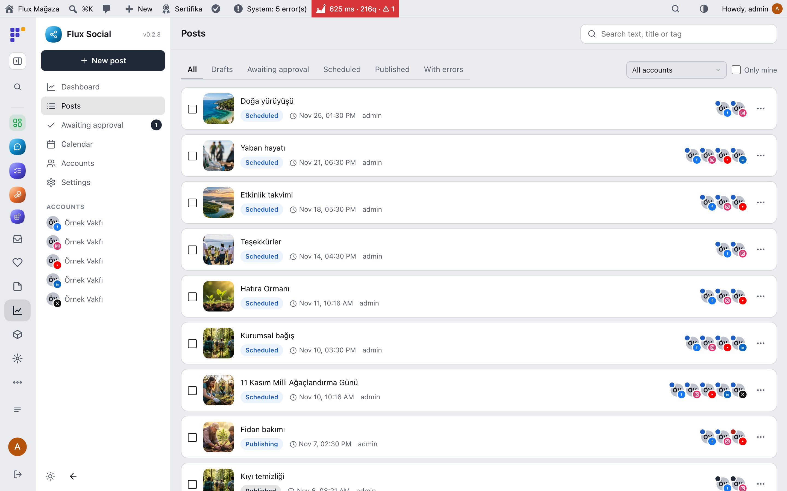 |
| **Composer with live preview** | **Calendar** |
| 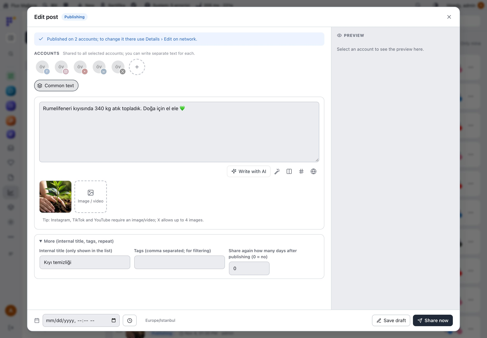 | 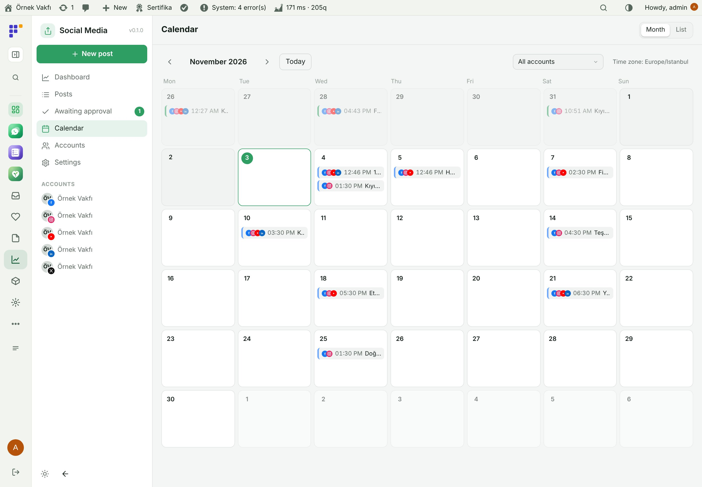 |
| **Awaiting approval** | **Connected accounts** |
| 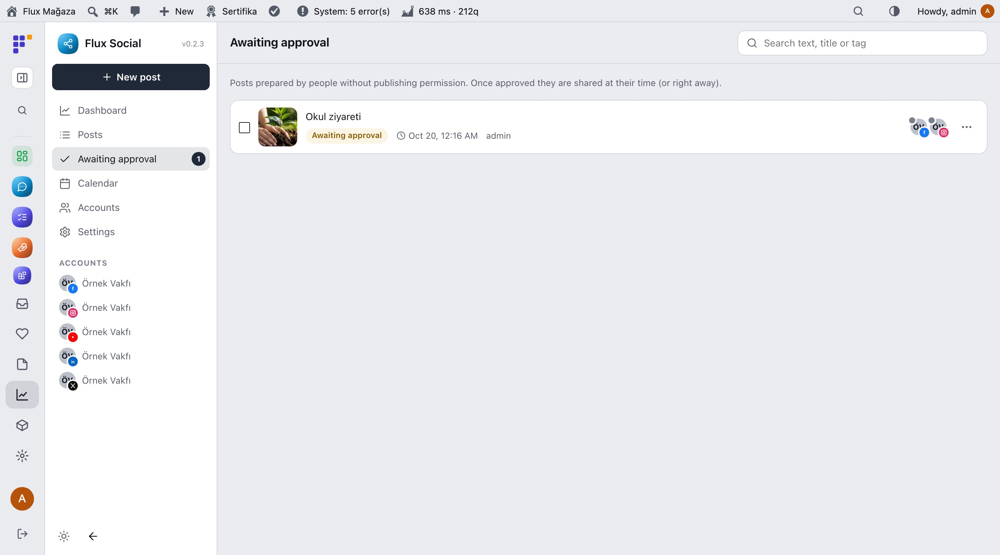 | 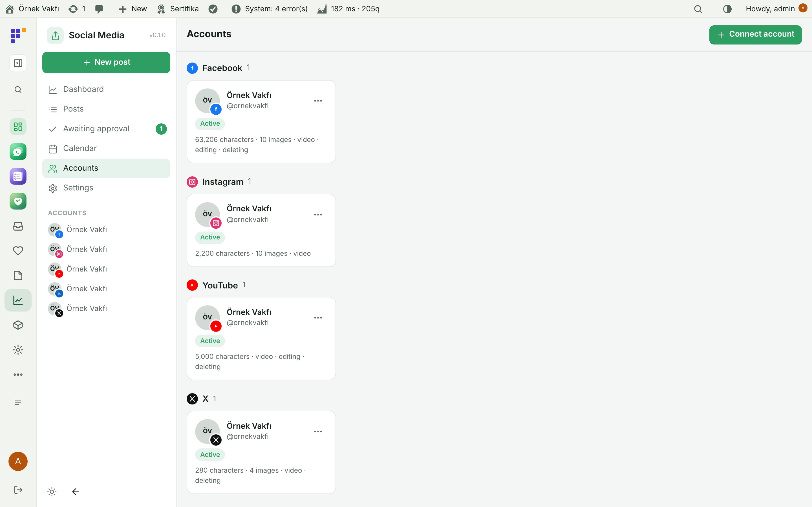 |
| **Settings and external trigger** | **Dark mode** |
| 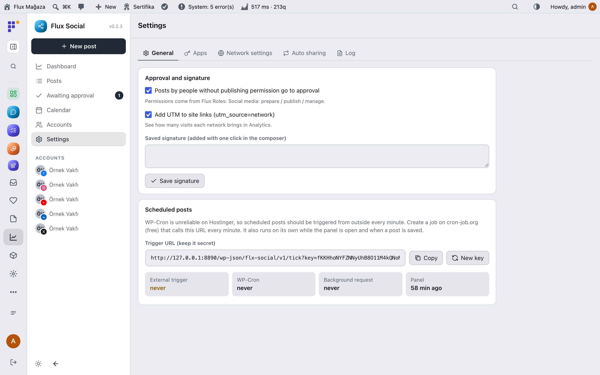 | 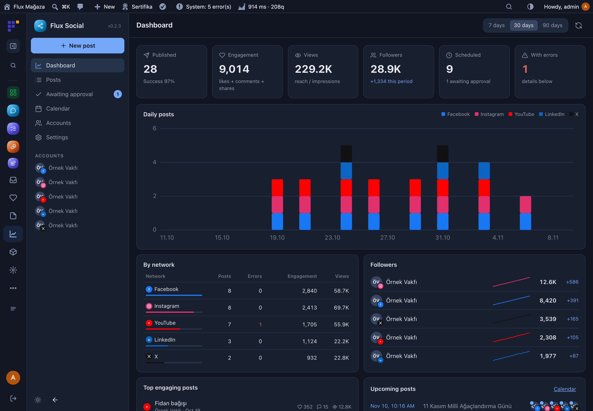 |
| **Mobile: dashboard** | **Mobile: posts** |
| 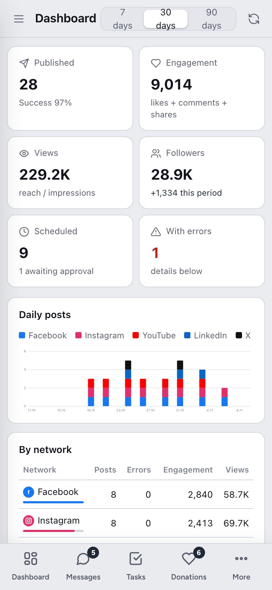 | 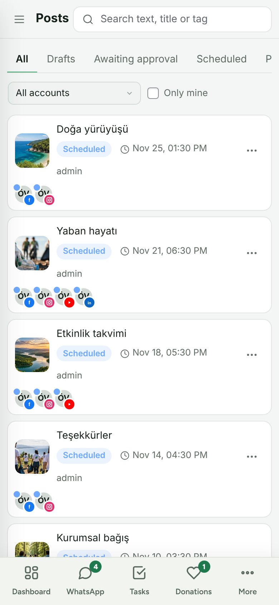 |

## Installation

Requirements: WordPress 6.4+, PHP 7.4+. PHP sodium and HTTPS. A developer app for each network you connect (Meta, Google, X, LinkedIn, TikTok, Pinterest). Optional: Flux AI (writing help), Flux Studio (images), Flux Contact or Flux Call Center (WhatsApp), Flux Roles (permissions).

**From a zip**

1. Download `flx-social.zip` from the latest `flx-social-v*` release on the [Releases](https://github.com/FluxWP/fluxwp/releases) page.
2. **Plugins › Add New › Upload Plugin**, choose the zip, then **Activate**.

**With FluxWP Panel** (recommended on our sites)

**FluxWP Panel › Packages** lists every FluxWP package; click **Install** next to *Flux Social*. Updates arrive the same way.

**First steps**

1. Activate Flux Social; **Social Media** appears in the menu.
2. **Settings › General**: copy the external trigger URL and add it to cron-job.org every minute.
3. **Settings › Apps**: enter the keys for each network and add the shown redirect address to the developer app.
4. **Accounts › Connect account**, pick the network, allow access and choose the page or channel.
5. **New post**, pick accounts, write, then **Schedule**.

> ⚠️ Real network APIs need each network's developer app and sometimes an app review (LinkedIn company pages, TikTok direct posting, Google Business). X Free has a low write limit and no metrics. Flux Social's data model is inspired by [Mixpost](https://github.com/inovector/mixpost) (MIT); the code is written from scratch for WordPress, see [NOTICE.md](NOTICE.md).

Full setup notes (Turkish): [KURULUM.md](../../docs/sosyal-medya/KURULUM.md) · API reference: [API.md](../../docs/sosyal-medya/API.md) · Release notes: [CHANGELOG.md](CHANGELOG.md)

## Use it with AI assistants (MCP)

Flux Social adds tools to the site's MCP server (**Flux SEO**) and to the **Flux AI** chat:

- `flxsm_accounts`, `flxsm_posts`, `flxsm_post_get`, `flxsm_stats`, `flxsm_time`
- `flxsm_post_create`, `flxsm_post_update`, `flxsm_post_delete`, `flxsm_remote_edit`, `flxsm_ai_write`

> "Write a post for 11 November in Turkish for Instagram and Facebook, schedule it for 10:00." · "Which post got the most engagement this month?"

Posts created by an assistant follow the same approval rules as people.

## Roadmap

| | |
|---|---|
| ✅ | Composer with per-account text and live previews |
| ✅ | Calendar, approval and dashboard |
| ✅ | Nine networks including WhatsApp status |
| ✅ | Flux AI writing and MCP tools |
| ⬜ | Comment and message inbox |
| ⬜ | Best time to post suggestions |
| ⬜ | First-comment and story scheduling |

## License

Flux Social Released under the [GNU General Public License v2 or later](https://www.gnu.org/licenses/gpl-2.0.html).

Made by FluxWP.
