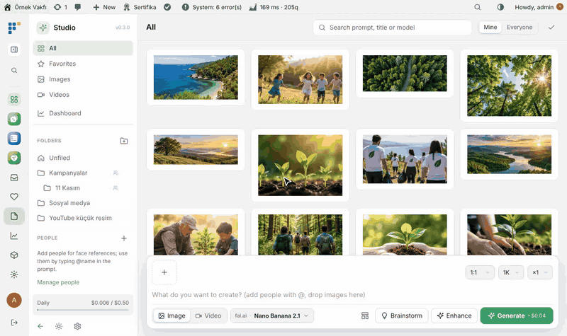
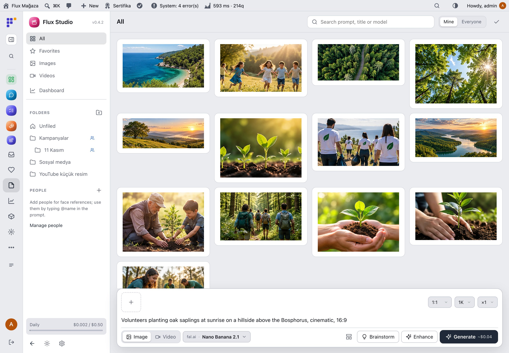
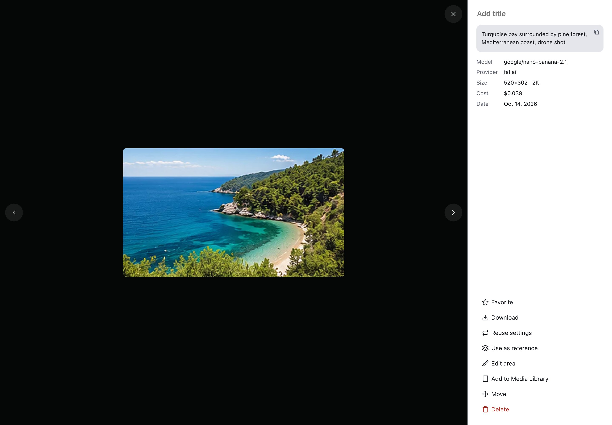
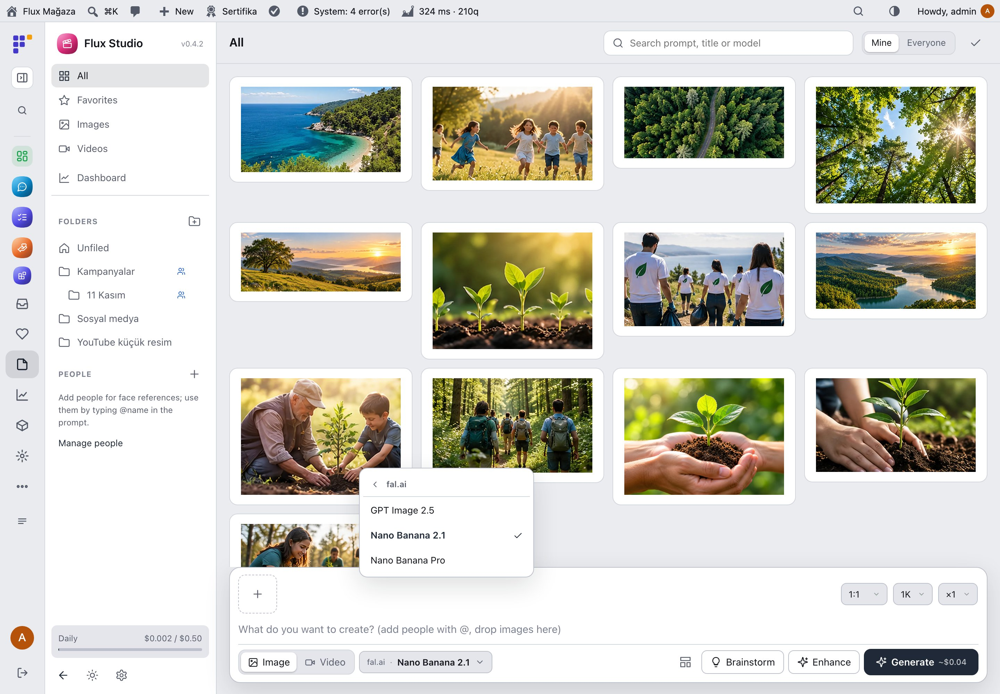
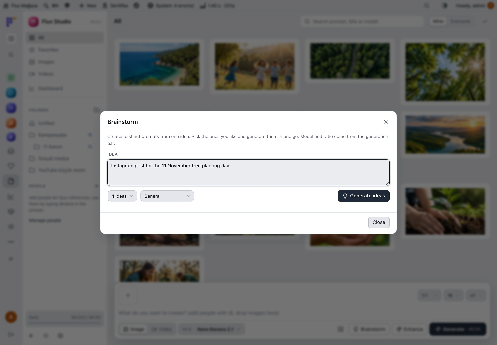
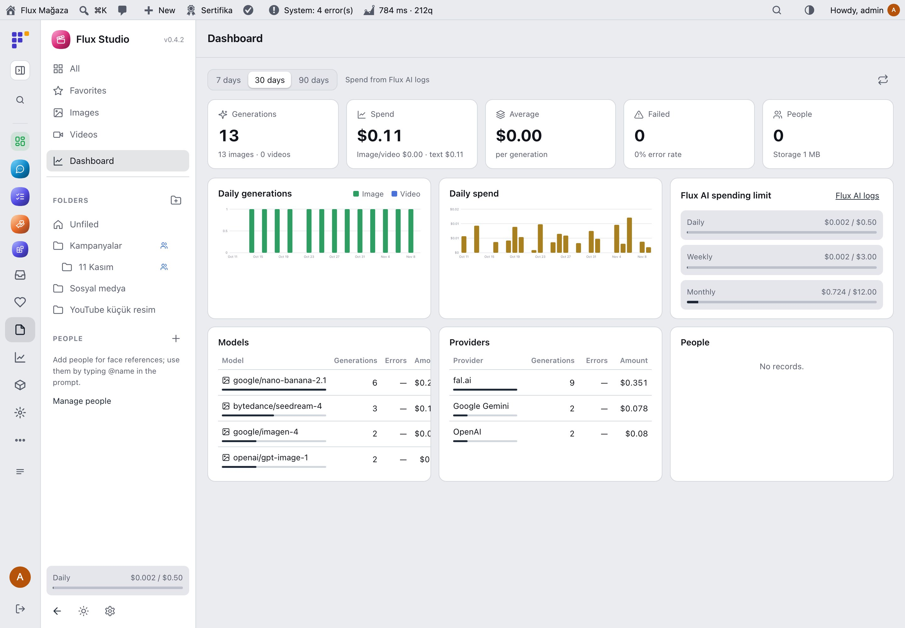
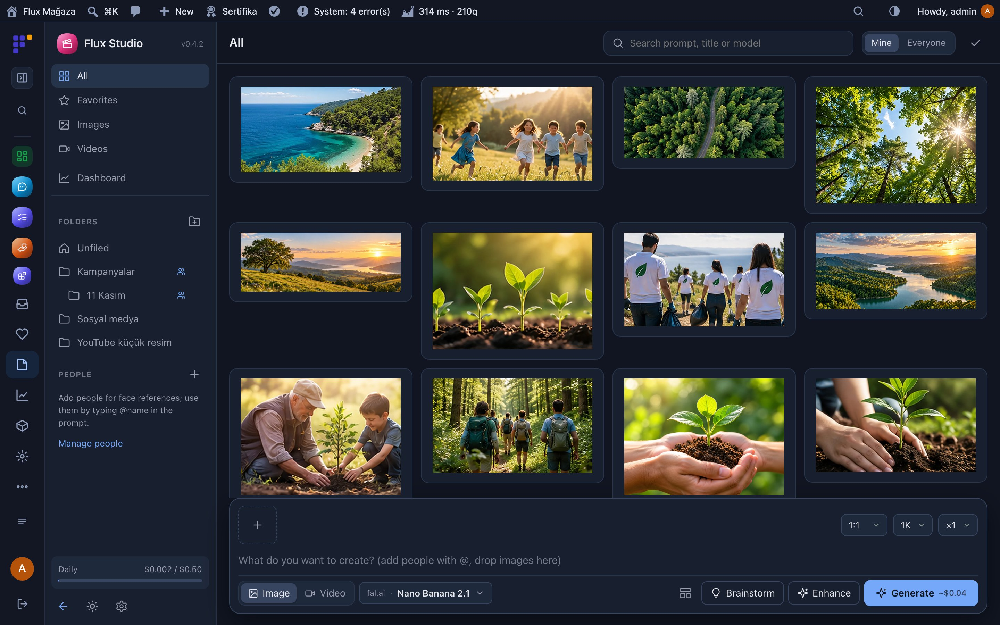
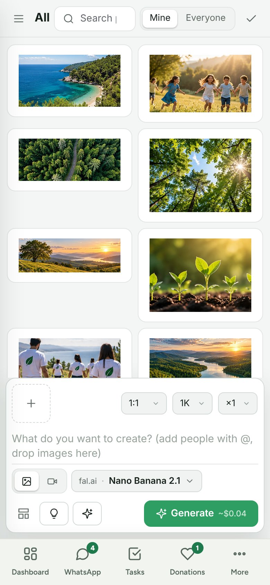

**English** · [Türkçe](README.tr.md)

# Flux Studio

**An AI image and video studio inside WordPress, for the whole team, on one budget.** 
Flux Studio lets your team create images and videos with AI from the admin: write what you want, pick a model, add reference images or people, and generate. Results land in a shared gallery with folders, favourites and templates, and can go straight to the Media Library. Generation runs through Flux AI, so keys, costs and the spending limit stay in one place.

[Features](#features) · [Screenshots](#screenshots) · [Installation](#installation) · [For developers](#for-developers) · [Roadmap](#roadmap)

---

## Why Flux Studio?

Posters for an event, a header for a news post, a thumbnail for a video: a small team needs images every week, and every person ends up on a different AI site with a different card. Flux Studio brings it into WordPress:

- 🎨 **One place for the team.** Everyone with access generates in the same studio; shared folders and templates keep the style consistent.
- 💸 **One budget.** Every generation goes through Flux AI and counts against its daily, weekly and monthly limit; the dashboard shows who spent what on which model.
- 🧠 **Better prompts without effort.** *Enhance* turns a rough idea into a detailed prompt for the chosen model; *Brainstorm* gives several directions to pick from.
- 🖼️ **Straight to the site.** Add a result to the Media Library in one click and use it in posts, pages and campaigns.

## Features

### Create
- Images and videos; model picker by provider and model (fal.ai, EvoLink, OpenAI, Gemini, OpenRouter), aspect ratio, resolution, quality, count, duration and audio; estimated price on the button.
- **References:** upload, paste, drag or pick from the gallery; give each a role (style, product, background, person, first/last frame); save favourites.
- **People:** 1–8 face photos per person; type `@name` in the prompt to use them as identity references.
- **Enhance** and **Brainstorm** (2–8 prompts from one idea, general or YouTube thumbnail), generated in one go.
- **Edit area:** brush, rectangle and eraser mask; only the masked part changes; before/after slider.
- Instant queue: a "Queued" card appears at once, long jobs keep running when the page is closed.

### Organise
- Gallery with a folder tree (subfolders, team sharing, drag to move), favourites, search, multi-select and infinite scroll.
- Viewer: download, reuse settings, use as reference, add to Media Library, move, delete.
- **Templates:** prompt, settings and references saved and shared with the team.

### Manage
- **Dashboard:** generations, spend (image/video and text), average per generation, error rate, people and storage; daily charts; tables per model, provider and person; Flux AI limit and recent errors.
- Capabilities `flxst_use` and `flxst_manage`, listed in Flux Roles; light and dark theme with Flux Admin; works on phones and as a native screen in the Flux App.

## Screenshots

| Gallery and composer | Image viewer |
|---|---|
|  |  |
| **Model picker** | **Brainstorm** |
|  |  |
| **Dashboard** | **Dark mode with Flux Admin** |
|  |  |
| **Mobile gallery** |   |
|  |   |

## Installation

Requirements: WordPress 6.4+, PHP 7.4+. Flux AI 0.6.0+ with at least one image/video key (fal.ai or EvoLink recommended; OpenAI, Gemini or OpenRouter also work).

**From a zip**

1. Download `flx-studio.zip` from the latest `flx-studio-v*` release on the [Releases](https://github.com/FluxWP/fluxwp/releases) page.
2. **Plugins › Add New › Upload Plugin**, choose the zip, then **Activate**.

**With Flux Setup** (recommended on our sites)

**Setup › Packages** lists every FluxWP package; click **Install** next to *Flux Studio*. Updates arrive the same way.

**First steps**

1. In **Flux AI › Settings › Images and video** enter a provider key.
2. Activate Flux Studio; **Studio** appears in the admin menu.
3. Give staff the **Studio: generate** capability in Flux Roles if they should use it.
4. Write a prompt and press **Generate** (Ctrl/⌘+Enter).

> ⚠️ Video can take minutes; the job keeps running if you close the page. Spend counts against the Flux AI limit. The demo gallery in these screenshots uses existing site photos.

Full setup notes (Turkish): [KURULUM.md](../../docs/flx-studio/KURULUM.md) · API reference: [API.md](../../docs/flx-studio/API.md) · Release notes: [CHANGELOG.md](CHANGELOG.md)

## For developers

- REST API under `/wp-json/flx-studio/v1` (boot, items, generate, poll, enhance, brainstorm, folders, people, refs, templates); works with Flux App tokens for the desktop and mobile app.
- Registered with Flux AI (`flxai_systems`), Flux Roles, Flux Admin app mode and the system checks.

## Roadmap

| | |
|---|---|
| ✅ | Image and video generation through Flux AI |
| ✅ | References, people, enhance and brainstorm |
| ✅ | Folders, templates and team sharing |
| ✅ | Dashboard with spend per model and person |
| ✅ | Native screen in the Flux App |
| ⬜ | Brand kit (colours, logo, fonts) as a reference |
| ⬜ | Batch resize for social media formats |

## License

Flux Studio Released under the [GNU General Public License v2 or later](https://www.gnu.org/licenses/gpl-2.0.html).

Workflow and prompt rules adapted from [Banana Studio](https://github.com/orkunisitmak/banana-studio) (MIT). See [NOTICE.md](NOTICE.md).

Made by FluxWP.
