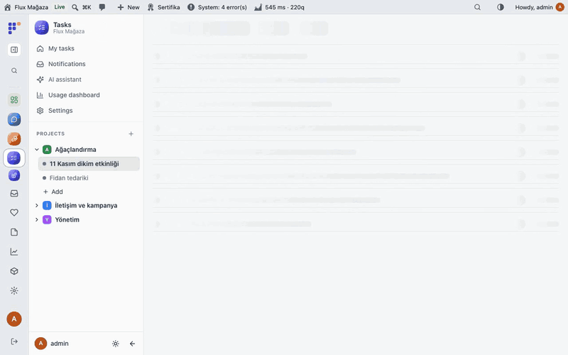
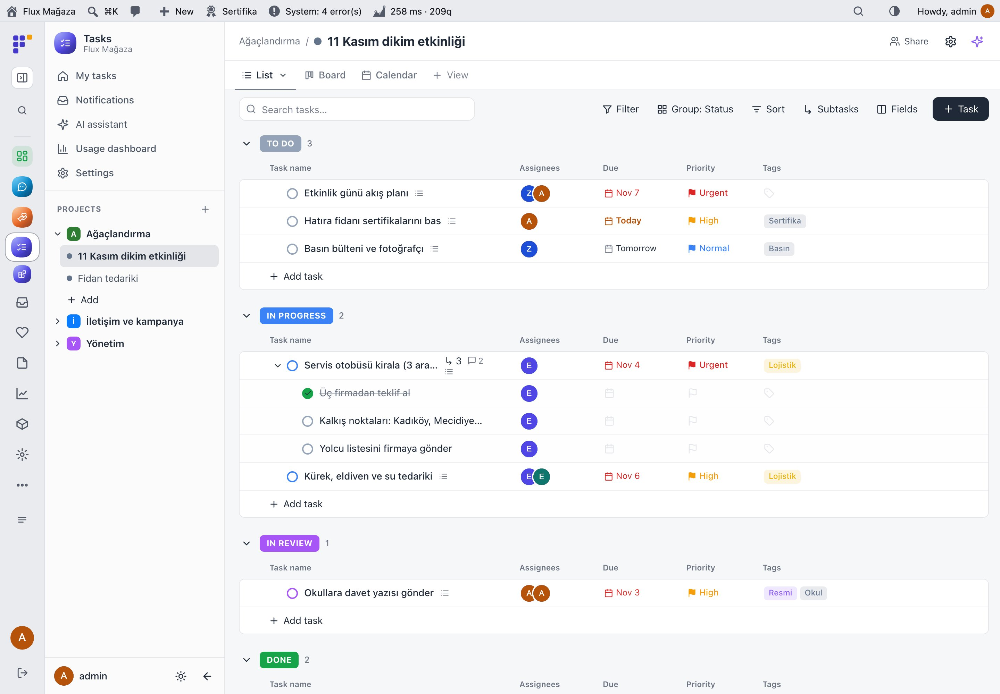
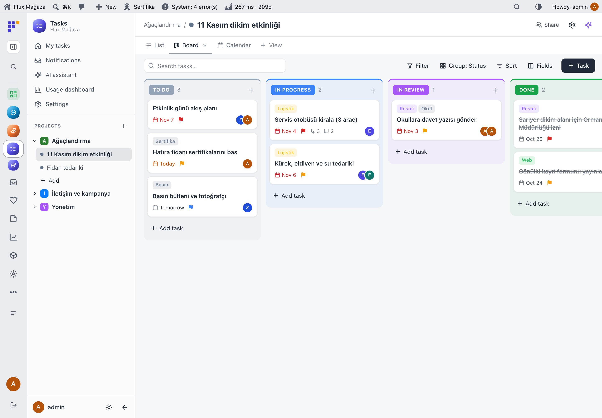
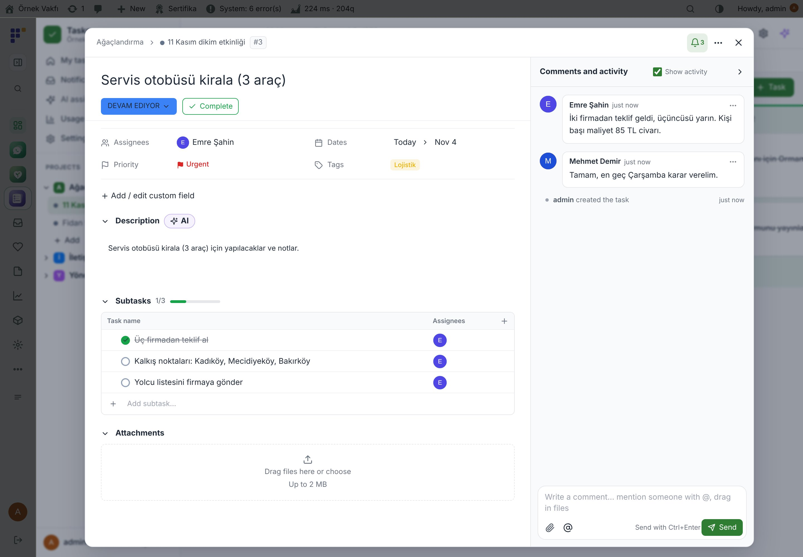
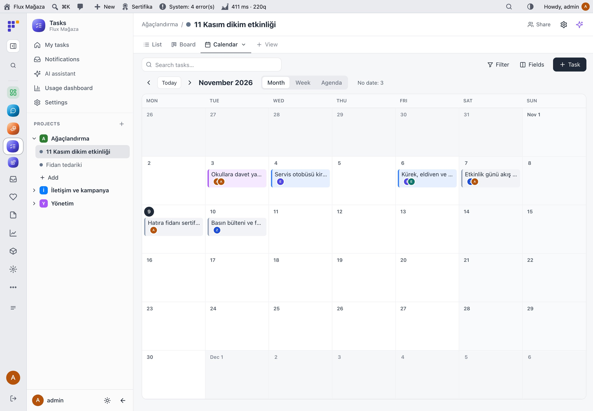
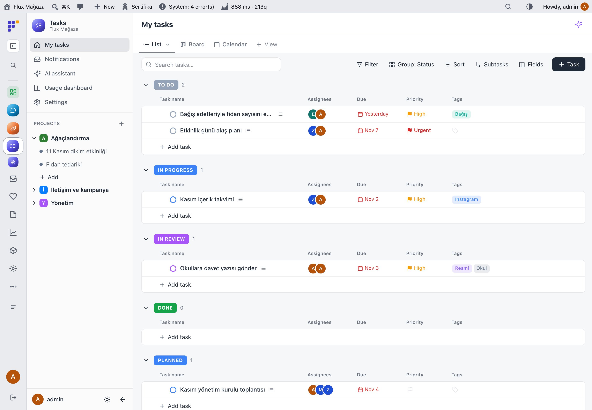
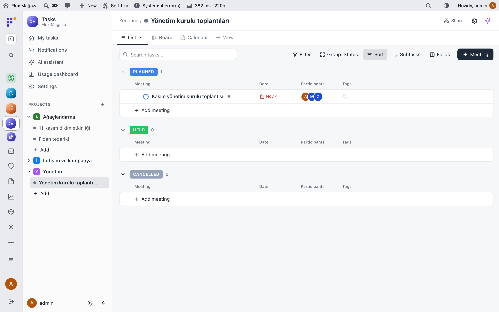
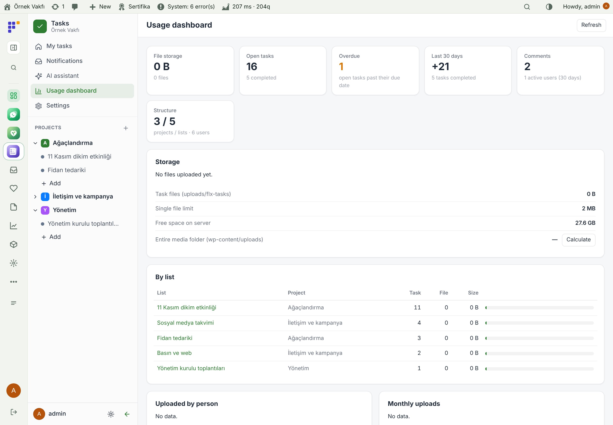
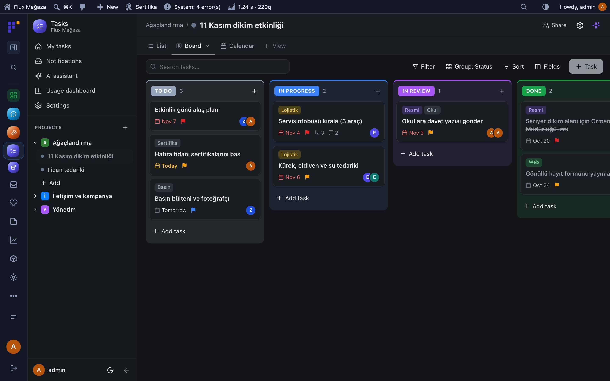
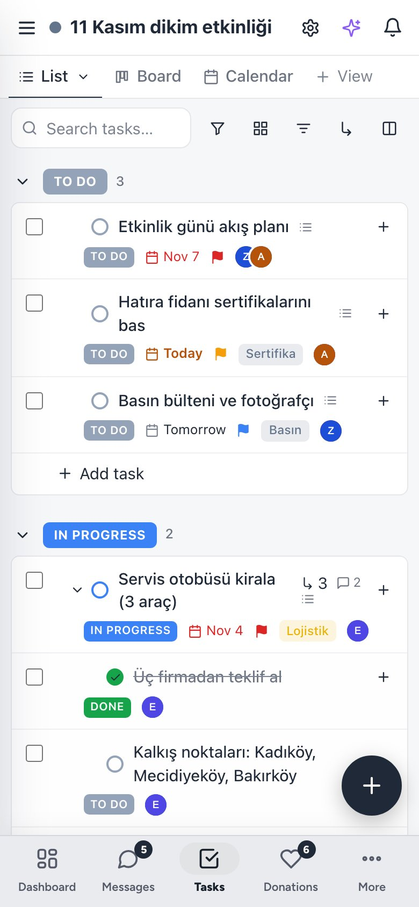

**English** · [Türkçe](README.tr.md)

# Flux Tasks

**Task and project tracking inside WordPress: lists, boards, calendars, meetings and docs, with an AI assistant.** 
Flux Tasks gives the team one place to plan work without another subscription: projects, folders and lists; list, board and calendar views; subtasks, comments with files, notifications and permissions. Meeting lists produce a PDF report, docs are edited block by block, and an assistant on Flux AI can create, update and summarise tasks.

[Features](#features) · [Screenshots](#screenshots) · [Installation](#installation) · [Roadmap](#roadmap)

---

## Why Flux Tasks?

Volunteer projects live in WhatsApp groups, spreadsheets and memory. A paid project tool means another login and another bill for every volunteer. Flux Tasks runs where the team already signs in:

- ✅ **Everything in one list.** Who does what by when, with status, priority, tags and custom fields; switch between list, board and calendar.
- 💬 **Talk on the task.** Comments, mentions, files and an activity log sit on the task, not in a chat that scrolls away.
- 📝 **Meetings with minutes.** Agenda, decisions and follow-up subtasks in one place, and a branded PDF report at the end.
- 🤖 **Ask the assistant.** "What is overdue this week?", "Split this into subtasks", "Summarise the comments": through Flux AI, and through MCP for Claude.

## Features

### Work
- Projects, folders and lists with drag-and-drop ordering and moving; per-list statuses.
- Views: **List** (grouped, sortable, inline edit), **Board** (drag between statuses) and **Calendar** (month, week, agenda); saved, filtered views per person or shared.
- Tasks with assignees, dates, priority, tags, custom fields (text, number, date, select, person, link…), nested subtasks, checklist, cover image.
- **My tasks** across all projects; notifications for assignment, mention, status, due and overdue.

### Collaborate
- Comments with mentions and drag-and-drop files (stored outside public access); activity log; watchers.
- Project and list permissions (view, comment, edit, manage); roles chosen in settings.
- Optional e-mails for assignment, mention and due dates, editable in Flux Contact.
- **Meeting lists:** agenda, decisions and subtasks, PDF report with logo and status badges.
- **Docs:** block editor with `/` menu, markdown shortcuts, nested pages, tables, task links and an AI menu (continue, summarise, extract to-dos).

### Manage
- **Usage dashboard:** open, overdue and completed tasks, comments, structure, storage per list and per person.
- AI assistant and quick actions through Flux AI; all tools available to the shared Flux AI chat and over MCP.
- Native screen in the Flux App (`flx-tasks/v1/app/*`); system checks.

## Screenshots

| List view grouped by status | Board |
|---|---|
|  |  |
| **Task with subtasks and comments** | **Calendar** |
|  |  |
| **My tasks** | **Meeting list** |
|  |  |
| **Usage dashboard** | **Dark mode with Flux Admin** |
|  |  |
| **Mobile list** |   |
|  |   |

## Installation

Requirements: WordPress 6.5+, PHP 7.4+. Optional: Flux AI (assistant), Flux Contact (e-mails), Flux Admin (app mode), Flux App.

**From a zip**

1. Download `flx-tasks.zip` from the latest `flx-tasks-v*` release on the [Releases](https://github.com/FluxWP/fluxwp/releases) page.
2. **Plugins › Add New › Upload Plugin**, choose the zip, then **Activate**.

**With FluxWP Panel** (recommended on our sites)

**FluxWP Panel › Packages** lists every FluxWP package; click **Install** next to *Flux Tasks*. Updates arrive the same way.

**First steps**

1. Activate Flux Tasks; **Tasks** appears in the admin menu with a starter project and list.
2. In **Tasks › Settings** choose which roles can use tasks, create projects and use AI.
3. Create a project and a list, add tasks, and switch to **Board** or **Calendar**.

> ℹ️ Files are stored in `wp-content/uploads/flx-tasks/`, closed to direct access with `.htaccess`; on Nginx add a `deny all` rule for that folder.

Full setup notes (Turkish): [KURULUM.md](../../docs/gorev-takip/KURULUM.md) · Release notes: [CHANGELOG.md](CHANGELOG.md)

## Roadmap

| | |
|---|---|
| ✅ | Lists, boards and calendars with saved views |
| ✅ | Comments, files, notifications and permissions |
| ✅ | Docs with an AI menu |
| ✅ | Meeting lists with PDF reports |
| ✅ | Native screen in the Flux App |
| ⬜ | Recurring tasks |
| ⬜ | Time tracking |

## License

Flux Tasks Released under the [GNU General Public License v2 or later](https://www.gnu.org/licenses/gpl-2.0.html).

Made by FluxWP.
