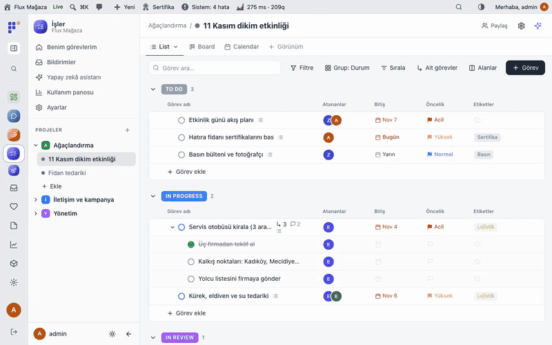
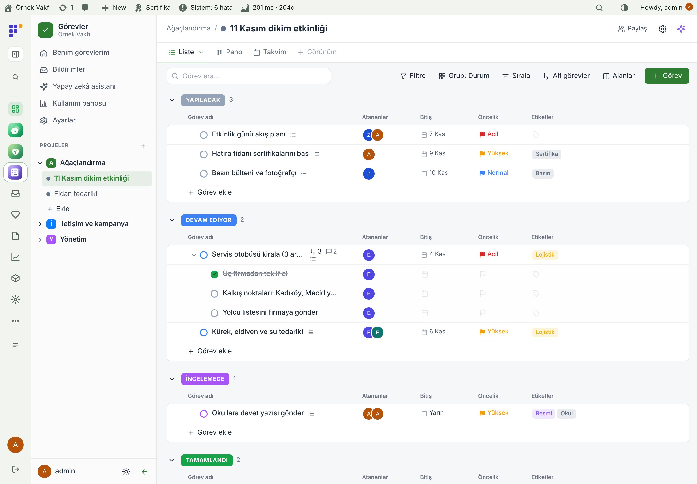
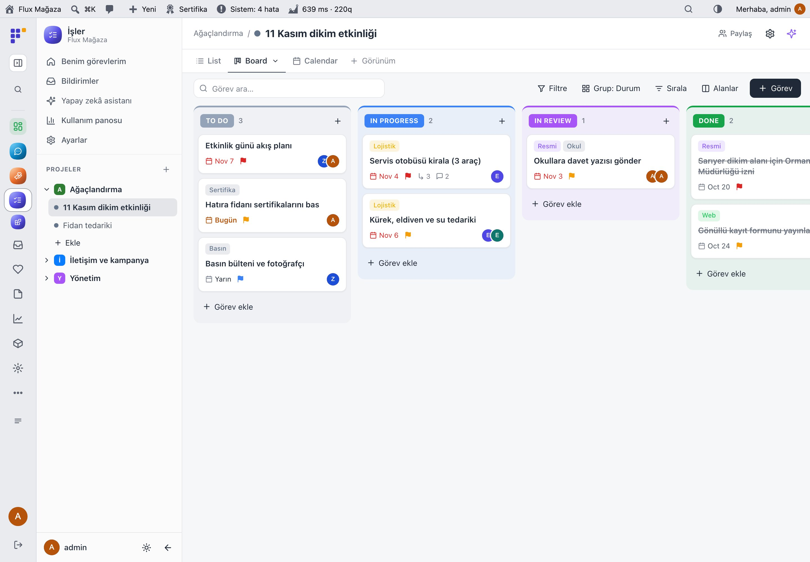
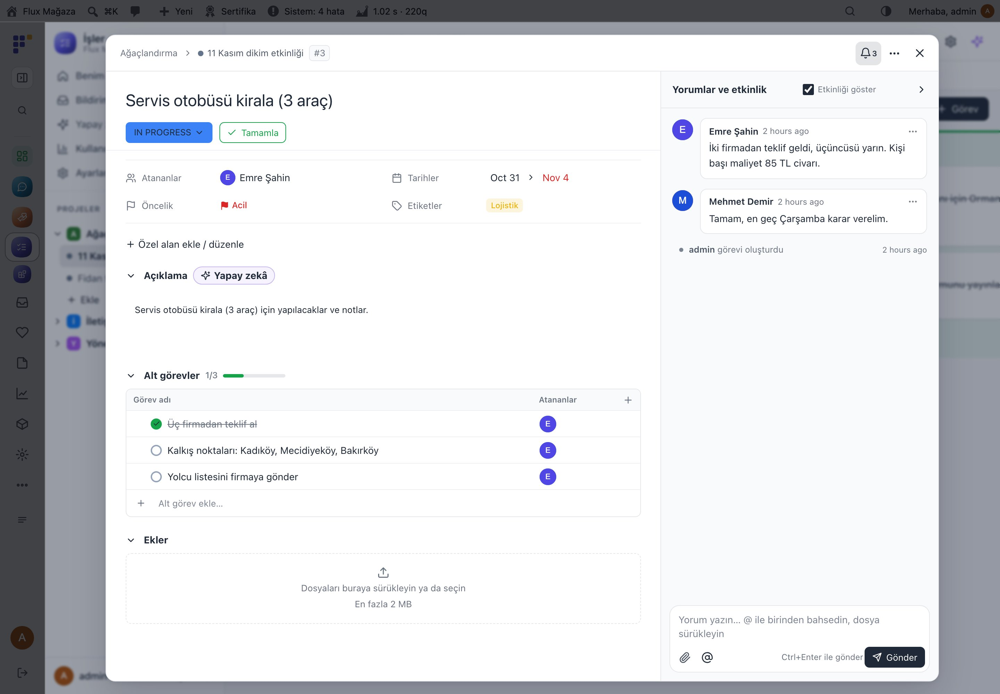
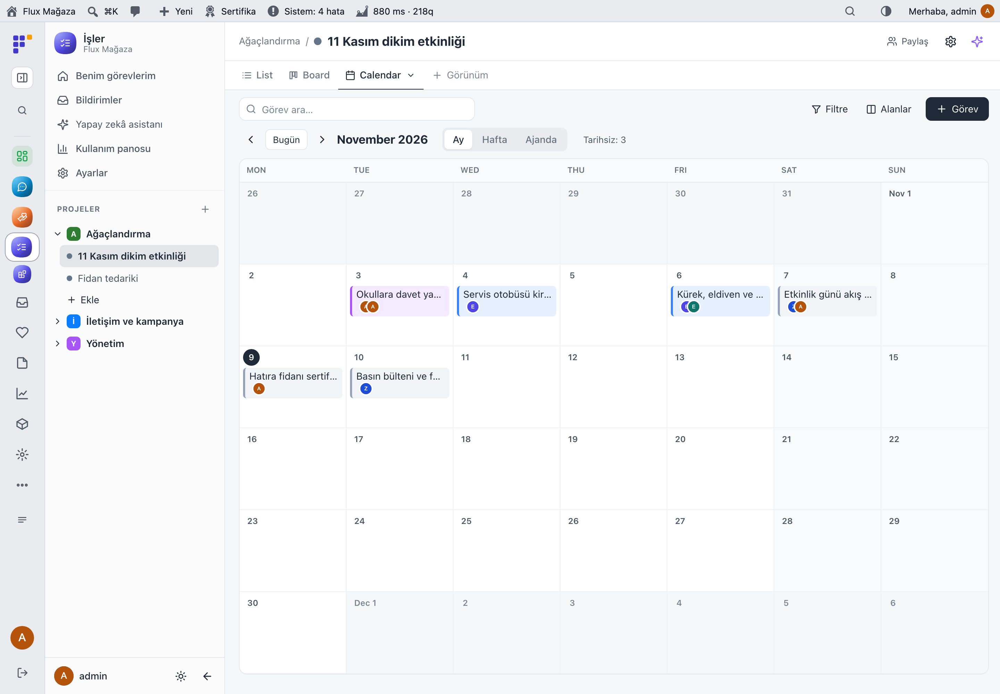
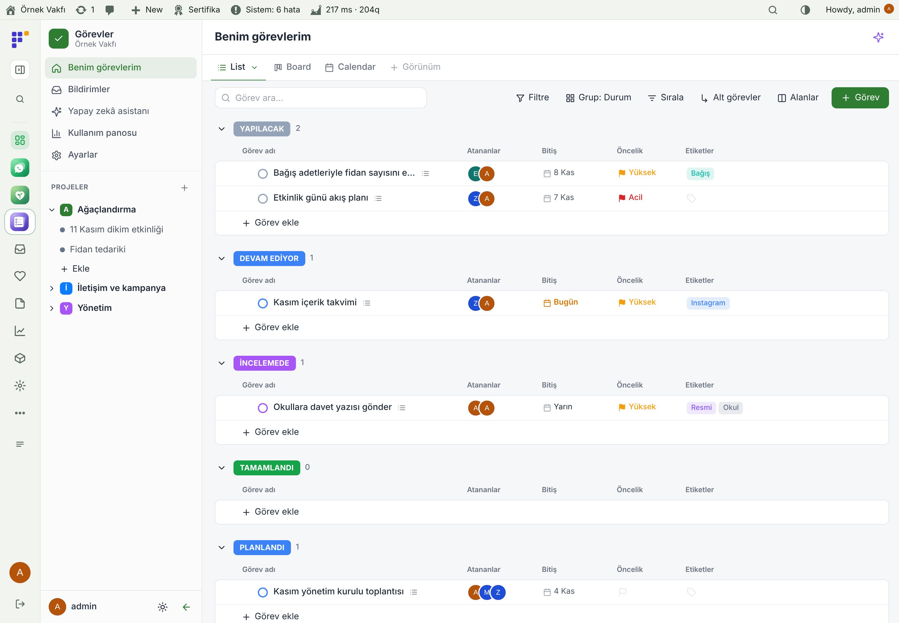
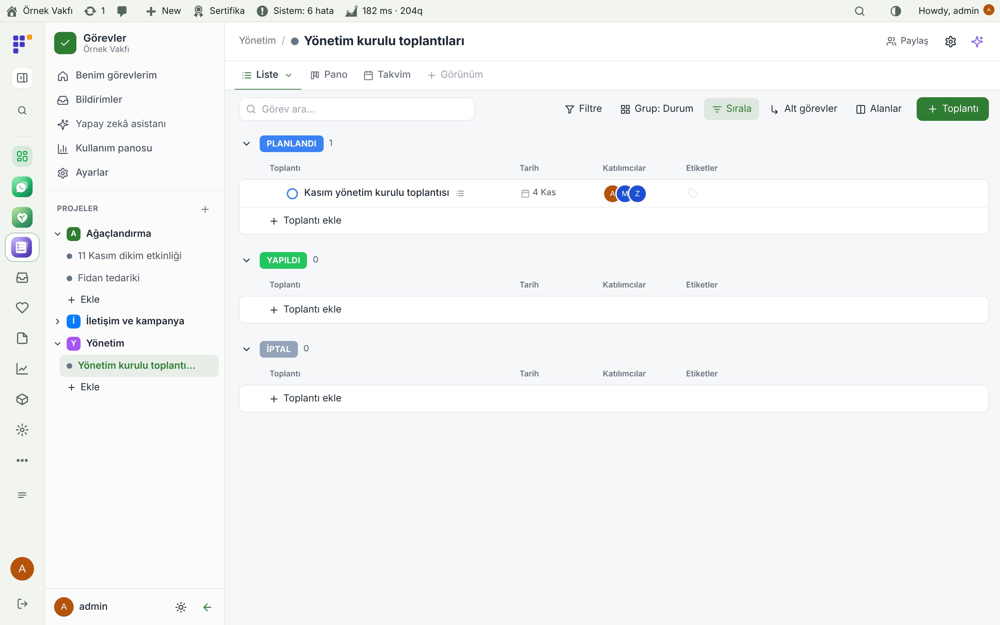
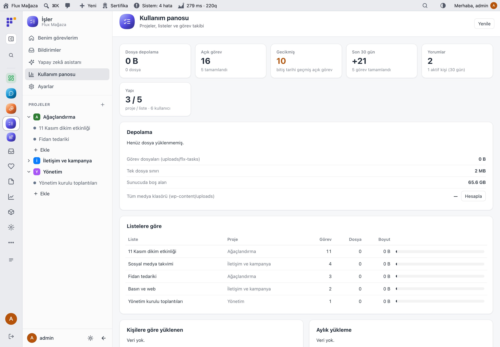
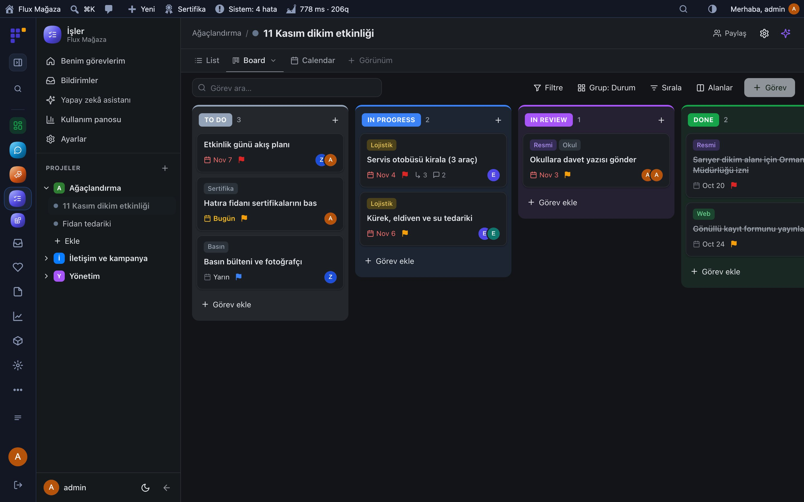
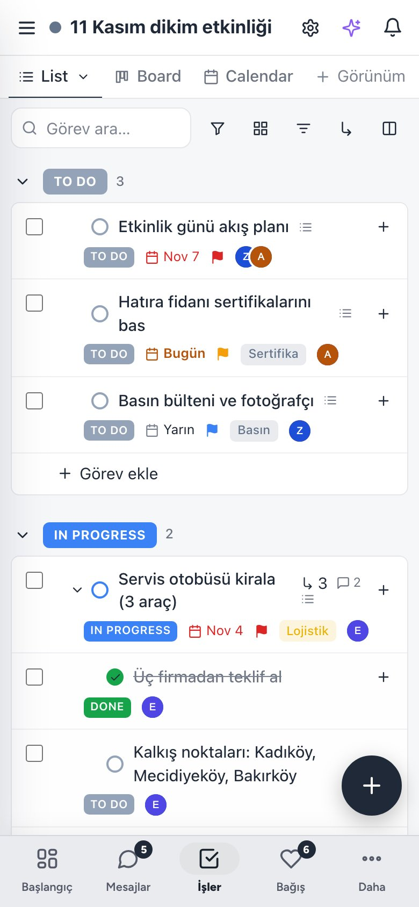

[English](README.md) · **Türkçe**

# Flux Tasks

**WordPress içinde görev ve proje takibi: liste, pano, takvim, toplantı ve doküman; yapay zekâ asistanıyla.** 
Flux Tasks ekibe ayrı bir abonelik olmadan işi planlayacağı tek bir yer verir: projeler, klasörler ve listeler; liste, pano ve takvim görünümleri; alt görevler, dosyalı yorumlar, bildirimler ve yetkiler. Toplantı listeleri PDF rapor üretir, dokümanlar blok blok düzenlenir, Flux AI üzerindeki asistan görev açar, günceller ve özetler.

[Özellikler](#özellikler) · [Ekran görüntüleri](#ekran-görüntüleri) · [Kurulum](#kurulum) · [Yol haritası](#yol-haritası)

---

## Neden Flux Tasks?

Gönüllü projeleri WhatsApp gruplarında, tablolarda ve akıllarda yaşar. Ücretli bir proje aracı her gönüllü için bir giriş ve bir fatura daha demektir. Flux Tasks ekibin zaten girdiği yerde çalışır:

- ✅ **Her şey tek listede.** Kim neyi ne zamana yapıyor; durum, öncelik, etiket ve özel alanlarla. Liste, pano ve takvim arasında geçiş.
- 💬 **Görevin üstünde konuşun.** Yorumlar, bahsetmeler, dosyalar ve hareket kaydı görevde durur, kayıp giden bir sohbette değil.
- 📝 **Tutanaklı toplantılar.** Gündem, kararlar ve takip alt görevleri tek yerde; sonunda logolu PDF rapor.
- 🤖 **Asistana sorun.** "Bu hafta geciken ne var?", "Bunu alt görevlere böl", "Yorumları özetle": Flux AI üzerinden ve ortak Flux AI & MCP sunucusuyla.

## Özellikler

### İş
- Sürükle-bırak sıralama ve taşımalı projeler, klasörler ve listeler; liste başına durumlar.
- Görünümler: **Liste** (gruplu, sıralanabilir, satırda düzenleme), **Pano** (durumlar arası sürükle) ve **Takvim** (ay, hafta, ajanda); kişiye özel ya da ortak, filtreli kayıtlı görünümler.
- Atanan, tarih, öncelik, etiket, özel alan (metin, sayı, tarih, seçim, kişi, bağlantı…), iç içe alt görev, kontrol listesi ve kapak görselli görevler.
- Tüm projelerden **Görevlerim**; atama, bahsetme, durum, yaklaşan ve geciken tarih bildirimleri.

### Birlikte çalışma
- Bahsetmeli ve sürükle-bırak dosyalı yorumlar (dosyalar dışarıya kapalı); hareket kaydı; takipçiler.
- Proje ve liste yetkileri (görür, yorum yapar, düzenler, yönetir); roller ayarlardan.
- Atama, bahsetme ve son tarih için isteğe bağlı e-postalar; metinleri Flux Mail'de düzenlenir.
- **Toplantı listeleri:** gündem, kararlar ve alt görevler; logolu, durum rozetli PDF rapor.
- **Dokümanlar:** `/` menülü blok editörü, markdown kısayolları, iç içe sayfalar, tablolar, görev bağlantıları ve yapay zekâ menüsü (devam et, özetle, yapılacakları çıkar).

### Yönetim
- **Kullanım panosu:** açık, geciken ve tamamlanan görevler, yorumlar, yapı, liste ve kişi başına depolama.
- Flux AI üzerinden asistan ve hızlı işlemler; aynı araçlar (`flxg_` adları) hem ortak Flux AI sohbetinde hem Flux AI & MCP'de; eski öneksiz adlar alias olarak çalışır.
- Flux App'da yerel ekran (`flx-tasks/v1/app/*`); sistem kontrolleri.

## Ekran görüntüleri

| Duruma göre gruplu liste | Pano |
|---|---|
|  |  |
| **Alt görevli ve yorumlu görev** | **Takvim** |
|  |  |
| **Görevlerim** | **Toplantı listesi** |
|  |  |
| **Kullanım panosu** | **Flux Admin ile koyu tema** |
|  |  |
| **Mobil liste** |   |
|  |   |

## Kurulum

Gereksinimler: WordPress 6.5+, PHP 7.4+. İsteğe bağlı: Flux AI (asistan), Flux Mail (e-postalar), Flux Admin (uygulama modu), Flux App.

**Zip ile**

1. [Releases](https://github.com/FluxWP/fluxwp/releases) sayfasında en son `flx-tasks-v*` sürümünden `flx-tasks.zip`'i indirin.
2. **Eklentiler › Yeni ekle › Eklenti yükle**, zip'i seçin, sonra **Etkinleştir**.

**FluxWP Panel ile** (sitelerimizde önerilen)

**FluxWP Panel › Paketler** tüm FluxWP paketlerini listeler; *Flux Tasks* satırındaki **Kur**'a basın. Güncellemeler de buradan gelir.

**İlk adımlar**

1. Flux Tasks'i etkinleştirin; panel menüsünde başlangıç projesi ve listesiyle **Görevler** çıkar.
2. **Görevler › Ayarlar**'da görevleri kullanabilecek, proje açabilecek ve yapay zekâ kullanabilecek rolleri seçin.
3. Bir proje ve liste açın, görev ekleyin, **Pano** ya da **Takvim**'e geçin.

> ℹ️ Dosyalar `wp-content/uploads/flx-tasks/` içinde, `.htaccess` ile dışarıya kapalı saklanır; Nginx'te bu klasör için `deny all` kuralı ekleyin.

Ayrıntılı kurulum notları: [KURULUM.md](../../docs/gorev-takip/KURULUM.md) · Sürüm notları: [CHANGELOG.md](CHANGELOG.md)

## Yol haritası

| | |
|---|---|
| ✅ | Kayıtlı görünümlü liste, pano ve takvim |
| ✅ | Yorum, dosya, bildirim ve yetkiler |
| ✅ | Yapay zekâ menülü dokümanlar |
| ✅ | PDF raporlu toplantı listeleri |
| ✅ | Flux App'da yerel ekran |
| ⬜ | Tekrarlayan görevler |
| ⬜ | Süre takibi |

## Lisans

Flux Tasks, [GNU Genel Kamu Lisansı v2 veya üzeri](https://www.gnu.org/licenses/gpl-2.0.html) ile yayınlanır.

FluxWP tarafından geliştirilmiştir.
