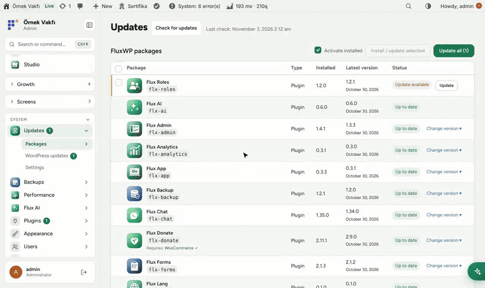
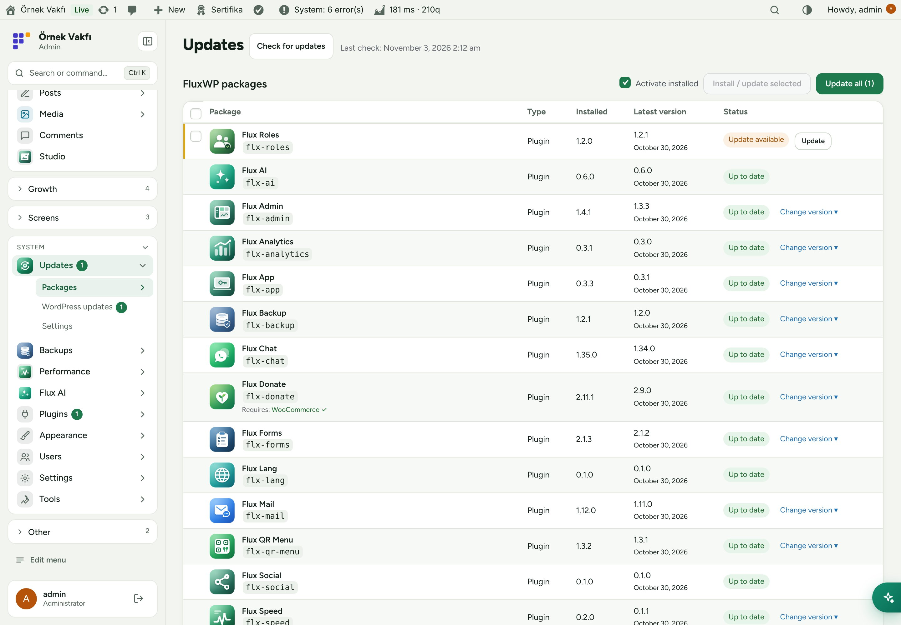
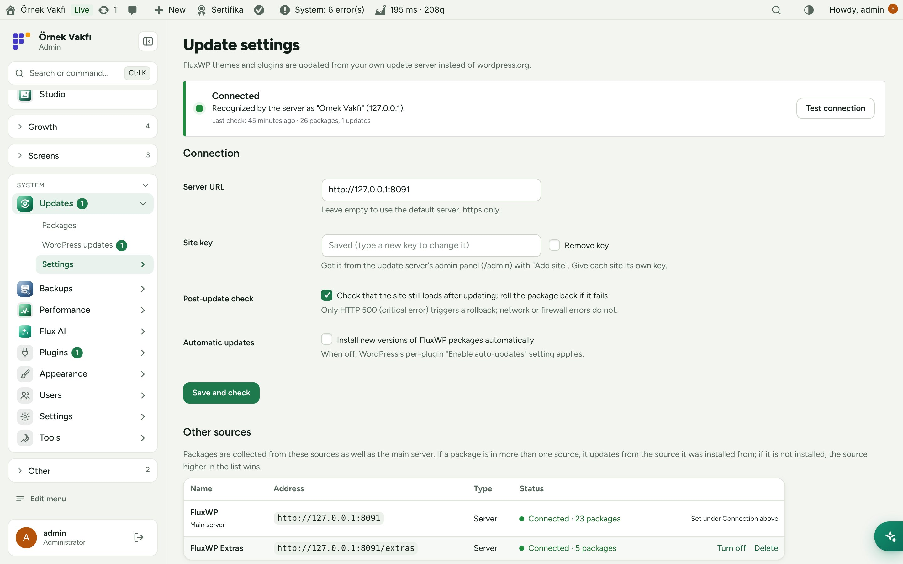
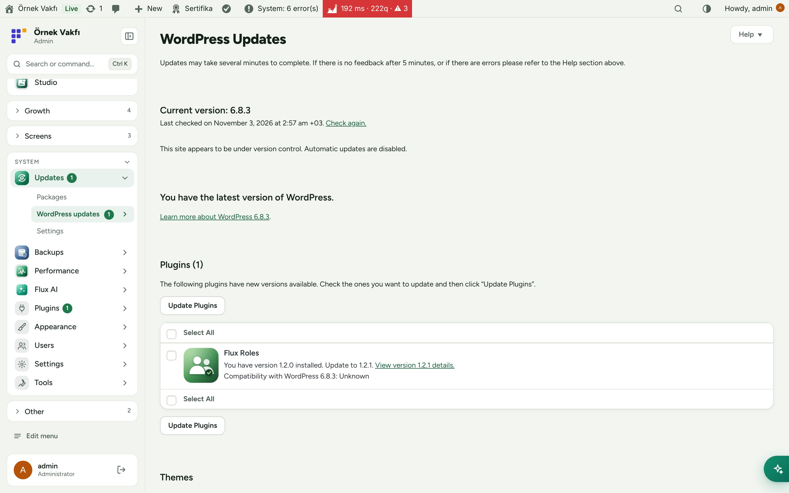
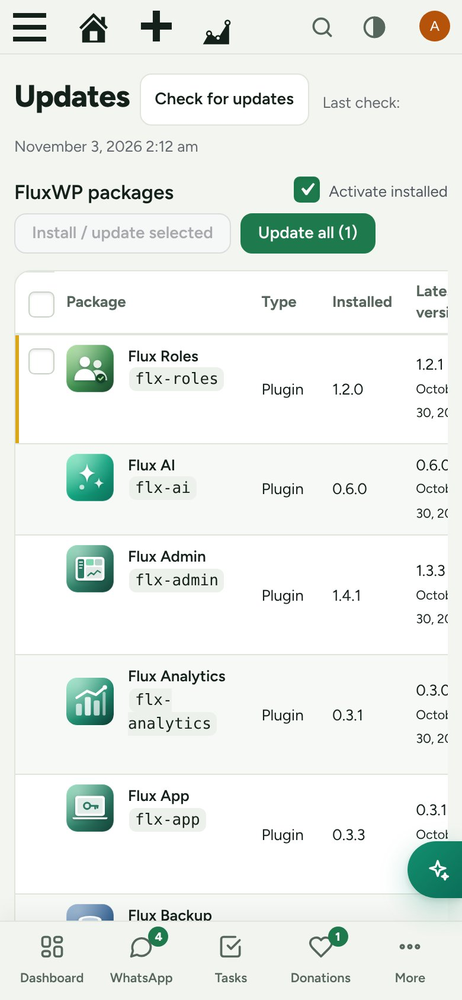

<div align="center">

**English** · [Türkçe](README.tr.md)


# Flux Updater

**Private themes and plugins, updated like the ones from WordPress.org.**<br>
Flux Updater brings our private FluxWP themes and plugins (GitHub releases of a private repository) into the normal WordPress update screens through our own update server. Install, update, roll back and check the site afterwards, with a backup taken before every change.

[](https://wordpress.org)
[](https://www.php.net)
[](https://www.gnu.org/licenses/gpl-2.0.html)


[Features](#features) · [Screenshots](#screenshots) · [Installation](#installation) · [For developers](#for-developers) · [Roadmap](#roadmap)



</div>

---

## Why Flux Updater?

Our packages live in a private GitHub repository and are not on WordPress.org. Without Flux Updater, every update means downloading a zip and uploading it by hand on every site. With it:

- 🔄 **Normal WordPress updates.** FluxWP packages appear in **Dashboard › Updates** and the plugin list, with release notes, like any other plugin.
- 🔐 **No GitHub token on the site.** Sites talk only to our update server with their own key; the token stays on the server.
- 🛟 **Safe by default.** A backup is taken before every update (Flux Backup), and if the site returns HTTP 500 afterwards the package is rolled back automatically.
- ⏪ **Switch versions.** Install any of the last 20 releases, for example to roll back.
- 📦 **One list for everything:** what is installed, what is new and what can be installed with one click.

## Features

### Packages
- **Updates** in the left menu with a pending-count badge; FluxWP packages table with logo, type, installed and latest version and status.
- **Install** packages that aren't on the site yet, **Update** one, several or all of them, without leaving the page: each row shows its own progress and result, and a live log at the top lists every step.
- **Required plugins** (`Requires Plugins`) are checked before anything is installed: a missing one (for example WooCommerce for Flux Donations) is shown with an *add it too* button, removing it from the selection also removes the packages that need it, and it is installed and activated first (from our server or WordPress.org). A package is never activated while its required plugins are inactive.
- Version switch: choose one of the last 20 releases from the server. A backup is taken first.
- Optional automatic updates for all FluxWP packages; when it is off, WordPress's per-plugin auto-update setting applies.

### Safety
- Post-update check: the front end and the admin are requested after each update; on HTTP 500 the previous version is restored.
- History: who updated what, from which version to which, the result and a link to the backup. Backups of updates are removed automatically after 1–90 days.

### Connection
- Default server: `https://updater.fluxwp.com`. Public packages (FluxWP Extras) need no key; a site key adds the private packages allowed for it.
- Server address and site key are entered once in the panel (or with `FLX_UPDATE_SERVER` / `FLX_UPDATE_KEY` in `wp-config.php`).
- Connection card: connected / error / not connected, the site's name on the server, package and update counts, and **Test connection**.
- Pre-release versions (`1.3.0-beta.1`) reach only sites set to the beta channel on the server.

### Other sources
- Besides the main server: public GitHub repositories (`<slug>.zip` in each release, `flx-meta` in the notes) and other servers that speak the Flux Updater protocol (key optional).
- Settings › Other sources: add (tested before saving), turn on/off, priority (Move up), remove. The packages table shows a "Source: …" label.
- If a package is in more than one source, it updates from the source it was installed from; if it is not installed, the source higher in the list wins ("available from 2 sources").
- Each key is sent only to its own server; a download URL outside the source's host is ignored. A source that can't be reached keeps showing its last known packages, with a warning on top.

## Screenshots

| FluxWP packages | Connection settings |
|---|---|
|  |  |
| **In the standard Updates screen** | **Mobile** |
|  |  |

## Installation

Requirements: WordPress 6.5+, PHP 7.4+.

**From a zip**

1. Download `flx-updater.zip` from the latest `flx-updater-v*` release on the [Releases](https://github.com/FluxWP/fluxwp/releases) page.
2. **Plugins › Add New › Upload Plugin**, choose the zip, then **Activate**.

**With Flux Updater** (recommended on our sites)

**Dashboard › Updates** lists every FluxWP package; click **Install** next to *Flux Updater*. Updates arrive the same way.

**First steps**

Public packages work right after activation, with no key. For private packages:

1. On the update server's admin panel, **Add site** and copy the key it shows once.
2. On the site, **Updates › Settings**: paste the key (the server address is pre-filled) and **Save and check**. The card turns green: **Connected**.
3. Open **Updates** to install or update FluxWP packages.

Full setup notes (Turkish): [KURULUM.md](../../docs/guncelleme-sistemi/KURULUM.md) · Release notes: [CHANGELOG.md](CHANGELOG.md)

## For developers

How the pieces fit together:

```
FluxWP/fluxwp (push → GitHub Actions → <slug>-v<version> release + <slug>.zip)
        │ GitHub token (read-only, only on the server)
        ▼
wp-update-server   /v1/check · /v1/download/<slug>/<version>.zip · /admin
        ▲ X-FluxWP-Site-Key (one key per site)
WordPress sites (Flux Updater)
```

- The update server is a separate repository: [FluxWP/updater](https://github.com/FluxWP/updater).
- A new release is published by bumping a package's `Version:` header on `main`; see the repository [README](../../README.md).
- Package logos: filter `flxu_package_icons`, or ship `assets/icon.svg` in the package.

## Roadmap

| | |
|---|---|
| ✅ | Private updates through our own server, logos and release notes |
| ✅ | Bulk updates, version switch and automatic rollback |
| ✅ | Backups before every update (Flux Backup) and update history |
| ✅ | Several update sources (other servers, public GitHub repositories) |
| ⬜ | Staged roll-out (update one site first, others later) |
| ⬜ | E-mail summary of updates |

## License

Flux Updater Released under the [GNU General Public License v2 or later](https://www.gnu.org/licenses/gpl-2.0.html).

Made by FluxWP.
