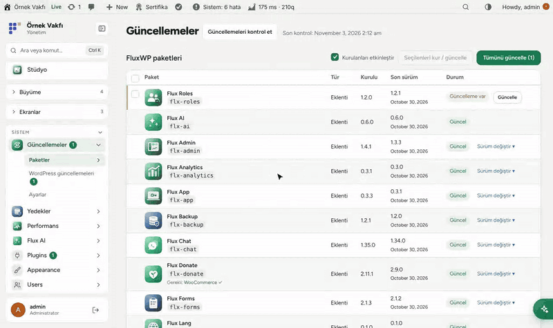
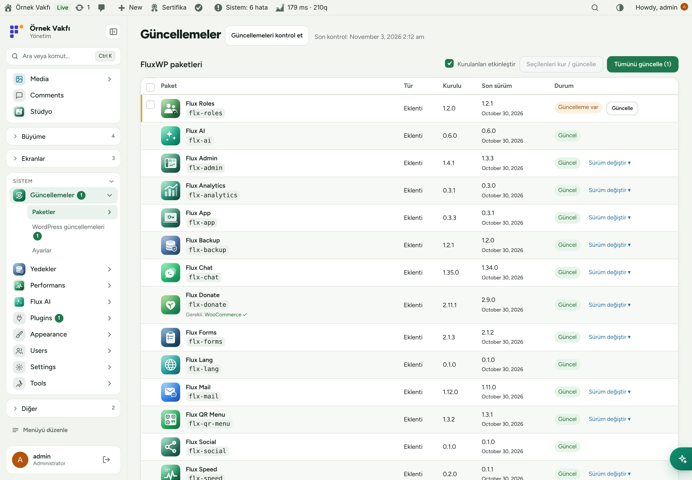
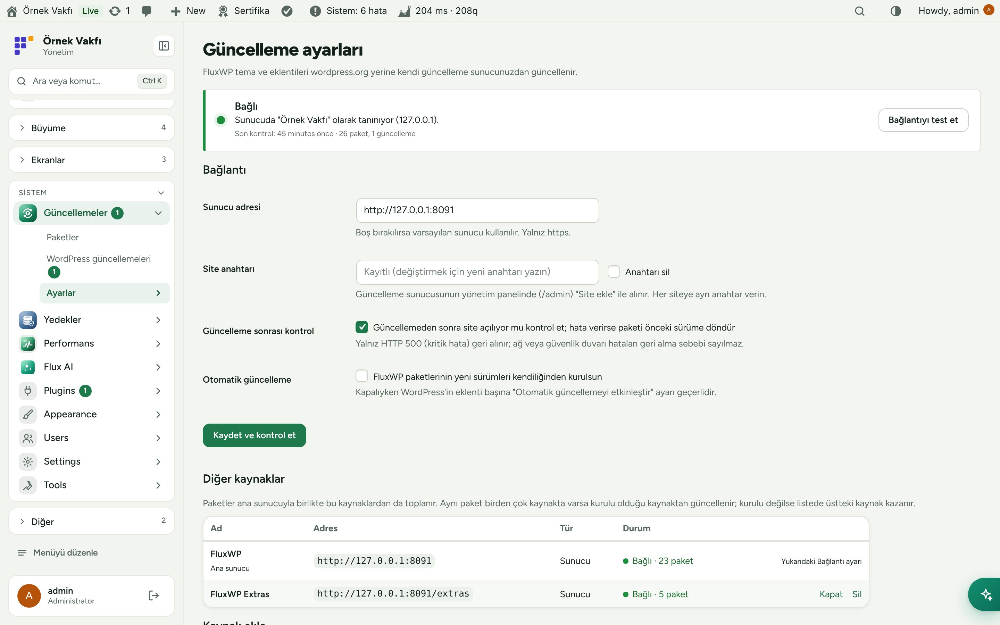
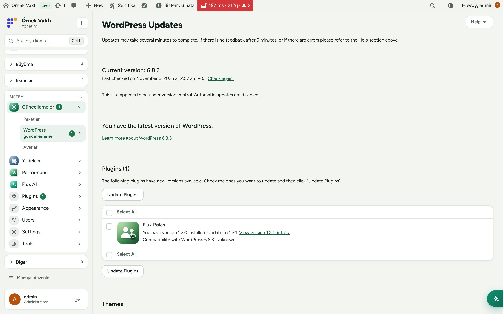
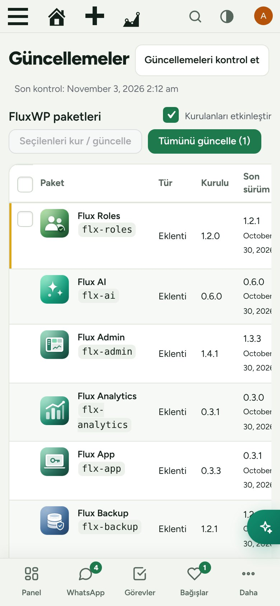

<div align="center">

[English](README.md) · **Türkçe**


# Flux Updater

**Özel tema ve eklentiler, WordPress.org'dakiler gibi güncellenir.**<br>
Flux Updater özel FluxWP tema ve eklentilerimizi (özel bir GitHub deposunun release'leri) kendi güncelleme sunucumuz üzerinden WordPress'in normal güncelleme ekranlarına getirir. Kurun, güncelleyin, geri alın ve sonrasında siteyi kontrol edin; her değişiklikten önce yedek alınır.

[](https://wordpress.org)
[](https://www.php.net)
[](https://www.gnu.org/licenses/gpl-2.0.html)


[Özellikler](#özellikler) · [Ekran görüntüleri](#ekran-görüntüleri) · [Kurulum](#kurulum) · [Geliştiriciler için](#geliştiriciler-için) · [Yol haritası](#yol-haritası)



</div>

---

## Neden Flux Updater?

Paketlerimiz özel bir GitHub deposunda duruyor, WordPress.org'da yok. Flux Updater olmadan her güncelleme, her sitede zip indirip elle yüklemek demek. Flux Updater ile:

- 🔄 **Normal WordPress güncellemesi.** FluxWP paketleri **Başlangıç › Güncellemeler**'de ve eklenti listesinde, sürüm notlarıyla, diğer eklentiler gibi görünür.
- 🔐 **Sitede GitHub token'ı yok.** Siteler yalnız kendi anahtarlarıyla güncelleme sunucusuna bağlanır; token sunucuda kalır.
- 🛟 **Varsayılan olarak güvenli.** Her güncellemeden önce yedek alınır (Flux Backup); güncellemeden sonra site HTTP 500 verirse paket kendiliğinden eski sürüme döner.
- ⏪ **Sürüm değiştirme.** Son 20 sürümden birini kurun; örneğin geri almak için.
- 📦 **Hepsi tek listede:** kurulu olan, yenisi çıkan ve tek tıkla kurulabilen paketler.

## Özellikler

### Paketler
- Sol menüde bekleyen güncelleme rozetli **Güncellemeler**; logo, tür, kurulu ve son sürüm, durum sütunlu FluxWP paketleri tablosu.
- Sitede olmayan paketi **Kur**, bir, birkaç ya da tüm paketi **Güncelle**; sayfadan çıkmadan: her satır kendi ilerlemesini ve sonucunu gösterir, üstteki canlı kayıt her adımı yazar.
- **Gerekli eklentiler** (`Requires Plugins`) kurmadan önce denetlenir: eksik olan (ör. Flux Donate için WooCommerce) *onu da ekle* düğmesiyle gösterilir, seçimden çıkarılırsa ona bağlı paketlerin seçimi de kalkar; önce o kurulup etkinleştirilir (bizim sunucudan ya da WordPress.org'dan). Gerekli eklentisi etkin olmayan paket etkinleştirilmez.
- Sürüm değiştirme: sunucudaki son 20 sürümden birine geçiş. Önce yedek alınır.
- Tüm FluxWP paketleri için isteğe bağlı otomatik güncelleme; kapalıyken WordPress'in eklenti başına otomatik güncelleme ayarı geçerli.

### Güvenlik
- Güncelleme sonrası kontrol: her güncellemeden sonra ön yüz ve panel istenir; HTTP 500 gelirse önceki sürüm geri kurulur.
- Geçmiş: kim neyi hangi sürümden hangisine güncelledi, sonuç ve yedek bağlantısı. Güncelleme yedekleri 1–90 gün sonra kendiliğinden silinir.

### Bağlantı
- Varsayılan sunucu: `https://updater.fluxwp.com`. Public paketler (FluxWP Extras) anahtarsız gelir; site anahtarı girilince ona tanımlı private paketler de gelir.
- Sunucu adresi ve site anahtarı panelden bir kez girilir (ya da `wp-config.php`'de `FLX_UPDATE_SERVER` / `FLX_UPDATE_KEY`).
- Bağlantı kartı: bağlı / hata / bağlı değil, sunucudaki site adı, paket ve güncelleme sayısı, **Bağlantıyı test et**.
- Ön sürümler (`1.3.0-beta.1`) yalnız sunucuda beta kanalına alınmış sitelere gelir.

### Diğer kaynaklar
- Ana sunucunun yanında başka kaynaklar: public GitHub depoları (release'inde `<slug>.zip`, notta `flx-meta`) ve Flux Updater protokolünü konuşan başka sunucular (anahtar isteğe bağlı).
- Ayarlar › Diğer kaynaklar: ekle (eklemeden önce test edilir), aç/kapat, öncelik (Yukarı), sil. Paket tablosunda "Kaynak: …" etiketi.
- Aynı paket birden çok kaynakta varsa kurulu olduğu kaynaktan güncellenir; kurulu değilse listede üstteki kaynak kazanır ("2 kaynakta var").
- Her anahtar yalnız kendi sunucusunun adresine gider; indirme adresi kaynağın host'unda değilse paket alınmaz. Ulaşılamayan kaynağın paketleri son bilinen veriden gösterilir, üstte uyarı çıkar.

## Ekran görüntüleri

| FluxWP paketleri | Bağlantı ayarları |
|---|---|
|  |  |
| **WordPress Güncellemeler ekranında** | **Mobil** |
|  |  |

## Kurulum

Gereksinimler: WordPress 6.5+, PHP 7.4+.

**Zip ile**

1. [Releases](https://github.com/FluxWP/fluxwp/releases) sayfasında en son `flx-updater-v*` sürümünden `flx-updater.zip`'i indirin.
2. **Eklentiler › Yeni ekle › Eklenti yükle**, zip'i seçin, sonra **Etkinleştir**.

**Flux Updater ile** (sitelerimizde önerilen)

**Başlangıç › Güncellemeler** tüm FluxWP paketlerini listeler; *Flux Updater* satırındaki **Kur**'a basın. Güncellemeler de buradan gelir.

**İlk adımlar**

Public paketler etkinleştirince anahtarsız gelir. Private paketler için:

1. Güncelleme sunucusunun yönetim panelinde **Site ekle** deyin ve bir kez gösterilen anahtarı kopyalayın.
2. Sitede **Güncellemeler › Ayarlar**: anahtarı yapıştırın (sunucu adresi hazır gelir) ve **Kaydet ve kontrol et**'e basın. Kart yeşile döner: **Bağlı**.
3. FluxWP paketlerini kurmak ya da güncellemek için **Güncellemeler**'i açın.

Ayrıntılı kurulum notları: [KURULUM.md](../../docs/guncelleme-sistemi/KURULUM.md) · Sürüm notları: [CHANGELOG.md](CHANGELOG.md)

## Geliştiriciler için

Parçalar nasıl birleşiyor:

```
FluxWP/fluxwp (push → GitHub Actions → <slug>-v<version> release + <slug>.zip)
        │ GitHub token (read-only, yalnız sunucuda)
        ▼
wp-update-server   /v1/check · /v1/download/<slug>/<version>.zip · /admin
        ▲ X-FluxWP-Site-Key (her siteye bir anahtar)
WordPress siteleri (Flux Updater)
```

- Güncelleme sunucusu ayrı bir depoda: [FluxWP/updater](https://github.com/FluxWP/updater).
- Yeni sürüm, paketin `Version:` başlığı artırılıp `main`'e gönderilince yayınlanır; bkz. deponun [README](../../README.md) dosyası.
- Paket logoları: `flxu_package_icons` filtresi ya da paketteki `assets/icon.svg`.

## Yol haritası

| | |
|---|---|
| ✅ | Kendi sunucumuz üzerinden özel güncelleme, logolar ve sürüm notları |
| ✅ | Toplu güncelleme, sürüm değiştirme ve otomatik geri alma |
| ✅ | Her güncellemeden önce yedek (Flux Backup) ve güncelleme geçmişi |
| ✅ | Birden çok güncelleme kaynağı (başka sunucular, public GitHub depoları) |
| ⬜ | Kademeli yayın (önce bir site, sonra diğerleri) |
| ⬜ | Güncellemelerin e-posta özeti |

## Lisans

Flux Updater, [GNU Genel Kamu Lisansı v2 veya üzeri](https://www.gnu.org/licenses/gpl-2.0.html) ile yayınlanır.

FluxWP tarafından geliştirilmiştir.
